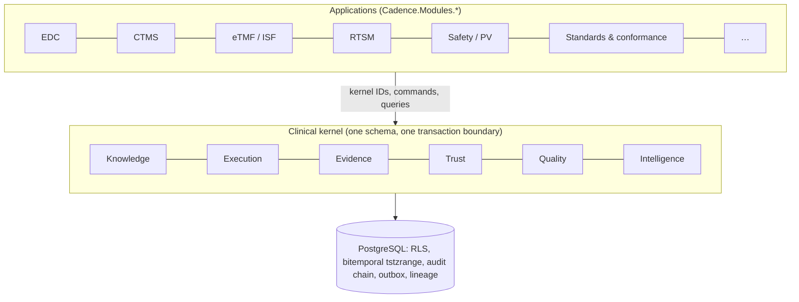

# Cadence Architecture

This document describes the system in two views: the **target architecture** (kernel, engines and
applications) and the **running system today** (a gateway in front of 17 ASP.NET Core services). The
gap between them is closed by the kernel roadmap.

The normative source for the target is the
[Clinical Research OS kernel specification v0.2](docs/kernel/CLINICAL_KERNEL_SPECIFICATION.md).
When this document and the spec disagree, the spec wins; fix this document.

| Section | Contents |
| --- | --- |
| [1. Target architecture](#1-target-architecture) | Kernel, six engines, applications, invariants |
| [2. Key decisions](#2-key-decisions) | Kernel decisions K001–K009 and their ADRs |
| [3. Running services today](#3-running-services-today) | Services, ports, gateway routes, maturity |
| [4. Request path and security](#4-request-path-and-security) | OIDC at the gateway, signed identity in services |
| [5. Persistence](#5-persistence) | Databases, connection strings, migrations |
| [6. Cross-cutting building blocks](#6-cross-cutting-building-blocks) | Telemetry, health, time, architecture tests, build |
| [7. Migration path](#7-migration-path) | How today's services become kernel applications |

---

## 1. Target architecture

Cadence is an **operating system for clinical research**. One kernel holds a single body of clinical
truth. Six **engines** organise the kernel's concepts; products such as EDC, CTMS, eTMF, RTSM, safety
and standards conformance are **applications** built on them (spec §2, §12).



| Engine | Answers | Examples of kernel concepts |
| --- | --- | --- |
| Knowledge | What does it mean, and what is supposed to happen? | Concept Registry, ProtocolVersion, Estimand, CollectionSpec, Standards Registry |
| Execution | What is happening, where, and to whom? | Organization, Site, StudySite, Participant, Enrollment, Applicability, ClinicalEvent |
| Evidence | What was observed, collected or produced? | Observation, Assertion, Source, Artifact, Specimen |
| Trust | Who was allowed, who agreed, where did it come from? | Actor, Delegation, Qualification, ConsentStatus, Attestation, lineage graph |
| Quality | Is it right, and is it under control? | Rule, ValidationFinding, Risk, Deviation, Lock |
| Intelligence | What does it imply, and what should happen next? | AutomationAgent, Proposal |

Engines are an organising frame, not deployment units. The rules that shape every change:

- **K-TRUTH-1:** no product owns clinical truth; SDTM, ADaM, FHIR and the protocol PDF are projections.
- **K-SCOPE-1:** a concept belongs in the kernel if it explains the provenance, authority, meaning or
  lifecycle of clinical evidence across more than one application.
- **Forbidden redefinitions (spec §2.3):** applications never declare their own `Study`, `Site`,
  `Participant`, `Observation`, `Person`, roles, rule engines or audit tables; they reference kernel IDs.
- **Assemblies (spec §2.4):** `Cadence.Kernel.Abstractions` (IDs, ports, `IClock`) → `Domain` →
  `Application` → `Persistence` (internal) → `Api`; applications reference `Abstractions` only (K-XS-2).

The [domain glossary](CONTEXT.md) defines the vocabulary.

## 2. Key decisions

| # | Decision | ADR |
| --- | --- | --- |
| K001 | Modular monolith kernel with a single schema | [ADR-2244](docs/adr/2026-09-29-clinical-kernel-modular-monolith-architecture.md), [ADR-2247](docs/adr/2026-09-29-clinical-kernel-single-database-schema-and-architecture-sentinel-hardening.md) |
| K002 | Bitemporality with hand-rolled `tstzrange` and exclusion constraints | [ADR-2246](docs/adr/2026-09-29-postgresql-native-bitemporal-interval-standard-via-tstzrange-and-gist.md) |
| K003 | Tenant isolation through row-level security in a shared schema | [ADR-2250](docs/adr/2026-09-29-kernel-tenant-isolation-via-row-level-security.md) |
| K004 | Authority computed from evidence by a hand-coded policy evaluator | [ADR-2251](docs/adr/2026-09-29-kernel-authority-computed-from-evidence-policy-engine.md) |
| K005 | Concept Registry keyed by CDISC Biomedical Concepts | [ADR-2252](docs/adr/2026-09-29-concept-registry-cdisc-biomedical-concepts-as-semantic-key.md) |
| K006 | Identity vault and layered participant identity | [ADR-2253](docs/adr/2026-09-29-identity-vault-and-layered-participant-identity.md) |
| K007 | Neo4j dropped; ProtocolVersion snapshots in PostgreSQL | [ADR-2245](docs/adr/2026-09-29-native-postgresql-protocolversion-snapshots-and-neo4j-retirement.md) |
| K008 | Rules as versioned data over one AST; public standards only; Rust runtime seam later | [ADR-2254](docs/adr/2026-09-29-rules-as-versioned-data-and-unified-rules-engine.md) |
| K009 | Lineage graph in the kernel schema, written transactionally | [ADR-2255](docs/adr/2026-09-29-kernel-lineage-graph-and-scientific-traceability.md) |
| — | Fail-closed gateway identity and signed caller authentication | [ADR-2256](docs/adr/2026-09-29-fail-closed-gateway-identity-and-signed-caller-authentication.md) |
| — | .NET 10 platform standards (C# 14, Minimal APIs, EF Core 10, CPM) | [ADR-2233](docs/adr/2026-09-02-migration-to-dotnet-10-architecture-and-standards.md) |

The full list is in the [ADR index](docs/adr/index.md).

## 3. Running services today

Every backend is an ASP.NET Core 10 Minimal API host under `apps/<name>/src`, built from
`Cadence.sln`. Ports are the gateway's defaults (`apps/gateway/src/Program.cs`) and the host ports in
`docker/docker-compose.yml`. Each service has a README with its details.

| Service | Project | Port | Gateway routes (`/api/v1/…`) | Persistence | Maturity |
| --- | --- | --- | --- | --- | --- |
| [gateway](apps/gateway/README.md) | `Cadence.Apps.Gateway` | 8000 (behind the nginx front proxy in compose) | all of the below; each route is tested against the endpoints its service maps ([ADR-2448](docs/adr/2026-09-29-gateway-routes-verified-against-service-endpoints.md)) | none | Implemented |
| [designer](apps/designer/README.md) | `Cadence.Apps.Designer` | 8001 | `studies`, `protocols` | none yet | Scaffold |
| [execution](apps/execution/README.md) | `Cadence.Apps.Execution` | 8002 | `observations`, `forms`, `queries`, `execution` | `ExecutionDbContext` | Implemented (EDC core) |
| [etmf](apps/etmf/README.md) | `Cadence.Apps.Etmf` | 8003 | `etmf` | `EtmfDbContext` | Scaffold |
| [interop](apps/interop/README.md) | `Cadence.Apps.Interop` | 8004 | `interop` | `InteropDbContext` | Scaffold |
| [quality](apps/quality/README.md) | `Cadence.Apps.Quality` | 8005 | `quality` | `QualityDbContext` | Scaffold |
| [notifications](apps/notifications/README.md) | `Cadence.Apps.Notifications` | 8006 | `notifications` | `NotificationsDbContext` | Scaffold |
| [ctms](apps/ctms/README.md) | `Cadence.Apps.Ctms` | 8007 | `ctms` | `CtmsDbContext` | Scaffold |
| [safety](apps/safety/README.md) | `Cadence.Apps.Safety` | 8008 | `safety` | `SafetyDbContext` | Scaffold |
| [tickets](apps/tickets/README.md) | `Cadence.Apps.Tickets` | 8009 | `tickets` | `TicketsDbContext` | Scaffold |
| [eisf](apps/eisf/README.md) | `Cadence.Apps.Eisf` | 8010 | `eisf` | `EisfDbContext` | Scaffold |
| [econsent](apps/econsent/README.md) | `Cadence.Apps.Econsent` | 8011 | `econsent` | `EconsentDbContext` | Scaffold |
| [org](apps/org/README.md) | `Cadence.Apps.Org` | 8012 | `org` | `OrgDbContext` | Scaffold |
| [fileshare](apps/fileshare/README.md) | `Cadence.Apps.Fileshare` | 8013 | `fileshare` | `FileshareDbContext` + MinIO | Scaffold |
| [imaging](apps/imaging/README.md) | `Cadence.Apps.Imaging` | 8014 | `imaging` | `ImagingDbContext` | Scaffold |
| [knowledge](apps/knowledge/README.md) | `Cadence.Apps.Knowledge` | 8015 | `knowledge` | `KnowledgeDbContext` | Scaffold |
| [payments](apps/payments/README.md) | `Cadence.Apps.Payments` | 8016 | `payments` | `PaymentsDbContext` | Scaffold |
| [ai_gateway](apps/ai_gateway/README.md) | `Cadence.Apps.AiGateway` | 8017 | `ai` | none | Scaffold |

"Scaffold" means the host, security, health checks and (usually) a `DbContext` with migrations exist,
but the service maps at most a few endpoints. Their future as kernel applications is decided in
[#4787](https://github.com/fderuiter/cadence-clinical/issues/4787) against spec §12.

Other runtime pieces:

| Component | Path | Notes |
| --- | --- | --- |
| Web client | `apps/web` | Vue 3 + Vite (port 5173); signs in through Keycloak |
| Subject portal | `apps/subject-portal` | Participant PWA (port 5174) |
| Aspire AppHost | `apps/apphost` | Local orchestration of PostgreSQL (database `cadence`), MinIO, Keycloak and a subset of services |
| Keycloak | `docker/cadence-realm.json` | OIDC identity provider (port 8080), realm `cadence` |
| PostgreSQL 16 | compose `postgres` | One `cadence` database with a schema per service (ADR-2447) |
| MinIO, ClamAV | compose profile `storage` | Object storage and upload scanning; no service reads them yet |
| Front proxy | compose `front-proxy` (nginx) | Port 8000; forwards the web apps' API calls to the gateway |
| Other compose services | `docker/docker-compose.yml` | `dotnet-dev` (SDK container) |

## 4. Request path and security

```mermaid
sequenceDiagram
    participant C as Web client / portal
    participant K as Keycloak
    participant G as Gateway (YARP)
    participant S as Service
    C->>K: Sign in (OIDC)
    C->>G: Request + bearer token
    G->>G: Validate JWT (OIDC_AUTHORITY), strip client identity headers
    G->>S: Forward with signed X-User-*, X-Tenant-Id, X-Timestamp, X-Gateway-Signature
    S->>S: CadenceGateway scheme verifies HMAC (GATEWAY_SECRET) and timestamp (2 min)
    S-->>C: Response (401 if unsigned, forged or stale; 403 if role not allowed)
```

Decided in [ADR-2256](docs/adr/2026-09-29-fail-closed-gateway-identity-and-signed-caller-authentication.md):

- The gateway requires an authenticated caller on every proxied route and fails at startup without
  `OIDC_AUTHORITY` or a `GATEWAY_SECRET` of at least 32 characters.
- Every service calls `AddCadenceSecurity()` / `UseCadenceSecurity()` (`packages/security`). Only
  health, status and development API-doc endpoints allow anonymous access.
- Application code takes identity and roles from the verified claims only. A PI signature records the
  authenticated caller as signer.
- Not yet done: e-signature step-up (`X-Sig-Token` issuance and verification) and replacing the web
  client's demo mode, tracked in epic [#4759](https://github.com/fderuiter/cadence-clinical/issues/4759).

In the target architecture, authority is computed from evidence (training, delegation,
qualification) by the kernel's policy evaluator (ADR-2251), not from role strings.

## 5. Persistence

- **PostgreSQL 16+ through EF Core 10 + Npgsql.** `AddCadencePostgresDbContext`
  (`packages/database`) resolves `ConnectionStrings:cadence` (set by the Aspire AppHost), then
  `POSTGRES_CONNECTION_STRING`. Only the `Development` environment falls back to the local compose
  database; any other environment fails at startup. Transient-failure retries are enabled.
- **One database, a schema per service** ([ADR-2447](docs/adr/2026-09-29-module-schemas-via-search-path-and-migration-deployment.md)):
  every service connects to the shared `cadence` database with its search path set to its own module
  schema (`ctms`, `execution`, …). The kernel owns the `kernel` schema.
- **Migrations** live in each service's `Infrastructure/Persistence/Migrations/` and are managed with
  `scripts/manage_migrations.ps1` (see [AGENTS.md §10](AGENTS.md)). `Database__MigrateOnStartup=true`
  applies them at startup; `Database__MigrateOnly=true` runs them as a deployment job and exits. See the
  [database runbook](docs/OPERATIONAL_DATABASE.md).
- **Today** each service has its own `DbContext` in its own schema. **Target:** one kernel schema with
  row-level security per tenant (ADR-2250), bitemporal `tstzrange` columns (ADR-2246), an audit chain,
  a transactional outbox and a lineage store (spec §5, §9.6).
- **Audit:** EF Core `SaveChangesInterceptor` populates `CreatedAt`, `CreatedBy`, `ReasonForChange`
  and `VersionIndex` (21 CFR Part 11), attributing every write to a real user or a named service account
  ([ADR-2257](docs/adr/2026-09-29-attributable-audit-actors-and-named-service-accounts.md)). `apps/execution` publishes domain events through the MassTransit
  EF Core outbox.

## 6. Cross-cutting building blocks

| Concern | Where | What it does |
| --- | --- | --- |
| Health | `packages/telemetry` | `/healthz/live` (no checks) and `/healthz/ready` (every `DbContext` reachable); `/healthz` returns a static payload |
| Telemetry | `packages/telemetry` | OpenTelemetry traces, metrics and logs named after the service (`OTEL_SERVICE_NAME`); OTLP export when `OTEL_EXPORTER_OTLP_ENDPOINT` is set |
| Time | `Cadence.Kernel.Abstractions` `IClock` | `DateTime.Now/UtcNow` are banned ([`BannedSymbols.txt`](BannedSymbols.txt)); take time from `IClock` (K-TIME-3). Remaining call sites: [clock migration backlog](docs/kernel/CLOCK_MIGRATION_BACKLOG.md) |
| Architecture tests | `tests/Architecture` | K-XS-1, K-XS-2 and K-MOD-1 with a checked-in baseline that may only shrink (`tests/ArchitectureBaselines/`) |
| Security | `packages/security` | Gateway authentication scheme, HMAC signing, audit digest |
| Build | `Directory.Build.props`, `Directory.Packages.props` | `net10.0`, nullable enabled, warnings as errors, Central Package Management |
| Contracts | `packages/contracts` | Typed cross-service DTOs and HTTP clients |
| DDF compiler | `packages/ddf` | USDM → DDF intermediate representation → CDISC ODM / XForms |
| De-identification | `packages/deid` | In-process de-identification and canonical signing (ADR-2261) |

## 7. Migration path

The [kernel roadmap (spec §15)](docs/kernel/CLINICAL_KERNEL_SPECIFICATION.md#15-roadmap) is the plan:

| Phase | Outcome |
| --- | --- |
| 0. Foundations | Kernel projects, `IClock`, `tstzrange`, RLS, command pipeline, architecture baseline |
| 1. EDC on the kernel | `apps/execution` runs on kernel concepts ([migration inventory](docs/kernel/EXECUTION_MIGRATION_INVENTORY.md)) |
| 2. Knowledge and standards | Concept Registry, executable protocol, standards registry, rules, lineage |
| 3. Quality and trust expansion | RBQM, computable consent, specimens, ingestion, AI proposals |
| 4. Analysis and submission | Derivations, ADaM, TLF lineage, Define-XML, submission package |
| 5. Lifecycle breadth | Feasibility, start-up, finance, recruitment, DCT, regulatory, RWE |

Work is tracked in epic [#4719](https://github.com/fderuiter/cadence-clinical/issues/4719). The
Python-to-.NET port that preceded this is complete; its playbook remains in
[docs/MIGRATION_WORKFLOW.md](docs/MIGRATION_WORKFLOW.md) for porting the remaining Python reference
sources ([#4789](https://github.com/fderuiter/cadence-clinical/issues/4789)).
