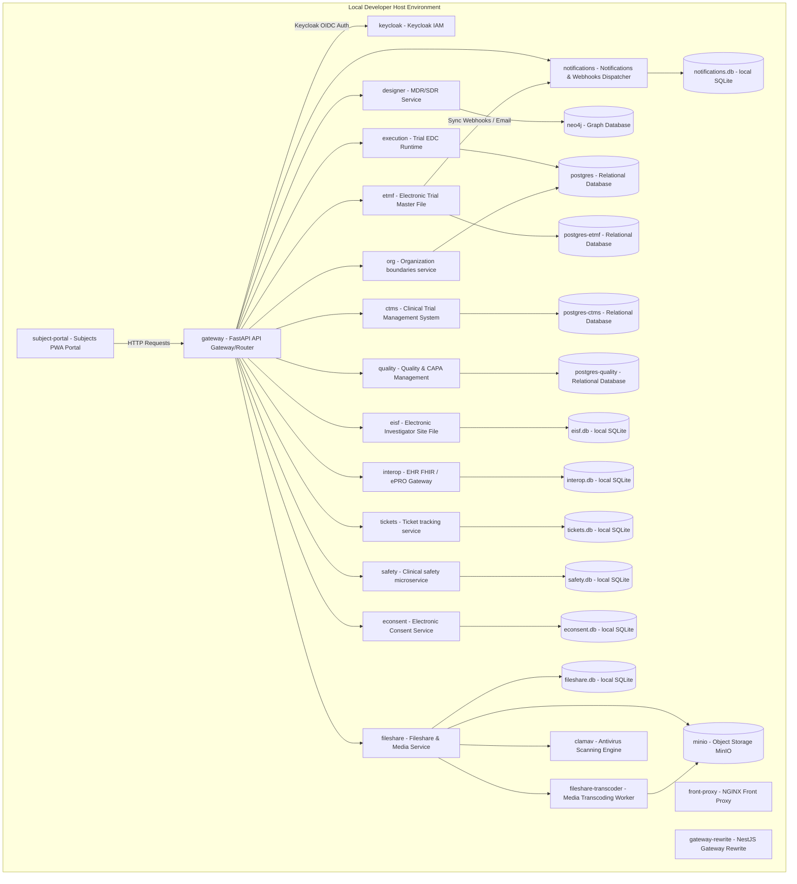
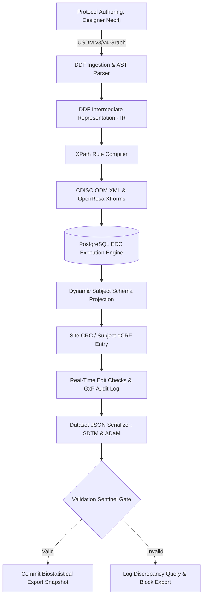

# Architecture Specification: Cadence Clinical Research Software

## 1. System Vision & Problem Statement

Traditional clinical trial builds require manual, error-prone translation of narrative protocol documents into disconnected downstream Electronic Data Capture (EDC) databases, Clinical Trial Management Systems (CTMS), and safety reporting workflows. This causes multi-month setup delays, discrepancy risks between protocols and eCRFs, and costly amendment rework.

**Cadence Clinical Research Software** establishes a unified, metadata-driven architecture that automates the generation of downstream clinical trial infrastructure directly from digitized protocol definitions (CDISC USDM), bridging upstream **Clinical Metadata Management (MDR/SDR)** with downstream **Electronic Data Capture (EDC)** and operational microservices via an automated **Digital Data Flow (DDF)** pipeline.

---

## 2. Core Service Domains & Microservices Catalog

Cadence is structured as a decoupled, reverse-proxy fronted microservices topology where every service encapsulates a specific clinical or platform domain.

```text
 ┌──────────────────────────────────────────────────────────────────────────────────────────┐
 │                                   API GATEWAY & PROXY                                    │
 ├──────────────────────────────────────────────────────────────────────────────────────────┤
 │  • Gateway Proxy (Port 8000)      • Keycloak OIDC Authentication                         │
 │  • HMAC Signature Injection       • 60s Step-Up Re-Authentication Tokens                 │
 └─────────────────────────────┬──────────────────────────────────────────────┬─────────────┘
                               │                                              │
                               ▼                                              ▼
 ┌──────────────────────────────────────────────┐ ┌──────────────────────────────────────────────┐
 │          PROTOCOL & STUDY DESIGN             │ │        CLINICAL OPERATIONS & EXECUTION       │
 ├──────────────────────────────────────────────┤ ├──────────────────────────────────────────────┤
 │ • Designer / USDM (Port 8001 : Neo4j)        │ │ • EDC Execution Engine (Port 8002 : Postgres)│
 │ • Knowledge & SOPs (Port 8011 : SQLite/PG)   │ │ • CTMS Operations (Port 8005 : SQLite/PG)    │
 │ • Clinical AI Gateway (Port 8013 : REST)     │ │ • Organization Directory (Port 8008 : SQL)   │
 │ • DDF Compiler Engine (packages/ddf)         │ │ • Clinical Issue Hub (Port 8012 : SQLite/PG) │
 │                                              │ │ • Site Payments & Grants (Port 8014 : SQL)   │
 └─────────────────────────────┬────────────────┘ └───────────────────────────┬──────────────────┘
                               │                                              │
                               ▼                                              ▼
 ┌──────────────────────────────────────────────┐ ┌──────────────────────────────────────────────┐
 │    PATIENT ENGAGEMENT & INTEROPERABILITY     │ │        SAFETY, QUALITY & GOVERNANCE          │
 ├──────────────────────────────────────────────┤ ├──────────────────────────────────────────────┤
 │ • Subject Portal PWA (Port 5174 : IndexedDB) │ │ • Safety & Pharmacovigilance (Port 8009)     │
 │ • FHIR & eSource Gateway (Port 8007 : SQL)   │ │ • Quality & CAPA Management (Port 8006)      │
 │ • Notifications Dispatcher (Port 8010 : SQL) │ │ • Blinded DICOM Adjudication (Port 8015)     │
 │ • Electronic Consent (Port 8017 : SQLite/PG) │ │ • Electronic Trial Master File (Port 8004)   │
 │                                              │ │ • Electronic Investigator Files (Port 8016)  │
 │                                              │ │ • FileShare & StoragePort (Port 8018 : MinIO)│
 │                                              │ │ • Compliance Engine (Port 8019 : Pytest/GxP) │
 └──────────────────────────────────────────────┘ └──────────────────────────────────────────────┘
```

### A. Protocol & Study Design Layer

#### 1. Designer Service (`apps/designer` — Port 8001)
- **Role:** Study Definition Repository (SDR) and Clinical Metadata Repository (MDR).
- **Datastore:** Neo4j Graph Database 5.0+.
- **Core Responsibilities:**
  - Protocol structure authoring (Study Arms, Epochs, Encounters, Activities, and Biomedical Concepts).
  - High-density Schedule of Activities (SoA) matrix generation.
  - Official CDISC USDM v3.0/v4.0 export and validation.
  - Immutable graph branching and semantic protocol amendment diffing.

#### 2. Knowledge & SOP Service (`apps/knowledge` — Port 8011)
- **Role:** Clinical SOP Hub & Dynamic Help Drawer Dispatcher.
- **Datastore:** PostgreSQL / SQLite.
- **Core Responsibilities:**
  - Contextual SOP delivery mapped to active user persona and frontend route patterns.
  - Hierarchical specificity scoring for clinical guidance lookup.
  - Two-tier controlled document versioning (`KnowledgeArticle` and `KnowledgeArticleVersion`).

#### 3. Clinical AI Gateway (`apps/ai_gateway` — Port 8013)
- **Role:** Intelligent Medical Coding & De-Identification Proxy.
- **Datastore:** Ephemeral in-memory caching / External REST.
- **Core Responsibilities:**
  - Three-tier model routing (Tier 1 Local SLMs, Tier 2 Fast Cloud LLMs, Tier 3 Frontier Models).
  - Outbound PII/PHI de-identification air-gap with surrogate tokenization.
  - Hybrid semantic medical coding against MedDRA and WHODrug dictionaries.
  - 21 CFR Part 11 dual-attribution AI draft ledgers (`DRAFT_AI`).

---

### B. Clinical Operations & Execution Layer

#### 4. EDC Execution Engine (`apps/execution` — Port 8002)
- **Role:** Downstream Electronic Data Capture (EDC) Runtime.
- **Datastore:** PostgreSQL 14+ Relational Database.
- **Core Responsibilities:**
  - Dynamic subject eCRF schema projection based on subject-specific protocol version tags.
  - Subject enrollment lifecycle state machines and visit scheduling.
  - Real-time edit check execution during site data entry.
  - Medical coding review, central/local laboratory reference range governance, and CTCAE toxicity grading.
  - CDISC Dataset-JSON 1.0.0 biostatistical export (SDTM / ADaM).

#### 5. CTMS Operations Service (`apps/ctms` — Port 8005)
- **Role:** Clinical Trial Management & Site Operational Governance.
- **Datastore:** PostgreSQL / SQLite.
- **Core Responsibilities:**
  - Trial and site milestone tracking, CRA workload balancing, and Monitoring Visit Reports (MVR).
  - 6-Facet Site Greenlight Engine evaluating IRB approvals, CTA contracts, essential regulatory documents, DOA logs, staff training certifications, and investigational product release.
  - Append-only `CTMSAuditLog` tracking all operational transactions with Part 11 metadata.

#### 6. Organization Directory (`apps/org` — Port 8008)
- **Role:** Multi-Tenant Organization & Site Directory.
- **Datastore:** PostgreSQL / SQLite.
- **Core Responsibilities:**
  - Master directory of Sponsor, CRO, and Site organizations and personnel.
  - Principal Investigator Electronic Delegation of Authority (DOA) log with electronic signature step-up tokens.
  - Role-based site scoping and investigator qualification management.

#### 7. Clinical Issue Hub (`apps/tickets` — Port 8012)
- **Role:** Query Discrepancy Escalation & Support SLA Management.
- **Datastore:** PostgreSQL / SQLite.
- **Core Responsibilities:**
  - Multi-tier module-based routing across functional clinical queues.
  - Dual-target SLA tracking (acknowledgment SLA vs. clinical resolution SLA) with automated escalation.
  - Controlled reopening window enforcement accompanied by mandatory 21 CFR Part 11 change reasons.

#### 8. Site Payments & Participant Compensation (`apps/payments` — Port 8014)
- **Role:** Investigator Grant Budgets & Participant Financial Wallet.
- **Datastore:** PostgreSQL / SQLite.
- **Core Responsibilities:**
  - Procedure-fee rule engine triggered by eCRF visit completion and CRA Source Data Verification (SDV).
  - Multi-party payee grant split calculations and 10% statutory closeout holdback escrows.
  - Participant stipend management, mobile receipt OCR reimbursement approval, and IRS 1099 threshold tracking.

---

### C. Patient Engagement & Interoperability Layer

#### 9. Subject Portal (`apps/subject-portal` — Port 5174)
- **Role:** Offline-First Patient-Facing eCOA/ePRO PWA.
- **Technology:** Vite + Vue 3 Progressive Web App.
- **Core Responsibilities:**
  - Isolated patient-facing interface running under the strict `Subject` role.
  - IndexedDB offline queue caching ePRO diary submissions during network disconnects.
  - Visual sync reconciliation queue with collision-free replay strategies.

#### 10. Electronic Consent Service (`apps/econsent` — Port 8017)
- **Role:** Digital Informed Consent (eConsent) & Re-Consent Engine.
- **Datastore:** PostgreSQL / SQLite.
- **Core Responsibilities:**
  - Interactive ICF document compilation with Flesch-Kincaid readability scoring.
  - Dynamic protocol amendment re-consent gating blocking downstream visit data capture upon protocol revisions.
  - Minor-to-adult age-of-majority transition tracking.
  - 21 CFR Part 11 compliant cryptographic signature manifests.

#### 11. Notifications Dispatcher (`apps/notifications` — Port 8010)
- **Role:** Multi-Channel Clinical Alert & Compliance Messenger.
- **Datastore:** PostgreSQL / SQLite.
- **Core Responsibilities:**
  - Asynchronous dispatch across SMTP Email (Jinja2 templates), SMS, HMAC-signed Outbound Webhooks, and In-App inbox.
  - Mandatory GxP notification policy bypassing user opt-out preferences for safety-critical alerts.
  - Deterministic notification idempotency keys preventing duplicate alerts across retries.

#### 12. FHIR & eSource Gateway (`apps/interop` — Port 8007)
- **Role:** EHR Interoperability & Biometric Sensor Streaming.
- **Datastore:** PostgreSQL / SQLite.
- **Core Responsibilities:**
  - SMART on FHIR USCDI clinical data ingestion from hospital EHR systems.
  - Split-screen CRC review drawer with 1-click clinical acceptance into draft eCRFs.
  - Open mHealth continuous time-series biometric sensor stream adapter.

---

### D. Safety, Quality & Governance Layer

#### 13. Safety & Pharmacovigilance (`apps/safety` — Port 8009)
- **Role:** Pharmacovigilance Gateway & Regulatory Safety Transmissions.
- **Datastore:** PostgreSQL / SQLite.
- **Core Responsibilities:**
  - ICH E2B(R3) Individual Case Safety Reports (ICSR) ISO 27953-2 XML compilation.
  - Automated NCI-CTCAE v5.0 laboratory toxicity grading and WHODrug active ingredient hierarchy verification.
  - B2B AS2 EDI gateway with SHA-256 S/MIME encryption, digital signatures, and synchronous MDN verification.

#### 14. Quality & CAPA Management (`apps/quality` — Port 8006)
- **Role:** Quality Assurance, Centralized Statistical Monitoring & Forensic Auditing.
- **Datastore:** PostgreSQL / SQLite.
- **Core Responsibilities:**
  - Protocol deviation management linked to Root Cause Analysis (RCA) and CAPA corrective workflows.
  - Centralized Statistical Monitoring (CSM forensics): Benford's Law Chi-Square/MAD, digit preference, and Mahalanobis distance multivariate outlier detection.
  - 64-bit DCT Perceptual Hashing (pHash) on medical images detecting duplicate scans across sites (Hamming distance $\le 5$).

#### 15. Blinded DICOM Adjudication (`apps/imaging` — Port 8015)
- **Role:** Clinical Oncology Imaging & RECIST 1.1 Adjudication.
- **Datastore:** PostgreSQL / SQLite.
- **Core Responsibilities:**
  - Zero-footprint WebGL Multi-Planar Reconstruction (MPR) axial/sagittal/coronal viewer.
  - Blinded dual-reader RECIST 1.1 / Lugano oncology evaluations.
  - Automated 20% Sum of Diameters (SOD) discordance trigger with Chair step-up sign-off.

#### 16. Electronic Trial Master File (`apps/etmf` — Port 8004)
- **Role:** Regulatory Document Ingestion & Completeness Repository.
- **Datastore:** PostgreSQL / SQLite.
- **Core Responsibilities:**
  - DIA TMF Reference Model v3.2.0 taxonomy classification across 10 canonical zones.
  - Expected Document Lists (EDLs) and dynamic milestone completeness scoring.
  - Automated QC lifecycle state engine (`DRAFT` $\rightarrow$ `TECHNICAL_QC` $\rightarrow$ `CLINICAL_QC` $\rightarrow$ `APPROVED`).

#### 17. Electronic Investigator Site Files (`apps/eisf` — Port 8016)
- **Role:** Site-Scoped Regulatory Binder Repository.
- **Datastore:** PostgreSQL / SQLite.
- **Core Responsibilities:**
  - Site-isolated regulatory binder management inheriting DIA eISF taxonomy structures.
  - Bidirectional synchronization with Sponsor eTMF artifacts.
  - Principal Investigator certification audit manifests.

#### 18. FileShare & StoragePort Gateway (`apps/fileshare` — Port 8018)
- **Role:** Binary Blob Storage & Presigned Transfer URL Broker.
- **Datastore:** MinIO / S3 Object Storage + PostgreSQL Envelope Metadata.
- **Core Responsibilities:**
  - Hexagonal `StoragePort[T]` protocol isolating tenant binary payloads (`/{tenant_id}/{study_id}/{doc_id}`).
  - Secure short-lived presigned upload and download URLs for direct browser transfer.
  - SHA-256 Merkle root verification before transitioning draft document envelopes to `COMMITTED`.

#### 19. Compliance Engine (`apps/compliance` — Port 8019)
- **Role:** Centralized Regulatory Verification & Qualification.
- **Datastore:** Pytest + Audit Ledgers.
- **Core Responsibilities:**
  - Full automated qualification test execution (IQ/OQ/PQ suites).
  - 100% GxP Requirements Traceability Matrix (RTM) synchronization.
  - 21 CFR Part 11 audit trail assertion gates.

---

## 3. Local Developer Runtime Topology

The developer runtime is containerized using Docker Compose to orchestrate relational databases, graph engines, identity providers, and object storage in a lightweight, single-host configuration.



---

## 4. Digital Data Flow (DDF) Compilation & Execution Pipeline



---

## 5. Security Architecture & 21 CFR Part 11 Compliance

Cadence enforces rigorous regulatory controls across all transactions:

1. **Centralized OIDC RBAC**: Keycloak validates JWT tokens, enforcing fine-grained persona permissions (`sponsor_designer`, `site_crc`, `cra_monitor`, `data_manager`, `safety_physician`, `auditor`).
2. **HMAC-SHA256 Inter-Service Gateway Signatures**: Downstream services reject unauthenticated internal requests lacking valid `X-Gateway-Signature` headers.
3. **60-Second Signature Step-Up Re-Authentication**: High-stakes mutations (PI batch sign-offs, subject randomization, unblinding) require re-entering password + TOTP to receive a short-lived `sig_token`.
4. **Monotonic SHA-256 Audit Chaining**: Every mutating transaction records `created_at`, `created_by`, `reason_for_change`, `version_index`, and a cryptographic hash digest chained to its predecessor.
5. **Strict Boolean Filters (E712 / EF Core)**: Prevents SQL emission discrepancies on nullable boolean columns via `.is_(True)` / `.is_(False)` in legacy Python and strongly-typed predicate evaluations in EF Core 10.

---

## 6. Target .NET 10 Platform Architecture & Standards (ADR-2233)

Per [ADR-2233](docs/adr/2026-09-02-migration-to-dotnet-10-architecture-and-standards.md), Cadence is executing a clean-break platform migration to **.NET 10 (C# 14 / ASP.NET Core 10)**:

### A. Architectural Pillars
1. **ASP.NET Core 10 Minimal APIs**: High-performance endpoint groups (`app.MapGroup(...)`) using `IEndpointFilter` for cross-cutting GxP security, HMAC signature verification, and correlation context propagation.
2. **Entity Framework Core 10 (Npgsql)**: PostgreSQL persistence with compiled models, mandatory `.AsNoTracking()` for read queries, and `ISaveChangesInterceptor` for immutable 21 CFR Part 11 audit trails.
3. **Async Neo4j.Driver**: Clinical protocol graph management and CDISC USDM v3/v4 authoring in `apps/designer`.
4. **Central Package Management (CPM)**: Root `Directory.Packages.props` and `Directory.Build.props` governing all NuGet dependencies across `Cadence.sln`.
5. **Native AOT & Immutability**: C# 14 immutable `record` types, primary constructors, and `System.Text.Json` source generator contexts.
6. **Regulatory Traceability**: Dual-level xUnit test annotation via XML documentation (`/// @req:PRD-SYS-xxx`) and compile-time attributes (`[GxPRequirement("PRD-SYS-xxx")]`).

