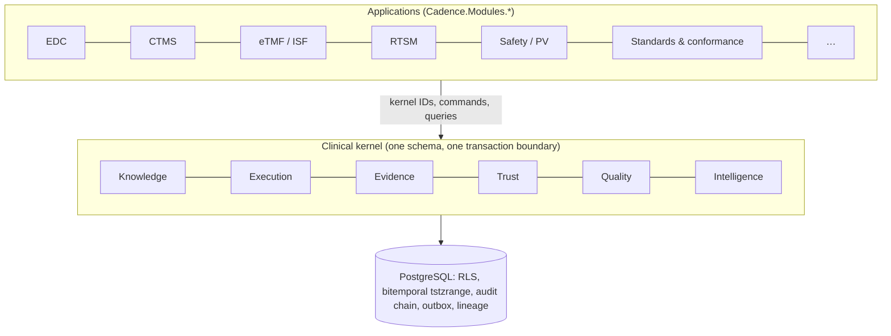

# Cadence Architecture

This document describes the system in two views: the **target architecture** (kernel, engines and
applications) and the **running system today** (a gateway in front of 16 ASP.NET Core product services and the kernel API host). The
gap between them is closed by the kernel roadmap and by
[ADR-2610](docs/adr/2026-10-15-scaffold-services-become-modules-merge-or-are-deleted.md), which turns the product services
into modules of one composition host. The kernel API host becomes that host (ADR-2601, #5315); so far it composes two
modules, Intelligence (#5374) and Execution (eCRF forms and their data queries, #5460, #5461), and every service below
still runs as its own process.

The normative source for the target is the
[Clinical Research OS kernel specification v0.2](docs/kernel/CLINICAL_KERNEL_SPECIFICATION.md).
When this document and the spec disagree, the spec wins; fix this document.

| Section                                                              | Contents                                                               |
| -------------------------------------------------------------------- | ---------------------------------------------------------------------- |
| [1. Target architecture](#1-target-architecture)                     | Kernel, six engines, applications, invariants                          |
| [2. Key decisions](#2-key-decisions)                                 | Kernel decisions K001–K036 and the platform decisions, with their ADRs |
| [3. Running services today](#3-running-services-today)               | Services, ports, gateway routes, maturity, disposition                 |
| [4. Request path and security](#4-request-path-and-security)         | OIDC at the gateway, signed identity in services                       |
| [5. Persistence](#5-persistence)                                     | Databases, connection strings, migrations                              |
| [6. Cross-cutting building blocks](#6-cross-cutting-building-blocks) | Telemetry, health, time, architecture tests, build                     |
| [7. Migration path](#7-migration-path)                               | How today's services become kernel applications                        |

---

## 1. Target architecture

Cadence is an **operating system for clinical research**. One kernel holds a single body of clinical
truth. Six **engines** organise the kernel's concepts; products such as EDC, CTMS, eTMF, RTSM, safety
and standards conformance are **applications** built on them (spec §2, §12).



| Engine       | Answers                                              | Examples of kernel concepts                                                          |
| ------------ | ---------------------------------------------------- | ------------------------------------------------------------------------------------ |
| Knowledge    | What does it mean, and what is supposed to happen?   | Concept Registry, ProtocolVersion, Estimand, CollectionSpec, Standards Registry      |
| Execution    | What is happening, where, and to whom?               | Organization, Site, StudySite, Participant, Enrollment, Applicability, ClinicalEvent |
| Evidence     | What was observed, collected or produced?            | Observation, Assertion, Source, Artifact, Specimen                                   |
| Trust        | Who was allowed, who agreed, where did it come from? | Actor, Delegation, Qualification, ConsentStatus, Attestation, lineage graph          |
| Quality      | Is it right, and is it under control?                | Rule, ValidationFinding, Risk, Deviation, Lock                                       |
| Intelligence | What does it imply, and what should happen next?     | AutomationAgent, Proposal                                                            |

Engines are an organising frame, not deployment units. The rules that shape every change:

- **K-TRUTH-1:** no product owns clinical truth; SDTM, ADaM, FHIR and the protocol PDF are projections.
- **K-SCOPE-1:** a concept belongs in the kernel if it explains the provenance, authority, meaning or
  lifecycle of clinical evidence across more than one application.
- **Forbidden redefinitions (spec §2.3):** applications never declare their own `Study`, `Site`,
  `Participant`, `Observation`, `Person`, roles, rule engines or audit tables; they reference kernel IDs.
- **Assemblies (spec §2.4):** `Cadence.Kernel.Abstractions` (IDs, ports, `IClock`) → `Domain` →
  `Application` → `Persistence` (internal) → `Api`; applications reference `Abstractions` and the module SDK
  `Cadence.Kernel.Modules` only (K-XS-2). A module writes clinical state by implementing a command handler from the SDK
  and sending its command through the kernel pipeline, which commits the module's records with the kernel's audit,
  events and outbox in one transaction ([ADR-2600](docs/adr/2026-10-19-modules-write-through-the-kernel-command-path.md)).
  `Cadence.Standards` loads public CDISC content into the Standards Registry and `Cadence.Rules` holds the rule
  language, rule packs and `IRuleEvaluator`; both reference `Abstractions` only.

The [domain glossary](CONTEXT.md) defines the vocabulary.

## 2. Key decisions

| #    | Decision                                                                                                                                                                                                                                                                                                                                           | ADR                                                                                                                                                                                                                                                                                                                                                                                                                                                                |
| ---- | -------------------------------------------------------------------------------------------------------------------------------------------------------------------------------------------------------------------------------------------------------------------------------------------------------------------------------------------------- | ------------------------------------------------------------------------------------------------------------------------------------------------------------------------------------------------------------------------------------------------------------------------------------------------------------------------------------------------------------------------------------------------------------------------------------------------------------------ |
| K001 | Modular monolith kernel with a single schema                                                                                                                                                                                                                                                                                                       | [ADR-2244](docs/adr/2026-09-29-clinical-kernel-modular-monolith-architecture.md), [ADR-2247](docs/adr/2026-09-29-clinical-kernel-single-database-schema-and-architecture-sentinel-hardening.md)                                                                                                                                                                                                                                                                    |
| K002 | Bitemporality with hand-rolled `tstzrange` and exclusion constraints                                                                                                                                                                                                                                                                               | [ADR-2246](docs/adr/2026-09-29-postgresql-native-bitemporal-interval-standard-via-tstzrange-and-gist.md)                                                                                                                                                                                                                                                                                                                                                           |
| K003 | Tenant isolation through row-level security in a shared schema                                                                                                                                                                                                                                                                                     | [ADR-2250](docs/adr/2026-09-29-kernel-tenant-isolation-via-row-level-security.md)                                                                                                                                                                                                                                                                                                                                                                                  |
| K004 | Authority computed from evidence by a hand-coded policy evaluator                                                                                                                                                                                                                                                                                  | [ADR-2251](docs/adr/2026-09-29-kernel-authority-computed-from-evidence-policy-engine.md)                                                                                                                                                                                                                                                                                                                                                                           |
| K005 | Concept Registry keyed by CDISC Biomedical Concepts; per-tenant terminology with pinned code-system versions                                                                                                                                                                                                                                       | [ADR-2252](docs/adr/2026-09-29-concept-registry-cdisc-biomedical-concepts-as-semantic-key.md), [ADR-2470](docs/adr/2026-09-30-per-tenant-terminology-and-pinned-code-system-versions.md)                                                                                                                                                                                                                                                                           |
| K006 | Identity vault and layered participant identity                                                                                                                                                                                                                                                                                                    | [ADR-2253](docs/adr/2026-09-29-identity-vault-and-layered-participant-identity.md)                                                                                                                                                                                                                                                                                                                                                                                 |
| K007 | Neo4j dropped; ProtocolVersion snapshots in PostgreSQL with an attested lifecycle, holding a typed protocol design document with stable element ids that USDM 4 studies import into, and a Schedule of Activities compiled from it                                                                                                                 | [ADR-2245](docs/adr/2026-09-29-native-postgresql-protocolversion-snapshots-and-neo4j-retirement.md), [ADR-2452](docs/adr/2026-09-30-protocol-version-lifecycle-content-hash-and-attested-approval.md), [ADR-2472](docs/adr/2026-09-30-executable-protocol-design-document.md), [ADR-2473](docs/adr/2026-09-30-usdm-4-import-into-the-protocol-design.md), [ADR-2475](docs/adr/2026-09-30-schedule-of-activities-as-a-rendering-with-typed-amendment-directives.md) |
| K008 | Rules as versioned data over one AST; public standards only; Rust runtime seam later                                                                                                                                                                                                                                                               | [ADR-2254](docs/adr/2026-09-29-rules-as-versioned-data-and-unified-rules-engine.md)                                                                                                                                                                                                                                                                                                                                                                                |
| K009 | Lineage graph in the kernel schema, written transactionally, with protocol design elements as nodes                                                                                                                                                                                                                                                | [ADR-2255](docs/adr/2026-09-29-kernel-lineage-graph-and-scientific-traceability.md), [ADR-2474](docs/adr/2026-09-30-protocol-elements-as-lineage-nodes.md)                                                                                                                                                                                                                                                                                                         |
| K010 | Kernel command pipeline: one transactional write set, per-tenant audit chain, outbox                                                                                                                                                                                                                                                               | [ADR-2449](docs/adr/2026-09-29-kernel-command-pipeline-transactional-write-set-and-per-tenant-audit-chain.md)                                                                                                                                                                                                                                                                                                                                                      |
| K011 | Simulation evaluates candidate versions and never writes                                                                                                                                                                                                                                                                                           | [ADR-2480](docs/adr/2026-09-30-evaluate-only-simulation-over-candidate-versions.md)                                                                                                                                                                                                                                                                                                                                                                                |
| K012 | Every kernel object has a public `NodeRef`; the kernel computes its zoom path                                                                                                                                                                                                                                                                      | [ADR-2481](docs/adr/2026-09-30-public-noderef-and-kernel-computed-zoom-path.md)                                                                                                                                                                                                                                                                                                                                                                                    |
| K013 | Standards Registry and MDR as governed, tenant-scoped reference data                                                                                                                                                                                                                                                                               | [ADR-2460](docs/adr/2026-09-30-standards-registry-and-mdr-as-governed-tenant-reference-data.md)                                                                                                                                                                                                                                                                                                                                                                    |
| K014 | Anything that decides also explains, with one `Explanation` type produced by the rule owner                                                                                                                                                                                                                                                        | [ADR-2482](docs/adr/2026-09-30-explanation-model-produced-by-the-rule-owner.md)                                                                                                                                                                                                                                                                                                                                                                                    |
| K015 | Every kernel command declares its capability; a dry run (`CanI`) takes the same authorization path and is logged, not audited                                                                                                                                                                                                                      | [ADR-2483](docs/adr/2026-09-30-dry-run-authorization-and-command-catalogue.md)                                                                                                                                                                                                                                                                                                                                                                                     |
| K016 | Search queries the source tables with PostgreSQL full-text search under the tenant's RLS, never a copy; results are NodeRefs and identity content is excluded                                                                                                                                                                                      | [ADR-2484](docs/adr/2026-09-30-tenant-scoped-search-over-source-tables.md)                                                                                                                                                                                                                                                                                                                                                                                         |
| K017 | Participant is identity only; each Enrollment keeps a bitemporal status history, gap-free numbers under the Study lock, and attested withdrawal                                                                                                                                                                                                    | [ADR-2453](docs/adr/2026-09-30-participants-enrollment-lifecycle-and-gap-free-numbering.md)                                                                                                                                                                                                                                                                                                                                                                        |
| K018 | Rule expression language, rule-pack format and `IRuleEvaluator` port                                                                                                                                                                                                                                                                               | [ADR-2461](docs/adr/2026-09-30-rule-expression-language-rule-pack-format-and-evaluator-port.md)                                                                                                                                                                                                                                                                                                                                                                    |
| K019 | The activity stream is an asynchronous, payload-free projection of outbox envelopes, scoped by the subject's zoom path and masked per reader at read time; integration events are unchanged                                                                                                                                                        | [ADR-2485](docs/adr/2026-09-30-reader-facing-activity-stream-projection.md)                                                                                                                                                                                                                                                                                                                                                                                        |
| K020 | Evidence artifacts are immutable, numbered versions described by hash, size, media type and storage reference; attestations sign a version                                                                                                                                                                                                         | [ADR-2454](docs/adr/2026-09-30-evidence-artifacts-as-immutable-hash-addressed-versions.md)                                                                                                                                                                                                                                                                                                                                                                         |
| K021 | Authority is kernel grants of a capability or role at a scope with bitemporal validity; a delegation is a grant bounded by its parent; one evaluator reads them                                                                                                                                                                                    | [ADR-2455](docs/adr/2026-09-30-grants-roles-and-delegation-as-bitemporal-kernel-authority.md)                                                                                                                                                                                                                                                                                                                                                                      |
| K022 | A validation finding keeps its identity across immutable runs; its status is derived from the runs and from attested decisions                                                                                                                                                                                                                     | [ADR-2462](docs/adr/2026-09-30-validation-findings-derived-from-immutable-runs-and-attested-decisions.md)                                                                                                                                                                                                                                                                                                                                                          |
| K023 | Work queues are versioned definitions keyed by a capability; a person's items are what a source reports as due and the evaluator permits them to act on now, so revoking a grant removes its items                                                                                                                                                 | [ADR-2486](docs/adr/2026-09-30-work-queues-as-capability-keyed-definitions.md)                                                                                                                                                                                                                                                                                                                                                                                     |
| K024 | Effectivity is bitemporal per protocol version and scope on artifact-version evidence; the most specific scope decides; a study site activates only where a version is in force                                                                                                                                                                    | [ADR-2456](docs/adr/2026-09-30-effectivity-and-study-site-activation.md)                                                                                                                                                                                                                                                                                                                                                                                           |
| K025 | The expected schedule is a pure function of the protocol design, a reference start and an as-of date, on the SDTM study-day axis (no day 0); simulation reports schedule changes from it                                                                                                                                                           | [ADR-2487](docs/adr/2026-09-30-expected-schedule-as-a-pure-function.md)                                                                                                                                                                                                                                                                                                                                                                                            |
| K026 | Pulse metrics, attention rules, KRIs and QTLs are versioned indicators in released, study-pinned indicator sets, counted through the rule evaluator; each value names its definition version, its objects and an explanation                                                                                                                       | [ADR-2488](docs/adr/2026-09-30-study-pulse-metrics-as-versioned-indicators.md)                                                                                                                                                                                                                                                                                                                                                                                     |
| K027 | Visibility is computed from the reader's grants in effect: what they cover, the scope path above them, participants and sites through their study sites, and reference data; everything else is masked                                                                                                                                             | [ADR-2457](docs/adr/2026-09-30-grant-backed-node-visibility.md)                                                                                                                                                                                                                                                                                                                                                                                                    |
| K028 | A mapping specification is a governed library item pinned to one standard version, CT versions and Concept versions; a protocol version is submitted only when every collected Concept is mapped or its gap is an accepted finding (K-STD-1); the engine sits behind `IMappingEngine`                                                              | [ADR-2463](docs/adr/2026-09-30-mapping-specifications-as-governed-concept-to-variable-maps.md)                                                                                                                                                                                                                                                                                                                                                                     |
| K029 | Direct identifiers live only in the IdentityVault: sealed per record under a per-tenant key, reached through its own functions, and recorded, revealed, erased and linked by audited kernel commands; residency is a tenant property                                                                                                               | [ADR-2458](docs/adr/2026-09-30-identity-vault.md)                                                                                                                                                                                                                                                                                                                                                                                                                  |
| K031 | Actor prerequisites are bitemporal Qualifications with artifact evidence; requirements name the qualification a capability needs within a scope, and the evaluator denies naming what to obtain or renew                                                                                                                                           | [ADR-2459](docs/adr/2026-09-30-qualifications-gate-capabilities.md)                                                                                                                                                                                                                                                                                                                                                                                                |
| K032 | An actual visit is measured against its expected window with no built-in severity (importance is a Quality rule); visits may be anchored on another visit's actual date, and repeating cycles expand into numbered occurrences, all in the one schedule function                                                                                   | [ADR-2507](docs/adr/2026-09-30-visit-timing-anchored-visits-and-cycles-on-the-expected-schedule.md)                                                                                                                                                                                                                                                                                                                                                                |
| K033 | An AI or a person suggests a change as a Proposal that changes nothing until a person executes it; only a person approves, with an attestation over its content hash; agents may read and propose but never execute or approve                                                                                                                     | [ADR-2489](docs/adr/2026-09-30-ai-proposals-and-automation-agents.md)                                                                                                                                                                                                                                                                                                                                                                                              |
| K037 | AI agents run in one governed runtime (the Intelligence module) whose only write into clinical data is a Proposal; each task has an autonomy level from 0 (inform) to 3 (standing grant, operational commands only); proposals cite what the agent read and name the qualified task configuration; an agent reads only with its requester's grants | [ADR-2630](docs/adr/2026-10-20-ai-agents-act-through-proposals-in-one-governed-runtime.md)                                                                                                                                                                                                                                                                                                                                                                         |
| K034 | An Observation keeps one id and appends insert-only revisions on correction; value Assertions cite the revision; `Locked`/`Frozen` are scoped Assertions with an attestation and unlock, guarded by shared scope locks                                                                                                                             | [ADR-2620](docs/adr/2026-10-15-ecrf-correction-transaction-boundary.md), [ADR-2621](docs/adr/2026-10-19-observation-corrections-are-revisions-locks-are-scoped-assertions.md)                                                                                                                                                                                                                                                                                      |
| K035 | A form instance is a kernel `CollectionInstance`; one command saves a whole page with an expected revision per value; structural checks before commit, edit checks after; form signatures bind to the members' revisions                                                                                                                           | [ADR-2622](docs/adr/2026-10-19-ecrf-forms-are-collection-instances-saved-in-one-command.md)                                                                                                                                                                                                                                                                                                                                                                        |
| K036 | Observation values are typed: quantity with UCUM unit, coded with code-system version, text, boolean, partial ISO 8601 date/time, or missing with a null flavor; stored as jsonb and projected to `--ORRES`/`--ORRESU`/`--STAT`/`--REASND`                                                                                                         | [ADR-2623](docs/adr/2026-10-19-observation-values-are-typed.md)                                                                                                                                                                                                                                                                                                                                                                                                    |
| —    | One database, a schema per module                                                                                                                                                                                                                                                                                                                  | [ADR-2447](docs/adr/2026-09-29-module-schemas-via-search-path-and-migration-deployment.md)                                                                                                                                                                                                                                                                                                                                                                         |
| —    | Fail-closed gateway identity and signed caller authentication                                                                                                                                                                                                                                                                                      | [ADR-2256](docs/adr/2026-09-29-fail-closed-gateway-identity-and-signed-caller-authentication.md)                                                                                                                                                                                                                                                                                                                                                                   |
| —    | No default credentials; secrets resolve fail-closed                                                                                                                                                                                                                                                                                                | [ADR-2260](docs/adr/2026-09-29-no-default-credentials-and-fail-closed-secret-resolution.md)                                                                                                                                                                                                                                                                                                                                                                        |
| —    | Services fail startup on missing required settings                                                                                                                                                                                                                                                                                                 | [ADR-2490](docs/adr/2026-09-30-fail-fast-startup-validation-of-required-settings.md)                                                                                                                                                                                                                                                                                                                                                                               |
| —    | Trusted forwarded headers, HSTS and per-caller rate limits at the edge                                                                                                                                                                                                                                                                             | [ADR-2491](docs/adr/2026-09-30-http-edge-hardening-forwarded-headers-hsts-rate-limits.md)                                                                                                                                                                                                                                                                                                                                                                          |
| —    | The web app signs in only through Keycloak                                                                                                                                                                                                                                                                                                         | [ADR-2493](docs/adr/2026-09-30-keycloak-only-web-sign-in.md)                                                                                                                                                                                                                                                                                                                                                                                                       |
| —    | Field-level encryption and keyed lookup hashes for secrets at rest                                                                                                                                                                                                                                                                                 | [ADR-2494](docs/adr/2026-09-30-field-level-encryption-and-keyed-lookup-hashes-for-secrets-at-rest.md)                                                                                                                                                                                                                                                                                                                                                              |
| —    | `X-Change-Reason` is printable ASCII or RFC 8187 `UTF-8''` encoded, decoded before audit                                                                                                                                                                                                                                                           | [ADR-2495](docs/adr/2026-09-30-reason-for-change-header-encoding.md)                                                                                                                                                                                                                                                                                                                                                                                               |
| —    | Routes require a `resource:action` permission from the permission matrix                                                                                                                                                                                                                                                                           | [ADR-2510](docs/adr/2026-09-30-endpoint-permissions-from-the-permission-matrix.md)                                                                                                                                                                                                                                                                                                                                                                                 |
| —    | Routes are denied unless they declare a permission, a reasoned signed-in caller or anonymous access; study scope fails closed                                                                                                                                                                                                                      | [ADR-2516](docs/adr/2026-10-16-routes-are-denied-unless-they-declare-who-may-call-them.md)                                                                                                                                                                                                                                                                                                                                                                         |
| —    | Safety, Notifications and CTMS render routes need `safety_report:create`, `notification:send`, `ctms_monitoring_visit:create`                                                                                                                                                                                                                      | [ADR-2511](docs/adr/2026-09-30-template-render-routes-need-a-permission.md)                                                                                                                                                                                                                                                                                                                                                                                        |
| —    | The safety ICSR render emits the ICH E2B(R3) HL7 v3 message, checks the ICH business rules first and validates the output against the vendored ICH schema                                                                                                                                                                                          | [ADR-2464](docs/adr/2026-10-20-icsr-render-emits-ich-e2br3-validated-against-the-ich-schema.md)                                                                                                                                                                                                                                                                                                                                                                    |
| —    | Form approval `payload_hash` is SHA-256 of the RFC 8785 canonical payload, computed by the client from what it submitted                                                                                                                                                                                                                           | [ADR-2513](docs/adr/2026-09-30-form-approval-hashes-the-rfc-8785-canonical-payload.md)                                                                                                                                                                                                                                                                                                                                                                             |
| —    | The caller's tenant is the `tenant_id` the sign-in token carries; a token without one reaches no kernel tenant, and there is no fallback tenant                                                                                                                                                                                                    | [ADR-2514](docs/adr/2026-09-30-the-tenant-comes-from-sign-in-with-no-fallback.md)                                                                                                                                                                                                                                                                                                                                                                                  |
| —    | Forms: skip logic and constraints are written in the one rule language and compiled to XPath; reusable form blocks are `CollectionSpecification` library items; the tripartite form definition is not carried forward                                                                                                                              | [ADR-2502](docs/adr/2026-09-30-ddf-item-rules-use-the-one-rule-language.md), [ADR-2503](docs/adr/2026-09-30-reusable-form-blocks-are-collection-specification-library-items.md), [ADR-2504](docs/adr/2026-09-30-the-tripartite-form-definition-is-not-carried-forward.md)                                                                                                                                                                                          |
| —    | The kernel API host serves the Canvas's kernel reads (nodes, zoom path, children, command catalogue, CanI, search, protocol versions, Trace, dependents, amendment impact, activity stream) under `/api/v1/kernel`, and runs the activity projector                                                                                                | [ADR-2540](docs/adr/2026-09-30-kernel-api-host-and-read-endpoints-for-the-canvas.md)                                                                                                                                                                                                                                                                                                                                                                               |
| —    | Each of the 17 product services becomes a module in one composition host or merges into one; org administers kernel Grants instead of keeping its own delegation model                                                                                                                                                                             | [ADR-2610](docs/adr/2026-10-15-scaffold-services-become-modules-merge-or-are-deleted.md)                                                                                                                                                                                                                                                                                                                                                                           |
| —    | The kernel `Observation` owns the clinical value; a correction commits value, revision, reason, version, audit link, event and outbox row in one transaction, and the eCRF form instance owns workflow only                                                                                                                                        | [ADR-2620](docs/adr/2026-10-15-ecrf-correction-transaction-boundary.md)                                                                                                                                                                                                                                                                                                                                                                                            |
| —    | Step-up signature tokens are single use across instances and restarts (PostgreSQL in Execution)                                                                                                                                                                                                                                                    | [ADR-2515](docs/adr/2026-10-15-step-up-tokens-are-single-use-across-instances-and-restarts.md)                                                                                                                                                                                                                                                                                                                                                                     |
| —    | Explicit EF Core transactions run inside the execution strategy, or are removed where one `SaveChangesAsync` is the whole write                                                                                                                                                                                                                    | [ADR-2523](docs/adr/2026-10-19-explicit-transactions-run-inside-the-execution-strategy.md)                                                                                                                                                                                                                                                                                                                                                                         |
| —    | Every mapped test is mandatory evidence; feature branches never commit the RTM or IQ/OQ/PQ snapshot, which only the integration owner regenerates                                                                                                                                                                                                  | [ADR-2531](docs/adr/2026-10-15-every-mapped-test-is-mandatory-evidence.md), [ADR-2532](docs/adr/2026-10-16-feature-branches-never-commit-the-gxp-snapshot.md)                                                                                                                                                                                                                                                                                                      |
| —    | Web coverage is measured over all source with a ratchet floor                                                                                                                                                                                                                                                                                      | [ADR-2530](docs/adr/2026-09-30-measure-web-coverage-over-all-source-with-a-ratchet-floor.md)                                                                                                                                                                                                                                                                                                                                                                       |
| —    | Python reference sources are deleted once their C# port is tested                                                                                                                                                                                                                                                                                  | [ADR-2492](docs/adr/2026-09-30-retire-python-reference-sources-once-ports-are-tested.md)                                                                                                                                                                                                                                                                                                                                                                           |
| —    | The developer CLI parses with System.CommandLine and publishes as Native AOT without suppressions                                                                                                                                                                                                                                                  | [ADR-2496](docs/adr/2026-09-30-parse-the-cli-with-system-commandline-and-publish-aot-without-suppressions.md)                                                                                                                                                                                                                                                                                                                                                      |
| —    | .NET 10 platform standards (C# 14, Minimal APIs, EF Core 10, CPM)                                                                                                                                                                                                                                                                                  | [ADR-2233](docs/adr/2026-09-02-migration-to-dotnet-10-architecture-and-standards.md)                                                                                                                                                                                                                                                                                                                                                                               |

The full list is in the [ADR index](docs/adr/index.md).

## 3. Running services today

Every backend is an ASP.NET Core 10 Minimal API host under `apps/<name>/src`, built from
`Cadence.sln`. The service topology manifest ([`packages/topology`](packages/topology/README.md), #5315) holds each
service's port, address variable and gateway routes; the gateway and the AppHost are built from it, and
`ServiceTopologyTests` fails when `docker/docker-compose.yml` or this table disagrees with it. Each service has a
README with its details.

| Service                                       | Project                      | Port                                           | Gateway routes (`/api/v1/…`)                                                                                                                                                                                                                                                                                                       | Persistence                                                                                                                                                                                                             | Today                                                                                                                                                                                                                                                                                                                                                                                                                                                                                                                                                                                                                 | ADR-2610 disposition                                                              |
| --------------------------------------------- | ---------------------------- | ---------------------------------------------- | ---------------------------------------------------------------------------------------------------------------------------------------------------------------------------------------------------------------------------------------------------------------------------------------------------------------------------------- | ----------------------------------------------------------------------------------------------------------------------------------------------------------------------------------------------------------------------- | --------------------------------------------------------------------------------------------------------------------------------------------------------------------------------------------------------------------------------------------------------------------------------------------------------------------------------------------------------------------------------------------------------------------------------------------------------------------------------------------------------------------------------------------------------------------------------------------------------------------- | --------------------------------------------------------------------------------- |
| [gateway](apps/gateway/README.md)             | `Cadence.Apps.Gateway`       | 8000 (behind the nginx front proxy in compose) | all of the below; each route is tested against the endpoints its service maps ([ADR-2448](docs/adr/2026-09-29-gateway-routes-verified-against-service-endpoints.md)); a stalled service gets a 504 and an unhealthy one a 503 without forwarding ([ADR-2451](docs/adr/2026-09-29-gateway-timeouts-and-health-checked-clusters.md)) | none                                                                                                                                                                                                                    | Implemented                                                                                                                                                                                                                                                                                                                                                                                                                                                                                                                                                                                                           | Stays: OIDC edge in front of the composition host                                 |
| [execution](apps/execution/README.md)         | `Cadence.Apps.Execution`     | 8002                                           | `execution`                                                                                                                                                                                                                                                                                                                        | `ExecutionDbContext`                                                                                                                                                                                                    | Implemented (EDC core); eCRF forms and their queries moved to the Execution module in the kernel host (ADR-2622, #5461)                                                                                                                                                                                                                                                                                                                                                                                                                                                                                               | Module (#5378)                                                                    |
| [ctms](apps/ctms/README.md)                   | `Cadence.Apps.Ctms`          | 8007                                           | `ctms`                                                                                                                                                                                                                                                                                                                             | `CtmsDbContext`                                                                                                                                                                                                         | Features on its own schema                                                                                                                                                                                                                                                                                                                                                                                                                                                                                                                                                                                            | Module (#5378)                                                                    |
| [etmf](apps/etmf/README.md)                   | `Cadence.Apps.Etmf`          | 8003                                           | `etmf`                                                                                                                                                                                                                                                                                                                             | `EtmfDbContext`                                                                                                                                                                                                         | Features on its own schema                                                                                                                                                                                                                                                                                                                                                                                                                                                                                                                                                                                            | Module (#5378); absorbs eisf and fileshare sharing                                |
| [payments](apps/payments/README.md)           | `Cadence.Apps.Payments`      | 8016                                           | `payments`                                                                                                                                                                                                                                                                                                                         | `PaymentsDbContext`                                                                                                                                                                                                     | Features on its own schema                                                                                                                                                                                                                                                                                                                                                                                                                                                                                                                                                                                            | Module (#5378)                                                                    |
| [interop](apps/interop/README.md)             | `Cadence.Apps.Interop`       | 8004                                           | `interop`                                                                                                                                                                                                                                                                                                                          | `InteropDbContext`                                                                                                                                                                                                      | Features on its own schema                                                                                                                                                                                                                                                                                                                                                                                                                                                                                                                                                                                            | Module (#5378)                                                                    |
| [imaging](apps/imaging/README.md)             | `Cadence.Apps.Imaging`       | 8014                                           | `imaging`                                                                                                                                                                                                                                                                                                                          | `ImagingDbContext`                                                                                                                                                                                                      | Features on its own schema (no segmentation model; the route refuses, #5426)                                                                                                                                                                                                                                                                                                                                                                                                                                                                                                                                          | Module (#5378)                                                                    |
| [safety](apps/safety/README.md)               | `Cadence.Apps.Safety`        | 8008                                           | `safety`                                                                                                                                                                                                                                                                                                                           | `SafetyDbContext`                                                                                                                                                                                                       | Features on its own schema                                                                                                                                                                                                                                                                                                                                                                                                                                                                                                                                                                                            | Module (#5378)                                                                    |
| [econsent](apps/econsent/README.md)           | `Cadence.Apps.Econsent`      | 8011                                           | `econsent`                                                                                                                                                                                                                                                                                                                         | `EconsentDbContext`                                                                                                                                                                                                     | Features on its own schema                                                                                                                                                                                                                                                                                                                                                                                                                                                                                                                                                                                            | Module (#5378)                                                                    |
| [knowledge](apps/knowledge/README.md)         | `Cadence.Apps.Knowledge`     | 8015                                           | `knowledge`                                                                                                                                                                                                                                                                                                                        | `KnowledgeDbContext`                                                                                                                                                                                                    | Features on its own schema                                                                                                                                                                                                                                                                                                                                                                                                                                                                                                                                                                                            | Module (#5378)                                                                    |
| [designer](apps/designer/README.md)           | `Cadence.Apps.Designer`      | 8001                                           | `studies`, `protocols`                                                                                                                                                                                                                                                                                                             | none yet                                                                                                                                                                                                                | Scaffold                                                                                                                                                                                                                                                                                                                                                                                                                                                                                                                                                                                                              | Module (#5378)                                                                    |
| [tickets](apps/tickets/README.md)             | `Cadence.Apps.Tickets`       | 8009                                           | `tickets`                                                                                                                                                                                                                                                                                                                          | `TicketsDbContext`                                                                                                                                                                                                      | Scaffold                                                                                                                                                                                                                                                                                                                                                                                                                                                                                                                                                                                                              | Module, built out in the host (#5377)                                             |
| [quality](apps/quality/README.md)             | `Cadence.Apps.Quality`       | 8005                                           | `quality`                                                                                                                                                                                                                                                                                                                          | `QualityDbContext`                                                                                                                                                                                                      | Scaffold                                                                                                                                                                                                                                                                                                                                                                                                                                                                                                                                                                                                              | Module, built out in the host (#5376)                                             |
| [org](apps/org/README.md)                     | `Cadence.Apps.Org`           | 8012                                           | `org`                                                                                                                                                                                                                                                                                                                              | `OrgDbContext`                                                                                                                                                                                                          | Scaffold                                                                                                                                                                                                                                                                                                                                                                                                                                                                                                                                                                                                              | Module over kernel Grants and Qualifications (#5375)                              |
| [eisf](apps/eisf/README.md)                   | `Cadence.Apps.Eisf`          | 8010                                           | `eisf`                                                                                                                                                                                                                                                                                                                             | `EisfDbContext`                                                                                                                                                                                                         | Scaffold                                                                                                                                                                                                                                                                                                                                                                                                                                                                                                                                                                                                              | Merges into etmf (#5371)                                                          |
| [fileshare](apps/fileshare/README.md)         | `Cadence.Apps.Fileshare`     | 8013                                           | `fileshare`                                                                                                                                                                                                                                                                                                                        | `FileshareDbContext` + MinIO                                                                                                                                                                                            | Scaffold (two background workers)                                                                                                                                                                                                                                                                                                                                                                                                                                                                                                                                                                                     | Storage and conversion become a host capability; sharing merges into etmf (#5372) |
| [notifications](apps/notifications/README.md) | `Cadence.Apps.Notifications` | 8006                                           | `notifications`                                                                                                                                                                                                                                                                                                                    | `NotificationsDbContext`                                                                                                                                                                                                | Scaffold (one render route)                                                                                                                                                                                                                                                                                                                                                                                                                                                                                                                                                                                           | Host capability (#5373)                                                           |
| [kernel-api](apps/kernel-api/README.md)       | `Cadence.Kernel.Host`        | 8018                                           | `kernel`, `ai` (the Intelligence module), `execution/forms` (the Execution module)                                                                                                                                                                                                                                                 | `KernelDbContext` (schema `kernel`); the Intelligence module's `IntelligenceDbContext` (schema `intelligence`) and the Execution module's `ExecutionModuleDbContext` (schema `execution`); both with Row-Level Security | Canvas reads ([ADR-2540](docs/adr/2026-09-30-kernel-api-host-and-read-endpoints-for-the-canvas.md)) and the observation commands (ADR-2620); decisions and visibility from grants (ADR-2455, ADR-2457); the Intelligence module ([apps/intelligence](apps/intelligence/README.md)): the governed AI agent runtime, its run ledger and controls, and the command-palette intent router ([ADR-2630](docs/adr/2026-10-20-ai-agents-act-through-proposals-in-one-governed-runtime.md)); the Execution module ([apps/execution/module](apps/execution/module/README.md)): eCRF forms over kernel form instances (ADR-2622) | The kernel, hosted in-process by the composition host (#5315)                     |

"Features on its own schema" means the service
serves real workflows but still keeps its own `DbContext`, module-local audit table and `string` study, site and
participant IDs, which the kernel replaces as it becomes a module (ADR-2610 §5). "Scaffold" means the host, security,
health checks and usually a `DbContext` exist, but the service maps few or no endpoints. Until the composition host
(#5315) and each follow-up land, the table above is what runs; each move removes the old host's gateway cluster,
AppHost entry and compose service together.

Other runtime pieces:

| Component              | Path                          | Notes                                                                                                                                                                                                                                 |
| ---------------------- | ----------------------------- | ------------------------------------------------------------------------------------------------------------------------------------------------------------------------------------------------------------------------------------- |
| Web client             | `apps/web`                    | Vue 3 + Vite (port 5173); signs in through Keycloak                                                                                                                                                                                   |
| Subject portal         | `apps/subject-portal`         | Participant PWA (port 5174)                                                                                                                                                                                                           |
| Aspire AppHost         | `apps/apphost`                | Local orchestration of PostgreSQL (database `cadence`), MinIO, Keycloak, every .NET service and the web app; a `core` profile runs the gateway, kernel API, execution and web only, optionally on an existing PostgreSQL and Keycloak |
| Keycloak               | `docker/cadence-realm.json`   | OIDC identity provider (port 8080), realm `cadence`                                                                                                                                                                                   |
| PostgreSQL 18          | compose `postgres`            | One `cadence` database with a schema per service (ADR-2447)                                                                                                                                                                           |
| MinIO, ClamAV          | compose profile `storage`     | Object storage (fileshare, through `packages/storage`) and upload scanning (no service calls ClamAV yet)                                                                                                                              |
| Front proxy            | compose `front-proxy` (nginx) | Port 8000; forwards the web apps' API calls to the gateway                                                                                                                                                                            |
| Other compose services | `docker/docker-compose.yml`   | `dotnet-dev` (SDK container)                                                                                                                                                                                                          |

## 4. Request path and security

```mermaid
sequenceDiagram
    participant C as Web client / portal
    participant K as Keycloak
    participant G as Gateway (YARP)
    participant S as Service
    C->>K: Sign in (OIDC)
    C->>G: Request + bearer token
    G->>G: Validate JWT (OIDC_AUTHORITY), strip client identity headers
    G->>S: Forward with signed X-User-*, X-Tenant-Id, X-Timestamp, X-Gateway-Signature
    S->>S: CadenceGateway scheme verifies HMAC (GATEWAY_SECRET) and timestamp (2 min)
    S-->>C: Response (401 if unsigned, forged or stale; 403 if role not allowed)
```

Decided in [ADR-2256](docs/adr/2026-09-29-fail-closed-gateway-identity-and-signed-caller-authentication.md):

- The gateway requires an authenticated caller on every proxied route and fails at startup without
  `OIDC_AUTHORITY` or a `GATEWAY_SECRET` of at least 32 characters.
- Every service calls `AddCadenceSecurity()` / `UseCadenceSecurity()` (`packages/security`). Only
  health, status and development API-doc endpoints allow anonymous access.
- Application code takes identity and roles from the verified claims only. A PI signature records the
  authenticated caller as signer.
- Signing a PI form approval needs a fresh re-authentication: the gateway re-checks the signer's
  password with Keycloak and issues a 60-second `X-Sig-Token` bound to the user, form and meaning
  ([ADR-2259](docs/adr/2026-09-29-electronic-signature-step-up-re-authentication.md)). Batch PI sign-off and the
  delegation-log sign-off bind the token to the exact targets (`batch_id`). Each token signs once: Execution, eConsent
  and Knowledge record its use in PostgreSQL, in their own schema, so single use holds across instances and restarts,
  and a host that maps a signed route without a durable store refuses to start outside Development (#5434)
  ([ADR-2515](docs/adr/2026-10-15-step-up-tokens-are-single-use-across-instances-and-restarts.md)).
- The web app signs in only through Keycloak (authorization code + PKCE) and keeps tokens in memory;
  only the opt-in demo build uses an offline demo identity
  ([ADR-2493](docs/adr/2026-09-30-keycloak-only-web-sign-in.md)).
- Secrets that services must keep are protected at rest: payment processor references and signer
  e-mail addresses are AES-256-GCM encrypted (`FIELD_ENCRYPTION_KEY`), device tokens are stored only
  as keyed HMAC-SHA256 lookup hashes (`FIELD_LOOKUP_HASH_KEY`), and consent signature captures only
  as a SHA-256 binding to the signed content
  ([ADR-2494](docs/adr/2026-09-30-field-level-encryption-and-keyed-lookup-hashes-for-secrets-at-rest.md)).
- A reason for change in any language travels in `X-Change-Reason` as printable ASCII or an RFC 8187
  `UTF-8''` percent-encoded value; the gateway rejects a malformed value with 400, and services decode it
  so the audit trail stores exactly what the user typed
  ([ADR-2495](docs/adr/2026-09-30-reason-for-change-header-encoding.md)).
- A route that needs a role declares `.RequirePermission("resource:action")`; the policy is built from the
  permission matrix and answers 403 to any caller whose roles lack it
  ([ADR-2510](docs/adr/2026-09-30-endpoint-permissions-from-the-permission-matrix.md)).
- Routes are denied by default. Every route declares a permission, a reasoned `RequireSignedInCaller`, or
  `AllowAnonymous()` (health, status and development API documents only), and study scope fails closed: a caller
  reaches a study only when the gateway-signed `study_ids` assignment names it. `RouteAuthorizationTests` boots every
  service and proves an unauthorized caller is refused before the handler runs
  ([ADR-2516](docs/adr/2026-10-16-routes-are-denied-unless-they-declare-who-may-call-them.md)).
- Forwarded headers are honoured only from proxies listed in `CADENCE_TRUSTED_PROXIES`, responses outside
  Development carry HSTS, and the gateway limits each caller to `GATEWAY_RATE_LIMIT_PER_MINUTE` requests (default 600) and answers 429 with `Retry-After` above it
  ([ADR-2491](docs/adr/2026-09-30-http-edge-hardening-forwarded-headers-hsts-rate-limits.md)).

In the target architecture, authority is computed from evidence (training, delegation,
qualification) by the kernel's policy evaluator (ADR-2251), not from role strings.

## 5. Persistence

- **PostgreSQL 18 through EF Core 10 + Npgsql** (tests, CI and compose pin one image, ADR-2533). `AddCadencePostgresDbContext`
  (`packages/database`) resolves `ConnectionStrings:cadence` (set by the Aspire AppHost), then
  `POSTGRES_CONNECTION_STRING`. Only the `Development` environment falls back to the local compose
  database; any other environment fails at startup. Transient-failure retries are enabled.
- **One database, a schema per service** ([ADR-2447](docs/adr/2026-09-29-module-schemas-via-search-path-and-migration-deployment.md)):
  every service connects to the shared `cadence` database with its search path set to its own module
  schema (`ctms`, `execution`, …). The kernel owns the `kernel` schema.
- **Migrations** live in each service's `Infrastructure/Persistence/Migrations/` and are managed with
  `scripts/manage_migrations.ps1` (see [AGENTS.md §10](AGENTS.md)). `Database__MigrateOnStartup=true`
  applies them at startup; `Database__MigrateOnly=true` runs them as a deployment job and exits. See the
  [database runbook](docs/OPERATIONAL_DATABASE.md).
- **The kernel schema** is implemented in `packages/kernel` ([README](packages/kernel/README.md)):
  - Row-level security is enabled and forced on every table, with composite `(tenant_id, id)` keys (ADR-2250).
  - Bitemporal tables use guarded `tstzrange` columns (ADR-2246).
  - Every change is a command whose aggregate, provenance, events, audit-chain link and outbox rows commit in one
    transaction (ADR-2449).
  - The kernel API host runs the background jobs (`AddKernelBackgroundJobs`): the outbox relay delivers committed
    events to the host's in-process consumers, and each tenant's audit chain is verified and sealed hourly. Each pass
    holds a PostgreSQL leader lock, so one replica runs each job at a time (ADR-2601). The host also runs the activity
    projector (ADR-2485).
  - The lineage graph (spec §9.6) is written in the same command transaction (`KernelLineageStore`, ADR-2255).
  - The kernel `Observation` owns the clinical value: each correction appends an insert-only revision with its reason,
    checks the expected version and lock, and commits with its audit link, event and outbox row (ADR-2620).
  - A Concept Registry holds pinned terminology (ADR-2470).
  - A Standards Registry holds standard versions (datasets, variables, value-level definitions) and a governed
    library of versioned items that studies pin; approval and deprecation need an attestation (ADR-2460).
  - Mapping specifications map Concepts to standard variables before first data capture: a protocol version is
    submitted only when every collected Concept is mapped in the study's pinned specifications or its gap is an
    accepted finding (K-STD-1); `IMappingEngine` applies them, with a .NET engine in `Cadence.Standards` (ADR-2463).
  - Protocol versions move Draft, InReview, Approved, then Superseded or Withdrawn. Submitting freezes the content
    under a SHA-256 hash, and approval or withdrawal needs a person's attestation on that hash (ADR-2452).
  - Every kernel object has a public `NodeRef` (`kind:id@version`), and `IKernelNavigator` resolves one to a summary
    and its zoom path (ADR-2481).
  - A decision, such as a denied command, carries an `Explanation`: the claim, every evaluated condition with its
    evidence and the next actions, produced by the component that owns the rule (ADR-2482).
  - Every kernel command declares its capability. `IAuthorizationProbe` answers "can I?" and lists the commands
    offered on an object through the same decision path as a real command; dry runs go to the access log, not
    the audit chain (ADR-2483).
  - `IKernelSearch` finds studies, sites, organizations, concepts, terminology codes, standards and library items by
    code or title, querying the source tables under the tenant's RLS with GIN full-text indexes (ADR-2484).
  - Rule packs are released library items evaluated through `IRuleEvaluator` in `Cadence.Rules` (ADR-2461).
  - A validation run records what a study's pinned rule packs detected. Findings keep their identity across runs,
    are resolved by the run that no longer detects them, and are accepted or explained only with an attestation
    over the decision's text; their status is derived from the runs and decisions on read (ADR-2462).
  - A Participant is identity only. Each Enrollment in a study keeps a bitemporal status history, takes a
    gap-free enrollment number under the study's lock, and needs an attestation to withdraw (ADR-2453).
- **Still to come:** the product services moving from their own `DbContext` and schema onto kernel concepts (ADR-2610).
- **Audit:** the EF Core `GxPAuditInterceptor` (`packages/database`) populates `CreatedAt`, `CreatedBy`,
  `ReasonForChange` and `VersionIndex` (21 CFR Part 11) and attributes every write to a real user or a named service
  account ([ADR-2257](docs/adr/2026-09-29-attributable-audit-actors-and-named-service-accounts.md)). Only Execution
  registers it today; the other services map an audit table it does not write and set audit fields by hand until
  `AddCadencePostgresDbContext` registers it for every context (#5312).
- **Transactions:** an explicit EF Core transaction runs inside the execution strategy so transient-failure retries
  replay the whole unit; where one `SaveChangesAsync` is the whole write, no explicit transaction is opened
  ([ADR-2523](docs/adr/2026-10-19-explicit-transactions-run-inside-the-execution-strategy.md)).
- **Messaging:** Execution, eTMF, eConsent and Notifications publish integration events through the MassTransit EF Core
  transactional outbox ([ADR-2814](docs/adr/2026-10-07-standardize-masstransit-ef-core-transactional-outbox-across-core-services.md)).
  Kernel events use the kernel outbox (ADR-2449). MassTransit stays on the Apache 2.0 8.x line; 9.x is a commercial
  product that needs a licence key, so Dependabot does not offer it
  ([ADR-2524](docs/adr/2026-10-19-messaging-stays-on-the-apache-licensed-masstransit-8-line.md)).

## 6. Cross-cutting building blocks

| Concern            | Where                                               | What it does                                                                                                                                                                                             |
| ------------------ | --------------------------------------------------- | -------------------------------------------------------------------------------------------------------------------------------------------------------------------------------------------------------- |
| Health             | `packages/telemetry`                                | `/healthz/live` (no checks) and `/healthz/ready` (every `DbContext` reachable); `/healthz` returns a static payload                                                                                      |
| Telemetry          | `packages/telemetry`                                | OpenTelemetry traces, metrics and logs named after the service (`OTEL_SERVICE_NAME`); OTLP export when `OTEL_EXPORTER_OTLP_ENDPOINT` is set                                                              |
| Time               | `Cadence.Kernel.Abstractions` `IClock`              | `DateTime.Now/UtcNow` are banned ([`BannedSymbols.txt`](BannedSymbols.txt)); take time from `IClock` (K-TIME-3). Remaining call sites: [clock migration backlog](docs/kernel/CLOCK_MIGRATION_BACKLOG.md) |
| Architecture tests | `tests/Cadence.ArchitectureTests/Architecture`      | K-XS-1, K-XS-2 and K-MOD-1, and a `[KernelRule]`-tagged test for every kernel rule, each with a checked-in baseline that may only shrink (`tests/Cadence.ArchitectureTests/ArchitectureBaselines/`)      |
| Security           | `packages/security`                                 | Gateway authentication scheme, HMAC signing, audit digest, e-signature tokens, field encryption and lookup hashes (`Cadence.Security.FieldProtection`)                                                   |
| Build              | `Directory.Build.props`, `Directory.Packages.props` | `net10.0`, nullable enabled, warnings as errors, Central Package Management                                                                                                                              |
| Contracts          | `packages/contracts`                                | Typed cross-service DTOs and HTTP clients                                                                                                                                                                |
| Topology           | `packages/topology`                                 | The service topology manifest: each service's port, address variable and gateway routes; the gateway and AppHost are built from it (#5315)                                                               |
| DDF compiler       | `packages/ddf`                                      | USDM → DDF intermediate representation → CDISC ODM / XForms                                                                                                                                              |
| De-identification  | `packages/deid`                                     | In-process de-identification and canonical signing (ADR-2261)                                                                                                                                            |
| Storage            | `packages/storage`                                  | S3/MinIO blob store used by fileshare; becomes the host's storage capability (ADR-2610, #5372)                                                                                                           |
| GxP evidence       | `pnpm cadence gxp sync` / `gxp snapshot`            | Requirement tags on tests feed the RTM and IQ/OQ/PQ report; branches validate a preview, and only the integration owner commits the snapshot (ADR-2531, ADR-2532)                                        |

## 7. Migration path

The [kernel roadmap (spec §15)](docs/kernel/CLINICAL_KERNEL_SPECIFICATION.md#15-roadmap) is the plan:

| Phase                          | Outcome                                                                                                        |
| ------------------------------ | -------------------------------------------------------------------------------------------------------------- |
| 0. Foundations                 | Kernel projects, `IClock`, `tstzrange`, RLS, command pipeline, architecture baseline                           |
| 1. EDC on the kernel           | `apps/execution` runs on kernel concepts ([migration inventory](docs/kernel/EXECUTION_MIGRATION_INVENTORY.md)) |
| 2. Knowledge and standards     | Concept Registry, executable protocol, standards registry, rules, lineage                                      |
| 3. Quality and trust expansion | RBQM, computable consent, specimens, ingestion, AI proposals                                                   |
| 4. Analysis and submission     | Derivations, ADaM, TLF lineage, Define-XML, submission package                                                 |
| 5. Lifecycle breadth           | Feasibility, start-up, finance, recruitment, DCT, regulatory, RWE                                              |

The services reach the kernel by becoming modules of one composition host
([ADR-2610](docs/adr/2026-10-15-scaffold-services-become-modules-merge-or-are-deleted.md)). The order, from the
architecture audit epic [#5310](https://github.com/fderuiter/cadence-clinical/issues/5310), is: honest test evidence
and contained failures; one composition host and one kernel command path (#5315, #5366); the eCRF end to end on it
(#5365); concurrency, durable jobs and recovery (#5362, #5364); then the other modules (#5367, #5371–#5378), Execution
first and Quality second. Each module conversion follows the fold-in rules: one owner per authoritative fact, query and
command contracts and durable events between modules, and no competing authoritative copies.

Work is tracked in epic [#4719](https://github.com/fderuiter/cadence-clinical/issues/4719). The
Python-to-.NET port that preceded this is complete; its playbook remains in
[docs/MIGRATION_WORKFLOW.md](docs/MIGRATION_WORKFLOW.md) for porting the remaining Python reference
sources listed in [docs/PYTHON_REFERENCE_INVENTORY.md](docs/PYTHON_REFERENCE_INVENTORY.md)
([#4789](https://github.com/fderuiter/cadence-clinical/issues/4789)); each is deleted once its port is tested
([ADR-2492](docs/adr/2026-09-30-retire-python-reference-sources-once-ports-are-tested.md)).
