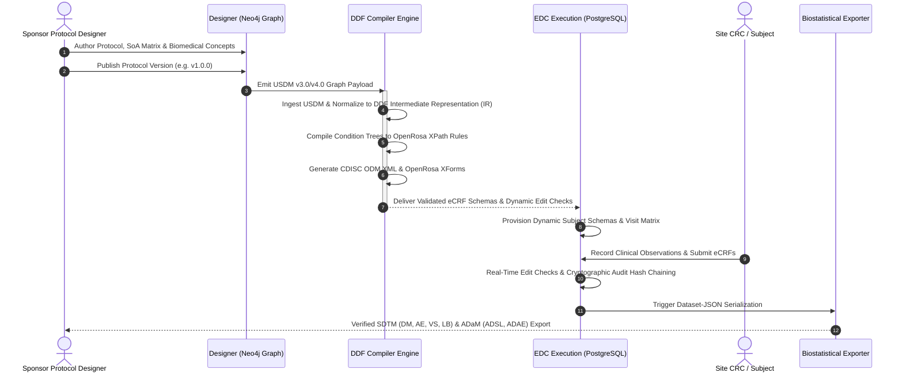

# Cadence Clinical Research Software

> **The Metadata-Driven Clinical Execution Platform.**
> _Unifying Clinical Study Design (MDR/SDR) and Electronic Data Capture (EDC) into an automated Digital Data Flow (DDF)._

[](https://github.com/fderuiter/cadence-clinical/actions/workflows/ci.yml)
[](https://dotnet.microsoft.com/)
[](https://learn.microsoft.com/en-us/dotnet/csharp/)
[](https://learn.microsoft.com/en-us/aspnet/core/)
[](https://vuejs.org/)
[](https://www.cdisc.org/standards/data-exchange/usdm)
[](docs/SDLC/01_Product_Requirements_Document_PRD.md)
[](LICENSE)

---

> [!IMPORTANT]
> **Active Initial Development / Pre-Release Status**
> Cadence Clinical Research Software is currently undergoing **active initial pre-release development** prior to our initial v1.0 General Availability (GA) release. The platform, architecture, and microservices are evolving rapidly.
>
> This repository represents an open-source evaluation sandbox and development environment intended for developers, clinical architects, and trial sponsors to explore automated digital data flows, test CDISC USDM protocol compilation, and evaluate GxP-compliant clinical microservices.
>
> - **Pre-Release Sandbox**: All databases, keycloak realms, and seed datasets provided in local containers are configured for pre-production evaluation with synthetic datasets.
> - **Clinical Pilots & Enterprise Inquiries**: For commercial evaluation, pilot program participation, or production qualification, please visit [ccrsoft.com](https://ccrsoft.com) or consult our [Support Policy](SUPPORT.md) rather than submitting inquiries on the public GitHub tracker.

---

## 📑 Table of Contents

- [Executive Overview](#-executive-overview)
- [Core Architectural Paradigm](#-core-architectural-paradigm)
- [Interactive 6-Persona Golden Path](#-interactive-6-persona-golden-path)
- [System Architecture & Digital Data Flow](#-system-architecture--digital-data-flow)
- [Repository Layout & Module Catalog](#-repository-layout--module-catalog)
- [Developer Experience & Unified Cadence CLI](#-developer-experience--unified-cadence-cli)
- [Developer Quickstart](#-developer-quickstart)
- [Clinical Standards & Regulatory Compliance](#-clinical-standards--regulatory-compliance)
- [Pre-Release Roadmap & Milestones](#-pre-release-roadmap--milestones)
- [CI/CD Quality Gates & Sentinel Enforcement](#-cicd-quality-gates--sentinel-enforcement)
- [Documentation Library](#-documentation-library)
- [Support & Community](#-support--community)
- [License](#-license)

---

## 🚀 Executive Overview

Traditional clinical trials suffer from months of friction, high human error rates, and multi-million dollar overhead caused by manual translation of static narrative protocols into downstream Electronic Data Capture (EDC) databases. When protocols inevitably amend mid-study, clinical teams face brittle database migrations, complex re-consent tracking, and fragmented data silos across Clinical Trial Management Systems (CTMS), safety gateways, and trial master files.

**Cadence Clinical Research Software** is an open-source, next-generation eClinical platform that synthesizes upstream **Clinical Metadata Management (MDR/SDR)** with downstream **Electronic Data Capture (EDC)** into an automated, event-driven **Digital Data Flow (DDF)**.

By treating the clinical study protocol as a machine-readable, version-chained graph model (CDISC USDM), Cadence dynamically compiles study arms, epochs, encounters, and biomedical concepts into executable electronic Case Report Forms (eCRFs), real-time edit checks, and biostatistical export schemas (SDTM/ADaM) with zero manual database restructuring.

---

## 🏛️ Core Architectural Paradigm

Cadence Clinical is structured around three foundational architectural pillars:

```text
 ┌───────────────────────────┐      ┌───────────────────────────┐      ┌───────────────────────────┐
 │   1. MDR/SDR Graph Core   │      │ 2. Digital Data Flow (DDF)│      │  3. EDC Execution Engine  │
 │     (Neo4j + USDM)        │─────►│  (Compiler & IR Engine)   │─────►│   (PostgreSQL + XForms)   │
 └───────────────────────────┘      └───────────────────────────┘      └───────────────────────────┘
   • Protocol Arms & Epochs           • USDM ➔ DDF Intermediate Rep      • Dynamic Subject Schemas
   • Schedule of Activities (SoA)     • XPath Rule Compilation           • Real-Time Edit Checks
   • Biomedical Concepts (BC)         • CDISC ODM & OpenRosa XML         • Medical Coding (MedDRA/WHO)
   • Immutable Graph Branching        • Amendment Impact Assessment      • 21 CFR Part 11 Audit Trail
```

1. **MDR/Designer (Neo4j)**: Upstream study authoring engine managing version-chained CDISC USDM (v3.0/v4.0) protocol graphs. Features deep Biomedical Concept libraries, Schedule of Activities (SoA) matrix design, and non-destructive graph branching for protocol amendments.
2. **Digital Data Flow Compiler (`packages/ddf`)**: Pure domain compiler that ingests USDM graph schemas, produces strongly-typed DDF Intermediate Representations (IR), compiles structured rule condition trees into OpenRosa-compliant XPath expressions, and outputs validated CDISC ODM XML and OpenRosa/Enketo XForm payloads.
3. **EDC Execution Engine (PostgreSQL)**: Downstream high-performance clinical runtime that projects dynamic eCRF schemas per subject protocol version, executes real-time edit checks, automates clinical queries, tracks subject lifecycle state machines, grades lab toxicities (CTCAE v5.0), and generates CDISC Dataset-JSON (SDTM/ADaM) deliverables.

---

## 👥 Interactive 6-Persona Golden Path

Cadence is built around end-to-end clinical role workflows. The web client (`apps/web`) provides role switching across six primary personas to demonstrate authentic clinical data lifecycles:

| Persona                | Clinical Role                 | Primary Workspaces & Responsibilities                                                                                                          | Key GxP Actions                                                                                                                                           |
| :--------------------- | :---------------------------- | :--------------------------------------------------------------------------------------------------------------------------------------------- | :-------------------------------------------------------------------------------------------------------------------------------------------------------- |
| **`sponsor_designer`** | Study Protocol Architect      | • Protocol Designer (`apps/designer`)<br>• Schedule of Activities (SoA) Matrix<br>• Biomedical Concept Library                                 | Authors USDM graph protocols, specifies visit schedules, defines eligibility criteria, and publishes versioned protocol amendments.                       |
| **`site_crc`**         | Clinical Research Coordinator | • Site Execution & eCRF Capture (`apps/execution`)<br>• eConsent Portal (`apps/econsent`)<br>• Participant Financial Wallet (`apps/payments`)  | Verifies 6-facet site greenlight, enrolls subjects, manages re-consent gating, records visit observations, and approves participant expense claims.       |
| **`cra_monitor`**      | Clinical Research Associate   | • CTMS Monitoring Workspace (`apps/ctms`)<br>• eISF Binder Inspector (`apps/eisf`)<br>• Source Data Verification (SDV/TSDV)                    | Performs on-site/remote monitoring, executes 100% SDV / Targeted SDV, verifies investigator delegation logs, and issues protocol deviations.              |
| **`data_manager`**     | Clinical Data Manager         | • Clinical Query & Issue Hub (`apps/tickets`)<br>• Medical Coding Console (MedDRA / WHODrug)<br>• SDTM / ADaM Export Engine (`apps/execution`) | Adjudicates auto-generated edit-check queries, reviews AI-assisted medical coding terms, manages lab reference ranges, and executes database freeze/lock. |
| **`safety_physician`** | Pharmacovigilance Officer     | • Safety & ICSR Gateway (`apps/safety`)<br>• Blinded DICOM Adjudication (`apps/imaging`)<br>• NCI-CTCAE Toxicity Reviewer                      | Reviews Grade 3/4 adverse events, performs blinded RECIST 1.1 tumor adjudication, generates safety narratives, and signs E2B(R3) AS2 XML submissions.     |
| **`auditor`**          | Regulatory QA & Inspector     | • Quality & CAPA Engine (`apps/quality`)<br>• eTMF Archive Inspector (`apps/etmf`)<br>• Cryptographic Audit Trail Explorer                     | Verifies SHA-256 Merkle root digest chains, reviews CAPA root-cause analyses, inspects DIA TMF binders, and validates 100% GxP RTM traceability.          |

---

## 🏛️ System Architecture & Digital Data Flow

### Microservice Topology

Cadence utilizes a reverse-proxy fronted, event-driven microservices topology secured with centralized Keycloak OIDC authentication and HMAC-SHA256 inter-service signatures.

```text
                                  ┌─────────────────────────────────────────────────────────┐
                                  │               Subject Portal (PWA / eCOA)               │
                                  │                  (Vite PWA : Port 5174)                 │
                                  └────────────────────────────┬────────────────────────────┘
                                                               │ (OIDC / PKCE Bearer)
                                                               ▼
  ┌─────────────────────────────┐    ┌──────────────────────────────────────────────────────┐
  │     Web Client SPA          │───►│            Unified API Gateway Proxy                 │
  │    (Vue 3 / Port 5173)      │    │        (ASP.NET Core 10 / YARP : Port 8000)          │
  └─────────────────────────────┘    └─────────────────────────┬────────────────────────────┘
                                                               │ (HMAC Gateway Signatures + Context Headers)
                                ┌──────────────────────────────┼──────────────────────────────┐
                                │                              │                              │
                                ▼                              ▼                              ▼
  ┌───────────────────────────────────┐  ┌───────────────────────────────────┐  ┌───────────────────────────────────┐
  │         Protocol & Design         │  │       Execution & Clinical Ops    │  │       Safety & Quality Assurance  │
  ├───────────────────────────────────┤  ├───────────────────────────────────┤  ├───────────────────────────────────┤
  │ • Designer / USDM (Port 8001)     │  │ • EDC Execution Engine (Port 8002)│  │ • Safety & E2B(R3) (Port 8009)    │
  │ • Knowledge / SOPs (Port 8011)    │  │ • CTMS Operations (Port 8005)     │  │ • Quality & CAPA (Port 8006)      │
  │ • AI Gateway (Port 8013)          │  │ • Payments & Grants (Port 8014)   │  │ • Imaging / RECIST (Port 8015)    │
  │ • Interop / FHIR (Port 8007)      │  │ • Org Directory (Port 8008)       │  │ • eTMF Archive (Port 8004)        │
  │ • Notifications (Port 8010)       │  │ • Clinical Tickets (Port 8012)    │  │ • eISF Site Binders (Port 8016)   │
  │ • eConsent Engine (Port 8017)     │  │ • FileShare / MinIO (Port 8018)   │  │ • Compliance Engine (Port 8019)   │
  └─────────────────┬─────────────────┘  └─────────────────┬─────────────────┘  └─────────────────┬─────────────────┘
                    │                                      │                                      │
                    ▼                                      ▼                                      ▼
  ┌───────────────────────────────────┐  ┌───────────────────────────────────┐  ┌───────────────────────────────────┐
  │         Neo4j Graph DB            │  │        PostgreSQL Relational      │  │         Object & Storage          │
  │   (Versioned USDM Protocol Graph) │  │ (EDC, Audit Ledgers, CTMS, State) │  │  (MinIO / S3 Encrypted Artifacts) │
  └───────────────────────────────────┘  └───────────────────────────────────┘  └───────────────────────────────────┘
```

### Digital Data Flow (DDF) Pipeline



---

## 📁 Repository Layout & Module Catalog

The Cadence monorepo is organized as a unified solution managed with **.NET 10 (`net10.0`)** for all backend microservices, shared domain packages, and developer tooling, and **pnpm** for frontend applications and shared UI packages.

### Layer 1: Protocol Design, Metadata & Intelligence

| Path                  | Microservice             | Description & Primary Responsibilities                                                                                         | Persistence         | Pre-Release Status |
| :-------------------- | :----------------------- | :----------------------------------------------------------------------------------------------------------------------------- | :------------------ | :----------------- |
| **`apps/designer`**   | Study Designer (MDR/SDR) | Graph-based clinical protocol authoring, CDISC USDM v3/v4 representation, SoA matrix builder, and Biomedical Concept library.  | Neo4j 5.0+          | **Supported**      |
| **`apps/knowledge`**  | Knowledge & SOP Engine   | Contextual SOP delivery, dynamic help drawer routing, role-specific clinical guidance, and controlled document versioning.     | PostgreSQL 16+      | **Supported**      |
| **`apps/ai_gateway`** | Clinical AI Gateway      | De-identification air-gap proxy, model routing (Tier 1–3), medical coding embeddings, and Part 11 dual-attribution AI ledgers. | Ephemeral / REST    | **Supported**      |

### Layer 2: Clinical Execution & Site Operations

| Path                 | Microservice           | Description & Primary Responsibilities                                                                                                | Persistence         | Pre-Release Status |
| :------------------- | :--------------------- | :------------------------------------------------------------------------------------------------------------------------------------ | :------------------ | :----------------- |
| **`apps/execution`** | EDC Execution Engine   | Downstream EDC runtime, subject state machines, dynamic eCRF schema projection, real-time edit checks, and Dataset-JSON SDTM export.  | PostgreSQL 16+      | **Supported**      |
| **`apps/ctms`**      | CTMS Operations        | Trial operational tracking, milestone governance, CRA monitoring visit reports, 6-facet site greenlight, and budget matrices.         | PostgreSQL 16+      | **Supported**      |
| **`apps/org`**       | Organization Directory | Global directory of Sponsor/CRO organizations, clinical trial sites, staff credentials, and Principal Investigator DOA logs.          | PostgreSQL 16+      | **Supported**      |
| **`apps/tickets`**   | Clinical Issue Hub     | Discrepancy escalation, data management queries, dual-target SLA timers, and controlled reopening windows.                            | PostgreSQL 16+      | **Supported**      |
| **`apps/payments`**  | Site Payments & Grants | Investigator grant contracts, procedure-fee rule calculations, payee split management, closeout holdbacks, and self-billing invoices. | PostgreSQL 16+      | **Supported**      |

### Layer 3: Patient Engagement & Decentralized Trials

| Path                      | Microservice             | Description & Primary Responsibilities                                                                                                | Persistence            | Pre-Release Status |
| :------------------------ | :----------------------- | :------------------------------------------------------------------------------------------------------------------------------------ | :--------------------- | :----------------- |
| **`apps/subject-portal`** | eCOA / ePRO PWA          | Offline-first Progressive Web App for trial participants. Includes IndexedDB local sync queues and electronic diary capture.          | IndexedDB / Client PWA | **Supported**      |
| **`apps/econsent`**       | Electronic Consent       | Interactive informed consent authoring, dynamic amendment re-consent gating, readability metrics, and digital signature sealing.      | PostgreSQL 16+         | **Supported**      |
| **`apps/notifications`**  | Multi-Channel Dispatcher | Automated patient compliance reminders and high-priority GxP alerts across SMTP Email (Jinja2), SMS, HMAC Webhooks, and In-App inbox. | PostgreSQL 16+         | **Supported**      |
| **`apps/interop`**        | FHIR & eSource Gateway   | SMART on FHIR EHR integration, eSource ingestion drawers, and Open mHealth continuous biometric sensor streaming adapters.            | PostgreSQL 16+         | **Supported**      |

### Layer 4: Clinical Safety, Quality & Regulatory Governance

| Path                 | Microservice                 | Description & Primary Responsibilities                                                                                                         | Persistence               | Pre-Release Status |
| :------------------- | :--------------------------- | :--------------------------------------------------------------------------------------------------------------------------------------------- | :------------------------ | :----------------- |
| **`apps/safety`**    | Safety & Pharmacovigilance   | ICH E2B(R3) ICSR XML compilation, NCI-CTCAE v5.0 lab toxicity grading, WHODrug validation, and B2B AS2 S/MIME regulatory EDI gateway.          | PostgreSQL 16+            | **Supported**      |
| **`apps/quality`**   | Quality & CAPA Engine        | Protocol deviation management, Centralized Statistical Monitoring (CSM forensics / Benford's Law), and 64-bit DCT pHash image fraud detection. | PostgreSQL 16+            | **Supported**      |
| **`apps/imaging`**   | Blinded DICOM Adjudication   | Zero-footprint WebGL Multi-Planar Reconstruction (MPR), blinded dual-reader RECIST 1.1 oncology evaluation, and 20% discordance escalation.    | PostgreSQL 16+            | **Supported**      |
| **`apps/etmf`**      | Electronic Trial Master File | DIA TMF Reference Model v3.2.0 classification, Expected Document Lists (EDLs), completeness indices, and automated QC lifecycle transitions.   | PostgreSQL 16+            | **Supported**      |
| **`apps/eisf`**      | Investigator Site Files      | Site-scoped regulatory binder management, DIA eISF taxonomy inheritance, and PI certification audit manifests.                                 | PostgreSQL 16+            | **Supported**      |
| **`apps/fileshare`** | Object Storage Gateway       | StoragePort abstraction over MinIO/S3, presigned transfer URLs, cryptographic guest links, and 21 CFR Part 11 document envelopes.              | MinIO / S3 & PostgreSQL   | **Supported**      |

### Layer 5: Frontend Workspaces & Gateway Infrastructure

| Path                      | Component                 | Description & Primary Responsibilities                                                                                                         | Technology                     | Pre-Release Status |
| :------------------------ | :------------------------ | :--------------------------------------------------------------------------------------------------------------------------------------------- | :----------------------------- | :----------------- |
| **`apps/web`**            | Clinical Workspace SPA    | High-density clinical workspace supporting all 6 personas, full-width SoA grids, Vanilla CSS semantic tokens, and live role context switching. | Vue 3 + Pinia + Vite           | **Supported**      |
| **`apps/gateway`**        | Central API Gateway Proxy | Unified reverse proxy fronting all microservices, Keycloak OIDC JWT verification, HMAC signature propagation, and aggregated OpenAPI docs.     | ASP.NET Core 10 + YARP + Polly | **Supported**      |
| **`packages/compliance`** | Compliance Test Suite     | Centralized regulatory compliance validation, IQ/OQ/PQ execution suites, and automated 21 CFR Part 11 audit trail assertions.                  | .NET 10 xUnit v3 + Playwright  | **Supported**      |

### Layer 6: Shared Core Packages & SDKs

| Path                        | Package Name                  | Description & Purpose                                                                                                             |
| :-------------------------- | :---------------------------- | :-------------------------------------------------------------------------------------------------------------------------------- |
| **`packages/cli`**          | `Cadence.Cli`                 | Unified developer CLI providing Rich TUI cockpits, auto-healing diagnostics, 21 parallel quality gates, and multi-engine seeding. |
| **`packages/ddf`**          | DDF Compiler Engine           | Pure in-memory domain compiler translating USDM graph models into DDF IR, XPath rules, and CDISC ODM XForms.                      |
| **`packages/security`**     | Cryptography & Security       | HMAC-SHA256 gateway signing (`HmacSigner`), step-up signature verification, and Keycloak JWT validation.                          |
| **`packages/testing`**      | Centralized Test Harness      | Shared domain entity factories (`SubjectFactory`, `AuditLogFactory`), `InMemoryRepository<T>` fakes, and test auth context.      |
| **`packages/storage`**      | StoragePort & Object Envelope | Decoupled S3/MinIO binary storage adapter with relational GxP metadata envelopes and SHA-256 checksum validation.                 |
| **`packages/database`**     | Database Infrastructure       | EF Core 10 PostgreSQL provider, GxP Audit Interceptor (`ISaveChangesInterceptor`), and connection pooling.                        |
| **`packages/deid`**         | De-Identification Engine      | High-performance PII/PHI redaction and tokenization engine for clinical narratives, medical notes, and DICOM metadata.            |
| **`packages/sentinels`**    | Architecture Sentinels        | Sentinel suite checking code duplication, import boundary leaks, ADR schema parity, and Clean Architecture layer purity.         |
| **`packages/ui`**           | Shared UI & Web Components    | Reusable Vanilla CSS components, dialog modals, accessible SoA grid primitives, and browser cryptographic signing utilities.      |
| **`packages/engine_core`**  | Shared Domain & Core Ports    | Foundational clinical abstractions, aggregate roots, GxP auditable interfaces, and domain event dispatchers.                      |
| **`packages/contracts`**    | Cross-Service Contracts       | Strongly-typed service-to-service DTOs, REST API client interfaces, and Polly resilient HTTP client extensions.                   |
| **`packages/tooling_core`** | Tooling & Compliance Engine   | Operational engine powering GxP sync, ADR validation, code duplication analysis, and multi-engine database seeders.               |
| **`packages/hexagonal`**    | Hexagonal Architecture SDK    | Core architectural port and adapter primitives, command/query dispatchers, and domain event interfaces.                           |
| **`packages/core-models`**  | Core Domain Models            | Universal base models, 21 CFR Part 11 GxP audit mixins, and standardized RFC 9457 problem detail representations.                 |

---

## 🛠️ Developer Experience & Unified Cadence CLI

Cadence features a first-class developer CLI (`packages/cli`) built with Spectre.Console, designed to eliminate script fragmentation and provide an interactive terminal development cockpit.

Run all commands using `dotnet cadence` (or `dotnet run --project packages/cli/src/Cadence.Cli.csproj --`):

```text
 ┌──────────────────────────────────────────────────────────────────────────────────────────┐
 │                                 CADENCE CLINICAL DEV TUI                                 │
 ├──────────────────────────────────────────────────────────────────────────────────────────┤
 │ [Gateway:8000] ONLINE  │ [Designer:8001] ONLINE │ [Execution:8002] ONLINE │ [Web] ONLINE │
 │ [Postgres:5432] HEALTH │ [Neo4j:7687] HEALTH    │ [Keycloak:8080] HEALTH  │ [TMF] ONLINE │
 ├──────────────────────────────────────────────────────────────────────────────────────────┤
 │ Logs: [14:32:01] Gateway dispatched GET /api/v1/execution/subjects (200 OK - 18ms)       │
 │ Hotkeys: [r] Restart All  [g] Gateway  [d] Designer  [e] Execution  [w] Web  [q] Quit    │
 └──────────────────────────────────────────────────────────────────────────────────────────┘
```

### Primary CLI Commands

| Task                       | Command                               | Description                                                                                                              |
| :------------------------- | :------------------------------------ | :----------------------------------------------------------------------------------------------------------------------- |
| **Interactive Dev TUI**    | `dotnet cadence dev --tui`            | Launches multi-service interactive cockpit with live streaming logs and hotkey process restarts.                         |
| **System Diagnostics**     | `dotnet cadence doctor --auto-fix`    | Validates host runtimes (.NET 10, Docker, Node), tests database connections, and auto-initializes schemas.               |
| **Quality Gates**          | `dotnet cadence check`                | Executes all 21 architectural sentinels (linters, import boundaries, ADR validator, ArchUnitNET).           |
| **Automated Remediation**  | `dotnet cadence fix --all`            | Auto-remediates C# code formatting (`dotnet format`), aligns schemas, and indexes ADR records.                           |
| **Fast Test Watcher**      | `dotnet cadence test --watch`         | Smart test watcher that re-runs only the minimal subset of tests affected by changed files.                              |
| **Sub-Second Fast Tests**  | `dotnet cadence test --fast`          | Sub-second unit test runner executing against in-memory repository fakes, bypassing database containers.                 |
| **Multi-Engine Seeding**   | `dotnet cadence db seed --tier full`  | Seeds multi-engine clinical test scenarios across Neo4j, PostgreSQL, and MinIO.                                           |
| **GxP Compliance Sync**    | `dotnet cadence gxp sync`             | Executes test suites, regenerates Requirements Traceability Matrix (RTM), and stages GxP documentation.                  |
| **ADR Scaffolding**        | `dotnet cadence scaffold adr "Title"` | Scaffolds a new dated Architecture Decision Record under `docs/adr/` and auto-indexes `docs/adr/index.md`.               |

---

## 🚀 Developer Quickstart

Follow these steps to spin up the entire Cadence Clinical development environment locally.

> **Shortcut**: on a brand-new machine, Codespace, or devcontainer, `make wizard`
> (or `bash scripts/setup_wizard.sh`, Windows: `scripts/setup_wizard.ps1`) runs
> steps 1–3 below for you — .NET 10 SDK, Node/pnpm, Playwright,
> pre-commit hooks, `.env`, and a final `dotnet cadence doctor` health check — and
> adapts to CI/agent sessions automatically. See [CONTRIBUTING.md](CONTRIBUTING.md#1-first-time-setup).

### 1. Prerequisites

Ensure your host machine meets the minimum system requirements:

- **Git & Pre-Commit**: `git` installed with hooks enabled.
- **.NET SDK**: Version `10.0+` (`net10.0`, C# 14).
- **Node.js & pnpm**: Node.js `v20+` LTS and `pnpm v9+`.
- **Container Engine**: Docker Desktop or Docker Engine with Docker Compose v2.

### 2. Launch Containerized Infrastructure

Start the infrastructure dependencies (PostgreSQL, Neo4j, Keycloak, Mailhog, and MinIO) in detached mode:

```bash
docker compose -f docker/docker-compose.yml up -d
```

### 3. Synchronize Dependencies & Run System Doctor

Restore the .NET 10 solution and install all frontend packages:

```bash
# Restore .NET 10 solution dependencies
dotnet restore Cadence.sln

# Install frontend dependencies and link monorepo packages
pnpm install

# Run automated system diagnostics and auto-initialize schemas
dotnet cadence doctor --auto-fix
```

### 4. Seed Multi-Engine Clinical Datasets

Populate the database cluster with realistic CDISC USDM protocols, trial sites, subjects, eCRFs, and audit ledgers:

```bash
dotnet cadence db seed --tier full
```

### 5. Launch the Development Environment

Launch the full interactive terminal cockpit or individual workspaces:

```bash
# Option A: Launch the unified interactive cockpit (Recommended)
dotnet cadence dev --tui

# Option B: Launch web client directly
pnpm --filter web dev
```

Open your browser to:

- **Clinical Web Workspace**: [http://localhost:5173](http://localhost:5173)
- **Subject Portal PWA**: [http://localhost:5174](http://localhost:5174)
- **API Gateway Swagger Docs**: [http://localhost:8000/docs](http://localhost:8000/docs)
- **Keycloak Admin Console**: [http://localhost:8080](http://localhost:8080) (`admin` / `admin`)
- **Neo4j Browser**: [http://localhost:7474](http://localhost:7474) (`neo4j` / `password123`)
- **Mailhog Email Sandbox**: [http://localhost:8025](http://localhost:8025)

---

## ⚖️ Clinical Standards & Regulatory Compliance

Cadence Clinical is engineered from the ground up to satisfy strict global regulatory standards governing electronic records, electronic signatures, clinical trial data integrity, and computerized system validation.

```text
 ┌──────────────────────────────────────────────────────────────────────────────────────────┐
 │                               REGULATORY COMPLIANCE SUITE                                │
 ├──────────────────────────────────────────────────────────────────────────────────────────┤
 │  FDA 21 CFR Part 11      │ • Monotonic SHA-256 HMAC digest audit chaining                │
 │  & EU Annex 11           │ • 60-second step-up signature re-auth tokens (TOTP + Password)│
 │                          │ • Immutable, non-destructible version-chained audit logs      │
 ├──────────────────────────┼───────────────────────────────────────────────────────────────┤
 │  CDISC Clinical          │ • USDM v3.0 / v4.0 Study Definition Model (Graph-native)      │
 │  Data Standards          │ • CDASH v1.4 eCRF variable definitions & metadata mapping     │
 │                          │ • CDISC ODM XML v1.3.2 study definitions and clinical data    │
 │                          │ • Dataset-JSON v1.0.0 biostatistical export (SDTM / ADaM)     │
 ├──────────────────────────┼───────────────────────────────────────────────────────────────┤
 │  ICH Harmonised          │ • ICH GCP E6(R3) Risk-Based Quality Management & CSM          │
 │  Tripartite Guidelines   │ • ICH M11 machine-readable protocol narrative synchronization │
 │                          │ • ICH E2B(R3) Individual Case Safety Reports (ICSR)           │
 ├──────────────────────────┼───────────────────────────────────────────────────────────────┤
 │  DIA Reference Models    │ • DIA TMF Reference Model v3.2.0 (10 canonical zones)         │
 │                          │ • DIA eISF Reference Model for site investigator binders      │
 └──────────────────────────┴───────────────────────────────────────────────────────────────┘
```

- **GxP Audit Trails**: Every mutating transaction captures `CreatedAt`, `CreatedBy`, `ReasonForChange`, `VersionIndex`, and an immutable cryptographic SHA-256 digest chained to the predecessor record via EF Core `SaveChangesInterceptor`.
- **Entity Framework Core 10 & Clean Architecture**: Clean hexagonal microservices with strict layer boundaries enforced at build time via `ArchUnitNET`. Read queries enforce `.AsNoTracking()` to eliminate memory overhead.
- **Automated GxP Traceability (RTM)**: 100% of test cases link directly to requirements via xUnit `[GxPRequirement("PRD-SYS-xxx")]` attributes and `/// @req:` doc comments, verified in CI and synchronized via `dotnet cadence gxp sync`.

---

## 🗺️ Pre-Release Roadmap & Milestones

Our development trajectory is organized into four sequential strategic phases:

```text
  [Phase 0: Core Foundation]  ──►  [Phase 1: Enterprise Suite]  ──►  [Phase 2: Pilot Validation]  ──►  [Phase 3: v1.0 GA]
         (Completed)                     (Active / Current)                 (Upcoming Q4 2026)             (Target 2027)
```

### ✅ Phase 0 — Core Foundation & DDF Engine (Completed)

- [x] USDM v3.0 Neo4j graph data models and relationship versioning.
- [x] PostgreSQL relational EDC runtime with dynamic subject schema projections.
- [x] Pure DDF Intermediate Representation (IR) compiler and OpenRosa XPath rule compiler.
- [x] Centralized Keycloak OIDC reverse-proxy gateway with HMAC-SHA256 request signing.
- [x] Initial Vue 3 single-page application sandbox with Pinia state management.

### 🔄 Phase 1 — Enterprise Multi-Module Suite & CLI (Active / Current Milestone)

- [x] Scaffold and deploy 20+ specialized microservices (CTMS, eTMF, Safety, Quality, Imaging, Payments, Interop).
- [x] Build unified `Cadence.Cli` developer experience (Rich TUI cockpit, doctor, DB seeders, quality gates).
- [x] Implement Centralized Statistical Monitoring (CSM / Benford's Law) and 64-bit DCT pHash image forensics.
- [x] Implement Blinded Dual-Reader RECIST 1.1 adjudication and 20% SOD discordance triggers.
- [x] Implement ICH E2B(R3) AS2 EDI gateway with SHA-256 S/MIME encryption and MDN verification.
- [ ] Route all remaining microservice paths (`apps/org`, `apps/econsent`, `apps/eisf`) through the central gateway dispatch map.
- [ ] Complete full operational CRUD endpoints for Principal Investigator Delegation of Authority in `apps/org`.
- [ ] Finalize the full migration of remaining legacy layout scripts into modular Vue 3 components.

### 🔜 Phase 2 — Multi-Site Clinical Pilot Validation (Upcoming)

- [ ] Multi-center clinical trial simulation and high-concurrency stress testing (>10,000 active eCRFs).
- [ ] Production SMART on FHIR electronic health record (EHR) bidirectional connectors.
- [ ] WHODrug and MedDRA automated dictionary up-versioning engine with impact analytics.
- [ ] Automated DSUR / PSUR aggregate safety report compilation and QPPV electronic sign-off.
- [ ] Multi-echelon RTSM supply optimization with Monte Carlo depot replenishment forecasting.

### 🎯 Phase 3 — v1.0 General Availability & Part 11 Certification (Planned Target)

- [ ] Formal independent 21 CFR Part 11 and EU Annex 11 computer systems validation (CSV/CSA) package.
- [ ] SOC 2 Type II and HIPAA/GDPR security audit certifications.
- [ ] Automated high-availability multi-region Kubernetes deployment helm charts.
- [ ] Public v1.0 General Availability release and enterprise commercial support launch.

---

## ⚙️ CI/CD Quality Gates & Sentinel Enforcement

GitHub Actions (`.github/workflows/ci.yml`) runs on every pull request and every push to `main`. A PR must pass these jobs before merging:

1. **Style and Lint Verification**: `dotnet format --verify-no-changes`, the 21 Cadence quality gates, architecture tests (ArchUnitNET), ADR, Markdown, OpenAPI, schema-doc and traceability checks, code duplication, Hadolint, ShellCheck, CODEOWNERS coverage, the docs build and frontend ESLint/Prettier.
2. **Security and Vulnerability Audit**: static security audit, secret detection, DEID scan and NuGet/npm vulnerability audit.
3. **.NET 10 C# xUnit Verification**: `dotnet build` with warnings as errors, then `dotnet test Cadence.sln`.
4. **Frontend Unit Tests**: Vitest across the pnpm workspace.
5. **GxP Compliance & Qualification Reporting**: regenerates the RTM and IQ/OQ/PQ report with `dotnet cadence gxp sync` and fails if they differ from the committed files.
6. **Check for Merge Conflicts** (`conflict-check.yml`): fails when the PR conflicts with `main`.

Pushes to `main` also run the accessibility E2E suite, the container build and Trivy scan, the production pipeline (uploads the generated GxP reports with SHA-256 checksums as release evidence), the branch ruleset sync and the docs deploy.

The pre-commit hook in `.githooks/` runs the same formatting check and quality gates locally. See [CONTRIBUTING.md](CONTRIBUTING.md#ci-failure-runbook) for how to reproduce each failure.

### Essential Contributor Commands

```bash
# Run all 21 quality gates
dotnet cadence check

# Sync OpenAPI specs and API docs, and validate ADRs
dotnet cadence fix

# Run backend unit test suite
dotnet cadence test --fast

# Regenerate and stage GxP RTM compliance documentation
dotnet cadence gxp sync
```

---

## 📚 Documentation Library

Explore our in-depth architectural specifications, regulatory compliance manuals, and developer guides:

- **[System Architecture Specification](ARCHITECTURE.md)**: Comprehensive service designs, cryptographic boundaries, and data models.
- **[Agent & Contributor Guidelines](AGENTS.md)**: Coding standards, import patterns, and GxP requirements.
- **[Software Requirements Specification (SRS)](docs/SRS.md)**: Authoritative GxP compliance document mapping 21 CFR Part 11 rules.
- **[Feature & Capability Matrix](docs/FEATURE_MATRIX.md)**: Service-by-service breakdown of supported, in-progress, and planned capabilities.
- **[Local Development Environment Guide](docs/LOCAL_DEV_ENVIRONMENT.md)**: Detailed environment setup, port allocations, and container topologies.
- **[Architecture Decision Records (ADRs)](docs/adr/index.md)**: Complete chronological index of architectural decisions and trade-offs.
- **[Product Requirements Document (PRD)](docs/SDLC/01_Product_Requirements_Document_PRD.md)**: Product requirements and domain specifications.

---

## 💬 Support & Community

- **Clinical Pilot & Enterprise Inquiries**: For commercial trials, pilot testing, or GxP qualification, please contact us at [ccrsoft.com](https://ccrsoft.com).
- **Technical Bug Reports**: Please open a GitHub Issue for reproducible software bugs. Ensure no PII/PHI or confidential protocol data is included.
- **Support Policy**: Review our [Support Policy](SUPPORT.md) for full details on support response channels and SLAs.

---

## 📄 License

Cadence Clinical Research Software is licensed under the **ISC License**. See the [LICENSE](LICENSE) file for complete details.
