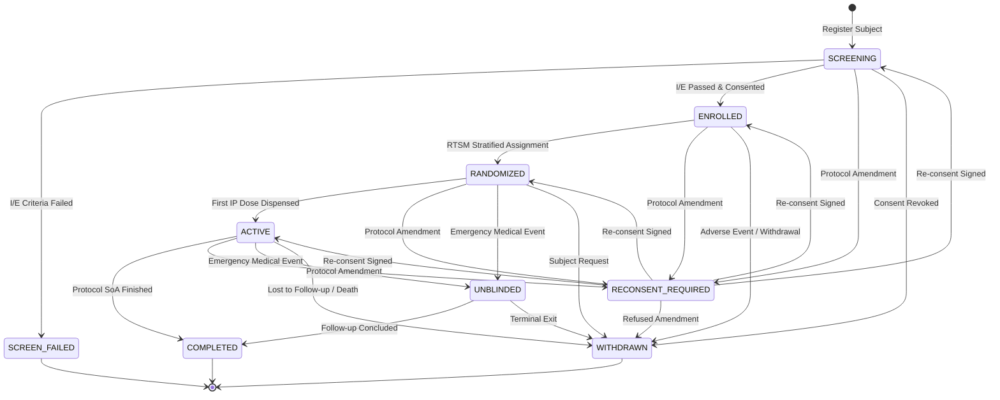
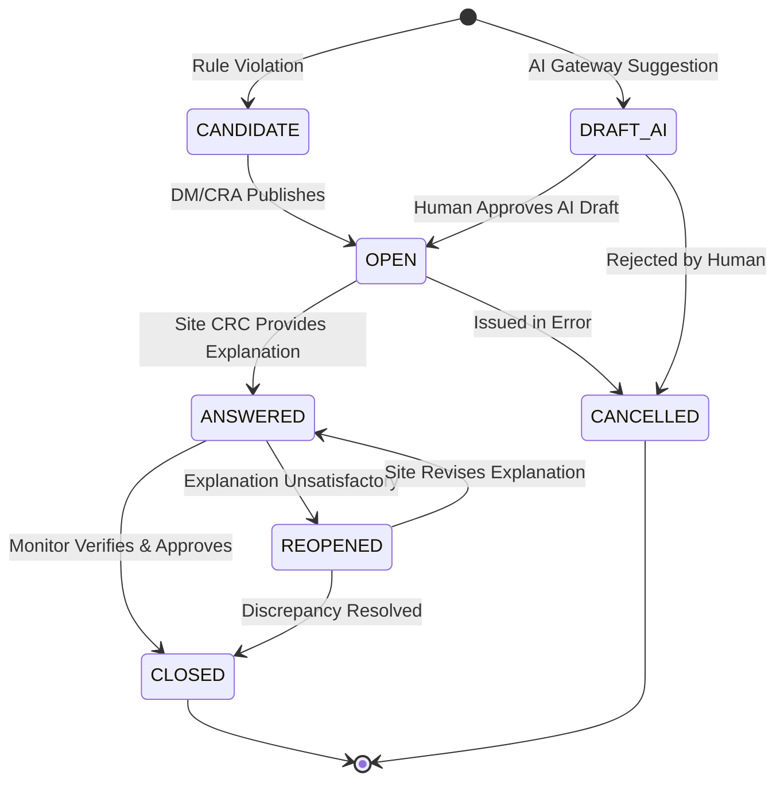

# Product Specification & Functional Requirements Document (FRD)
## Cadence Clinical Research Software Platform

**Document Reference:** CAD-SPEC-FRD-001  
**Version:** 2.0.0-RELEASE  
**Classification:** GxP Validated / Single Source of Functional Truth  
**Target Standards:** FDA 21 CFR Part 11, EU Annex 11, ICH GCP E6(R2/R3), CDISC USDM v3.0/v4.0, CDISC ODM v1.3.2, CDISC Dataset-JSON v1.0.0, ISO 14155:2020, IEC 62304 Class C  

---

## 1. Executive Product Overview & Mission

### 1.1 Core Product Thesis
The clinical research enterprise suffers from a structural breakdown between upstream **Study Protocol Design** and downstream **Clinical Operations**. Clinical trial protocols authored as static documents require months of manual, error-prone translation into Electronic Data Capture (EDC) databases, Clinical Trial Management Systems (CTMS), and safety reporting workflows. This introduces discrepancy risks, protocol deviations, multi-month site activation delays, and costly amendment re-work.

**Cadence Clinical Research Software** is a unified, metadata-driven eClinical architecture that automates the generation of downstream clinical trial infrastructure directly from digitized protocol definitions. It synthesizes upstream **Clinical Metadata Management (MDR)** with downstream **Electronic Data Capture (EDC)**, **Clinical Trial Management (CTMS)**, **Decentralized Clinical Trials (DCT)**, and **Pharmacovigilance (PV)** into an automated **Digital Data Flow (DDF)**. By separating study metadata authoring from transactional execution and connecting them via CDISC USDM (Unified Study Definition Model), Cadence enables continuous, error-free clinical execution, zero-downtime protocol amendments, and end-to-end 21 CFR Part 11 regulatory compliance.

### 1.2 Application Paradigm
Cadence operates as an **Enterprise Multi-Tenant SaaS and On-Premises Qualified Platform**.
- **Data Isolation:** Complete logical tenant and trial isolation. Clinical sites operate under strict geographical and institutional data siloing.
- **Regulatory Paradigm:** Validated under GxP / 21 CFR Part 11 / EU Annex 11 with non-repudiation, dual-attribution AI draft governance, and cryptographic audit chaining.
- **Architectural Topology:** Modular clean-architecture microservices fronted by an API Gateway and Keycloak OpenID Connect (OIDC) identity provider, coordinating via strongly typed REST contracts, transactional outbox messaging, and PostgreSQL/Neo4j datastores.

### 1.3 Primary System Actors

#### Human Actors
1. **Sponsor Clinical Designer (`sponsor_designer`):** Authors study designs, objectives, endpoints, Study Arms, Epochs, Encounters, Biomedical Concepts (BCs), and the Schedule of Activities (SoA) matrix.
2. **Sponsor Administrator (`sponsor_admin`):** Oversees overall study operations, site activation waivers, multi-tenant directory setup, and executive governance.
3. **Data Manager (`data_manager`):** Governs data review, clinical coding (MedDRA / WHODrug), automated and manual query resolution, edit checks, and data lock states.
4. **Site Principal Investigator (`site_investigator` / `PI`):** Clinically responsible for subject safety at a site; screens, enrolls, and randomizes subjects; executes 21 CFR Part 11 electronic signatures on eCRFs and Delegation of Authority (DOA) logs.
5. **Clinical Research Coordinator (`crc`):** Site staff member conducting day-to-day data entry into eCRFs, managing site drug kit inventory, tracking subject visits, and submitting expense claims.
6. **Clinical Research Associate (`cra` / `monitor`):** Performs onsite and remote monitoring, Source Data Verification (SDV), Monitoring Visit Reports (MVR), protocol deviation logging, and site audit preparation.
7. **Safety Physician / Qualified Person for Pharmacovigilance (`safety_physician` / `qppv`):** Conducts adverse event triage, medical causality assessments, ICSR E2B(R3) expedited reporting approvals, and aggregate safety signal detection (DSUR/PBRER).
8. **Blinded / Unblinded Statistician (`unblinded_statistician`, `sponsor_statistician`):** Analyzes interim and final trial results. Unblinded statisticians access treatment allocation codes; blinded statisticians validate SDTM/ADaM datasets.
9. **Clinical Endpoint Committee (CEC) Adjudicator:** Independent medical expert reviewing de-identified clinical dossiers to perform blinded event adjudications (e.g. RECIST 1.1 tumor evaluations, cardiovascular events).
10. **Study Subject / Participant (`subject`):** Trial participant who completes eConsent, submits ePRO symptom diaries via offline-first PWA, manages stipend reimbursements, and views lay summaries.
11. **System Auditor (`auditor` / `tmf_auditor`):** Regulatory inspector or internal quality auditor with read-only access across all ledgers, shadow audit schemas, and cryptographic proofs.

#### Machine / Automated Actors
1. **Cryptographic Sealing Worker:** Recurring background worker executing SHA-256 Merkle chaining across transactional audit records every 60 seconds.
2. **Query SLA Escalation Worker:** Evaluates query acknowledgment and resolution age against defined study SLAs, escalating overdue queries.
3. **Transactional Outbox Worker:** Dispatches staged domain events across microservices with at-least-once delivery guarantees.
4. **Statistical Forensics & Fraud Detection Engine:** Analyzes clinical observations for digit preference (Benford's Law) and multi-variate anomalies (Mahalanobis distance).
5. **Perceptual Image Hash (pHash) Sentinel:** Computes 64-bit DCT perceptual hashes of uploaded medical images to detect cross-subject or cross-site image duplication fraud.
6. **AI Gateway Proxy:** Routes semantic medical coding and narrative summarization tasks across Tier 1–3 model tiers behind a PII/PHI de-identification air-gap.
7. **SMART on FHIR Ingestion Adapter:** Polls external EHR systems to discover clinical observation candidates for CRC reconciliation.

---

## 2. Comprehensive Domain Model & Glossary

### 2.1 Universal Inherited Data Model (GxP Base)
Every persistent entity in the Cadence platform inherits the following universal GxP audit schema:

| Attribute | Data Type | Constraints | Description |
| :--- | :--- | :--- | :--- |
| `id` | UUIDv4 / String(36) | Primary Key | Globally unique entity identifier. |
| `created_at` | DateTime (UTC) | Non-nullable, ISO 8601 | Exact timestamp of record persistence. |
| `created_by` | String(255) | Non-nullable, OIDC Subject | Cryptographic identity (`sub`) of executing user. |
| `reason_for_change` | String(1000) | Non-nullable, Min 10 chars | Clinical or business justification for record creation or mutation. |
| `version_index` | Integer | Non-nullable, Auto-increment $\ge 1$ | Monotonically increasing revision counter. |
| `is_deleted` | Boolean | Non-nullable, Default `FALSE` | Soft-delete flag; records are never physically destroyed in userland. |

### 2.2 Core Entity Glossary

| Entity Name | Domain Subsystem | Operational Definition | Key Attributes | Ownership & Cardinality |
| :--- | :--- | :--- | :--- | :--- |
| **Study** | Designer / MDR | Top-level clinical protocol container defining phases, therapeutic areas, and objectives. | `study_id`, `title`, `phase`, `status`, `usdm_version` | Root entity; 1:N with Arms, Epochs, Visits, Sites. |
| **Biomedical Concept (BC)** | Designer / MDR | Standardized clinical data definition (CDISC USDM) specifying variables, constraints, and data types. | `concept_code`, `name`, `data_type`, `vlm_rules`, `is_locked` | Reusable; M:N with Protocol Elements & Form Items. |
| **Schedule of Activities (SoA)** | Designer / MDR | Structural matrix intersecting Study Encounters (Visits) with Clinical Activities and Biomedical Concepts. | `encounter_id`, `activity_id`, `is_mandatory`, `window_days` | 1:N within Study Protocol. |
| **Protocol Amendment** | Designer / MDR | Formally versioned mutation of an active study definition requiring approval and re-consent tracking. | `amendment_id`, `version_tag`, `status`, `diff_payload`, `effective_date` | 1:N per Study; creates immutable child graph branch. |
| **Clinical Subject** | Execution / EDC | Pseudonymized human participant enrolled in a clinical trial at a specific investigative site. | `subject_id`, `study_id`, `site_id`, `status`, `encrypted_demographics` | Owned by Site; 1:N with Visits, Consents, Observations. |
| **Clinical Visit** | Execution / EDC | Calendar or trigger-based clinical encounter mapped to the protocol Schedule of Activities. | `visit_id`, `subject_id`, `encounter_code`, `scheduled_date`, `status` | Owned by Subject; 1:N with Form Submissions. |
| **eCRF Form Submission** | Execution / EDC | Structured electronic Case Report Form capturing visit observation data. | `form_id`, `visit_id`, `form_definition_id`, `status`, `raw_payload` | Owned by Visit; 1:N with Clinical Observations. |
| **Clinical Observation** | Execution / EDC | Individual atomic data point (e.g. Systolic Blood Pressure) captured within an eCRF. | `observation_id`, `form_id`, `item_code`, `value`, `is_locked`, `sdv_status` | Owned by Form Submission; 1:N with Queries. |
| **Clinical Query** | Execution / EDC | Data clarification discrepancy raised automatically by edit checks or manually by monitors. | `query_id`, `observation_id`, `status`, `query_type`, `message`, `sla_due_date` | M:1 with Observation; 1:N with Query Audit Logs. |
| **RTSM Randomization** | Execution / RTSM | Cryptographically sealed assignment of a subject to a treatment arm and investigational kit. | `randomization_id`, `subject_id`, `treatment_arm`, `kit_number`, `seed_hash` | 1:1 with Subject; immutable once committed. |
| **Site Greenlight Gate** | CTMS / SSU | Multi-factorial readiness validator gating site screening, enrollment, and investigational product release. | `site_id`, `overall_status`, `greenlight_token`, `6_facet_booleans` | 1:1 per Site in Study. |
| **Monitoring Visit (MVR)** | CTMS | Record of CRA site oversight, including source data verification, regulatory binder review, and action items. | `visit_id`, `site_id`, `cra_id`, `visit_type`, `status`, `findings_summary` | Owned by Site; 1:N with Action Items and Findings. |
| **Delegation of Authority (DOA)** | Org / CTMS | Regulatory log defining duties delegated by the Principal Investigator to site staff members. | `site_id`, `personnel_id`, `assigned_roles`, `start_date`, `pi_signature` | Owned by Site; requires 21 CFR Part 11 eSignatures. |
| **eConsent Document** | Electronic Consent | Digitized Informed Consent Form (ICF) presented to subjects with readability metrics and comprehension checks. | `consent_id`, `version_tag`, `flesch_kincaid_score`, `pdf_storage_hash` | 1:N per Study; 1:N with Subject Signatures. |
| **TMF Document** | eTMF | Regulatory artifact classified under the DIA TMF Reference Model v3.2.0 across 10 canonical zones. | `doc_id`, `zone`, `section`, `artifact_code`, `status`, `sha256_hash` | Owned by Study/Site; 1:1 with Storage Envelope. |
| **ISF Document** | eISF | Site-specific regulatory document housed in the site's isolated regulatory binder. | `doc_id`, `site_id`, `eisf_section`, `status`, `etmf_sync_state` | Owned by Site; bidirectionally synced to eTMF. |
| **Safety Case (ICSR)** | Clinical Safety | Individual Case Safety Report capturing adverse events meeting Serious Adverse Event (SAE) criteria. | `case_id`, `subject_id`, `seriousness_criteria`, `expedited_due_date`, `e2b_xml` | Owned by Subject; 1:N with Regulatory Transmissions. |
| **Protocol Deviation** | Quality / CAPA | Non-compliance event with the approved clinical protocol or ICH GCP standards. | `deviation_id`, `site_id`, `severity`, `category`, `status`, `capa_id` | Owned by Study/Site; 1:1 with Root Cause Analysis. |
| **CAPA Record** | Quality / CAPA | Corrective and Preventive Action workflow investigating deviations and systemic quality issues. | `capa_id`, `rca_methodology`, `status`, `effectiveness_outcome` | 1:N with CAPA Action Items; 1:N with Effectiveness Checks. |
| **Imaging Adjudication** | Imaging | Blinded evaluation of radiological scans by independent radiologists using RECIST 1.1 / Lugano criteria. | `adjudication_id`, `series_id`, `reader_id`, `target_lesions`, `overall_response` | M:1 with Imaging Series; triggers tie-breaker on >20% discordance. |
| **Investigational Device** | Device / IVD | Serialized medical device tracking under FDA UDI rules with defect reporting and quarantine states. | `udi_barcode`, `serial_number`, `model_number`, `custody_status`, `quarantine_flag` | Tracked from depot to site to subject. |
| **Participant Wallet** | Payments | Digital financial ledger tracking subject stipends, visit allowances, and OCR receipt reimbursements. | `wallet_id`, `subject_id`, `available_balance`, `ytd_disbursed`, `irs_1099_flag` | 1:1 per Subject; triggers IRS 1099 tracking at $600. |

---

### 2.3 Entity State Lifecycles



#### A. Clinical Subject State Machine
- `SCREENING`: Initial state upon demographics capture. Allowed exits: `SCREEN_FAILED`, `ENROLLED`, `WITHDRAWN`, `RECONSENT_REQUIRED`.
- `ENROLLED`: Subject satisfies all protocol Inclusion/Exclusion criteria and has signed eConsent. Allowed exits: `RANDOMIZED`, `WITHDRAWN`, `RECONSENT_REQUIRED`.
- `RANDOMIZED`: Cryptographic randomization algorithm has allocated a treatment group and initial kit. Stratification factors become permanently immutable. Allowed exits: `ACTIVE`, `WITHDRAWN`, `UNBLINDED`, `RECONSENT_REQUIRED`.
- `ACTIVE`: Subject is actively receiving investigational treatment and undergoing SoA encounters. Allowed exits: `COMPLETED`, `WITHDRAWN`, `UNBLINDED`, `RECONSENT_REQUIRED`.
- `UNBLINDED`: Emergency or planned code-break has exposed treatment allocation. Requires 60-second step-up re-authentication, medical monitor justification, and generates safety alerts. Allowed exits: `COMPLETED`, `WITHDRAWN`, `RECONSENT_REQUIRED`.
- `RECONSENT_REQUIRED`: Intermediate holding state triggered by protocol amendments. Soft-locks downstream data capture until the subject signs the amended ICF.
- Terminal States: `SCREEN_FAILED`, `COMPLETED`, `WITHDRAWN` (immutable; cannot transition further).

#### B. Clinical Discrepancy (Query) Lifecycle


#### C. eTMF Document Quality Control (QC) Lifecycle
```
[DRAFT] ---> (Initial Upload & Metadata Tagging)
   |
   v
[TECHNICAL_QC] ---> (Automated File Integrity, Virus Scan & Rendition Check)
   |  \
   |   +---> [REJECTED] (Corrupt file, wrong format, failed antivirus)
   v
[CLINICAL_QC] ---> (Document Quality Reviewer inspects DIA taxonomy & legibility)
   |  \
   |   +---> [REJECTED] (Missing pages, wrong metadata classification)
   v
[APPROVED] ---> (Verified, counts toward Expected Document List completeness)
   |
   v
[SIGNED] ---> (Certificate-bound 21 CFR Part 11 Electronic Signature applied)
   |
   v
[ARCHIVED] ---> (Permanent retention lock; legal hold prevents purging)
```

#### D. Quality Deviation & CAPA Lifecycle
- **Deviation:** `REPORTED` $\rightarrow$ `UNDER_ASSESSMENT` $\rightarrow$ `CLOSED_NO_CAPA` or `CAPA_REQUIRED` $\rightarrow$ `CAPA_INITIATED` $\rightarrow$ `CLOSED`.
- **CAPA Workflow:** `INITIATED` $\rightarrow$ `RCA_IN_PROGRESS` (5-Whys / Fishbone) $\rightarrow$ `PLANNING` $\rightarrow$ `PENDING_APPROVAL` $\rightarrow$ `IN_EXECUTION` $\rightarrow$ `EFFECTIVENESS_CHECK` $\rightarrow$ `CLOSED` (or `REOPENED` if ineffective).

---

## 3. Exhaustive Feature & Capability Catalog

### 3.1 Subsystem 1: Protocol Design & Clinical Metadata Repository (MDR)

#### 1. CDISC USDM Protocol Graph Authoring
* **Actor(s):** Sponsor Clinical Designer, Sponsor Admin.
* **Functional Description:** Enables graphical and schema-driven authoring of clinical protocol architectures, including study arms, epochs (Screening, Treatment, Follow-up), encounters, and activities conforming to CDISC USDM v3.0/v4.0.
* **Inputs & Triggers:** REST payloads specifying protocol elements, arms, encounters, and transitions; or USDM JSON import.
* **Underlying Logic & Business Rules:** Stored natively as a connected property graph in Neo4j. Prevents orphan nodes; enforces acyclic epoch sequences and valid epoch-to-encounter relationships.
* **System Side Effects:** Emits graph mutation events; updates study draft version index.
* **Error States:** Rejects invalid references with RFC 7807 problem details (HTTP 400); blocks cyclical epoch loops.

#### 2. Biomedical Concepts (BC) & Value-Level Metadata (VLM)
* **Actor(s):** Sponsor Clinical Designer, Data Manager.
* **Functional Description:** Standardizes clinical data elements (e.g. CDISC BC for Vital Signs) with value-level validation rules (ranges, units, controlled terminology).
* **Inputs & Triggers:** Creation/editing of BC nodes with variable definitions and UCUM unit bindings.
* **Underlying Logic & Business Rules:** Value-Level Metadata constraints automatically propagate down to generated eCRF input definitions. When a study is in `ACTIVE` execution, instantiated BCs are locked from breaking edits.
* **System Side Effects:** Propagates schema constraints to downstream DDF compilation jobs.
* **Error States:** Mutation of a locked, in-use BC without a formal amendment triggers `IN_USE_LOCK_ERROR` (HTTP 423).

#### 3. Schedule of Activities (SoA) Matrix Synthesis
* **Actor(s):** Sponsor Clinical Designer.
* **Functional Description:** Generates the cross-sectional operational matrix defining which clinical activities occur at which encounters, visit windows (target days $\pm$ tolerance), and mandatory/optional flags.
* **Inputs & Triggers:** Encounter-to-Activity association commands.
* **Underlying Logic & Business Rules:** Computes visit window calculations ($T_{\text{target}} \pm \Delta_{\text{days}}$); ensures baseline activities precede investigational dosing.
* **System Side Effects:** Automatically compiles downstream EDC visit schedules and participant calendar projections.

#### 4. Semantic Protocol Amendment Diffing & In-Use Locks
* **Actor(s):** Sponsor Clinical Designer, Data Manager, Sponsor Admin.
* **Functional Description:** Manages version branches of study metadata. Provides semantic graph diffs highlighting added visits, modified forms, and discontinued procedures between Protocol Version $N$ and $N+1$.
* **Inputs & Triggers:** Executing `/api/v1/designer/studies/{id}/amend`.
* **Underlying Logic & Business Rules:** Branches graph nodes via `PREVIOUS_VERSION` edges. Enforces in-use locks: existing patient data locked to Version $N$ remains intact while new visits project from Version $N+1$.
* **System Side Effects:** Notifies CTMS and EDC; marks affected enrolled subjects as `RECONSENT_REQUIRED`.

#### 5. Complex Trial Designs (Adaptive, Basket, Umbrella, Platform)
* **Actor(s):** Sponsor Clinical Designer, Unblinded Statistician.
* **Functional Description:** Supports dynamic cohort opening/closing, crossover arms, response-adaptive randomization (RAR), and multi-sub-study platform master protocols.
* **Inputs & Triggers:** Statistical interim analysis signals triggering cohort expansion or arm cessation.
* **Underlying Logic & Business Rules:** Uses PostgreSQL transaction-level advisory locks (`key: 42010`) to coordinate cohort transition rules hermetically across cluster nodes.

---

### 3.2 Subsystem 2: Electronic Data Capture (EDC) & eCRF Execution Runtime

#### 6. Dynamic Subject Schema Projection
* **Actor(s):** Site CRC, Principal Investigator, Monitor.
* **Functional Description:** Renders subject-specific eCRF forms reflecting the precise protocol amendment version the subject is currently assigned to, preventing historical data invalidation.
* **Inputs & Triggers:** Navigation to subject visit data entry screen.
* **Underlying Logic & Business Rules:** Resolves subject `active_protocol_version`; projects eCRF layout from compiled USDM/ODM AST without migrating historical observation keys.
* **System Side Effects:** Reads data using `.AsNoTracking()` to eliminate persistence connection overhead.

#### 7. Real-Time Clinical Edit Checks & Dynamic Skip Logic
* **Actor(s):** Site CRC, Data Manager.
* **Functional Description:** Evaluates univariate and multivariate validation rules client-side and server-side during data entry (e.g. Diastolic BP must not exceed Systolic BP; Pregnancy test mandatory for females of childbearing potential).
* **Inputs & Triggers:** Form field value changes and form submission payloads.
* **Underlying Logic & Business Rules:** Evaluates XPath/JSONPath logic trees. Distinguishes between Hard Stops (blocks form commit) and Soft Flags (permits commit but generates candidate discrepancy queries).
* **System Side Effects:** Auto-generates `ClinicalQuery` records in `CANDIDATE` state if discrepancies persist upon submit.

#### 8. 21 CFR Part 11 Electronic Signatures & Step-Up Authentication
* **Actor(s):** Principal Investigator, Sub-Investigator.
* **Functional Description:** Executes legally binding digital signatures on eCRF casebooks, visit forms, and protocol deviations.
* **Inputs & Triggers:** PI submits e-signature request with credentials.
* **Underlying Logic & Business Rules:** Requires 60-second step-up re-authentication token (`sig_token`) obtained via re-entering password + TOTP. Binds user identity, UTC timestamp, and regulatory intent statement ("I certify that the entries herein are true and accurate").
* **System Side Effects:** Generates an immutable cryptographic signature manifest; transitions form state to `SIGNED`; increments `version_index`.
* **Error States:** Expired or replayed `sig_token` returns `401 Unauthorized` with security audit logging.

#### 9. Granular Entity Leases & Soft-Locking
* **Actor(s):** Site CRC, Data Manager.
* **Functional Description:** Prevents concurrent write collisions during live eCRF data entry by acquiring a short-lived lease on the active form.
* **Inputs & Triggers:** Form edit initiation in browser.
* **Underlying Logic & Business Rules:** Leases expire after 5 minutes of inactivity unless refreshed via heartbeat. If User A holds the lease, User B receives a read-only lock banner.
* **System Side Effects:** Writes lease metadata to Redis / PostgreSQL ephemeral cache.

---

### 3.3 Subsystem 3: Subject Operations & Randomization (RTSM)

#### 10. Subject Screening, Enrollment & I/E Evaluation
* **Actor(s):** Site CRC, Principal Investigator.
* **Functional Description:** Captures candidate demographics, checks eligibility against Inclusion/Exclusion criteria, and assigns unique subject identification numbers.
* **Inputs & Triggers:** Submission of Screening eCRF with I/E checklist.
* **Underlying Logic & Business Rules:** Automated parser verifies all Inclusion criteria are `TRUE` and all Exclusion criteria are `FALSE`. Any failure transitions subject to `SCREEN_FAILED` and blocks enrollment.
* **System Side Effects:** Increments site screening metrics; logs immutable audit trail.

#### 11. Stratified Permuted Block & Dynamic Minimization Randomization
* **Actor(s):** Principal Investigator, Automated RTSM Engine.
* **Functional Description:** Allocates enrolled subjects to treatment arms based on pre-configured stratification factors (e.g. Age Group, Biomarker Status, Geographic Region).
* **Inputs & Triggers:** PI clicks "Randomize Subject" with verified eligibility.
* **Underlying Logic & Business Rules:** Executes stratified permuted block algorithm or Pocock-Simon dynamic minimization. Commits allocation under database transaction; locks stratification factors permanently against subsequent modification.
* **System Side Effects:** Assigns treatment group and initial blinded kit number; transitions state to `RANDOMIZED`; publishes RTSM allocation event.
* **Error States:** Attempted re-randomization or editing stratification factors raises `LOCKED_FACTOR_MUTATION` (HTTP 422).

#### 12. Emergency Code-Break (Unblinding) Protocol
* **Actor(s):** Principal Investigator, Safety Physician.
* **Functional Description:** Reveals the blinded treatment allocation of a subject in life-threatening medical emergencies.
* **Inputs & Triggers:** Unblind request with mandatory clinical justification and PI step-up re-authentication.
* **Underlying Logic & Business Rules:** Immediately exposes active drug/placebo identity to the requesting clinician; sets `is_unblinded = TRUE`; transitions subject to `UNBLINDED`.
* **System Side Effects:** Dispatches high-priority alerts to the Sponsor Medical Monitor and Safety Directorate; logs unblinding audit record with IP address and timestamp.

---

### 3.4 Subsystem 4: Query Discrepancy & Medical Data Review

#### 13. Multi-Channel Query Generation & Triaging
* **Actor(s):** Data Manager, CRA Monitor, System Edit Checks.
* **Functional Description:** Raises, routes, and manages queries on clinical observation data points.
* **Inputs & Triggers:** Failed edit checks (system) or manual discrepancy identification by monitors.
* **Underlying Logic & Business Rules:** Queries are tagged by category (Field Validation, Missing Data, SAE Inconsistency, Protocol Deviation) and assigned dual-target SLAs (Acknowledgment SLA vs. Resolution SLA).
* **System Side Effects:** Notifies site CRC via in-app alerts and notifications dispatcher.

#### 14. Query Escalation & SLA Background Monitor
* **Actor(s):** Automated Background Worker (`key: 42002`).
* **Functional Description:** Continuously monitors unresolved queries against study SLA thresholds.
* **Inputs & Triggers:** Runs every 60 minutes.
* **Underlying Logic & Business Rules:** If query age exceeds Level 1 SLA (e.g. 5 days without response), auto-escalates to Lead CRC. If age exceeds Level 2 SLA (e.g. 10 days), escalates to PI and CRA.
* **System Side Effects:** Updates query `escalated_at` timestamp; triggers automated notification escalation emails.

#### 15. Controlled Reopening Window Enforcement
* **Actor(s):** Data Manager.
* **Functional Description:** Allows reopening a previously closed query within a strict 14-day regulatory window if subsequent data entry contradicts the prior resolution.
* **Inputs & Triggers:** Reopen request with mandatory 21 CFR Part 11 justification.
* **Underlying Logic & Business Rules:** Reopening beyond the 14-day window requires Data Management Director sign-off.
* **System Side Effects:** Appends record to `TicketAuditLog` and updates state to `REOPENED`.

---

### 3.5 Subsystem 5: Medical Coding & Terminology Governance

#### 16. MedDRA & WHODrug Automated Semantic Coding
* **Actor(s):** Data Manager, AI Gateway Proxy.
* **Functional Description:** Codes verbatim medical terms reported for Adverse Events (`AETERM`), Medical History (`MHTERM`), and Concomitant Medications (`CMTRT`) into standard regulatory hierarchies.
* **Inputs & Triggers:** Ingestion of eCRF observation containing un-coded verbatim terms.
* **Underlying Logic & Business Rules:** Executes exact and synonym matching against loaded dictionary tables (MedDRA: LLT, PT, HLT, HLGT, SOC; WHODrug: Medicinal Product, Active Ingredient, ATC Code). If confidence score $\ge 0.95$, auto-assigns code; otherwise stages for manual review.
* **System Side Effects:** Writes to `ClinicalCodingAssignment`; marks coding status as `CODED` or `NEEDS_REVIEW`.

#### 17. Dictionary Up-Versioning & Impact Assessment
* **Actor(s):** Data Manager.
* **Functional Description:** Manages transitions to new versions of MedDRA (bi-annual) or WHODrug.
* **Inputs & Triggers:** Import of new dictionary release archive.
* **Underlying Logic & Business Rules:** Executes background impact analysis identifying previously coded terms whose Preferred Term (PT) or hierarchy mapping changed in the new version.
* **System Side Effects:** Generates a recoding discrepancy ledger; preserves historical version tags for auditability.

---

### 3.6 Subsystem 6: Study Startup (SSU) & Greenlight Site Activation

#### 18. 6-Facet Automated Site Greenlight Evaluator
* **Actor(s):** Sponsor Admin, CRA Monitor, System Engine.
* **Functional Description:** Evaluates whether a clinical site has satisfied all prerequisites to open for recruitment and receive investigational product.
* **Inputs & Triggers:** Verification of startup milestones or manual Greenlight audit trigger.
* **Underlying Logic & Business Rules:** Evaluates 6 distinct operational facets:
  1. `facet_regulatory_irb`: Institutional Review Board / Ethics Committee approval granted.
  2. `facet_cta_budget`: Clinical Trial Agreement and budget executed.
  3. `facet_eisf_baseline`: Essential documents (Form 1572, FDF, CVs) verified in eISF.
  4. `facet_doa_log`: Delegation of Authority log signed by PI.
  5. `facet_staff_training`: Protocol curricula and GCP training certified for all delegated staff.
  6. `facet_ip_release`: Qualified Person (QP) investigational product release authorized.
* **System Side Effects:** When all 6 evaluate to `TRUE`, generates an HMAC-signed `greenlight_token`; unlocks site in EDC and RTSM for subject screening.
* **Error States:** Screening attempts at a non-greenlit site return `403 Forbidden` (`SITE_NOT_GREENLIT`).

#### 19. Executive Dual-Signature GxP Override
* **Actor(s):** Sponsor Executive, Medical Director.
* **Functional Description:** Authorizes conditional site activation when a non-safety-critical facet is pending (e.g. minor administrative document pending).
* **Inputs & Triggers:** Dual-signature override submission with legal/clinical justification.
* **Underlying Logic & Business Rules:** Requires separate credentialed sign-offs from both the Sponsor Clinical Lead and Medical Monitor.
* **System Side Effects:** Sets `is_overridden = TRUE`; issues conditional `greenlight_token`; flags site on all audit dashboards.

---

### 3.7 Subsystem 7: CTMS Site Operations & Monitoring

#### 20. CRA Monitoring Visit Reports (MVR) & SDV Workflows
* **Actor(s):** CRA Monitor, Principal Investigator.
* **Functional Description:** Documents onsite and remote monitoring visits (Pre-Study, Site Initiation, Interim Monitoring, Close-Out), tracks Source Data Verification (SDV) percentages, and logs follow-up findings.
* **Inputs & Triggers:** CRA drafts and submits an MVR.
* **Underlying Logic & Business Rules:** Tracks SDV flags at the observation level. Enforces review lifecycle: `SCHEDULED` $\rightarrow$ `IN_PROGRESS` $\rightarrow$ `REPORT_DRAFTED` $\rightarrow$ `PENDING_PI_SIGNOFF` $\rightarrow$ `FINALIZED`.
* **System Side Effects:** Auto-converts unaddressed MVR findings into trackable action items; archives finalized report to eTMF.

#### 21. Risk-Based Quality Management (RBQM) & KRI Engine
* **Actor(s):** Quality Lead, Study Manager.
* **Functional Description:** Computes Key Risk Indicators (KRIs) across sites (e.g. Adverse Event under-reporting rate, query resolution velocity, protocol deviation rate, lost-to-follow-up frequency).
* **Inputs & Triggers:** Scheduled nightly aggregation.
* **Underlying Logic & Business Rules:** Computes site $Z$-scores relative to global trial means; flags sites exceeding $\pm 2\sigma$ or $\pm 3\sigma$ risk thresholds.
* **System Side Effects:** Adjusts site risk profiles; triggers targeted SDV sampling adjustments.

---

### 3.8 Subsystem 8: Regulatory eTMF & eISF Document Management

#### 22. DIA TMF Reference Model v3.2.0 Ingestion & Expected Document Lists (EDLs)
* **Actor(s):** Document Manager, TMF Specialist, Auditor.
* **Functional Description:** Archives trial regulatory documents into 10 canonical zones (Trial, Central/Local Ethics, Regulatory, Investigator, IP, Safety, Committees, Third Party, Data Management, Statistics).
* **Inputs & Triggers:** Document upload via direct presigned S3 transfer or automated cross-app dispatch.
* **Underlying Logic & Business Rules:** Evaluates uploaded artifacts against study/site Expected Document Lists (EDLs); dynamically calculates completeness percentages per milestone (e.g. Site Activation EDL, LPI EDL, Database Lock EDL).
* **System Side Effects:** Writes to `TMFAuditLog`; computes SHA-256 binary hash.

#### 23. eISF Site Isolation & Bidirectional eTMF Synchronization
* **Actor(s):** Site CRC, Principal Investigator, Sponsor TMF Manager.
* **Functional Description:** Provides clinical sites with an isolated electronic Investigator Site File binder while automatically synchronizing sponsor-relevant artifacts (e.g. signed 1572, CVs, IRB approvals) to the master eTMF.
* **Inputs & Triggers:** Document published in eISF.
* **Underlying Logic & Business Rules:** Strict site-isolation barrier ensures Site A cannot view Site B documents; sponsor-approved documents propagate to eTMF with synchronization receipts.
* **System Side Effects:** Creates linked `ISFDocument` and `TMFDocument` records.

---

### 3.9 Subsystem 9: Digital Informed Consent (eConsent)

#### 24. ICF Compilation & Flesch-Kincaid Readability Scoring
* **Actor(s):** Sponsor Designer, Regulatory Affairs.
* **Functional Description:** Authoring tool for informed consent documents with automated readability validation.
* **Inputs & Triggers:** ICF text authoring and template assembly.
* **Underlying Logic & Business Rules:** Analyzes sentence length and polysyllabic word count to compute the Flesch-Kincaid Grade Level score. Warns if readability exceeds 8th-grade reading level (IRB/FDA standard).
* **System Side Effects:** Stores versioned `ConsentDocument` template with score metadata.

#### 25. Subject Comprehension Verification & Signature Manifestation
* **Actor(s):** Subject, Legally Authorized Representative (LAR), Investigator.
* **Functional Description:** Presents interactive consent clauses, administers comprehension quizzes, and executes Part 11 signatures.
* **Inputs & Triggers:** Subject reviews document, answers quizzes, and signs via touchscreen/biometric input.
* **Underlying Logic & Business Rules:** Enforces 100% correct answers on mandatory comprehension questions before enabling signature capture. Generates cryptographic signature block embedding user ID, timestamp, and IP address.
* **System Side Effects:** Generates flattened, tamper-evident PDF; archives copy to eISF and eTMF; transitions subject to `ENROLLED`.

#### 26. Dynamic Protocol Amendment Re-Consent Gating
* **Actor(s):** Automated Engine, Subject.
* **Functional Description:** Automatically identifies active subjects impacted by a protocol amendment that modifies risks, procedures, or visit schedules.
* **Inputs & Triggers:** Publication of approved Protocol Amendment.
* **Underlying Logic & Business Rules:** Sets subject `status = RECONSENT_REQUIRED`; soft-locks subsequent eCRF visit data entry until the amended ICF is signed.
* **System Side Effects:** Sends multi-channel alerts to subject and CRC.

---

### 3.10 Subsystem 10: Pharmacovigilance & AS2 Regulatory Gateway

#### 27. ICH E2B(R3) ICSR XML Compilation
* **Actor(s):** Safety Officer, Medical Monitor.
* **Functional Description:** Compiles Serious Adverse Event (SAE) data into regulatory XML conforming strictly to ISO 27953-2 / ICH E2B(R3) specifications.
* **Inputs & Triggers:** SAE confirmed or expedited reporting triggered.
* **Underlying Logic & Business Rules:** Validates mandatory E2B data elements (Patient Characteristics, Reaction Details, Suspect Drug, De-challenge/Re-challenge, Reporter Details). Evaluates reporting timelines:
  - **Fatal / Life-Threatening SUSAR:** $\le 7$ calendar days.
  - **Serious Non-Fatal / Non-Life-Threatening SUSAR:** $\le 15$ calendar days.
* **System Side Effects:** Generates schema-validated E2B(R3) XML payload.

#### 28. B2B AS2 Secure Regulatory Transmission Gateway
* **Actor(s):** Safety Regulatory Gateway (Automated).
* **Functional Description:** Transmits ICSR packages directly to regulatory health authorities (FDA FAERS, EMA EudraVigilance, PMDA) via AS2 protocol.
* **Inputs & Triggers:** Execution of safety transmission job.
* **Underlying Logic & Business Rules:** Encrypts payload with recipient's public key (RSA-2048 / SHA-256 S/MIME); signs with sponsor private certificate; awaits synchronous Message Disposition Notification (MDN) with matching cryptographic digest.
* **System Side Effects:** Logs transaction to `AS2TransmissionAuditLog`; attaches MDN receipt to safety case.

#### 29. Aggregate Safety Compilation (DSUR / PBRER)
* **Actor(s):** Qualified Person for Pharmacovigilance (QPPV), Biostatistician.
* **Functional Description:** Compiles periodic aggregate safety reports (Development Safety Update Reports).
* **Inputs & Triggers:** Annual or semi-annual DSUR reporting window trigger.
* **Underlying Logic & Business Rules:** Aggregates cumulative patient exposure (patient-years); cross-tabulates Serious Adverse Reactions by MedDRA SOC and PT; evaluates against Reference Safety Information (RSI).
* **System Side Effects:** Creates immutable regulatory dataset snapshot; requires QPPV electronic signature.

---

### 3.11 Subsystem 11: Medical Imaging & Blinded DICOM Adjudication

#### 30. Zero-Footprint WebGL MPR DICOM Viewer
* **Actor(s):** Radiologist, CEC Adjudicator, Medical Monitor.
* **Functional Description:** High-performance browser-based viewing of CT, MRI, and PET scans supporting Multi-Planar Reconstruction (axial, sagittal, coronal views), window/level adjustment, and calibration measurement.
* **Inputs & Triggers:** Opening an imaging evaluation session.
* **Underlying Logic & Business Rules:** Streamed directly from S3/MinIO via presigned transfer URLs; renders entirely client-side using WebGL/Canvas; eliminates local client data caching of PHI.

#### 31. Blinded Dual-Reader RECIST 1.1 Oncology Adjudication
* **Actor(s):** Independent Radiologists (Reader 1, Reader 2), Adjudication Chair.
* **Functional Description:** Blinded dual-reader assessment of baseline and follow-up oncology scans measuring target lesions, non-target lesions, and new lesions.
* **Inputs & Triggers:** Radiologists log lesion measurements and categorical responses.
* **Underlying Logic & Business Rules:** Computes Sum of Diameters (SOD) percentage change:
  - **Complete Response (CR):** Disappearance of all target lesions.
  - **Partial Response (PR):** $\ge 30\%$ decrease in SOD from baseline.
  - **Progressive Disease (PD):** $\ge 20\%$ increase in SOD over smallest recorded nadir (plus absolute increase $\ge 5\text{ mm}$).
  - **Stable Disease (SD):** Neither PR nor PD.
* **Automated Escalation:** If Reader 1 and Reader 2 exhibit categorical discordance or $> 20\%$ difference in SOD, the system automatically escalates the case to the Adjudication Chair (Reader 3 / Tie-breaker).
* **System Side Effects:** Exports verified adjudication endpoints directly into CDISC SDTM `CE` domain.

---

### 3.12 Subsystem 12: Centralized Statistical Monitoring (CSM) & Fraud Forensics

#### 32. Benford's Law Digit Preference Forensics
* **Actor(s):** Quality Auditor, Central Statistical Monitor.
* **Functional Description:** Evaluates clinical numeric observations across investigative sites to detect data fabrication or human rounding bias.
* **Inputs & Triggers:** Scheduled statistical surveillance run.
* **Underlying Logic & Business Rules:** Tests leading and trailing digits of laboratory, vital sign, and pharmacokinetic measurements against Benford's Law distribution ($P(d) = \log_{10}(1 + 1/d)$) using Chi-Square goodness-of-fit and Mean Absolute Deviation (MAD).
* **System Side Effects:** Sites exceeding MAD threshold ($> 0.015$) are flagged with `ForensicsAnomalyFlag.DIGIT_PREFERENCE`; auto-generates Quality Deviations.

#### 33. Mahalanobis Multivariate Outlier Detection
* **Actor(s):** Central Statistical Monitor.
* **Functional Description:** Detects multivariate anomalies across correlated clinical measurements (e.g. unnatural pairings of Blood Pressure, Heart Rate, and Weight).
* **Inputs & Triggers:** Nightly statistical surveillance run.
* **Underlying Logic & Business Rules:** Computes Mahalanobis distance $D_M(x) = \sqrt{(x - \mu)^T \Sigma^{-1} (x - \mu)}$. Identifies records deviating significantly ($p < 0.001$) from site and study covariance matrices.
* **System Side Effects:** Flags potential fabrication; routes dossier to Central Monitoring Review.

#### 34. Perceptual Image Hash (pHash) Duplicate Scan Fraud Detection
* **Actor(s):** System Forensic Sentinel (Automated).
* **Functional Description:** Detects duplicate or re-used medical scans (X-rays, ultrasounds, ECG strips, photos) uploaded across different visits, subjects, or sites.
* **Inputs & Triggers:** Ingestion of binary image files.
* **Underlying Logic & Business Rules:** Computes a 64-bit Discrete Cosine Transform (DCT) perceptual hash. Compares new hash against historical hash index using Hamming distance.
* **Threshold:** A Hamming distance $\le 5$ bits indicates image reuse/fraud.
* **System Side Effects:** Immediately soft-locks the observation; triggers high-priority security alert to Quality Director; logs finding in `DataIntegrityFindingRecord`.

---

### 3.13 Subsystem 13: Clinical AI Gateway & Privacy Air-Gap

#### 3.13.1 Three-Tier Model Routing & De-Identification Air-Gap
* **Actor(s):** Platform Microservices (Internal).
* **Functional Description:** Centralized AI proxy that routes NLP, summarization, and coding prompts across tiered language models while sanitizing sensitive data.
* **Underlying Logic & Business Rules:**
  - **Tier 1 (Local SLM):** On-premises / zero-network models for high-throughput, latency-sensitive tasks.
  - **Tier 2 (Fast Cloud LLM):** Cost-effective cloud models for document classification and extraction.
  - **Tier 3 (Frontier Model):** Complex medical reasoning, protocol digitization, and narrative synthesis.
  - **Privacy Air-Gap:** Automatically strips PII/PHI (names, dates of birth, MRNs, site names), substituting reversible surrogate tokens (`[SURROGATE_SUBJ_01]`) before outbound network transmission, and re-hydrating tokens on return.

#### 3.13.2 21 CFR Part 11 Dual-Attribution AI Draft Ledgers
* **Actor(s):** AI Gateway, Reviewing Human Clinician.
* **Functional Description:** Governs generative AI outputs (e.g. draft safety narratives, proposed query resolutions, auto-coded terms).
* **Underlying Logic & Business Rules:** AI-generated records are committed in the intermediate state `DRAFT_AI`. AI outputs are legally prohibited from becoming official clinical data until a credentialed human user explicitly reviews, edits, and signs off with a 21 CFR Part 11 electronic signature.
* **System Side Effects:** Preserves dual-attribution audit history: records both the AI model generator and the human approving authority.

---

### 3.14 Subsystem 14: Site Financials, Investigator Grants & Participant Wallet

#### 35. Automated Procedure-Fee Grant Triggers & 10% Holdback
* **Actor(s):** Sponsor Financial Manager, Site Billing Coordinator.
* **Functional Description:** Automatically calculates payable investigator grants driven by clinical trial execution events.
* **Inputs & Triggers:** eCRF visit completion and CRA Source Data Verification (SDV).
* **Underlying Logic & Business Rules:** Maps completed eCRF procedures against the site's executed `ProcedurePaymentGrid`. Calculates multi-party payee splits (e.g. 70% Institution, 30% PI PC).
* **Statutory Holdback:** Automatically withholds exactly 10.0% into `HoldbackReserveModel`, released only upon final study close-out, query resolution, and database lock.
* **System Side Effects:** Creates self-billing invoices; logs transaction in `PaymentAuditLogModel`.

#### 36. Participant Stipend Wallet & Mobile Receipt OCR Reimbursement
* **Actor(s):** Subject, Site CRC, Sponsor Financial Lead.
* **Functional Description:** Mobile wallet allowing trial subjects to receive visit stipends, travel allowances, and submit expense receipts.
* **Inputs & Triggers:** Visit completion event or subject receipt upload.
* **Underlying Logic & Business Rules:** OCR extracts receipt date, vendor, and amount; matches against allowable expense policies (meals, parking, rideshare).
* **Tax Compliance:** Automatically tracks year-to-date disbursements per participant; flags accounts exceeding the $600 IRS Form 1099 reporting threshold.
* **System Side Effects:** Dispatches funds via ACH or digital debit card; generates EU CTR 536/2014 lay receipts.

---

### 3.15 Subsystem 15: Interoperability, EHR (FHIR) & Sensor Streams

#### 37. SMART on FHIR eSource Ingestion & CRC Review Drawer
* **Actor(s):** Site CRC, Hospital EHR System.
* **Functional Description:** Ingests clinical data directly from hospital Electronic Health Records (Epic, Cerner) conforming to USCDI / HL7 FHIR standards.
* **Inputs & Triggers:** Scheduled or manual FHIR pull for consented subjects.
* **Underlying Logic & Business Rules:** Maps FHIR Resources (`Observation`, `Condition`, `MedicationStatement`) to CDASH eCRF fields. Presents data in a split-screen review drawer allowing the CRC to accept data into draft eCRFs with 1-click verification.
* **System Side Effects:** Preserves FHIR provenance URI; logs CRC acceptance signature.

#### 38. Continuous Biometric Sensor Telemetry Streaming
* **Actor(s):** Connected Sensor, Patient.
* **Functional Description:** Ingests high-frequency time-series telemetry (heart rate, SpO2, accelerometer, continuous glucose) via Open mHealth adapters.
* **Inputs & Triggers:** Sensor telemetry data packets.
* **Underlying Logic & Business Rules:** Aggregates time-series into daily summary records (`SensorDailySummaryRecord`). Evaluates safety thresholds (e.g. sustained heart rate $> 130\text{ bpm}$ or SpO2 $< 88\%$); auto-drafts safety alert notifications.
* **System Side Effects:** Writes to `SensorTelemetryStreamRecord` and notifies site coordinator.

---

### 3.16 Subsystem 16: Supply Chain, Temperature Excursions & Cell/Gene Therapy (CGT) RTSM

#### 39. Predictive Resupply Forecasting & Drug Stability Budgets
* **Actor(s):** Supply Chain Manager, Depot Coordinator.
* **Functional Description:** Monitors site investigational product inventory, predicts kit stock-outs based on screening velocity, and tracks drug stability budgets.
* **Inputs & Triggers:** Visit scheduling and inventory depletion events.
* **Underlying Logic & Business Rules:** Computes Mean Kinetic Temperature (MKT) from continuous data logger readings. Automatically decrements the lot's stability budget upon temperature excursions.
* **System Side Effects:** Auto-generates `TransferOrder` for depot resupply; flags compromised kits as `QUARANTINED`.

#### 40. Cell and Gene Therapy (CGT) Vein-to-Vein Chain of Custody
* **Actor(s):** Apheresis Nurse, Cell Processing Lab, Infusion Specialist.
* **Functional Description:** End-to-end chain of custody tracking for autologous and personalized cellular therapies.
* **Inputs & Triggers:** Collection, transit, manufacturing release, thaw, and infusion milestones.
* **Underlying Logic & Business Rules:** Enforces mandatory dual-nurse bedside verification via biometric or two-factor authentication prior to cellular product infusion.
* **System Side Effects:** Generates immutable `CGTChainOfCustody` log and destruction certificates for unused aliquots.

---

### 3.17 Subsystem 17: Biostatistical Repository (CDR) & Export Engine

#### 41. CDISC SDTM & ADaM Dataset-JSON 1.0.0 Generation
* **Actor(s):** Biostatistician, Data Manager.
* **Functional Description:** Extracts, maps, and serializes clinical execution data into regulatory submission formats conforming to CDISC Dataset-JSON 1.0.0, SAS Transport (XPT v5), and ODM-XML.
* **Inputs & Triggers:** Export wizard execution.
* **Underlying Logic & Business Rules:** Generates canonical SDTM domains (DM, AE, VS, LB, MH, CM, CE) and ADaM analysis datasets (ADSL, ADAE, ADVS). Enforces strict CDISC Controlled Terminology validation before committing export snapshots.
* **System Side Effects:** Logs export event to `BiostatExport`; generates SHA-256 manifest hash for FDA eCTD Module 5 submission.

---

### 3.18 Subsystem 18: Clinical Issue Hub & Tickets

#### 42. Functional Queue Routing & Dual-Target SLA Escalations
* **Actor(s):** Site CRC, CRA, Data Manager, System Administrator.
* **Functional Description:** In-application issue tracking system handling operational inquiries, technical software defects, and protocol deviations.
* **Inputs & Triggers:** Ticket creation in frontend or system generation.
* **Underlying Logic & Business Rules:** Routes tickets to functional queues based on category (EDC, RTSM, eTMF, Lab, Protocol). Enforces dual SLAs:
  - **Acknowledgment SLA:** Time to assign ticket and initiate review.
  - **Resolution SLA:** Time to provide validated clinical or technical resolution.
* **System Side Effects:** Automatically reassigns and escalates overdue tickets.

---

### 3.19 Subsystem 19: Clinical SOP Knowledge Hub & Contextual Help

#### 43. Persona-Route Specificity SOP Dispatcher
* **Actor(s):** All Platform Users.
* **Functional Description:** Contextual help drawer providing instant access to validated Standard Operating Procedures (SOPs) and clinical protocols based on current user context.
* **Inputs & Triggers:** User clicks "Help" or encounters an error banner.
* **Underlying Logic & Business Rules:** Matches active route pattern (`/ecrf`, `/ssu`, `/safety`) and user role (`site_investigator`, `cra`) against a hierarchical specificity scoring algorithm to present the most relevant SOP document version.
* **System Side Effects:** Logs SOP access history in compliance ledgers.

---

### 3.20 Subsystem 20: Decentralized Clinical Trials (DCT) & Telehealth

#### 44. Telehealth Clinical Encounters & Direct-to-Patient (DTP) Shipments
* **Actor(s):** Investigator, Patient, Mobile Home Health Nurse.
* **Functional Description:** Facilitates remote clinical trial visits via WebRTC encrypted telehealth and coordinates direct-to-patient drug delivery.
* **Inputs & Triggers:** Remote visit scheduling.
* **Underlying Logic & Business Rules:** Direct-to-patient drug shipments require temperature logger verification and subject digital signature confirmation upon courier handover.
* **System Side Effects:** Records `TelehealthSessionRecord` and `DTPShipmentRecord`.

---

### 3.21 Subsystem 21: Medical Device & IVD Investigation Suite

#### 45. FDA UDI Tracking, Deficiencies & RTSM Quarantine
* **Actor(s):** Site Coordinator, Medical Device Specialist, CRA.
* **Functional Description:** Governs investigational medical devices under ISO 14155 and FDA Unique Device Identification (UDI) regulations.
* **Inputs & Triggers:** UDI 2D barcode scan upon device receipt, assignment, or malfunction.
* **Underlying Logic & Business Rules:** Captures device deficiencies (malfunctions, use errors, inadequate labeling). Malfunctions with adverse event potential trigger automatic RTSM inventory quarantine across all sites sharing that manufacturing lot.
* **System Side Effects:** Updates `DeviceQuarantineRecord`; alerts study safety officer.

---

### 3.22 Subsystem 22: Plain-Language Lay Summaries (EU CTR 536/2014)

#### 46. Public Clinical Lay Summary Portal
* **Actor(s):** Trial Participant, Public, Sponsor Communications Lead.
* **Functional Description:** Publishes plain-language, non-promotional trial results to trial participants and the public, complying with EU Clinical Trials Regulation 536/2014.
* **Inputs & Triggers:** Publication of approved lay summary.
* **Underlying Logic & Business Rules:** Completely public (no authentication required); verifies reading level; presents aggregated endpoint findings, demographics, and safety outcomes without technical jargon.

---

### 3.23 Subsystem 23: Centralized Audit Trail & Cryptographic Ledger

#### 47. 21 CFR Part 11 Monotonic SHA-256 Audit Chaining
* **Actor(s):** Automated Sealer Worker (`key: 42001`).
* **Functional Description:** Cryptographically chains and seals transactional audit log records to guarantee non-repudiation and detect database-level tampering.
* **Inputs & Triggers:** Scheduled every 60 seconds.
* **Underlying Logic & Business Rules:** Recalculates block hashes using the monotonic chaining formula:
  $$\text{Block\_Hash}_n = \text{SHA256}(\text{Block\_Data}_n \parallel \text{Block\_Hash}_{n-1})$$
  If any block hash does not match, or if a block in the sequence is missing, the system transitions to a read-only GxP-Lock state and dispatches critical security alerts.

#### 48. Database-Level Soft-Delete & Shadow Schema Interception
* **Actor(s):** Database Engine (PostgreSQL Triggers / EF Core Interceptor).
* **Functional Description:** Completely prevents physical row purging from the database.
* **Inputs & Triggers:** Execution of any SQL `DELETE` statement.
* **Underlying Logic & Business Rules:** Database triggers (`BEFORE DELETE`) intercept delete operations, cancel the purge, and divert the pre-delete row state into an isolated `shadow` audit schema with timestamp and executing role.

---

### 3.24 Subsystem 24: Cross-App Event Spine & Transactional Outbox

#### 49. Transactional Outbox Event Relay
* **Actor(s):** Outbox Background Worker (`key: 42003`).
* **Functional Description:** Implements the Transactional Outbox pattern across microservices to guarantee atomic database updates and event emission.
* **Inputs & Triggers:** Outbox table polling.
* **Underlying Logic & Business Rules:** Mutating business logic writes entity state and an outbox event in the same ACID transaction. The outbox worker polls unsent events, acquires a PostgreSQL advisory lock, and dispatches to consumer queues with at-least-once delivery.
* **System Side Effects:** Ensures zero data loss and cross-service eventual consistency.

---

## 4. Role & Permissions Matrix (RBAC / ABAC)

| Functional Capability | Unauthenticated Guest | Study Subject | Site CRC | Site PI | CRA Monitor | Data Manager | Sponsor Designer | Safety Physician | Statistician | System Auditor | Sponsor Admin |
| :--- | :---: | :---: | :---: | :---: | :---: | :---: | :---: | :---: | :---: | :---: | :---: |
| **View Public Lay Summaries** | ✅ | ✅ | ✅ | ✅ | ✅ | ✅ | ✅ | ✅ | ✅ | ✅ | ✅ |
| **Submit ePRO Diaries (Offline)** | ❌ | ✅ | ❌ | ❌ | ❌ | ❌ | ❌ | ❌ | ❌ | ❌ | ❌ |
| **Manage Participant Wallet** | ❌ | ✅ | View Only | ❌ | ❌ | ❌ | ❌ | ❌ | ❌ | ❌ | Full Access |
| **Author Protocol & USDM Graph** | ❌ | ❌ | ❌ | ❌ | ❌ | Read-Only | Full Access | ❌ | Read-Only | Read-Only | Full Access |
| **Screen & Enroll Subjects** | ❌ | ❌ | Full Access | Full Access | Read-Only | Read-Only | ❌ | ❌ | ❌ | Read-Only | Read-Only |
| **Enter eCRF Observation Data** | ❌ | ❌ | Full Access | Full Access | Read-Only | Read-Only | ❌ | ❌ | ❌ | Read-Only | ❌ |
| **Execute 21 CFR Part 11 eSignatures** | ❌ | eConsent Only | ❌ | Full Access | ❌ | ❌ | Amendment Only | ICSR Only | ❌ | ❌ | Full Access |
| **Perform Source Data Verification (SDV)** | ❌ | ❌ | ❌ | ❌ | Full Access | ❌ | ❌ | ❌ | ❌ | Read-Only | Read-Only |
| **Raise & Close Clinical Queries** | ❌ | ❌ | Answer Only | Answer Only | Full Access | Full Access | ❌ | Safety Only | ❌ | Read-Only | Full Access |
| **Medical Coding (MedDRA/WHODrug)** | ❌ | ❌ | ❌ | ❌ | ❌ | Full Access | Read-Only | Consult | ❌ | Read-Only | Full Access |
| **Emergency Randomization Unblinding**| ❌ | ❌ | ❌ | Emergency | ❌ | ❌ | ❌ | Emergency | Unblinded Only| Read-Only | ❌ |
| **Manage Greenlight Site Startup** | ❌ | ❌ | Read-Only | Read-Only | Verify Facets| Read-Only | ❌ | ❌ | ❌ | Read-Only | Full Access |
| **Adjudicate Blinded Imaging (CEC)**| ❌ | ❌ | ❌ | ❌ | ❌ | ❌ | ❌ | Adjudicator | ❌ | Read-Only | Read-Only |
| **Transmit AS2 E2B(R3) Safety ICSR**| ❌ | ❌ | ❌ | ❌ | ❌ | ❌ | ❌ | Full Access | ❌ | Read-Only | Read-Only |
| **Export SDTM/ADaM Datasets** | ❌ | ❌ | ❌ | ❌ | ❌ | Full Access | Read-Only | ❌ | Full Access | Read-Only | Full Access |
| **Inspect System & Shadow Audit Logs**| ❌ | ❌ | ❌ | ❌ | ❌ | ❌ | ❌ | ❌ | ❌ | Full Access | Full Access |

---

## 5. Automated, Asynchronous & Background Operations

| Job / Routine Name | Trigger / Cadence | Subsystem / Service | Functional Objective | Impacted Entities |
| :--- | :--- | :--- | :--- | :--- |
| **Audit Log Cryptographic Sealing** | Every 60 seconds (Advisory Lock `42001`) | Execution Engine | Recalculates SHA-256 Merkle chain across unsealed audit events; seals blocks and flags ledger tampering. | `AuditLog`, `AuditLedgerSeal` |
| **Query SLA Escalation Monitor** | Every 60 minutes (Advisory Lock `42002`) | Tickets / Execution | Evaluates query age against study SLA parameters; auto-escalates overdue queries to Lead CRC, CRA, and PI. | `ClinicalQuery`, `TicketAuditLog` |
| **Transactional Outbox Event Relay** | Continuous polling (Advisory Lock `42003`) | Platform Spine (All apps) | Relays staged integration events to consumer message brokers with at-least-once delivery guarantees. | `IntegrationOutbox` |
| **Cohort Feasibility Evaluation** | Event-driven / On-demand (Lock `42010`) | Designer / RTSM | Runs Monte Carlo simulations evaluating adaptive trial cohort opening, arm dropping, and RAR allocation boundaries. | `AdaptiveTrialConfig`, `DoseCohortState` |
| **Central Statistical Monitoring (CSM)** | Daily (02:00 UTC cron) | Quality Service | Executes Benford's Law Chi-Square and Mahalanobis multivariate anomaly detection across site observations. | `StatisticalForensicsRun`, `SiteForensicsRecord` |
| **Document Intelligence Classifier** | Event-driven upon file ingestion | eTMF Service | OCR extracts text; machine learning model classifies document against DIA TMF Reference Model taxonomy. | `TMFDocument`, `ExpectedDocument` |
| **eConsent Archival Compiler** | Event-driven upon subject sign-off | Electronic Consent | Flattens signed ICF, generates SHA-256 certificate manifest, and dispatches archival copies to eISF and eTMF. | `ConsentDocument`, `EtmfArchivalDelivery` |
| **Continuous Sensor Telemetry Ingestion**| Sub-minute streaming | Interoperability | Ingests wearable sensor time-series data; aggregates daily metrics and raises alerts on safety threshold breaches. | `SensorTelemetryStreamRecord`, `SensorSafetyAlertRecord` |
| **Predictive Resupply Forecasting** | Nightly (03:00 UTC cron) | Execution / RTSM | Analyzes site screening rates and drug shelf-life to generate automated depot-to-site transfer orders. | `PredictiveResupplyForecast`, `TransferOrder` |
| **Media Transcoding Worker** | Event-driven upon media upload | FileShare Service | Transcodes patient interview audio and telemedicine video recordings into standardized, web-streamable MP4/HLS formats. | `FileRecordModel`, `PlaybackAuditLogModel` |
| **Antivirus Scanner Engine** | Event-driven upon file commit | FileShare Service | ClamAV engine scans uploaded binary streams before transitioning storage envelopes to `COMMITTED`. | `FileRecordModel` (Virus scan status) |

---

## 6. External Integrations & Boundary Exchanges

| External Capability | Protocol / Format | Direction | Functional Payload & Trigger |
| :--- | :--- | :--- | :--- |
| **Identity Provider (OIDC/IAM)** | OAuth 2.0 / OIDC (JWT) | Inbound / Bidirectional | Authenticates user credentials, validates MFA, provides user roles/claims, and issues 60s step-up tokens. |
| **Hospital EHR Systems** | SMART on FHIR / HL7 REST | Inbound | Polls `Condition`, `Observation`, and `MedicationStatement` resources to populate eSource review drawers. |
| **Regulatory Health Gateways** | AS2 / EDI / ISO 27953-2 XML | Outbound / Bidirectional | Transmits ICH E2B(R3) ICSR safety cases to FDA FAERS, EMA EudraVigilance, PMDA; receives synchronous MDN receipts. |
| **Medical Terminology Dictionaries**| Flat File / ASCII Ingestion | Inbound | Imports authoritative MedDRA (MSSO) and WHODrug (Uppsala Monitoring Centre) dictionary releases. |
| **Object Storage Sinks** | S3 API / Presigned HTTPS | Bidirectional | Direct browser-to-storage binary upload/download for eCRF attachments, medical imaging DICOMs, and eTMF files. |
| **Multi-Channel Dispatchers** | SMTP (Jinja2) / SMS / Webhooks | Outbound | Sends email notifications, SMS compliance alerts, and HMAC-signed external webhooks for study events. |
| **Payment Processors / Banking** | NACHA ACH / ISO 20022 REST | Outbound | Dispatches direct deposit stipend disbursements to patient wallets and site bank accounts. |
| **Biometric Sensor Gateways** | Open mHealth / Bluetooth API | Inbound | Telemetry streams from continuous glucose monitors, pulse oximeters, and actigraphy wearables. |

---

## 7. Core End-to-End User Journeys

### Journey 1: Digital Protocol Design to Downstream Execution Activation
1. **Authoring:** Sponsor Designer logs into Cadence Designer (`/mdr`), selects study, and authors Study Arms, Epochs, and Encounters.
2. **Concept Mapping:** Designer drags Biomedical Concepts (e.g. Vital Signs, Adverse Events) onto the Schedule of Activities (SoA) matrix and sets visit tolerance windows.
3. **Validation:** Designer runs the Protocol Quality Sentinel; system validates graph connectivity and USDM compliance.
4. **Digitization & Export:** DDF Compiler transforms the Neo4j USDM graph into intermediate representation (IR) and compiles eCRF definitions into the PostgreSQL Execution Engine.
5. **Readiness:** Site CRC logs into `/ecrf`; the new study forms are immediately ready for dynamic schema projection without manual database schema creation.

### Journey 2: Site Startup, 6-Facet Greenlight, and First Subject Ingestion
1. **Startup Governance:** Sponsor Admin inspects Site 101 on the SSU dashboard (`/ssu`).
2. **Facet Verification:** System checks: IRB approval documented (✅), CTA executed (✅), Form 1572 in eISF (✅), PI signed DOA log (✅), staff training complete (✅), and IP received (✅).
3. **Certification:** System generates cryptographic `greenlight_token`; unlocks site in EDC and RTSM.
4. **Subject Screening:** CRC registers Subject 101-001; captures demographics.
5. **eConsent:** Subject reads ICF on tablet, completes comprehension quiz, and executes electronic signature. System archives signed PDF to eISF/eTMF.
6. **I/E Verification:** CRC completes Inclusion/Exclusion checklist; system confirms eligibility.
7. **Randomization:** PI clicks "Randomize Subject" and enters step-up credentials; RTSM executes stratified permuted block algorithm, assigns Treatment Arm A and Kit #4021; subject transitions to `RANDOMIZED`.

### Journey 3: Clinical Data Entry, Discrepancy Query, and CRA Verification
1. **Data Entry:** CRC enters Visit 1 vital signs (Systolic: 120, Diastolic: 130).
2. **Edit Check Trigger:** System edit check flags Diastolic > Systolic; creates `ClinicalQuery` in `CANDIDATE` state.
3. **Data Manager Review:** Data Manager reviews candidate query and clicks "Publish"; query becomes `OPEN`.
4. **Site Correction:** CRC receives alert, inspects source document, and updates Diastolic to 80 with reason "Transposition error in source note".
5. **Query Resolution:** Query transitions to `ANSWERED`.
6. **Monitoring:** CRA arrives on site, reviews source electronic health record against eCRF, and verifies data. CRA approves query resolution (`CLOSED`) and signs off on observation Source Data Verification (`SDV_COMPLETED`).

### Journey 4: Emergency Pharmacovigilance & Expedited ICSR Regulatory Reporting
1. **SAE Occurrence:** Subject 101-001 experiences anaphylaxis post-infusion; admitted to ICU.
2. **Event Capture:** CRC records Adverse Event in eCRF; marks "Serious: Life-Threatening / Hospitalization".
3. **Emergency Unblinding:** PI navigates to `/ecrf`, initiates code-break, provides medical rationale, and enters step-up signature. System unblinds subject (Arm A - Active Drug).
4. **Safety Triage:** Safety Physician receives immediate alert, reviews case in PV workbench (`/safety`), verifies causality as "Related", and marks case as SUSAR.
5. **XML Compilation:** System compiles ISO 27953-2 E2B(R3) XML; calculates 7-calendar-day expedited regulatory deadline.
6. **AS2 Dispatch:** B2B AS2 Gateway transmits encrypted package to FDA FAERS and EMA EudraVigilance; receives and validates synchronous MDN receipt; transitions case to `TRANSMITTED_VERIFIED`.

### Journey 5: Protocol Amendment, Semantic Diff, and Subject Re-Consent
1. **Protocol Revision:** Sponsor amends study to add an exploratory biomarker blood draw at Visit 3.
2. **Branching:** Designer branches protocol to Version 2.0.0; adds procedure to SoA.
3. **Diff Analysis:** System generates semantic diff highlighting new blood draw; updates ICF template.
4. **Execution Release:** Amendment is published. Enrolled active subjects are automatically transitioned to `RECONSENT_REQUIRED`.
5. **Site Alert:** Site 101 is notified; Visit 3 data capture for enrolled subjects is soft-locked.
6. **Re-Consent:** Subject attends Visit 3, signs amended ICF on tablet. Subject state returns to `ACTIVE`; Visit 3 biomarker eCRF unlocks for CRC data entry.
