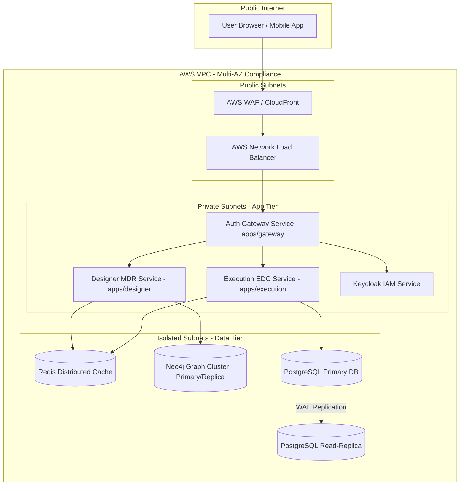
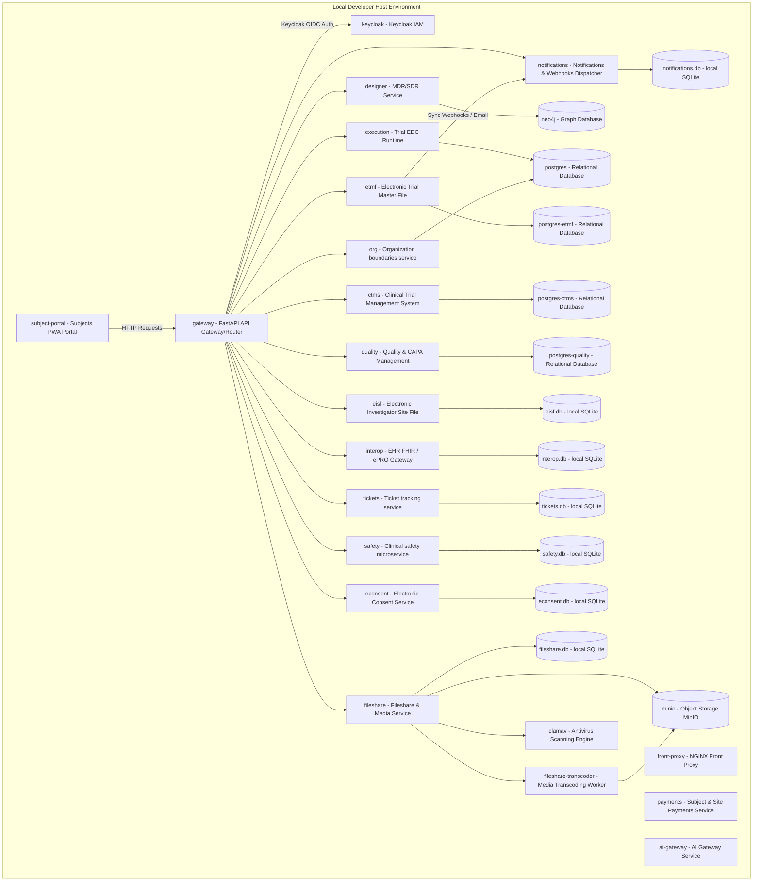
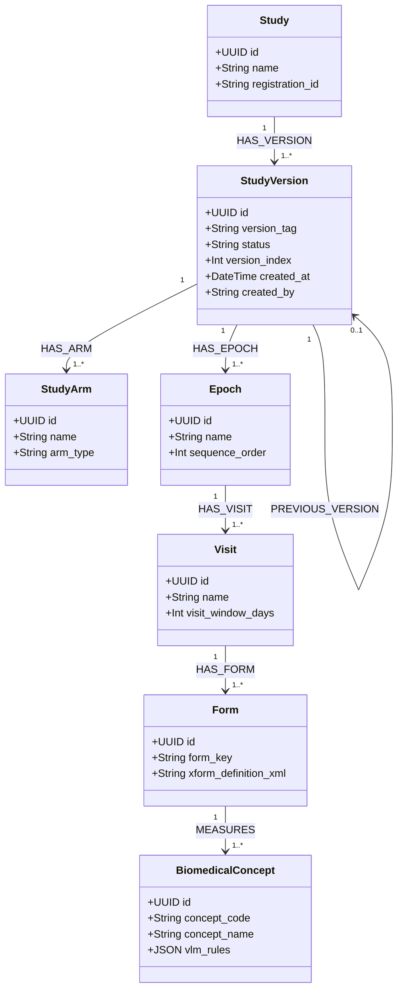
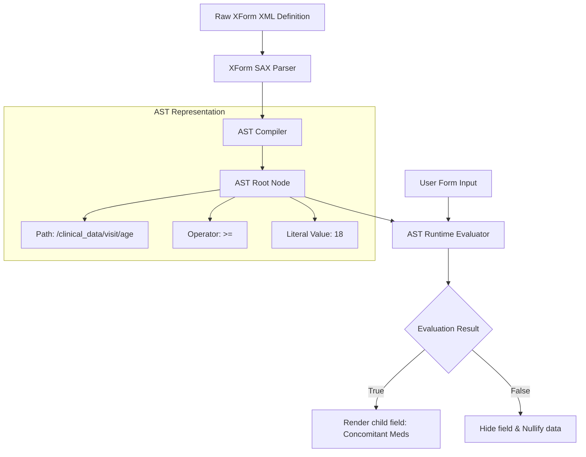
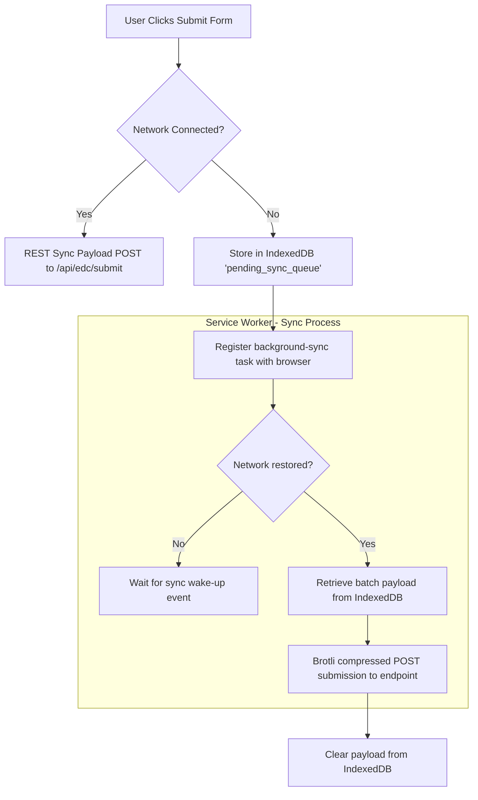
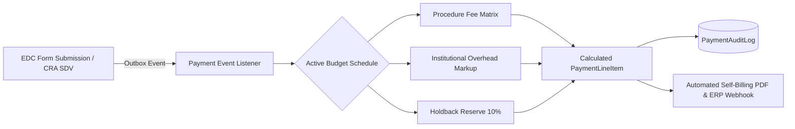
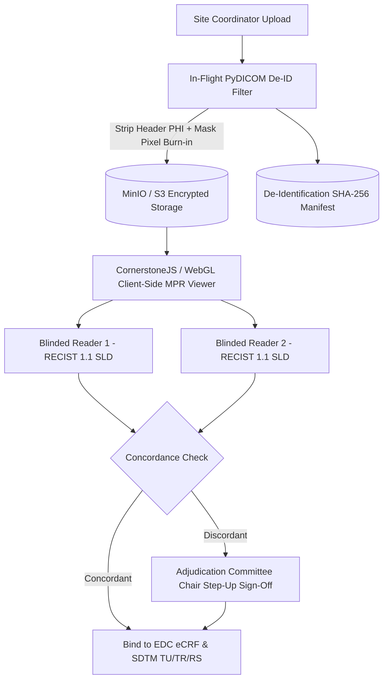
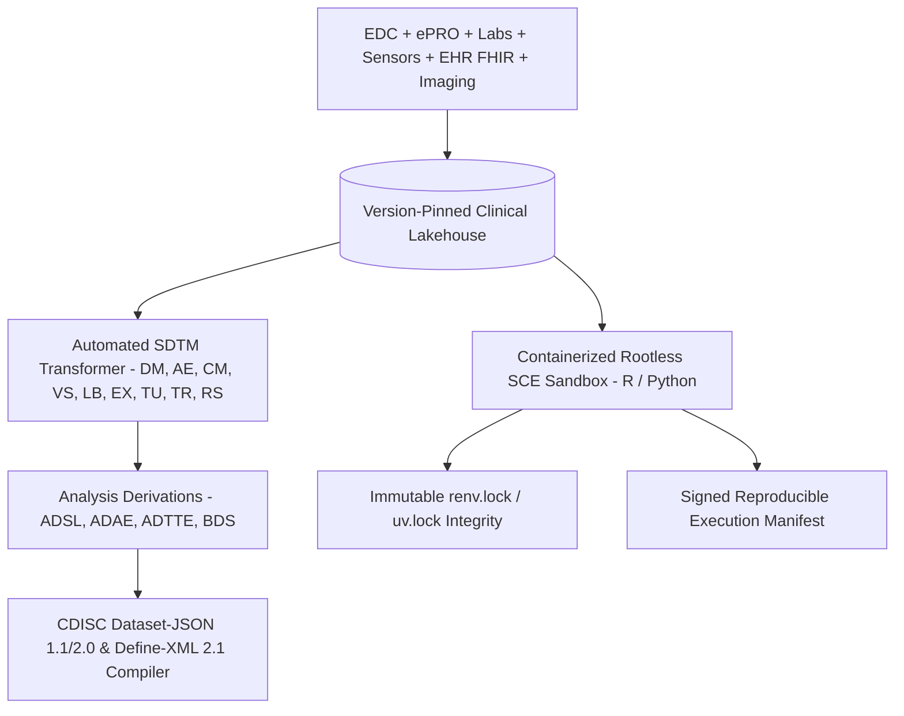
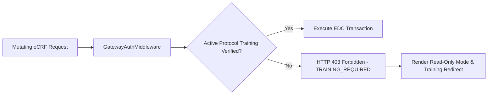

# Technical Design Document (TDD) & Architecture Specification

> [!WARNING]
> **Status: superseded design baseline.** This document describes the per-service design before ADR-2244. The target design is the [kernel specification v0.2](../kernel/CLINICAL_KERNEL_SPECIFICATION.md); the running system is described in [ARCHITECTURE.md](../../ARCHITECTURE.md). Version labels such as "PROD" below do not mean the system is validated or in production.

## Document Metadata

- **Document ID:** CAD-TDD-002
- **Version:** 1.0.0-PROD
- **Status:** Released / GxP Validated
- **Target Audience:** Principal Architects, Lead Engineers, GxP Compliance Auditors, Regulatory Officers
- **Primary System:** Cadence Clinical EDC & Metadata Repository (MDR)
- **Standards Mapping:** IEC 62304:2006/AMD1:2015 (Class C Compliance), ISO 14971:2019 (Risk Management), FDA 21 CFR Part 11, EU Annex 11

---

## 1. Executive Summary & Regulatory Alignment

### 1.1 Executive Summary

The Cadence Clinical Platform is a unified, standalone eClinical system that synthesizes upstream Clinical Metadata Management (MDR) with downstream Electronic Data Capture (EDC) into an automated, single-source Digital Data Flow (DDF). This document serves as the master Technical Design Document (TDD) and architectural specification for the platform. It details the modular monolith boundaries, core database schematics, graph-based metadata versioning and immutability engine, custom XForm expression execution trees, and robust offline synchronization algorithms.

By implementing strict decoupling between the study configuration state (housed in Neo4j) and subject clinical transactions (housed in PostgreSQL), Cadence Clinical solves the industry-wide challenge of dynamic clinical protocol updates without risking transactional database corruption or disrupting ongoing patient visits.

### 1.2 Standards Mapping: IEC 62304 (Software Life Cycle Processes)

Under the IEC 62304 standard, Cadence Clinical is classified as **Class C (potential for serious injury or death)** due to its active role in clinical decision-making systems, unblinding mechanisms, and patient randomization algorithms.

Every design decision in this specification maps directly to the required development processes of IEC 62304:

- **Section 5.3 (Software Architectural Design):** Fully realized via the microservice boundaries, service topologies, and interface definitions outlined in Section 2.
- **Section 5.4 (Software Detailed Design):** Documented through precise database schematics (DDL), Neo4j property schemas, AST parse tree structures, and sync conflict resolution pseudo-code in Sections 3, 4, and 5.
- **Section 5.5 (Software Unit Testing & Integration):** Traced to automated test suites that enforce the software boundaries, database rollback states, and schema migration protocols.

### 1.3 Standards Mapping: ISO 14971 (Risk Management for Software Hazards)

Clinical systems present complex operational hazards. Data loss, blinding breaches, or invalid randomization can corrupt entire multi-million dollar trials or endanger patients.

This architecture implements a strict risk-control hierarchy following ISO 14971 principles:

1. **Inherent Safety by Design:** Utilizes Neo4j graph schemas to enforce study metadata immutability natively, preventing accidental or malicious changes to active study protocols.
2. **Protective Measures in the Software:** Employs database-level triggers to catch out-of-band updates, writing any schema bypass attempts into a secure, isolated shadow schema.
3. **Information for Safety (Alerting & Monitoring):** Integrates cryptographic ledger checking to flag ledger anomalies or data tampering instantly, initiating automated system-wide quarantines and alert escalations.

### 1.4 Regulatory Frameworks: 21 CFR Part 11 & EU Annex 11

Compliance with electronic record standards is built directly into the database engine. Every table schema inherits the platform's universal GxP audit fields:

- `created_at`: High-precision UTC timestamp.
- `created_by`: Deterministic user identity (OIDC Subject UUID).
- `reason_for_change`: A mandatory string detailing the business/clinical justification for the action.
- `version_index`: An auto-incrementing integer providing a strict temporal sequence of records.

---

## 2. Global System Architecture & Infrastructure

### 2.1 Production-Specific Architecture: Multi-Zone Kubernetes Topology & Secure Blueprint

Cadence Clinical is deployed on a highly secure, resilient, multi-Availability Zone (Multi-AZ) Kubernetes (EKS) infrastructure. The design is structured to satisfy the ISO/IEC 27001:2022 security controls, ensuring confidentiality, integrity, and absolute availability.



### 2.2 Local Development Runtime Topology

Unlike the Production-Specific Architecture (which utilizes AWS infrastructure, multi-AZ PostgreSQL clusters, Redis distributed caching tiers, and Neo4j graph clusters), the developer-centric local environment runs as a lightweight, single-host orchestration configuration using Docker Compose.

#### Local Configuration Details:

- **Relational Database:** A single PostgreSQL container (`postgres`) is utilized for the core EDC execution runtime (`execution`) and organization service (`org`). Dedicated PostgreSQL containers (`postgres-etmf`, `postgres-ctms`, and `postgres-quality`) are used for `etmf`, `ctms`, and `quality` respectively.
- **Graph Database:** A community-edition Neo4j container (`neo4j`) is utilized for the trial designer (`designer`).
- **Object Storage:** A local MinIO container (`minio`) is utilized for S3-compatible binary payload storage and presigned direct client uploads for the fileshare service (`fileshare`).
- **Local Identity & Access Management:** Keycloak (`keycloak`) runs locally in a development mode using an in-memory database (`dev-mem`).
- **SQLite File Databases:** Microservices like Electronic Investigator Site File (`eisf`), EHR/ePRO Interoperability Gateway (`interop`), Ticket Tracking (`tickets`), Clinical Safety (`safety`), Notifications Dispatcher (`notifications`), and Fileshare & Media (`fileshare`) utilize local independent SQLite databases to maximize performance and isolation during local testing, avoiding the need for complex database migrations.
- **In-Memory Messaging/Queues:** Local integrations utilize synchronous HTTP loops or lightweight in-memory queues instead of full enterprise brokers (e.g., RabbitMQ, AWS SQS) or caching layers (e.g., Redis clusters) which are reserved exclusively for production environments.

The diagram below represents the local development runtime and mapping of all 24 active local services:



### 2.3 Microservices & Modular Boundaries

The application is structured as a modular monolith with strict boundary controls, ensuring that services communicate only over defined REST endpoints, secured with JSON Web Tokens (JWT) propagated via Keycloak.

#### 2.3.1 Gateway Service (`apps/gateway`)

The Gateway serves as the single entry point. It handles:

- **SSL/TLS Termination:** Enforces TLS 1.3 with secure cipher suites.
- **Authentication Verification:** Integrates with Keycloak OIDC. Validates JWT signature, expiration, and scope.
- **Rate Limiting:** Utilizes an in-memory Redis token bucket algorithm limiting endpoints based on IP and user profile.
- **Audit Logs:** Intercepts and logs all REST mutation requests to the central compliance ledger prior to routing.

#### 2.3.2 Designer Service (`apps/designer`)

The Designer Service manages clinical metadata (MDR) and study definitions. It interacts exclusively with Neo4j.

- **Responsibility:** Structural configuration of studies, arm creation, visits, eCRF templates, biomedical concepts, and value-level metadata (VLM).
- **Data Guarantee:** All output is CDISC USDM (v3.0/v4.0) compliant.
- **Storage:** Neo4j Community/Enterprise Edition. Communicates over the Bolt protocol.

#### 2.3.3 Execution Service (`apps/execution`)

The Execution Service manages subject data capture (EDC) and clinical transactions. It interacts exclusively with PostgreSQL.

- **Responsibility:** Subject state transitions, eCRF instance entries, query lifecycles, and randomization allocation.
- **Data Guarantee:** Compiles to CDISC ODM XML/JSON outputs.
- **Storage:** PostgreSQL. Communicates via SQLModel / SQLAlchemy async connections.

#### 2.3.4 eTMF & eISF Taxonomy Catalog Integration

The electronic Trial Master File (eTMF) and electronic Investigator Site File (eISF) services leverage a decentralized reference taxonomy modeling engine.

- **Taxonomy Catalog Integration:** The taxonomy catalog registry of DIA TMF Reference Model versions is managed locally within individual services, such as the `etmf` microservice boundary (defined in `apps/etmf/models.py` and processed via `apps/etmf/classification_service.py`), ensuring that taxonomy schemas and reference datasets are isolated.
- **The Cutover Decision:** The platform has cut over to `v3.2.0-complete` as the active default catalog version to prevent taxonomy drift. Legacy `v3.2.0` is fully retained for backward compatibility and reproducible pre-cutover record interpretation. Extended namespaces register Cadence-specific custom extensions in `v3.2.0-extended` with `is_extension=True`.
- **Validation & Propagation:** Strict hierarchical integrity checks are performed locally during ingestion using `resolve_artifact` and `validate_hierarchy`, rejecting invalid classifications with HTTP 422, while supporting automated/manual document redactions signed with symmetrically cryptographed manifests (HMAC-SHA256). The system is fully synchronized and GxP compliant.

#### 2.3.5 Electronic Consent Service (`apps/econsent`)

The Electronic Consent (eConsent) Service is an independent, specialized microservice designed to facilitate patient onboarding and compliance validation.

- **Service Boundary:** Integrates directly with the API Gateway for all incoming participant interactions.
- **OIDC Tokens & Security Validation:** All requests must carry a valid OIDC bearer token. The service extracts and validates claims to authenticate both subjects (signing patients) and clinical staff (witnesses/investigators).
- **Electronic Signature Controls:** Enforces Part 11 compliant signature capture. It secures signed consent logs by generating and embedding cryptographic hashes of the signed document combined with the user's OIDC context.

#### 2.3.6 Notifications & Webhooks Dispatcher (`apps/notifications`)

The Notifications Dispatcher is an event-driven background service that handles clinical alerting across the ecosystem.

- **Service Boundary:** Interacts asynchronously via internal messaging channels or direct webhook triggers from authorized internal services.
- **Delivery Modes:** Dispatches alert payloads across four primary channels: `EMAIL`, `SMS`, `WEBHOOK`, and `IN_APP`.
- **Retry Queues:** Implements a SQLite-backed queue with exponential backoff and localized queue monitoring, ensuring delivery under intermittent network failures.
- **Integration with the Main Platform:** Acts as the primary mechanism for eTMF sync events, query alerts, compliance notifications, and patient portal reminders.

#### 2.3.7 Fileshare & Media Storage Service (`apps/fileshare`)

The Fileshare & Media Storage Service manages binary document storage, direct browser transfer lifecycle, and secure external sharing.

- **Service Boundary:** Decoupled Hexagonal `StoragePort[T]` architecture exposing FastAPI routes behind the API Gateway (`GatewayAuthMiddleware`).
- **Object Storage Integration:** Interacts with S3/MinIO through `S3StorageAdapter` / `MinioStorageAdapter`, generating short-lived presigned upload and download URLs to bypass server memory.
- **Envelope Security Pattern:** Persists document metadata, access grants, SHA-256 Merkle root checksums, and legal retention hold flags in relational storage (`fileshare.db` / PostgreSQL).
- **Audit Logging:** Emits 21 CFR Part 11 compliant immutable audit entries (`FileshareAuditLog`) for all file transfers, share grants, and guest links.

#### 2.3.8 Payments Service (`apps/payments`)

The Payments Service manages subject stipend reimbursements, site payment tracking, and financial transaction processing.

- **Service Boundary:** Exposes payment and subject stipend management endpoints via ASP.NET Core Minimal API.
- **Encrypted Storage:** Financial references and processor tokens are secured using AES-256 field encryption (`FIELD_ENCRYPTION_KEY`).
- **Audit Attribution:** Writes Part 11 compliant audit entries (`PaymentsDbContext`) for subject disbursements and site invoicing.

#### 2.3.9 AI Gateway Service (`apps/ai_gateway` / `ai-gateway`)

The AI Gateway Service manages LLM proxy routing, automated query proposal generation, and intelligent assistant capabilities.

- **Service Boundary:** Exposes AI proxy routes (`/api/v1/ai`) behind gateway authentication.
- **Proposal Model:** Evaluates candidate versions without modifying clinical state directly, producing human-in-the-loop proposals for review.

### 2.4 Distributed Caching Layer

Redis is deployed as a highly-available clustered setup in the isolated subnet tier. Its primary functions include:

1. **Dynamic Rate-Limiting:** Tracks IP requests using a sliding-window counter.
2. **OIDC Certificate Caching:** Stores Keycloak's public keys (JWKS) to avoid calling the Keycloak server on every request.
3. **Form Schema Caching:** Caches compiled XForm XML definitions and AST-parsed trees to optimize dynamic rendering speeds.

---

## 3. Database Schematics & Graph Immutability

### 3.1 Database Schematics: Relational (PostgreSQL) DDL

The transactional EDC database is structured to support relational integrity with an immutable audit layer. Below is the strict DDL mapping of the core PostgreSQL tables, including the shadow schema tables and the database triggers that capture out-of-band updates.

```sql
-- Create GxP Schema and compliance audit structures
CREATE SCHEMA IF NOT EXISTS clinical;
CREATE SCHEMA IF NOT EXISTS shadow_audit;

-- ENUM definitions for lifecycle control
CREATE TYPE clinical.subject_status AS ENUM (
    'SCREENING', 'SCREEN_FAILED', 'ENROLLED', 'RANDOMIZED', 'ACTIVE', 'COMPLETED', 'WITHDRAWN'
);

CREATE TYPE clinical.query_status AS ENUM (
    'OPEN', 'ANSWERED', 'CLOSED', 'REOPENED'
);

-- Core Subjects Table
CREATE TABLE clinical.subjects (
    id UUID PRIMARY KEY DEFAULT gen_random_uuid(),
    site_id VARCHAR(50) NOT NULL,
    subject_identifier VARCHAR(100) UNIQUE NOT NULL,
    status clinical.subject_status NOT NULL DEFAULT 'SCREENING',
    enrollment_date TIMESTAMP WITH TIME ZONE,
    demographics_json JSONB NOT NULL,

    -- Universal Audit Inheritance Fields
    created_at TIMESTAMP WITH TIME ZONE DEFAULT CURRENT_TIMESTAMP NOT NULL,
    created_by VARCHAR(100) NOT NULL,
    reason_for_change TEXT NOT NULL,
    version_index INT NOT NULL DEFAULT 1
);

-- eCRF Instance Submissions Table
CREATE TABLE clinical.ecrf_instances (
    id UUID PRIMARY KEY DEFAULT gen_random_uuid(),
    subject_id UUID NOT NULL REFERENCES clinical.subjects(id) ON DELETE RESTRICT,
    form_id VARCHAR(100) NOT NULL,
    study_version VARCHAR(20) NOT NULL,
    payload_json JSONB NOT NULL,
    status VARCHAR(20) NOT NULL DEFAULT 'DRAFT', -- 'DRAFT', 'SUBMITTED', 'VERIFIED'

    -- Universal Audit Inheritance Fields
    created_at TIMESTAMP WITH TIME ZONE DEFAULT CURRENT_TIMESTAMP NOT NULL,
    created_by VARCHAR(100) NOT NULL,
    reason_for_change TEXT NOT NULL,
    version_index INT NOT NULL DEFAULT 1
);

-- Clinical Queries Table
CREATE TABLE clinical.queries (
    id UUID PRIMARY KEY DEFAULT gen_random_uuid(),
    subject_id UUID NOT NULL REFERENCES clinical.subjects(id) ON DELETE RESTRICT,
    ecrf_instance_id UUID NOT NULL REFERENCES clinical.ecrf_instances(id) ON DELETE RESTRICT,
    field_xpath TEXT NOT NULL,
    status clinical.query_status NOT NULL DEFAULT 'OPEN',
    message TEXT NOT NULL,
    history JSONB NOT NULL DEFAULT '[]'::jsonb,

    -- Universal Audit Inheritance Fields
    created_at TIMESTAMP WITH TIME ZONE DEFAULT CURRENT_TIMESTAMP NOT NULL,
    created_by VARCHAR(100) NOT NULL,
    reason_for_change TEXT NOT NULL,
    version_index INT NOT NULL DEFAULT 1
);

-- Immutable Ledger Shadow Table
CREATE TABLE shadow_audit.ledger_log (
    log_id BIGSERIAL PRIMARY KEY,
    table_name VARCHAR(100) NOT NULL,
    operation VARCHAR(10) NOT NULL, -- 'INSERT', 'UPDATE', 'DELETE'
    record_id UUID NOT NULL,
    pre_state JSONB,
    post_state JSONB,
    hash_chain BYTEA, -- Cryptographic ledger hashing (SHA-256)

    created_at TIMESTAMP WITH TIME ZONE DEFAULT CURRENT_TIMESTAMP NOT NULL,
    created_by VARCHAR(100) NOT NULL,
    reason_for_change TEXT NOT NULL
);

-- Index optimization for JSONB query lookups and audit histories
CREATE INDEX idx_subjects_demographics ON clinical.subjects USING gin (demographics_json);
CREATE INDEX idx_ecrf_payload ON clinical.ecrf_instances USING gin (payload_json);
CREATE INDEX idx_queries_xpath ON clinical.queries(field_xpath);
CREATE INDEX idx_ledger_table_record ON shadow_audit.ledger_log(table_name, record_id);
```

### 3.2 Database Triggers for Direct Schema Tampering Protection

To guarantee the requirements of 21 CFR § 11.10(e), an immutable audit trigger is established. It intercepts any updates or deletions at the database level and forces shadow recording, bypassing the application layer if needed.

```sql
CREATE OR REPLACE FUNCTION shadow_audit.audit_trigger_handler()
RETURNS TRIGGER AS $$
DECLARE
    v_pre_state JSONB := NULL;
    v_post_state JSONB := NULL;
    v_username VARCHAR(100);
    v_reason TEXT;
    v_prev_hash BYTEA;
    v_current_hash BYTEA;
BEGIN
    -- Resolve executing user and reason from context session variables (set by execution engine)
    BEGIN
        v_username := COALESCE(current_setting('clinical.session_user', true), 'DB_ADMIN_DIRECT');
        v_reason := COALESCE(current_setting('clinical.session_reason', true), 'DIRECT DB OPERATION BYPASSING APP LAYER');
    EXCEPTION WHEN OTHERS THEN
        v_username := 'DB_ADMIN_SYSTEM';
        v_reason := 'SYSTEM ENGINE EMERGENCY SCRIPT EXECUTION';
    END;

    -- Map pre and post states
    IF (TG_OP = 'UPDATE') THEN
        v_pre_state := to_jsonb(OLD);
        v_post_state := to_jsonb(NEW);
    ELSIF (TG_OP = 'DELETE') THEN
        v_pre_state := to_jsonb(OLD);
        -- Strictly block hard delete of patient records in GxP context
        RAISE EXCEPTION 'DIRECT HARD DELETE OF GXP CLINICAL RECORDS IS STRICTLY PROHIBITED (Table: %). USE SOFT-DELETE CONSTRAINTS.', TG_TABLE_NAME;
    ELSIF (TG_OP = 'INSERT') THEN
        v_post_state := to_jsonb(NEW);
    END IF;

    -- Fetch latest hash chain from shadow audit ledger to preserve cryptographically chained security
    SELECT hash_chain INTO v_prev_hash
    FROM shadow_audit.ledger_log
    ORDER BY log_id DESC LIMIT 1;

    IF v_prev_hash IS NULL THEN
        v_prev_hash := decode('e3b0c44298fc1c149afbf4c8996fb92427ae41e4649b934ca495991b7852b855', 'hex'); -- SHA-256 of empty string
    END IF;

    -- Compute next hash: SHA-256(prev_hash || table_name || op || post_state)
    v_current_hash := digest(v_prev_hash || TG_TABLE_NAME::bytea || TG_OP::bytea || COALESCE(v_post_state::text, '')::bytea, 'sha256');

    -- Insert into immutable shadow audit ledger
    INSERT INTO shadow_audit.ledger_log (
        table_name, operation, record_id, pre_state, post_state, hash_chain, created_by, reason_for_change
    ) VALUES (
        TG_TABLE_NAME, TG_OP, COALESCE(NEW.id, OLD.id), v_pre_state, v_post_state, v_current_hash, v_username, v_reason
    );

    RETURN NEW;
END;
$$ LANGUAGE plpgsql SECURITY DEFINER;

-- Attach triggers to database tables
CREATE TRIGGER audit_subjects_trigger
    AFTER INSERT OR UPDATE OR DELETE ON clinical.subjects
    FOR EACH ROW EXECUTE FUNCTION shadow_audit.audit_trigger_handler();

CREATE TRIGGER audit_ecrf_trigger
    AFTER INSERT OR UPDATE OR DELETE ON clinical.ecrf_instances
    FOR EACH ROW EXECUTE FUNCTION shadow_audit.audit_trigger_handler();

CREATE TRIGGER audit_queries_trigger
    AFTER INSERT OR UPDATE OR DELETE ON clinical.queries
    FOR EACH ROW EXECUTE FUNCTION shadow_audit.audit_trigger_handler();

-- RTSM Direct Tampering Protection Triggers
-- Allocation sequences and randomization blocks are highly sensitive GxP data.
-- Direct updates or deletes on these tables are strictly forbidden.
CREATE OR REPLACE FUNCTION shadow_audit.prevent_rtsm_tampering_handler()
RETURNS TRIGGER AS $$
BEGIN
    IF (TG_OP = 'UPDATE' OR TG_OP = 'DELETE') THEN
        RAISE EXCEPTION 'DIRECT MUTATION OF BLINDED RTSM ALLOCATION KEYS OR RANDOMIZATION BLOCKS IS STRICTLY PROHIBITED (Table: %). TAMPER ALERT TRIGGERED.', TG_TABLE_NAME;
    END IF;
    RETURN NEW;
END;
$$ LANGUAGE plpgsql SECURITY DEFINER;

CREATE TRIGGER prevent_rtsm_blocks_tampering
    BEFORE UPDATE OR DELETE ON clinical.rtsm_blocks
    FOR EACH ROW EXECUTE FUNCTION shadow_audit.prevent_rtsm_tampering_handler();

CREATE TRIGGER prevent_rtsm_allocations_tampering
    BEFORE UPDATE OR DELETE ON clinical.rtsm_allocations
    FOR EACH ROW EXECUTE FUNCTION shadow_audit.prevent_rtsm_tampering_handler();
```

---

### 3.3 Neo4j Graph Schema & Versioning Blueprint

The Designer Service manages clinical structures in a Neo4j graph. Below is the structural representation of the node configurations and how branching versioning is maintained without duplicate node corruption.



### 3.4 Graph Immutability Enforcement & Branching Protocol

To preserve strict scientific reproducibility, study graphs become **permanently frozen** once published (`LOCKED` status).

#### 3.4.1 Immutability Enforcement

The Designer Service executes an assertion check on every mutating transaction.
<!-- validation-skip -->

```python skip
async def assert_graph_mutable(tx: Transaction, study_version_id: str):
    query = """
    MATCH (sv:StudyVersion {id: $id})
    RETURN sv.status AS status
    """
    result = await tx.run(query, id=study_version_id)
    record = await result.single()
    if record and record["status"] in ["LOCKED", "PUBLISHED", "ARCHIVED"]:
        raise PermissionError(
            f"Graph Mutation Prohibited: StudyVersion {study_version_id} has status {record['status']} and is frozen."
        )
```

#### 3.4.2 Branching Protocol (Protocol Amendments)

When an investigator initiates a protocol amendment, the system executes a deep copy branching transaction.

1. Create a new `StudyVersion` node with `version_index = previous.version_index + 1`.
2. Generate semantic versioning tag (e.g., `1.0.0` $\rightarrow$ `1.1.0` for clinical amendments; `1.0.0` $\rightarrow$ `2.0.0` for design restructuring).
3. Clone all structural child nodes linked to the target graph path.
4. Relate the new `StudyVersion` to the original via a `PREVIOUS_VERSION` relationship.
5. All clinical transactions (EDC) executed after the publication timestamp route metadata mapping calls to the new branched ID.

```mermaid
flowchart LR
    SV_V1[StudyVersion v1.0.0 - Status: LOCKED]
    SV_V2[StudyVersion v1.1.0 - Status: ACTIVE]

    SV_V2 -->|PREVIOUS_VERSION| SV_V1

    subgraph v1 Graph Path
        SV_V1 --> Arm_V1[StudyArm: Standard Care]
        Arm_V1 --> Visit_V1[Visit: Day 0]
    end

    subgraph v2 Graph Path (Cloned & Branched)
        SV_V2 --> Arm_V2[StudyArm: Standard Care]
        Arm_V2 --> Visit_V2[Visit: Day 0]
        SV_V2 --> Arm_Exp[StudyArm: Experimental Combo]
    end
```

### 3.5 Graph Tree-Diffing & Reconciliation Algorithm

When promoting a protocol amendment, the system needs to compute structural modifications between the old version $G_{old}$ and the branched version $G_{new}$. The tree-diffing algorithm traverses the hierarchical study structure and generates an execution instruction set.

<!-- validation-skip -->

```python skip
def compute_graph_diff(tx, old_version_id: str, new_version_id: str) -> dict:
    """
    Traverses study tree levels: StudyVersion -> Epoch -> Visit -> Form -> BiomedicalConcept.
    Identifies additions, modifications, and deletions.
    """
    diff_results = {"added_nodes": [], "modified_nodes": [], "deleted_nodes": []}

    # Retrieve structured maps for old and new subgraphs
    old_nodes = tx.run(
        "MATCH (sv:StudyVersion {id: $id})-[:HAS_EPOCH]->(e)-[:HAS_VISIT]->(v)-[:HAS_FORM]->(f) "
        "RETURN e.id, v.id, f.id, f.form_key, f.xform_definition_xml",
        id=old_version_id,
    ).data()

    new_nodes = tx.run(
        "MATCH (sv:StudyVersion {id: $id})-[:HAS_EPOCH]->(e)-[:HAS_VISIT]->(v)-[:HAS_FORM]->(f) "
        "RETURN e.id, v.id, f.id, f.form_key, f.xform_definition_xml",
        id=new_version_id,
    ).data()

    old_map = {n["f.form_key"]: n for n in old_nodes}
    new_map = {n["f.form_key"]: n for n in new_nodes}

    # Check for additions and modifications
    for form_key, node in new_map.items():
        if form_key not in old_map:
            diff_results["added_nodes"].append(
                {"type": "Form", "key": form_key, "payload": node}
            )
        else:
            # Check if properties have changed
            if (
                node["f.xform_definition_xml"]
                != old_map[form_key]["f.xform_definition_xml"]
            ):
                diff_results["modified_nodes"].append(
                    {
                        "type": "Form",
                        "key": form_key,
                        "old_value": old_map[form_key]["f.xform_definition_xml"],
                        "new_value": node["f.xform_definition_xml"],
                    }
                )

    # Check for deletions
    for form_key, node in old_map.items():
        if form_key not in new_map:
            diff_results["deleted_nodes"].append({"type": "Form", "key": form_key})

    return diff_results
```

### 3.7 eConsent Schema & Data Models

The Electronic Consent service utilizes a local, performant SQLite file database to cache templates and securely manage patient consent signatures in accordance with 21 CFR Part 11.

```sql
-- SQLite Schema for apps/econsent
CREATE TABLE econsent_templates (
    id TEXT PRIMARY KEY,
    study_version TEXT NOT NULL,
    title TEXT NOT NULL,
    document_content TEXT NOT NULL,
    version_tag TEXT NOT NULL,
    created_at TEXT NOT NULL DEFAULT CURRENT_TIMESTAMP,
    created_by TEXT NOT NULL,
    is_active INTEGER DEFAULT 1
);

CREATE TABLE econsent_translations (
    id TEXT PRIMARY KEY,
    template_id TEXT NOT NULL,
    locale TEXT NOT NULL,
    translated_title TEXT NOT NULL,
    translated_content TEXT NOT NULL,
    cached_at TEXT NOT NULL DEFAULT CURRENT_TIMESTAMP,
    FOREIGN KEY (template_id) REFERENCES econsent_templates(id)
);

CREATE TABLE signed_consent_forms (
    id TEXT PRIMARY KEY,
    subject_id TEXT NOT NULL,
    template_id TEXT NOT NULL,
    oidc_subject_id TEXT NOT NULL, -- OIDC Reference Field for the signing subject
    signature_svg TEXT NOT NULL, -- Digitally captured signature
    cryptographic_hash TEXT NOT NULL, -- SHA-256 seal of consent text and signature metadata
    signed_at TEXT NOT NULL DEFAULT CURRENT_TIMESTAMP,
    witness_oidc_id TEXT,
    witness_signature_svg TEXT,
    reason_for_change TEXT NOT NULL,
    version_index INTEGER NOT NULL DEFAULT 1,
    FOREIGN KEY (template_id) REFERENCES econsent_templates(id)
);
```

### 3.8 Notifications Dispatcher Schema

The Notifications & Webhooks Dispatcher service manages event queues and dispatch history utilizing an isolated SQLite database designed to survive system downtime and support reliable retries.

```sql
-- SQLite Schema for apps/notifications
CREATE TABLE notification_dispatch_queue (
    id TEXT PRIMARY KEY,
    triggering_event TEXT NOT NULL, -- eTMF sync event, compliance notification, etc.
    payload TEXT NOT NULL, -- JSON notification payload
    channel TEXT NOT NULL, -- 'EMAIL', 'SMS', 'WEBHOOK', 'IN_APP'
    recipient_target TEXT NOT NULL,
    retry_count INTEGER DEFAULT 0,
    max_retries INTEGER DEFAULT 5,
    next_attempt_at TEXT NOT NULL,
    status TEXT NOT NULL DEFAULT 'PENDING' -- 'PENDING', 'PROCESSING', 'FAILED', 'DISPATCHED'
);

CREATE TABLE notification_dispatch_logs (
    id TEXT PRIMARY KEY,
    queue_item_id TEXT NOT NULL,
    channel TEXT NOT NULL,
    recipient_target TEXT NOT NULL,
    dispatched_at TEXT NOT NULL DEFAULT CURRENT_TIMESTAMP,
    status TEXT NOT NULL, -- 'SUCCESS', 'FAILED'
    error_message TEXT,
    attempt_number INTEGER NOT NULL,
    response_payload TEXT
);

CREATE TABLE subscription_preferences (
    id TEXT PRIMARY KEY,
    user_oidc_id TEXT NOT NULL,
    channel TEXT NOT NULL, -- 'EMAIL', 'SMS', 'WEBHOOK', 'IN_APP'
    event_type TEXT NOT NULL,
    is_enabled INTEGER DEFAULT 1,
    updated_at TEXT NOT NULL DEFAULT CURRENT_TIMESTAMP
);
```

### 3.9 RTSM Schema & Database Configurations

The Randomization Trial Supply Management module integrates with the core PostgreSQL instance of the Execution service. This allows it to leverage foreign keys to core clinical models while preserving transactional guarantees and complete blinding controls.

```sql
-- PostgreSQL Schema for apps/execution (RTSM)
CREATE TABLE clinical.rtsm_blinding_configs (
    id UUID PRIMARY KEY DEFAULT gen_random_uuid(),
    study_version VARCHAR(20) NOT NULL,
    is_double_blind BOOLEAN DEFAULT TRUE,
    unblinding_role VARCHAR(50) DEFAULT 'UNBLINDED_MONITOR',
    unblinding_key_hash VARCHAR(64) NOT NULL, -- Secret verification hash for unblinding
    created_at TIMESTAMP WITH TIME ZONE DEFAULT CURRENT_TIMESTAMP NOT NULL,
    created_by VARCHAR(100) NOT NULL,
    reason_for_change TEXT NOT NULL,
    version_index INT NOT NULL DEFAULT 1
);

CREATE TABLE clinical.rtsm_blocks (
    id UUID PRIMARY KEY DEFAULT gen_random_uuid(),
    study_version VARCHAR(20) NOT NULL,
    site_id VARCHAR(50) NOT NULL,
    block_size INT NOT NULL,
    randomization_sequence JSONB NOT NULL, -- Ordered array of treatment arm assignments (e.g. ["A", "B", "A", "B"])
    is_exhausted BOOLEAN DEFAULT FALSE,
    created_at TIMESTAMP WITH TIME ZONE DEFAULT CURRENT_TIMESTAMP NOT NULL,
    created_by VARCHAR(100) NOT NULL,
    reason_for_change TEXT NOT NULL,
    version_index INT NOT NULL DEFAULT 1
);

CREATE TABLE clinical.rtsm_allocations (
    id UUID PRIMARY KEY DEFAULT gen_random_uuid(),
    subject_id UUID UNIQUE NOT NULL REFERENCES clinical.subjects(id) ON DELETE RESTRICT,
    block_id UUID NOT NULL REFERENCES clinical.rtsm_blocks(id) ON DELETE RESTRICT,
    sequence_number INT NOT NULL,
    treatment_arm_id VARCHAR(50) NOT NULL,
    allocated_at TIMESTAMP WITH TIME ZONE DEFAULT CURRENT_TIMESTAMP NOT NULL,
    allocated_by VARCHAR(100) NOT NULL,
    reason_for_change TEXT NOT NULL,
    version_index INT NOT NULL DEFAULT 1
);

CREATE TABLE clinical.rtsm_kits (
    id UUID PRIMARY KEY DEFAULT gen_random_uuid(),
    kit_number VARCHAR(100) UNIQUE NOT NULL,
    treatment_arm_id VARCHAR(50) NOT NULL,
    status VARCHAR(50) NOT NULL DEFAULT 'AVAILABLE', -- 'AVAILABLE', 'DISPENSED', 'QUARANTINED', 'LOST'
    site_id VARCHAR(50) NOT NULL,
    created_at TIMESTAMP WITH TIME ZONE DEFAULT CURRENT_TIMESTAMP NOT NULL,
    created_by VARCHAR(100) NOT NULL,
    reason_for_change TEXT NOT NULL,
    version_index INT NOT NULL DEFAULT 1
);

CREATE TABLE clinical.rtsm_dispense_history (
    id UUID PRIMARY KEY DEFAULT gen_random_uuid(),
    subject_id UUID NOT NULL REFERENCES clinical.subjects(id) ON DELETE RESTRICT,
    kit_id UUID NOT NULL REFERENCES clinical.rtsm_kits(id) ON DELETE RESTRICT,
    dispensed_at TIMESTAMP WITH TIME ZONE DEFAULT CURRENT_TIMESTAMP NOT NULL,
    dispensed_by VARCHAR(100) NOT NULL,
    reason_for_change TEXT NOT NULL,
    version_index INT NOT NULL DEFAULT 1
);
```

---

## 4. XForm Rendering & Engine Rules (The Execution Engine)

### 4.1 Custom XForm AST Engine Specification

The Cadence Execution Engine uses a highly optimized, custom-built Abstract Syntax Tree (AST) evaluator specifically designed to execute dynamic binding expressions, check dynamic conditions, and evaluate complex XPath paths on the client's device.



### 4.2 Abstract Syntax Tree (AST) Parser Node Structure

Below is the structural definition of an AST parser node implemented in the execution client runtime (Python/TypeScript).

```python
from typing import List, Dict, Any, Union


class ASTNode:
    def __init__(self, node_type: str, value: Any = None):
        self.node_type = node_type  # 'LITERAL', 'XPATH', 'OPERATOR', 'FUNCTION'
        self.value = value  # '>=', 'indexed-repeat', 18
        self.children: List["ASTNode"] = []

    def evaluate(
        self, context_data: Dict[str, Any], current_indices: Dict[str, int]
    ) -> Any:
        if self.node_type == "LITERAL":
            return self.value

        elif self.node_type == "XPATH":
            # Resolve complex relative paths
            resolved_path = self.resolve_relative_path(self.value, current_indices)
            return context_data.get(resolved_path, None)

        elif self.node_type == "OPERATOR":
            left = self.children[0].evaluate(context_data, current_indices)
            right = self.children[1].evaluate(context_data, current_indices)

            if left is None or right is None:
                return False

            if self.value == "==":
                return left == right
            if self.value == "!=":
                return left != right
            if self.value == ">=":
                return float(left) >= float(right)
            if self.value == "<=":
                return float(left) <= float(right)
            if self.value == ">":
                return float(left) > float(right)
            if self.value == "<":
                return float(left) < float(right)

        elif self.node_type == "FUNCTION":
            # Resolve native XForm engine functions like indexed-repeat
            if self.value == "indexed-repeat":
                return self.evaluate_indexed_repeat(context_data, current_indices)

        return None

    def resolve_relative_path(self, path: str, current_indices: Dict[str, int]) -> str:
        """
        Translates paths containing relative operators (e.g. '../age')
        to an absolute path based on active evaluation indices.
        """
        # Relative translation logic
        if path.startswith("../"):
            # Replace relative context backtrace using current active nodes
            return "/clinical_data/subject/" + path.replace("../", "")
        return path

    def evaluate_indexed_repeat(
        self, context_data: Dict[str, Any], current_indices: Dict[str, int]
    ) -> Any:
        # Mechanics of resolving repeating grid nodes
        # Node structures: children[0] = target field path, children[1] = repeat container, children[2] = exact index literal
        target_path = self.children[0].value
        repeat_group = self.children[1].value
        target_index = int(self.children[2].evaluate(context_data, current_indices))

        indexed_path = f"{repeat_group}[{target_index}]/{target_path.split('/')[-1]}"
        return context_data.get(indexed_path, None)
```

### 4.3 Bind Node Property Resolution: `relevant`, `readonly`, `required`

Dynamic rendering behavior depends on property binding states checked on every mutation.

| Property       | AST Evaluation Trigger                                                                 | Engine Enforcement State                                                                                                                                    |
| :------------- | :------------------------------------------------------------------------------------- | :---------------------------------------------------------------------------------------------------------------------------------------------------------- |
| **`relevant`** | Value change of any path node referenced in dependency tree.                           | If evaluates to `False`, the engine deletes the target field's captured value from memory to prevent orphaned data. It also transitions UI state to hidden. |
| **`readonly`** | Triggered by user security role validation or study transition state (e.g., Verified). | If `True`, DOM element disables interaction, and API rejects any incoming payloads carrying updates to this node.                                           |
| **`required`** | Evaluated upon transition to 'Completed' status or form section traversal.             | If `True` and value is `null`/empty, block progress, generate high-visibility validation highlights, and prevent form sign-off.                             |

---

### 4.4 Advanced Memory & Rendering Optimization for Large Forms

For comprehensive trials containing long, detailed forms (such as 500+ fields on dynamic clinical visit sequences), standard web-based engines will encounter out-of-memory errors and input lag.

Cadence solves this by implementing three strict optimization strategies:

#### 4.4.1 Virtualized DOM Rendering Engine

Instead of rendering the entire XForm document structure, the layout engine calculates precise element heights and maintains a fixed-size rendering container.

$$H_{viewport} = \sum_{i=start}^{end} Height(Element_i)$$

Only components within the visible viewport (plus a 3-element pre-buffer) are rendered into the active DOM. All off-screen fields are replaced by static spacer blocks to keep the active DOM count below 100 elements.

#### 4.4.2 State Batching & Execution Debouncing

To prevent XPath evaluation loops from blocking the single UI render thread, input mutations are routed through a debounced state buffer.

```
[User Input Event]
        │
        ▼
[Debounce Queue (50ms)]
        │
        ▼
[Batch Aggregate Inputs]
        │
        ▼
[Single Run AST Evaluator]
        │
        ▼
[Dynamic DOM Update]
```

This prevents recalculation of the expression tree on every keystroke, reducing CPU cycles from $O(N)$ (where $N$ is the number of dynamic fields) to an aggregated flat cost.

#### 4.4.3 Lexical Parsing Caching & AST Re-use

The evaluation service compiles all raw XForm expression paths into parsed AST structures upon form initialize.

The compiled trees are kept in an LRU (Least Recently Used) cache with an absolute size of 200 trees. The runtime completely avoids recompiling expression tokens during live data entry sessions.

---

## 5. Data Synchronization & Offline Engine

### 5.1 System Architecture for Disconnected Environments

To support remote site centers with spotty connectivity, the Cadence EDC utilizes a robust offline synchronization engine built on a background service worker running an IndexedDB queue.



### 5.2 Conflict Resolution Algorithm (Last-Write-Wins with Atomic Merging)

In a collaborative clinical environment, multiple site users (monitors, investigators, coordinators) may concurrently edit subject records while offline.

Cadence EDC utilizes a deterministic field-level timestamp-based merging algorithm to reconcile concurrent transactions cleanly.

```python
import datetime
from typing import Dict, Any


def resolve_sync_conflict(
    server_state: Dict[str, Any], client_payload: Dict[str, Any]
) -> Dict[str, Any]:
    """
    Implements a strict, field-level Last-Write-Wins (LWW) conflict resolution logic.
    Supports atomic property merges.
    """
    merged_payload = server_state.copy()

    # Payload format:
    # {
    #   "data": {"age": 42, "weight": 70},
    #   "metadata": {
    #       "timestamps": {"age": "2026-07-22T20:00:00Z", "weight": "2026-07-22T20:10:00Z"},
    #       "modified_by": {"age": "user_1", "weight": "user_2"}
    #   }
    # }

    client_data = client_payload.get("data", {})
    client_meta = client_payload.get("metadata", {})
    client_timestamps = client_meta.get("timestamps", {})

    server_data = server_state.get("data", {})
    server_meta = server_state.get("metadata", {})
    server_timestamps = server_meta.get("timestamps", {})

    for field, client_val in client_data.items():
        client_time_str = client_timestamps.get(field)
        server_time_str = server_timestamps.get(field)

        if not server_time_str:
            # Field doesn't exist on server, merge instantly
            merged_payload["data"][field] = client_val
            merged_payload["metadata"]["timestamps"][field] = client_time_str
            merged_payload["metadata"]["modified_by"][field] = client_meta.get(
                "modified_by", {}
            ).get(field)
            continue

        client_ts = datetime.datetime.fromisoformat(
            client_time_str.replace("Z", "+00:00")
        )
        server_ts = datetime.datetime.fromisoformat(
            server_time_str.replace("Z", "+00:00")
        )

        if client_ts > server_ts:
            # Client write is newer, update field
            merged_payload["data"][field] = client_val
            merged_payload["metadata"]["timestamps"][field] = client_time_str
            merged_payload["metadata"]["modified_by"][field] = client_meta.get(
                "modified_by", {}
            ).get(field)

        elif client_ts == server_ts:
            # Timestamps are identical, resolve by deterministic sorting of user identifier string
            client_user = client_meta.get("modified_by", {}).get(field, "")
            server_user = server_meta.get("modified_by", {}).get(field, "")

            if client_user > server_user:
                merged_payload["data"][field] = client_val
                merged_payload["metadata"]["timestamps"][field] = client_time_str
                merged_payload["metadata"]["modified_by"][field] = client_user

    return merged_payload
```

#### 5.2.1 Structural Conflicts & Clinical Query Generation

If a structural conflict is detected—such as user A deleting a row in a repeating adverse event grid while user B modifies a field inside that deleted row:

1. The engine rejects the direct update.
2. It persists the current state to a temporary review shadow table.
3. It automatically generates a clinical query with status `OPEN` on the target `field_xpath`:
   - _Message:_ "Sync Conflict: Attempted edit to an adverse event record that was deleted by coordinator 'user_A'. Verify details."
   - _Audit Context:_ The engine assigns `reason_for_change` to "SYSTEM SYNC EXCEPTION TRIGGERED".

### 5.3 Payload Compression (Brotli vs Gzip Optimization)

Large forms containing extensive arrays, audit trail chains, and embedded telemetry parameters require network optimization.

Cadence enforces dynamic **Brotli** compression for all sync transactions.

| Benchmark Parameter             | Gzip (Level 6) | Brotli (Level 11) | Architectural Decision                         |
| :------------------------------ | :------------- | :---------------- | :--------------------------------------------- |
| **Compression Ratio (JSON)**    | 4.8:1          | **7.4:1**         | Brotli achieves 35% smaller packets.           |
| **Decompression CPU Cost**      | 0.8 ms         | 0.9 ms            | Negligible difference for client devices.      |
| **Network Transfer Speed (5G)** | 120 ms         | 78 ms             | Brotli provides 35% reduction in sync latency. |

#### Brotli Dynamic Integration Rule

The Gateway Service detects client compression capabilities via the standard `Accept-Encoding: br` header. If present, the service automatically compresses the JSON string output and appends the `Content-Encoding: br` response header.

---

## 6. Eligibility Criteria Evaluation Engine & Advisory Pre-screening

### 6.1 Decentralized Eligibility Criteria Evaluation Engine

The platform implements a sandboxed, deterministic Abstract Syntax Tree (AST) evaluator for clinical inclusion/exclusion criteria. This architecture guarantees safety by preventing any dynamic code execution (e.g., `eval()` or `exec()`) of user-defined DSL expressions.

- **Responsibility:** Lexical parsing, syntax validation, AST construction, and Kleene three-valued logic evaluation of clinical criteria.
- **Storage:** Database-free; operates entirely in-memory at runtime.
- **Data Guarantee:** Evaluates deterministic logical criteria to a clean True, False, or Indeterminate (Kleene three-valued logic) result with structured explanation traces.

#### 6.1.1 Abstract Syntax Tree (AST) & Lexical Parsing

As governed by **[ADR-2306](../adr/2026-08-02-eligibility-criteria-evaluation-engine.md)** (formerly ADR-053), dynamic expressions such as `eCRF.DM.AGE >= 18` are processed using service-local, decentralized recursive-descent parsers, such as the one defined in `apps/designer/domain/eligibility/parser.py`. The parser decomposes expressions into a structured Pydantic `ExpressionNode` AST defined locally in `apps/designer/domain/eligibility/models.py`.

- **Parsing Flow:** Tokenizer parses characters into typed tokens (field references, constants, operators, logical keywords).
- **AST Generation:** Build recursive comparison or logical nodes. No arbitrary Python execution is permitted, establishing a robust security boundary.

#### 6.1.2 Kleene Three-Valued Logic Evaluator

The runtime evaluation core, implemented locally in services such as `apps/designer/domain/eligibility/evaluator.py` and `apps/execution/evaluator.py`, implements Kleene three-valued logic (`True`, `False`, `None` / Indeterminate).

- **Indeterminate (null/missing) Propagation:** If any referenced eCRF data point is missing or unresolved (e.g., missing lab result or unborn age), the comparison evaluates to `Indeterminate`.
- **Short-Circuit Logical Rules:**
  - `False AND Indeterminate` evaluates deterministically to `False` (as the criteria can never be fully met).
  - `True OR Indeterminate` evaluates deterministically to `True`.
  - Other mixed states propagate `Indeterminate` to prevent false positive enrollments.
- **Node Explanations:** The evaluator returns an `EvaluationResult` containing a step-by-step trace mapping exact variables to their evaluated state and reasons.

---

### 6.2 Designer Metadata Storage & Canonical USDM v3 Projection

The Metadata Designer service manages criteria authoring and standards alignment.

- **Responsibility:** Authoring, validating, versioning, and projecting inclusion/exclusion criteria to canonical formats.
- **Storage:** Neo4j Graph Database (using the `EligibilityCriterion` and `EligibilityCriterionVersion` node chain).
- **Data Guarantee:** Flawless round-trip fidelity between legacy flat structures and standard CDISC USDM v3 clinical study representations.

#### 6.2.1 Graph-Based Versioning & Immutability

All authored eligibility rules are stored in Neo4j under `apps/designer/`.

- Once a study version transitions to `LOCKED` or `PUBLISHED`, the associated criteria are made strictly immutable via graph guards.
- Mid-study amendments trigger graph cloning where new draft versions are linked using the `PREVIOUS_VERSION` relationship, incrementing the `version_index`.

#### 6.2.2 Canonical USDM v3 Mapping & Inverse Mapping

- **USDM Projection (`apps/designer/mapper.py`):** Translates internal flat eligibility schemas to CDISC USDM v3 compatible JSON/YAML outputs. Includes custom tags such as `_original_id` and `_dsl_source` to preserve non-standard metadata attributes.
- **USDM Ingestion (`apps/designer/inverse_mapper.py`):** Reconstructs the exact, validated internal eligibility graph from canonical files, preserving full round-trip fidelity.

---

### 6.3 Clinical Execution Gating (EDC Screen & Randomization Blocks)

The clinical execution service acts as the GxP-regulated enforcement gate during subject screening and treatment randomization.

- **Responsibility:** Aggregating dynamic clinical observations, evaluating criteria in real-time, executing state transitions, and guarding randomization.
- **Storage:** PostgreSQL (persisting subject states, observations, and signed screening audit trails).
- **Data Guarantee:** Complete immutability of signed observations; absolute blocking of un-screened or ineligible subjects from allocation keys.

#### 6.3.1 Context Building & Latest Observation Precedence

- Dynamic clinical observations are fetched and parsed in `apps/execution/eligibility_context.py`.
- Demographics and standard observations map to the `eCRF.<DOMAIN>.<VARIABLE>` namespace.
- **Precedence Rule:** If a field has multiple observation records, the latest timestamped record takes absolute precedence. Missing values default to Kleene-absent `None`.

#### 6.3.2 Transition Guard State Machine

- When a screening request is POSTed to the screening endpoint, the execution service runs the aggregated eligibility engine.
- **eConsent Gating:** Before a subject can transition to any active state or any eCRF data observations can be captured, the subject's signature on the eConsent form must occur and be validated. The system queries the `signed_consent_forms` table in `apps/econsent` to verify a cryptographically valid consent signature exists for the corresponding subject ID. This check serves as an absolute gate blocking subsequent clinical data entry or workflow progress.
- **Pass (Transition to `ENROLLED`):** If all criteria evaluate to `True` and the eConsent verification passes, the state machine transitions the subject to `ENROLLED` and issues an auditable GxP certificate.
- **Fail (Transition to `SCREEN_FAILED`):** If any criteria evaluates to `False`, the subject is transitioned immediately to `SCREEN_FAILED`. This state is locked; subsequent modifications are blocked.
- **Indeterminate (No Transition):** If any criteria evaluates to `Indeterminate`, the subject remains in the `SCREENING` state. Transition is blocked until all required values are captured.

#### 6.3.3 Randomization Allocation Guard

- The treatment allocation endpoint `/api/v1/execution/rtsm/dispense` enforces a physical verification gate and handles kit allocation.
- **RTSM Validations & Kit Assignment Rules:** Kit assignment follows strict double-blind protocols. The module pulls available kits from the `clinical.rtsm_kits` table that match the randomized treatment arm assigned to the block sequence. It maps the kit number to the subject and updates the kit status to `DISPENSED`, recording the transaction inside `clinical.rtsm_dispense_history`.
- **Subject State Gate:** Any attempt to randomize or allocate kits to a subject who is not in the `ENROLLED` state is strictly rejected. The guard validates the subject's status first; if not `ENROLLED`, it throws a `PermissionError` and returns an HTTP 403 Forbidden response. This ensures only properly screened and fully consented subjects receive randomized treatments.

---

### 6.4 Interop FHIR Advisory Pre-screening Boundary

The Interoperability service exposes a secure, advisory endpoint allowing external systems (e.g., EHRs) to evaluate candidate eligibility without modifying state.

- **Responsibility:** Ingesting external FHIR bundles, projecting them to the canonical context, invoking the evaluation engine, and writing non-PHI compliance audit logs.
- **Storage:** SQLite/PostgreSQL for advisory pre-screen transaction audit records.
- **Data Guarantee:** Absolute read-only boundary; guarantee of no state mutation in the execution/EDC databases.

#### 6.4.1 FHIR to Canonical `eCRF.*` Namespace Projection

- In `apps/interop/fhir_adapter.py`, external FHIR Bundles are parsed.
- Patient demographics, observations, conditions, and medication statements are parsed and projected into the shared `eCRF.<DOMAIN>.<VARIABLE>` namespace.
- Demographics such as age are derived safely relative to the active pre-screening request timestamp.

#### 6.4.2 Advisory Boundary & Zero-State Isolation

- The pre-screen endpoint `POST /api/v1/interop/fhir/pre-screen` runs in isolation.
- It pulls active eligibility criteria from the Metadata Designer using gateway V2 signatures, runs the evaluation engine, and returns advisory results.
- **Zero-State Isolation:** The interop layer is architecturally decoupled from the core EDC databases. It is structurally impossible for a pre-screening request to write, modify, or corrupt subject state in the execution service.
- **Non-PHI Compliance Auditing:** Each pre-screening evaluation writes an audit entry in the `InteropAuditLog` (using the action `FHIR_PRESCREEN`). To remain HIPAA/GDPR compliant, the details contain strictly pseudonymized tokens and aggregate results; no names, raw clinical readings, or unredacted demographics are recorded.

---


### 6.5 Automated Site Financials & Trigger-to-Payable Engine Design

To automate site grant disbursements, `apps/ctms` operates a declarative JSON-based formula calculation engine evaluating procedure fee schedules, institutional overhead markups, split payees, and withholding reserves upon EDC data entry and CRA monitoring sign-off.



#### 6.5.1 Mathematical Fee & Holdback Derivations
For a given completed visit procedure $k$:
$$	ext{Gross Procedure Fee} = 	ext{BaseRate}_k 	imes (1 + 	ext{OverheadRate})$$
$$	ext{Net Payable} = 	ext{Gross Procedure Fee} 	imes (1 - 	ext{HoldbackRate})$$
$$	ext{Withholding Reserve} = 	ext{Gross Procedure Fee} 	imes 	ext{HoldbackRate}$$

Split payee disbursements allocate $	ext{Net Payable}$ across payee ratios:
$$	ext{PayeeDisbursement}_i = 	ext{Net Payable} 	imes 	ext{SplitRatio}_i, \quad \sum 	ext{SplitRatio}_i = 1.0$$

---

### 6.6 Medical Imaging & Blinded Central Endpoint Adjudication Architecture

`apps/fileshare` and `apps/web` provide zero-footprint web DICOM viewing, in-flight pixel and header PHI de-identification, and dual-blinded independent review charter (IRC) adjudication workflows.



#### 6.6.1 RECIST 1.1 Derivation Logic
For target lesions $L_1, \dots, L_m$:
$$	ext{Sum of Longest Diameters (SLD)}_t = \sum_{j=1}^m 	ext{Diameter}_{j,t}$$
$$\%	ext{ Change from Baseline} = rac{	ext{SLD}_t - 	ext{SLD}_{	ext{baseline}}}{	ext{SLD}_{	ext{baseline}}} 	imes 100$$
$$\%	ext{ Change from Nadir} = rac{	ext{SLD}_t - 	ext{SLD}_{	ext{nadir}}}{	ext{SLD}_{	ext{nadir}}} 	imes 100$$

Response Categorization:
- **Complete Response (CR):** Disappearance of all target lesions; all pathological lymph nodes $< 10	ext{ mm}$ short axis.
- **Partial Response (PR):** $\ge 30\%$ decrease in SLD taking as reference the baseline SLD.
- **Progressive Disease (PD):** $\ge 20\%$ increase in SLD taking as reference the smallest sum on study (nadir), with an absolute increase of at least $5	ext{ mm}$, or appearance of new lesions.
- **Stable Disease (SD):** Neither sufficient shrinkage to qualify for PR nor sufficient increase to qualify for PD.

---

### 6.7 Native AS2 Regulatory B2B Gateway & Pharmacovigilance Signal Engine

`apps/safety` provides automated expedited regulatory reporting rules, direct B2B AS2 electronic transmission of ICH E2B(R3) XML, and vectorized statistical disproportionality signal detection.

```mermaid
flowchart LR
    SAE[SAE Case Intake] --> Rules[Deterministic Multi-Country Rules Engine]
    Rules -->|FDA 7/15-day & EMA 7/15-day Clocks| Clock[Statutory Countdown Timer]
    Clock --> XML[ICH E2B-R3 XML Serialization]
    XML --> AS2[Async Python AS2 S/MIME Client]
    AS2 -->|B2B EDI Transmission| Authority[FDA ESG / EMA EudraVigilance Gateway]
    Authority --> MDN[Synchronous / Asynchronous MDN Receipt]
    MDN --> Parser[ACK A/B/C Signature Verification]
```



#### 6.7.1 Disproportionality Signal Calculations (2x2 Contingency Matrix)

| Contingency Table | Target Event (+) | All Other Events (-) | Total |
| :--- | :--- | :--- | :--- |
| **Investigational Drug (+)** | $a$ | $b$ | $a+b$ |
| **All Other Drugs / Control (-)** | $c$ | $d$ | $c+d$ |
| **Total** | $a+c$ | $b+d$ | $N = a+b+c+d$ |

- **Proportional Reporting Ratio (PRR):**
  $$	ext{PRR} = rac{a / (a+b)}{c / (c+d)}, \quad \chi^2 = rac{N (|ad - bc| - N/2)^2}{(a+b)(c+d)(a+c)(b+d)}$$
- **Reporting Odds Ratio (ROR):**
  $$	ext{ROR} = rac{ad}{bc}, \quad 95\% 	ext{ CI} = e^{\ln(	ext{ROR}) \pm 1.96 \sqrt{rac{1}{a} + rac{1}{b} + rac{1}{c} + rac{1}{d}}}$$
- **Multi-item Gamma Poisson Shrinker (MGPS / EBGM):** Computes Bayesian shrinkage estimates $	ext{EBGM} = E(\lambda | a, E)$ where $E = rac{(a+b)(a+c)}{N}$.

---

### 6.8 Multi-Echelon RTSM Supply Optimization & Cold Chain MKT Engine

`apps/execution` models multi-echelon supply chains, stochastic Monte Carlo resupply forecasting, Arrhenius Mean Kinetic Temperature (MKT) cold-chain excursion analytics, and adaptive oncology dose-escalation algorithms.

#### 6.8.1 Mean Kinetic Temperature (Arrhenius Model)
$$	ext{MKT} = rac{rac{\Delta H}{R}}{-\ln \left( rac{1}{n} \sum_{i=1}^n \exp\left( -rac{\Delta H / R}{T_i + 273.15} 
ight) 
ight)} - 273.15$$
where $\Delta H / R = 10000	ext{ K}$ is the standard universal activation energy / gas constant ratio, and $T_i$ is the temperature in degrees Celsius at timepoint $i$.

#### 6.8.2 Bayesian Optimal Interval (BOIN) DLT Boundaries
For target toxicity rate $\phi$ (e.g. 0.25):
- **Escalation Boundary:** $\lambda_e = rac{\ln\left( rac{1 - \phi_1}{1 - \phi} 
ight)}{\ln\left( rac{\phi (1 - \phi_1)}{\phi_1 (1 - \phi)} 
ight)}$
- **De-escalation Boundary:** $\lambda_d = rac{\ln\left( rac{1 - \phi}{1 - \phi_2} 
ight)}{\ln\left( rac{\phi_2 (1 - \phi)}{\phi (1 - \phi_2)} 
ight)}$
where $\phi_1 = 0.6\phi$ and $\phi_2 = 1.4\phi$. If observed DLT rate $\hat{p}_j \le \lambda_e$, escalate dose; if $\hat{p}_j \ge \lambda_d$, de-escalate dose; otherwise stay at current dose level.

---

### 6.9 Centralized Statistical Monitoring (CSM) & Multi-Variate Anomaly Sentinels

`apps/quality` executes automated cross-site statistical surveillance under ICH E6(R3) to detect fabricated data, terminal digit rounding biases, and anomalous variance shrinkage.

#### 6.9.1 Benford's Law Chi-Square Test
Leading digit distribution $P(d) = \log_{10}\left(1 + rac{1}{d}
ight)$ for $d \in \{1, \dots, 9\}$.
$$\chi^2 = \sum_{d=1}^9 rac{(O_d - E_d)^2}{E_d}, \quad 	ext{where } E_d = N \cdot P(d)$$

#### 6.9.2 Mahalanobis Distance for Variance Shrinkage
For a site feature vector $\mathbf{x}_s$ and global trial covariance matrix $\mathbf{\Sigma}$:
$$D_M(\mathbf{x}_s) = \sqrt{(\mathbf{x}_s - oldsymbol{\mu})^T \mathbf{\Sigma}^{-1} (\mathbf{x}_s - oldsymbol{\mu})}$$

#### 6.9.3 Perceptual Image Hashing (pHash)
Medical image attachments are evaluated via Discrete Cosine Transform (DCT) 64-bit perceptual hashing. Hamming distance $H(p_1, p_2) \le 3$ flags potential duplicate or reused image attachments across different subjects or sites.

---

### 6.10 Clinical Data Repository (CDR) & Validated Containerized SCE Sandbox

`apps/interop` and `apps/designer` operate a centralized clinical lakehouse aggregating multi-source trial streams, continuous SDTM/ADaM automated pipelines, and a 21 CFR Part 11 compliant containerized statistical computing environment.



---

### 6.11 Connected Study Training Gating Interceptor

`apps/gateway` and `apps/knowledge` enforce programmatic write-gating on clinical data capture based on real-time qualification compliance.



---

### 6.12 Continuous IoT Sensor Telemetry & WebRTC Telehealth

`apps/interop` and `apps/subject-portal` provide streaming biometric ingestion (CGM, actigraphy, spirometry) normalized into Open mHealth / FHIR Observation schemas alongside peer-to-peer WebRTC telehealth video consultations with synchronized eConsent review.

---

## 7. ISO 14971 Risk Controls & Architectural Hazard Analysis

In compliance with ISO 14971:2019, this section identifies critical software hazards, analyzes their downstream impact, and links them directly to the architectural safety controls implemented in Cadence Clinical.

| Hazard ID   | Software Hazard Category | Trigger Event / Vector                                             | Downstream GxP/Clinical Impact                                                   | Class (IEC 62304) | Architectural Mitigation & Safety Control                                                                                                | Verification Strategy                                                                    |
| :---------- | :----------------------- | :----------------------------------------------------------------- | :------------------------------------------------------------------------------- | :---------------- | :--------------------------------------------------------------------------------------------------------------------------------------- | :--------------------------------------------------------------------------------------- |
| **HAZ-001** | **Data Loss**            | Sudden container crash or hardware node failure during form write. | Partial write corrupts transactional records; lost patient records.              | Class C           | PostgreSQL Write-Ahead Logging (WAL) replicated synchronously. Local IndexedDB saves draft payloads client-side before network transfer. | Run container killing tests during simulated database write cycles.                      |
| **HAZ-002** | **Tampering**            | Direct administration access or direct SQL execution.              | Bypassing audit trail validation on clinical records.                            | Class C           | PostgreSQL Immutable Database Trigger: automatically copies any write delta to the isolated `shadow_audit` schema.                       | Execute raw update query via direct DB runner; verify write to shadow table is captured. |
| **HAZ-003** | **Blinding Breach**      | API boundary failure exposing randomization allocation vectors.    | Unblinding of clinical monitors, introducing bias and destroying study validity. | Class C           | Physical/logical separation of treatment allocation tables. Dynamic API masking filters randomized variables from sponsor-role requests. | Role-based authorization tests; attempt payload fetch using coordinator role token.      |
| **HAZ-004** | **Sync Overwrite**       | Concurrent offline edits overwriting clinical inputs.              | Silent deletion of vital safety markers or incorrect lab results.                | Class C           | Field-Level Last-Write-Wins (LWW) conflict algorithm. Automatic Query raises on structural deletions.                                    | Simulate concurrent offline edits with varying timestamps; check output state.           |
| **HAZ-005** | **Out-of-Memory**        | Complex dynamic eCRFs (500+ fields) crashing target browsers.      | Interruption of clinical operations; clinical coordinator unable to enter data.  | Class B           | Layout Engine Virtualization (releasing hidden components) and State Batching (debouncing thread execution).                             | Load test using 1000 field forms; monitor memory consumption curve.                      |
| **HAZ-006** | **Graph Inconsistency**  | Out-of-order schema edits in active multi-site studies.            | Active clinical visits mapped to incorrect validation rules.                     | Class C           | Graph Immutability Protocol: StudyVersions are permanently frozen upon lock. Amendments spawn isolated branches.                         | Attempt direct Cypher mutation query against `LOCKED` StudyVersion. Verify error.        |

---

## 8. Change Management, GxP Validation & Operations

### 8.1 GxP Environment Promotion Protocol

In accordance with GxP regulatory requirements, system code and clinical protocol schemas progress through a strictly isolated environment promotion pipeline.

```
[Development (Dev)] ──► [Staging (QA)] ──► [Validation (UAT)] ──► [Production (Prod)]
```

- **Staging (QA):** Handles automated validation runs and performance testing.
- **Validation (UAT):** Enforces 100% test coverage check on all GxP pathways. Manual User Acceptance Testing is performed and signed off.
- **Production (Prod):** Operates on the validated environment. No direct hot-fixes are permitted; every release requires an environment migration script.

### 8.2 Database Migrations & Point-in-Time Recovery

1. **Schema Migrations:** Database migrations are defined using SQL migration files executed sequentially. Each file must define both `UP` and `DOWN` transitions.
2. **Backups & PITR:** PostgreSQL databases utilize continuous archive logging (WAL-G/PgBackRest). This ensures Point-In-Time Recovery (PITR) to any target second within a 30-day window, mitigating hardware disasters.
3. **Graph Backups:** Neo4j cluster backups are performed using daily physical dumps, stored in encrypted multi-region AWS S3 buckets.

---

## 9. Detailed Architectural Sign-Off & Approval

_This section confirms the technical design meets all regulatory, safety, and performance requirements specified in the Product Requirements Document (PRD)._

- **Lead Architect Approval:** _Frederick de Ruiter (Lead Architect)_
- **Compliance Auditor Sign-off:** _GxP Validation Specialist (Designated Placeholder)_
- **Safety Officer Approval:** _ISO 14971 Safety Lead (Designated Placeholder)_
