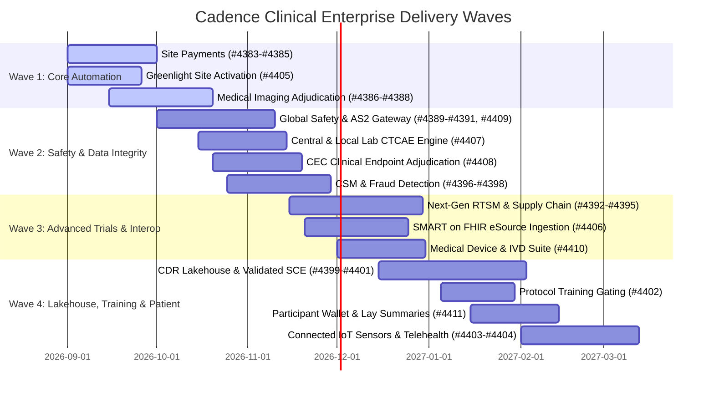

# Cadence Clinical: Global Enterprise Implementation Roadmap & Competitive Superiority Blueprint

> [!WARNING]
> **Status: superseded.** The current roadmap is [kernel specification §15](../kernel/CLINICAL_KERNEL_SPECIFICATION.md#15-roadmap), tracked in epic #4719. This document is kept as the earlier product vision.

## 1. Executive Vision & Market Positioning

Cadence Clinical is engineered as the world's first **Sovereign, Metadata-Compiled All-in-One eClinical Platform**. Powered by a **CDISC USDM v3.0/v4.0 Graph Spine (Neo4j)**, an **Async PostgreSQL Execution Engine**, and a **Reactive Clinical Event Spine**, Cadence eliminates the architectural fragmentation, multi-week amendment downtime, and batch synchronization lag inherent to legacy incumbent suites (Veeva Vault Clinical, Medidata Clinical Cloud, Oracle Clinical One).

---

## 2. Global Functional Pillars & Feature Traceability Matrix

The platform unifies 17 distinct clinical trial operational pillars into a single execution plane:

```
+---------------------------------------------------------------------------------------------------------+
|                                        CADENCE CLINICAL PLATFORM                                        |
+---------------------------------------------------------------------------------------------------------+
|  METADATA SPINE: CDISC USDM v3/v4 Graph (Neo4j) + Universal Digital Data Flow (DDF) + Reactive Outbox   |
+---------------------------------------------------------------------------------------------------------+
|  1. Protocol Designer & MDR  |  2. Dynamic EDC / CDMS      |  3. Next-Gen RTSM & Supply |  4. Site Payments & Grants    |
|  5. Blinded Medical Imaging  |  6. Global Safety & PV      |  7. RBQM & Fraud Sentinels |  8. CDR & Validated SCE       |
|  9. Connected Study Training |  10. DCT & IoT Sensors      |  11. Study Startup & SSU   |  12. SMART on FHIR eSource    |
|  13. Lab Engine & CTCAE      |  14. CEC Adjudication Suite |  15. Medical Device / IVD  |  16. Patient Financial Wallet |
|  17. DIA eTMF / eISF Sync    |                             |                            |                               |
+---------------------------------------------------------------------------------------------------------+
|  SECURITY & AUDIT: 21 CFR Part 11 Cryptographic SHA-256 Ledger + Keycloak OIDC IAM + StoragePort MinIO   |
+---------------------------------------------------------------------------------------------------------+
```

---

## 3. Comprehensive Epic & GitHub Issue Tracking Index

| Domain / Pillar | GitHub Issue | Title / Specification | Key Regulatory / Industry Standard |
| :--- | :--- | :--- | :--- |
| **Site Payments** | [#4383](https://github.com/fderuiter/cadence-clinical/issues/4383) | Fee Matrix & Investigator Grant Contract Engine | 21 CFR Part 11, PRD-PAY-001 |
| **Site Payments** | [#4384](https://github.com/fderuiter/cadence-clinical/issues/4384) | Real-Time EDC/SDV Trigger-to-Payable & Split-Payee Engine | 21 CFR Part 11, PRD-PAY-002 |
| **Site Payments** | [#4385](https://github.com/fderuiter/cadence-clinical/issues/4385) | Self-Billing Invoicing & Remittance Advice Generator | VAT Compliance, PRD-PAY-003 |
| **Medical Imaging** | [#4386](https://github.com/fderuiter/cadence-clinical/issues/4386) | In-Flight DICOM PHI De-Identification & S3 Envelope Storage | HIPAA Safe Harbor, DICOM PS3.15 |
| **Medical Imaging** | [#4387](https://github.com/fderuiter/cadence-clinical/issues/4387) | Browser-Native DICOM Viewer with RECIST 1.1 / Lugano Calipers | RECIST 1.1, Lugano, Cheson |
| **Medical Imaging** | [#4388](https://github.com/fderuiter/cadence-clinical/issues/4388) | Blinded Dual-Reader Charter & Tie-Breaker Adjudication Workflow | 21 CFR Part 11, FDA Imaging Guidance |
| **Safety & PV** | [#4389](https://github.com/fderuiter/cadence-clinical/issues/4389) | Deterministic Multi-Country Expedited Safety Reporting Rules Engine | FDA 7/15-day, EMA EudraVigilance, PMDA |
| **Safety & PV** | [#4390](https://github.com/fderuiter/cadence-clinical/issues/4390) | Secure AS2 B2B Transmission Gateway & E2B(R3) MDN Parser | RFC 4130 (AS2), ICH E2B(R3) XML |
| **Safety & PV** | [#4391](https://github.com/fderuiter/cadence-clinical/issues/4391) | Disproportionality Safety Signal Detection Engine (PRR, ROR, EBGM) | CIOMS VIII, FDA FAERS Benchmarks |
| **Safety & PV** | [#4409](https://github.com/fderuiter/cadence-clinical/issues/4409) | Automated Aggregate Safety Compiler (DSUR / PSUR / PBRER) & Exposure | ICH E2F (DSUR), ICH E2C(R2), PRD-AGG-001 |
| **Next-Gen RTSM** | [#4392](https://github.com/fderuiter/cadence-clinical/issues/4392) | Multi-Echelon Supply Hierarchy & Predictive Resupply Forecasting | GMP Annex 13, PRD-SCM-001 |
| **Next-Gen RTSM** | [#4393](https://github.com/fderuiter/cadence-clinical/issues/4393) | Cold Chain Logger Ingestion & Mean Kinetic Temperature (MKT) Engine | USP <1079>, PDA TR 39, PRD-SCM-002 |
| **Next-Gen RTSM** | [#4394](https://github.com/fderuiter/cadence-clinical/issues/4394) | Adaptive Oncology Trial Dose Escalation (Bayesian BOIN / CRM) | FDA Adaptive Design Guidance, PRD-SCM-004 |
| **Next-Gen RTSM** | [#4395](https://github.com/fderuiter/cadence-clinical/issues/4395) | Cell & Gene Therapy Vein-to-Vein Chain of Custody / Identity (COC/COI) | ISBT 128, 21 CFR Part 1271, PRD-SCM-005 |
| **RBQM & Fraud** | [#4396](https://github.com/fderuiter/cadence-clinical/issues/4396) | Cross-Site Digit Preference (Benford's Law) & Variance Shrinkage | ICH E6(R2)/(R3), PRD-CSM-001 |
| **RBQM & Fraud** | [#4397](https://github.com/fderuiter/cadence-clinical/issues/4397) | Duplicate Patient Record & Perceptual Image Hashing Sentinel | ICH GCP E6(R2), PRD-CSM-004 |
| **RBQM & Fraud** | [#4398](https://github.com/fderuiter/cadence-clinical/issues/4398) | Integrated TransCelerate RACT Matrix & Automated KRI Linkage | TransCelerate RACT, PRD-CSM-005 |
| **CDR & Stats** | [#4399](https://github.com/fderuiter/cadence-clinical/issues/4399) | Multi-Source Clinical Lakehouse & Version-Pinned Data Pooling | 21 CFR Part 11, PRD-CDR-001 |
| **CDR & Stats** | [#4400](https://github.com/fderuiter/cadence-clinical/issues/4400) | Automated Continuous CDISC SDTM/ADaM Pipeline & Dataset-JSON / Define-XML | CDISC SDTM v2.0, ADaM v2.1, Dataset-JSON |
| **CDR & Stats** | [#4401](https://github.com/fderuiter/cadence-clinical/issues/4401) | Validated Containerized Statistical Computing Environment (R & Python) | 21 CFR Part 11, GAMP 5 Category 5 |
| **Study Training** | [#4402](https://github.com/fderuiter/cadence-clinical/issues/4402) | Protocol Amendment Training Curricula & Automated EDC Write-Gating | ICH GCP E6(R2) Section 4, PRD-TRN-001 |
| **DCT & Sensors** | [#4403](https://github.com/fderuiter/cadence-clinical/issues/4403) | Continuous Biometric IoT Sensor Telemetry Ingestion | Open mHealth, IEEE 11073, PRD-DCT-002 |
| **DCT & Sensors** | [#4404](https://github.com/fderuiter/cadence-clinical/issues/4404) | GxP Telehealth Video Consultation & Direct-to-Patient (DTP) Logistics | WebRTC HIPAA, GDP, PRD-DCT-005 |
| **Study Startup** | [#4405](https://github.com/fderuiter/cadence-clinical/issues/4405) | Country-Aware Greenlight Site Activation Engine & SSU Tracker | ICH GCP E6(R2) Section 8, PRD-SSU-001 |
| **eSource / EHR** | [#4406](https://github.com/fderuiter/cadence-clinical/issues/4406) | SMART on FHIR Ingestion Pipeline & CRC Source Data Reconciliation Drawer | HL7 FHIR USCDI / EU Core, PRD-ESR-001 |
| **Lab Management**| [#4407](https://github.com/fderuiter/cadence-clinical/issues/4407) | Central & Local Lab Normal Range Governance with Auto CTCAE/DAIDS | CDISC LAB v1.0.1, NCI-CTCAE v5.0, PRD-LAB-001 |
| **CEC Adjudication**| [#4408](https://github.com/fderuiter/cadence-clinical/issues/4408) | Clinical Endpoint Adjudication Committee (CEC) Dossier & 2+1 Review Suite | FDA Endpoints Guidance, PRD-CEC-001 |
| **Medical Devices**| [#4410](https://github.com/fderuiter/cadence-clinical/issues/4410) | Medical Device & IVD Investigation Suite (ISO 14155 / UDI / Malfunction) | ISO 14155:2020, EU MDR 2017/745, PRD-DEV-001 |
| **Patient Wallet** | [#4411](https://github.com/fderuiter/cadence-clinical/issues/4411) | Participant Financial Wallet (Stipends/Reimbursements) & EU CTR Lay Summaries | EU CTR Regulation No 536/2014, PRD-PAT-001 |

---

## 4. Multi-Phase Implementation Execution Sequence



---

## 5. Architectural Moats vs Legacy Competitors

1. **Zero-ETL Unified Spine vs Batch Middleware**:
   - *Legacy (Veeva / Medidata / Oracle)*: EDC, RTSM, CTMS, Safety, and Payments exist as separate point solutions acquired over decades, requiring complex custom integration bridges, nightly batch jobs, and constant manual data reconciliation.
   - *Cadence*: All 17 pillars share a unified metadata representation (CDISC USDM v3/v4 in Neo4j) and a reactive transactional outbox event spine in PostgreSQL. An action in one pillar (e.g. eCRF visit completion) immediately triggers downstream reactions (site payment calculation, SDTM derivation, KRI updating, lab CTCAE grading) in sub-100ms.

2. **Dynamic Subject Schema Projection vs Amendment Downtime**:
   - *Legacy*: Mid-study protocol amendments require 4–12 weeks of technical migrations, database locking, downtime, and risk of retroactive historical data corruption.
   - *Cadence*: Subject schemas are projected dynamically based on each participant's active protocol version tag. Amendments fork the metadata graph without downtime, preserving non-destructive historical data permanently.

3. **21 CFR Part 11 AI Compliance Ledger with Dual Attribution**:
   - *Legacy*: AI features are bolted on as unvalidated external copilots without regulatory traceability.
   - *Cadence*: Outbound prompts pass through an in-flight de-identification air-gap; generated artifacts (ICH M11 text, SAE narratives, medical coding, query suggestions) are flagged in `DRAFT_AI` state with model provenance, prompt hashes, and confidence scores, requiring human physician/data manager electronic signatures before entering active clinical status.

