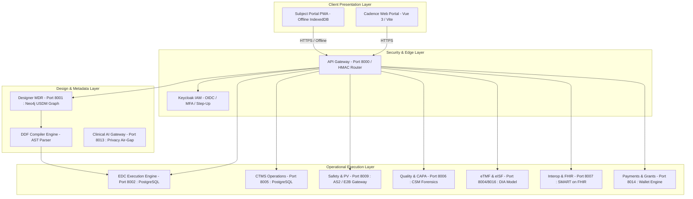
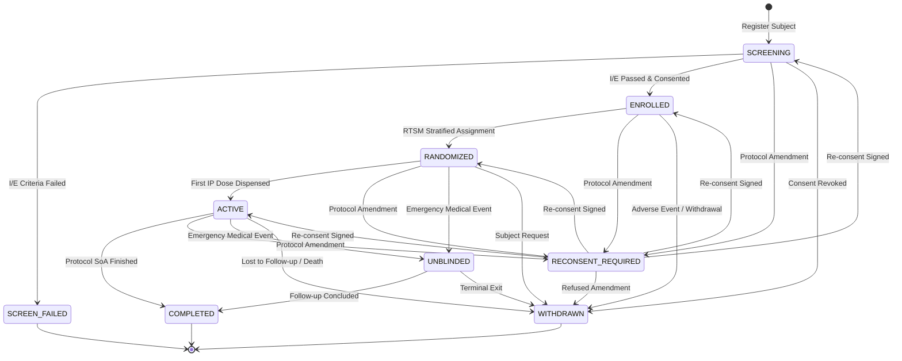
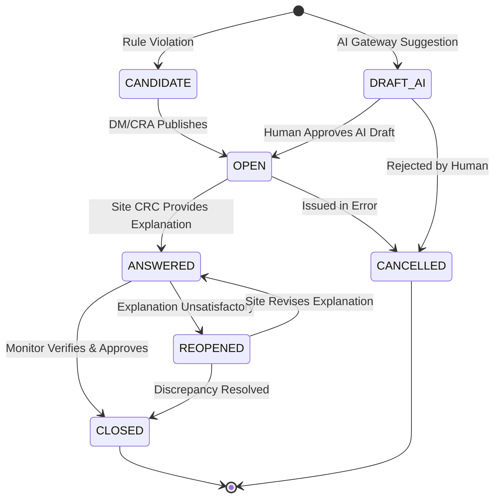
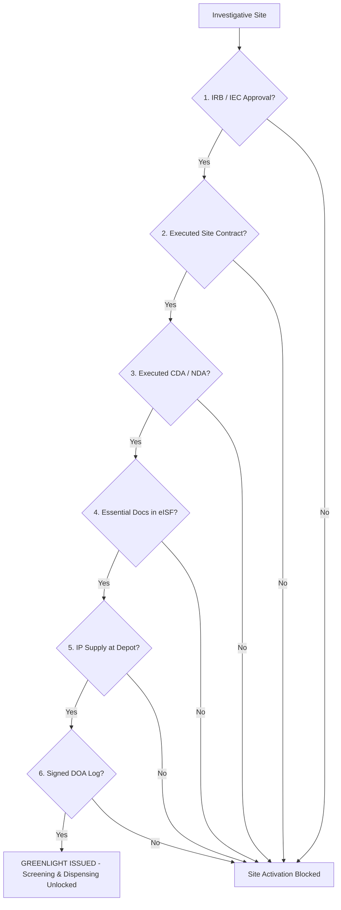
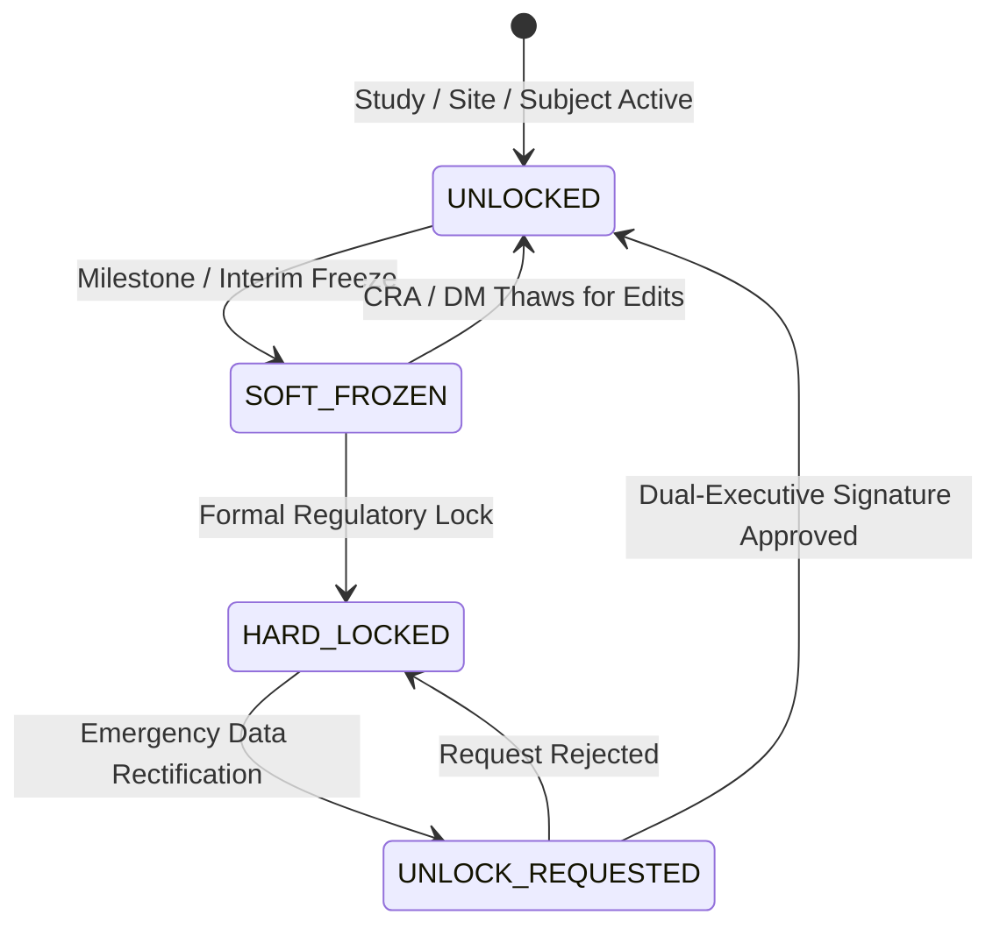

# Software Requirements Specification (SRS)
## Cadence Clinical Research Software Platform

**Document Identifier:** CAD-SRS-001  
**Document Version:** 2.0.0-RELEASE  
**Effective Date:** 2026-09-09  
**GxP Status:** Qualified / Baseline Specification  
**Classification:** GxP Validated / Single Source of Functional Truth  
**Formal Standard Compliance:**  
- **ISO/IEC/IEEE 29148:2018:** Systems and software engineering — Life cycle processes — Requirements engineering (Clauses 9.5 & 9.6)
- **IEC 62304:2006/AMD1:2015:** Medical device software — Software life cycle processes (Class C Classification)
- **FDA 21 CFR Part 11 / EU Annex 11:** Electronic Records; Electronic Signatures
- **ICH GCP E6(R2/R3):** Good Clinical Practice: Integrated Addendum & Modernized Principles
- **CDISC USDM v3.0 / v4.0:** Unified Study Definition Model Specification
- **ISO 14155:2020:** Clinical investigation of medical devices for human subjects — Good clinical practice

---

## 1. Document Control & Standards Conformance

### 1.1 Document Overview & Purpose
This document serves as the formal **Software Requirements Specification (SRS)** and **System Requirements Specification (SyRS)** for the Cadence Clinical Research Software Platform, structured in rigorous adherence to **ISO/IEC/IEEE 29148:2018**.

It establishes the unambiguous, testable, verifiable, and traceably managed functional baseline for the software system that bridges upstream **Clinical Metadata Management (MDR)** with downstream **Electronic Data Capture (EDC)**, **Clinical Trial Management Systems (CTMS)**, **Decentralized Clinical Trials (DCT)**, and operational clinical trial microservices.

### 1.2 Conformance Declaration (ISO/IEC/IEEE 29148:2018)
In conformance with ISO/IEC/IEEE 29148:2018:
1. **Requirements Syntax:** All functional requirement statements are formulated using the formal syntactic rule:  
   $$\text{[Condition]} \;\; \textbf{The [Subject] shall} \;\; \text{[Action]} \;\; \text{[Object]} \;\; \text{[Constraint]}$$
2. **Singularity & Verifiability:** Each requirement clause asserts exactly one verifiable functional behavior.
3. **Modal Verb Standard:** The auxiliary verb **shall** denotes a mandatory binding requirement. The verbs **should** (recommendation) and **may** (permission) are non-binding.
4. **Verification Method Designation:** Every individual requirement specifies an assigned verification method conforming to ISO 29148 §9.6.4:
   - **Inspection (I):** Visual and documentary verification of code, schema, or static configuration.
   - **Analysis (A):** Verification via mathematical proof, statistical calculation, or algorithm evaluation.
   - **Demonstration (D):** Observable operational flow without quantitative instrumentation.
   - **Test (T):** Automated execution against deterministic inputs with quantifiable assertions.

---

## 2. Overall System Description & Operational Context

### 2.1 System Perspective & Architectural Topology
Cadence Clinical operates as a modular, high-integrity eClinical suite deployed across containerized microservices fronted by a reverse-proxy API Gateway and Keycloak OpenID Connect (OIDC) identity provider.



### 2.2 System Operational Modes & States

| Mode / State | Operational Characteristics | Entry Condition | Exit Condition |
| :--- | :--- | :--- | :--- |
| **Normal Operations** | Full read/write concurrency across all 24 subsystems; active transactional audit logging. | System initialization; all health probes green. | Unhandled ledger mismatch or maintenance signal. |
| **Maintenance Mode** | Read-only access to historical records; write endpoints reject mutations with HTTP 503. | Scheduled schema migration or disaster recovery rehearsal. | Administrative cutover completion. |
| **GxP-Lock Mode** | Total immediate freeze on all data mutations; HTTP 423 Locked returned on all write attempts. | SHA-256 Merkle chain verification failure or data tampering detected. | Executive Quality Director cryptographic key reset. |
| **Emergency Unblinding**| Transient medical code-break session exposing treatment allocation for a single subject. | Life-threatening medical emergency requiring PI step-up re-authentication. | 60-second token expiration; safety audit commit. |

### 2.3 Universal GxP Data Invariants
Every transactional table throughout the relational and graph datastores shall implement the universal GxP inheritance schema:
1. `id` (UUIDv4): Globally unique identifier.
2. `created_at` (UTC DateTime): Immutable server-committed timestamp in ISO 8601 UTC format.
3. `created_by` (String): Authenticated OIDC Subject identifier (`sub`).
4. `reason_for_change` (String): Mandatory clinical justification (minimum 10 characters).
5. `version_index` (Integer): Auto-incrementing version sequence ($\ge 1$).
6. `is_deleted` (Boolean): Soft-delete flag; hard deletions are intercepted by `BEFORE DELETE` triggers that divert deleted states into a secure `shadow` schema.

### 2.4 Primary System Actors

#### Human Actors
1. **Sponsor Clinical Designer (`sponsor_designer`):** Authors study designs, objectives, endpoints, Study Arms, Epochs, Encounters, Biomedical Concepts (BCs), and the Schedule of Activities (SoA) matrix.
2. **Sponsor Administrator (`sponsor_admin`):** Oversees overall study operations, site activation waivers, multi-tenant directory setup, and executive governance.
3. **Data Manager (`data_manager`):** Governs data review, clinical coding (MedDRA / WHODrug), automated and manual query resolution, edit checks, and data lock states.
4. **Site Principal Investigator (`site_investigator` / `PI`):** Clinically responsible for subject safety at a site; screens, enrolls, and randomizes subjects; executes 21 CFR Part 11 electronic signatures on eCRFs and Delegation of Authority (DOA) logs.
5. **Clinical Research Coordinator (`crc`):** Site staff member conducting day-to-day data entry into eCRFs, managing site drug kit inventory, tracking subject visits, and submitting expense claims.
6. **Clinical Research Associate (`cra` / `monitor`):** Performs onsite and remote monitoring, Source Data Verification (SDV), Monitoring Visit Reports (MVR), protocol deviation logging, and site audit preparation.
7. **Safety Physician / Qualified Person for Pharmacovigilance (`safety_physician` / `qppv`):** Conducts adverse event triage, medical causality assessments, ICSR E2B(R3) expedited reporting approvals, and aggregate safety signal detection (DSUR/PBRER).
8. **Blinded / Unblinded Statistician (`unblinded_statistician`, `sponsor_statistician`):** Analyzes interim and final trial results. Unblinded statisticians access treatment allocation codes; blinded statisticians validate SDTM/ADaM datasets.
9. **Clinical Endpoint Committee (CEC) Adjudicator:** Independent medical expert reviewing de-identified clinical dossiers to perform blinded event adjudications (e.g. RECIST 1.1 tumor evaluations, cardiovascular events).
10. **Study Subject / Participant (`subject`):** Trial participant who completes eConsent, submits ePRO symptom diaries via offline-first PWA, manages stipend reimbursements, and views lay summaries.
11. **System Auditor (`auditor` / `tmf_auditor`):** Regulatory inspector or internal quality auditor with read-only access across all ledgers, shadow audit schemas, and cryptographic proofs.

#### Machine / Automated Actors
1. **Cryptographic Sealing Worker:** Recurring background worker executing SHA-256 Merkle chaining across transactional audit records every 60 seconds (Advisory Lock `42001`).
2. **Query SLA Escalation Worker:** Evaluates query acknowledgment and resolution age against defined study SLAs, escalating overdue queries (Advisory Lock `42002`).
3. **Transactional Outbox Worker:** Dispatches staged domain events across microservices with at-least-once delivery guarantees (Advisory Lock `42003`).
4. **Statistical Forensics & Fraud Detection Engine:** Analyzes clinical observations for digit preference (Benford's Law) and multi-variate anomalies (Mahalanobis distance).
5. **Perceptual Image Hash (pHash) Sentinel:** Computes 64-bit DCT perceptual hashes of uploaded medical images to detect cross-subject or cross-site image duplication fraud.
6. **AI Gateway Proxy:** Routes semantic medical coding and narrative summarization tasks across Tier 1–3 model tiers behind a PII/PHI de-identification air-gap.
7. **SMART on FHIR Ingestion Adapter:** Polls external EHR systems to discover clinical observation candidates for CRC reconciliation.

### 2.5 Role & Permissions Matrix (RBAC / ABAC)

| Functional Capability | Unauthenticated Guest | Study Subject | Site CRC | Site PI | CRA Monitor | Data Manager | Sponsor Designer | Safety Physician | Statistician | System Auditor | Sponsor Admin |
| :--- | :---: | :---: | :---: | :---: | :---: | :---: | :---: | :---: | :---: | :---: | :---: |
| **View Public Lay Summaries** | ✅ | ✅ | ✅ | ✅ | ✅ | ✅ | ✅ | ✅ | ✅ | ✅ | ✅ |
| **Submit ePRO Diaries (Offline)** | ❌ | ✅ | ❌ | ❌ | ❌ | ❌ | ❌ | ❌ | ❌ | ❌ | ❌ |
| **Manage Participant Wallet** | ❌ | ✅ | View Only | ❌ | ❌ | ❌ | ❌ | ❌ | ❌ | ❌ | Full Access |
| **Author Protocol & USDM Graph** | ❌ | ❌ | ❌ | ❌ | ❌ | Read-Only | Full Access | ❌ | Read-Only | Read-Only | Full Access |
| **Screen & Enroll Subjects** | ❌ | ❌ | Full Access | Full Access | Read-Only | Read-Only | ❌ | ❌ | ❌ | Read-Only | Read-Only |
| **Enter eCRF Observation Data** | ❌ | ❌ | Full Access | Full Access | Read-Only | Read-Only | ❌ | ❌ | ❌ | Read-Only | ❌ |
| **Execute 21 CFR Part 11 eSignatures** | ❌ | eConsent Only | ❌ | Full Access | ❌ | ❌ | Amendment Only | ICSR Only | ❌ | ❌ | Full Access |
| **Perform Source Data Verification (SDV)** | ❌ | ❌ | ❌ | ❌ | Full Access | ❌ | ❌ | ❌ | ❌ | Read-Only | Read-Only |
| **Raise & Close Clinical Queries** | ❌ | ❌ | Answer Only | Answer Only | Full Access | Full Access | ❌ | Safety Only | ❌ | Read-Only | Full Access |
| **Medical Coding (MedDRA/WHODrug)** | ❌ | ❌ | ❌ | ❌ | ❌ | Full Access | Read-Only | Consult | ❌ | Read-Only | Full Access |
| **Emergency Randomization Unblinding**| ❌ | ❌ | ❌ | Emergency | ❌ | ❌ | ❌ | Emergency | Unblinded Only| Read-Only | ❌ |
| **Manage Greenlight Site Startup** | ❌ | ❌ | Read-Only | Read-Only | Verify Facets| Read-Only | ❌ | ❌ | ❌ | Read-Only | Full Access |
| **Adjudicate Blinded Imaging (CEC)**| ❌ | ❌ | ❌ | ❌ | ❌ | ❌ | ❌ | Adjudicator | ❌ | Read-Only | Read-Only |
| **Transmit AS2 E2B(R3) Safety ICSR**| ❌ | ❌ | ❌ | ❌ | ❌ | ❌ | ❌ | Full Access | ❌ | Read-Only | Read-Only |
| **Export SDTM/ADaM Datasets** | ❌ | ❌ | ❌ | ❌ | ❌ | Full Access | Read-Only | ❌ | Full Access | Read-Only | Full Access |
| **Inspect System & Shadow Audit Logs**| ❌ | ❌ | ❌ | ❌ | ❌ | ❌ | ❌ | ❌ | ❌ | Full Access | Full Access |

### 2.6 Comprehensive Domain Model & Glossary

| Entity Name | Domain Subsystem | Operational Definition | Key Attributes | Ownership & Cardinality |
| :--- | :--- | :--- | :--- | :--- |
| **Study** | Designer / MDR | Top-level clinical protocol container defining phases, therapeutic areas, and objectives. | `study_id`, `title`, `phase`, `status`, `usdm_version` | Root entity; 1:N with Arms, Epochs, Visits, Sites. |
| **Biomedical Concept (BC)** | Designer / MDR | Standardized clinical data definition (CDISC USDM) specifying variables, constraints, and data types. | `concept_code`, `name`, `data_type`, `vlm_rules`, `is_locked` | Reusable; M:N with Protocol Elements & Form Items. |
| **Schedule of Activities (SoA)** | Designer / MDR | Structural matrix intersecting Study Encounters (Visits) with Clinical Activities and Biomedical Concepts. | `encounter_id`, `activity_id`, `is_mandatory`, `window_days` | 1:N within Study Protocol. |
| **Protocol Amendment** | Designer / MDR | Formally versioned mutation of an active study definition requiring approval and re-consent tracking. | `amendment_id`, `version_tag`, `status`, `diff_payload`, `effective_date` | 1:N per Study; creates immutable child graph branch. |
| **Clinical Subject** | Execution / EDC | Pseudonymized human participant enrolled in a clinical trial at a specific investigative site. | `subject_id`, `study_id`, `site_id`, `status`, `encrypted_demographics` | Owned by Site; 1:N with Visits, Consents, Observations. |
| **Clinical Visit** | Execution / EDC | Calendar or trigger-based clinical encounter mapped to the protocol Schedule of Activities. | `visit_id`, `subject_id`, `encounter_code`, `scheduled_date`, `status` | Owned by Subject; 1:N with Form Submissions. |
| **eCRF Form Submission** | Execution / EDC | Structured electronic Case Report Form capturing visit observation data. | `form_id`, `visit_id`, `form_definition_id`, `status`, `raw_payload` | Owned by Visit; 1:N with Clinical Observations. |
| **Clinical Observation** | Execution / EDC | Individual atomic data point (e.g. Systolic Blood Pressure) captured within an eCRF. | `observation_id`, `form_id`, `item_code`, `value`, `is_locked`, `sdv_status` | Owned by Form Submission; 1:N with Queries. |
| **Clinical Query** | Execution / EDC | Data clarification discrepancy raised automatically by edit checks or manually by monitors. | `query_id`, `observation_id`, `status`, `query_type`, `message`, `sla_due_date` | M:1 with Observation; 1:N with Query Audit Logs. |
| **RTSM Randomization** | Execution / RTSM | Cryptographically sealed assignment of a subject to a treatment arm and investigational kit. | `randomization_id`, `subject_id`, `treatment_arm`, `kit_number`, `seed_hash` | 1:1 with Subject; immutable once committed. |
| **Site Greenlight Gate** | CTMS / SSU | Multi-factorial readiness validator gating site screening, enrollment, and investigational product release. | `site_id`, `overall_status`, `greenlight_token`, `6_facet_booleans` | 1:1 per Site in Study. |
| **Monitoring Visit (MVR)** | CTMS | Record of CRA site oversight, including source data verification, regulatory binder review, and action items. | `visit_id`, `site_id`, `cra_id`, `visit_type`, `status`, `findings_summary` | Owned by Site; 1:N with Action Items and Findings. |
| **Delegation of Authority (DOA)** | Org / CTMS | Regulatory log defining duties delegated by the Principal Investigator to site staff members. | `site_id`, `personnel_id`, `assigned_roles`, `start_date`, `pi_signature` | Owned by Site; requires 21 CFR Part 11 eSignatures. |
| **eConsent Document** | Electronic Consent | Digitized Informed Consent Form (ICF) presented to subjects with readability metrics and comprehension checks. | `consent_id`, `version_tag`, `flesch_kincaid_score`, `pdf_storage_hash` | 1:N per Study; 1:N with Subject Signatures. |
| **TMF Document** | eTMF | Regulatory artifact classified under the DIA TMF Reference Model v3.2.0 across 10 canonical zones. | `doc_id`, `zone`, `section`, `artifact_code`, `status`, `sha256_hash` | Owned by Study/Site; 1:1 with Storage Envelope. |
| **ISF Document** | eISF | Site-specific regulatory document housed in the site's isolated regulatory binder. | `doc_id`, `site_id`, `eisf_section`, `status`, `etmf_sync_state` | Owned by Site; bidirectionally synced to eTMF. |
| **Safety Case (ICSR)** | Clinical Safety | Individual Case Safety Report capturing adverse events meeting Serious Adverse Event (SAE) criteria. | `case_id`, `subject_id`, `seriousness_criteria`, `expedited_due_date`, `e2b_xml` | Owned by Subject; 1:N with Regulatory Transmissions. |
| **Protocol Deviation** | Quality / CAPA | Non-compliance event with the approved clinical protocol or ICH GCP standards. | `deviation_id`, `site_id`, `severity`, `category`, `status`, `capa_id` | Owned by Study/Site; 1:1 with Root Cause Analysis. |
| **CAPA Record** | Quality / CAPA | Corrective and Preventive Action workflow investigating deviations and systemic quality issues. | `capa_id`, `rca_methodology`, `status`, `effectiveness_outcome` | 1:N with CAPA Action Items; 1:N with Effectiveness Checks. |
| **Imaging Adjudication** | Imaging | Blinded evaluation of radiological scans by independent radiologists using RECIST 1.1 / Lugano criteria. | `adjudication_id`, `series_id`, `reader_id`, `target_lesions`, `overall_response` | M:1 with Imaging Series; triggers tie-breaker on >20% discordance. |
| **Investigational Device** | Device / IVD | Serialized medical device tracking under FDA UDI rules with defect reporting and quarantine states. | `udi_barcode`, `serial_number`, `model_number`, `custody_status`, `quarantine_flag` | Tracked from depot to site to subject. |
| **Participant Wallet** | Payments | Digital financial ledger tracking subject stipends, visit allowances, and OCR receipt reimbursements. | `wallet_id`, `subject_id`, `available_balance`, `ytd_disbursed`, `irs_1099_flag` | 1:1 per Subject; triggers IRS 1099 tracking at $600. |

### 2.7 Master Entity State Lifecycles

#### A. Clinical Subject State Machine


- **`SCREENING`**: Initial state upon demographics capture. Transitions: `SCREEN_FAILED` (I/E failure), `ENROLLED` (all I/E passed and consent signed), `WITHDRAWN` (voluntary exit).
- **`ENROLLED`**: Subject meets all criteria and is eligible for randomization.
- **`RANDOMIZED`**: Subject has received treatment arm assignment and kit allocation; stratification factors are permanently locked.
- **`ACTIVE`**: Subject is actively receiving treatment and participating in scheduled encounters.
- **`UNBLINDED`**: Emergency code-break has unblinded allocation; restricted to life-threatening medical events.
- **`RECONSENT_REQUIRED`**: Protocol amendment issued; freezes future data capture until amended consent form is signed.
- **Terminal States**: `SCREEN_FAILED`, `COMPLETED`, `WITHDRAWN`.

#### B. Clinical Discrepancy (Query) Lifecycle


- **`CANDIDATE`**: Automated edit check has flagged a potential discrepancy, awaiting data manager or CRA confirmation.
- **`DRAFT_AI`**: Clinical AI Gateway has identified a semantic coding or cross-form anomaly; requires human verification before publication.
- **`OPEN`**: Query published and transmitted to investigative site; SLA response clock active.
- **`ANSWERED`**: Site coordinator or investigator has submitted a clarifying explanation or updated eCRF field.
- **`CLOSED`**: Monitor or data manager has verified the response and formally closed the discrepancy.
- **`REOPENED`**: Explanation deemed insufficient; query returned to site for further clarification.
- **`CANCELLED`**: Query cancelled due to invalid flag or system retraction.

#### C. Regulatory eTMF Document Quality Control (QC) Lifecycle
```
[DRAFT] ---> (Initial Upload & Metadata Tagging)
   |
   v
[TECHNICAL_QC] ---> (Automated File Integrity, Virus Scan & Rendition Check)
   |     |   +---> [REJECTED] (Corrupt file, wrong format, failed antivirus)
   v
[CLINICAL_QC] ---> (Document Quality Reviewer inspects DIA taxonomy & legibility)
   |     |   +---> [REJECTED] (Missing pages, wrong metadata classification)
   v
[APPROVED] ---> (Verified, counts toward Expected Document List completeness)
   |
   v
[SIGNED] ---> (Certificate-bound 21 CFR Part 11 Electronic Signature applied)
   |
   v
[ARCHIVED] ---> (Permanent retention lock; legal hold prevents purging)
```

#### D. Quality Deviation & CAPA Lifecycle
- **Deviation States**: `REPORTED` -> `UNDER_ASSESSMENT` -> `RCA_COMPLETE` -> `CAPA_INITIATED` -> `CLOSED`.
- **CAPA Workflow**: `INITIATED` -> `UNDER_REVIEW` -> `IMPLEMENTATION` -> `EFFECTIVENESS_CHECK` -> `CLOSED` (or `REOPENED` upon effectiveness failure).
- **Invariants**: Direct state bypasses are blocked; terminal transitions require Quality Oversight credentials; every transition persists to `QualityAuditLog`.

#### E. Site Greenlight Activation Gate (6-Facet Evaluation)


#### F. Clinical Data Lock Lifecycle


### 2.8 Automated, Asynchronous & Background Operations

| Job / Routine Name | Trigger / Cadence | Subsystem / Service | Functional Objective | Impacted Entities |
| :--- | :--- | :--- | :--- | :--- |
| **Audit Log Cryptographic Sealing** | Every 60 seconds (Advisory Lock `42001`) | Execution Engine | Recalculates SHA-256 Merkle chain across unsealed audit events; seals blocks and flags ledger tampering. | `AuditLog`, `AuditLedgerSeal` |
| **Query SLA Escalation Monitor** | Every 60 minutes (Advisory Lock `42002`) | Tickets / Execution | Evaluates query age against study SLA parameters; auto-escalates overdue queries to Lead CRC, CRA, and PI. | `ClinicalQuery`, `TicketAuditLog` |
| **Transactional Outbox Event Relay** | Continuous polling (Advisory Lock `42003`) | Platform Spine (All apps) | Relays staged integration events to consumer message brokers with at-least-once delivery guarantees. | `IntegrationOutbox` |
| **Cohort Feasibility Evaluation** | Event-driven / On-demand (Lock `42010`) | Designer / RTSM | Runs Monte Carlo simulations evaluating adaptive trial cohort opening, arm dropping, and RAR allocation boundaries. | `AdaptiveTrialConfig`, `DoseCohortState` |
| **Central Statistical Monitoring (CSM)** | Daily (02:00 UTC cron) | Quality Service | Executes Benford's Law Chi-Square and Mahalanobis multivariate anomaly detection across site observations. | `StatisticalForensicsRun`, `SiteForensicsRecord` |
| **Document Intelligence Classifier** | Event-driven upon file ingestion | eTMF Service | OCR extracts text; machine learning model classifies document against DIA TMF Reference Model taxonomy. | `TMFDocument`, `ExpectedDocument` |
| **eConsent Archival Compiler** | Event-driven upon subject sign-off | Electronic Consent | Flattens signed ICF, generates SHA-256 certificate manifest, and dispatches archival copies to eISF and eTMF. | `ConsentDocument`, `EtmfArchivalDelivery` |
| **Continuous Sensor Telemetry Ingestion**| Sub-minute streaming | Interoperability | Ingests wearable sensor time-series data; aggregates daily metrics and raises alerts on safety threshold breaches. | `SensorTelemetryStreamRecord`, `SensorSafetyAlertRecord` |
| **Predictive Resupply Forecasting** | Nightly (03:00 UTC cron) | Execution / RTSM | Analyzes site screening rates and drug shelf-life to generate automated depot-to-site transfer orders. | `PredictiveResupplyForecast`, `TransferOrder` |
| **Media Transcoding Worker** | Event-driven upon media upload | FileShare Service | Transcodes patient interview audio and telemedicine video recordings into standardized, web-streamable MP4/HLS formats. | `FileRecordModel`, `PlaybackAuditLogModel` |
| **Antivirus Scanner Engine** | Event-driven upon file commit | FileShare Service | ClamAV engine scans uploaded binary streams before transitioning storage envelopes to `COMMITTED`. | `FileRecordModel` (Virus scan status) |

### 2.9 External Integrations & Boundary Exchanges

| External Capability | Protocol / Format | Direction | Functional Payload & Trigger |
| :--- | :--- | :--- | :--- |
| **Identity Provider (OIDC/IAM)** | OAuth 2.0 / OIDC (JWT) | Inbound / Bidirectional | Authenticates user credentials, validates MFA, provides user roles/claims, and issues 60s step-up tokens. |
| **Hospital EHR Systems** | SMART on FHIR / HL7 REST | Inbound | Polls `Condition`, `Observation`, and `MedicationStatement` resources to populate eSource review drawers. |
| **Regulatory Health Gateways** | AS2 / EDI / ISO 27953-2 XML | Outbound / Bidirectional | Transmits ICH E2B(R3) ICSR safety cases to FDA FAERS, EMA EudraVigilance, PMDA; receives synchronous MDN receipts. |
| **Medical Terminology Dictionaries**| Flat File / ASCII Ingestion | Inbound | Imports authoritative MedDRA (MSSO) and WHODrug (Uppsala Monitoring Centre) dictionary releases. |
| **Object Storage Sinks** | S3 API / Presigned HTTPS | Bidirectional | Direct browser-to-storage binary upload/download for eCRF attachments, medical imaging DICOMs, and eTMF files. |
| **Multi-Channel Dispatchers** | SMTP (Jinja2) / SMS / Webhooks | Outbound | Sends email notifications, SMS compliance alerts, and HMAC-signed external webhooks for study events. |
| **Payment Processors / Banking** | NACHA ACH / ISO 20022 REST | Outbound | Dispatches direct deposit stipend disbursements to patient wallets and site bank accounts. |
| **Biometric Sensor Gateways** | Open mHealth / Bluetooth API | Inbound | Telemetry streams from continuous glucose monitors, pulse oximeters, and actigraphy wearables. |

### 2.10 Core End-to-End Clinical User Journeys

#### Journey 1: Digital Protocol Design to Downstream Execution Activation
1. **Authoring:** Sponsor Designer logs into Cadence Designer (`/mdr`), selects study, and authors Study Arms, Epochs, and Encounters.
2. **Concept Mapping:** Designer drags Biomedical Concepts (e.g. Vital Signs, Adverse Events) onto the Schedule of Activities (SoA) matrix and sets visit tolerance windows.
3. **Validation:** Designer runs the Protocol Quality Sentinel; system validates graph connectivity and USDM compliance.
4. **Digitization & Export:** DDF Compiler transforms the Neo4j USDM graph into intermediate representation (IR) and compiles eCRF definitions into the PostgreSQL Execution Engine.
5. **Readiness:** Site CRC logs into `/ecrf`; the new study forms are immediately ready for dynamic schema projection without manual database schema creation.

#### Journey 2: Site Startup, 6-Facet Greenlight, and First Subject Ingestion
1. **Startup Governance:** Sponsor Admin inspects Site 101 on the SSU dashboard (`/ssu`).
2. **Facet Verification:** System checks: IRB approval documented (✅), CTA executed (✅), Form 1572 in eISF (✅), PI signed DOA log (✅), staff training complete (✅), and IP received (✅).
3. **Certification:** System generates cryptographic `greenlight_token`; unlocks site in EDC and RTSM.
4. **Subject Screening:** CRC registers Subject 101-001; captures demographics.
5. **eConsent:** Subject reads ICF on tablet, completes comprehension quiz, and executes electronic signature. System archives signed PDF to eISF/eTMF.
6. **I/E Verification:** CRC completes Inclusion/Exclusion checklist; system confirms eligibility.
7. **Randomization:** PI clicks "Randomize Subject" and enters step-up credentials; RTSM executes stratified permuted block algorithm, assigns Treatment Arm A and Kit #4021; subject transitions to `RANDOMIZED`.

#### Journey 3: Clinical Data Entry, Discrepancy Query, and CRA Verification
1. **Data Entry:** CRC enters Visit 1 vital signs (Systolic: 120, Diastolic: 130).
2. **Edit Check Trigger:** System edit check flags Diastolic > Systolic; creates `ClinicalQuery` in `CANDIDATE` state.
3. **Data Manager Review:** Data Manager reviews candidate query and clicks "Publish"; query becomes `OPEN`.
4. **Site Correction:** CRC receives alert, inspects source document, and updates Diastolic to 80 with reason "Transposition error in source note".
5. **Query Resolution:** Query transitions to `ANSWERED`.
6. **Monitoring:** CRA arrives on site, reviews source electronic health record against eCRF, and verifies data. CRA approves query resolution (`CLOSED`) and signs off on observation Source Data Verification (`SDV_COMPLETED`).

#### Journey 4: Emergency Pharmacovigilance & Expedited ICSR Regulatory Reporting
1. **SAE Occurrence:** Subject 101-001 experiences anaphylaxis post-infusion; admitted to ICU.
2. **Event Capture:** CRC records Adverse Event in eCRF; marks "Serious: Life-Threatening / Hospitalization".
3. **Emergency Unblinding:** PI navigates to `/ecrf`, initiates code-break, provides medical rationale, and enters step-up signature. System unblinds subject (Arm A - Active Drug).
4. **Safety Triage:** Safety Physician receives immediate alert, reviews case in PV workbench (`/safety`), verifies causality as "Related", and marks case as SUSAR.
5. **XML Compilation:** System compiles ISO 27953-2 E2B(R3) XML; calculates 7-calendar-day expedited regulatory deadline.
6. **AS2 Dispatch:** B2B AS2 Gateway transmits encrypted package to FDA FAERS and EMA EudraVigilance; receives and validates synchronous MDN receipt; transitions case to `TRANSMITTED_VERIFIED`.

#### Journey 5: Protocol Amendment, Semantic Diff, and Subject Re-Consent
1. **Protocol Revision:** Sponsor amends study to add an exploratory biomarker blood draw at Visit 3.
2. **Branching:** Designer branches protocol to Version 2.0.0; adds procedure to SoA.
3. **Diff Analysis:** System generates semantic diff highlighting new blood draw; updates ICF template.
4. **Execution Release:** Amendment is published. Enrolled active subjects are automatically transitioned to `RECONSENT_REQUIRED`.
5. **Site Alert:** Site 101 is notified; Visit 3 data capture for enrolled subjects is soft-locked.
6. **Re-Consent:** Subject attends Visit 3, signs amended ICF on tablet. Subject state returns to `ACTIVE`; Visit 3 biomarker eCRF unlocks for CRC data entry.

---

## 3. Specific Software Functional Requirements (4-Part ISO 29148 Specification)

### 3.1 Subsystem 1: System Baseline, Cryptography & Audit Ledger

#### SRS-SYS-001: Standard 21 CFR Part 11 Audit Trail Persistence
* **Parent PRD:** `PRD-SYS-001`
* **Statement:** When any transactional clinical entity or metadata record is created, updated, or soft-deleted, the Execution Engine shall persist an immutable audit record capturing `created_at`, `created_by`, `reason_for_change`, and an incremented `version_index` within the same database transaction.
* **Regulatory Basis:** 21 CFR Part 11 § 11.10(e); EU Annex 11 § 9; ICH GCP E6(R2) § 5.5.3.
* **Verification Method & Qualification:** Test (T) — Automated Unit & Integration Suite [OQ].
* **Verification Criteria:** Assert that updates increment `version_index` by exactly 1, reject reasons shorter than 10 characters, and write synchronous entries to `AuditLog`.

#### SRS-SYS-002: Monotonic SHA-256 Merkle Audit Chain Sealing
* **Parent PRD:** `PRD-SYS-003`
* **Statement:** The Cryptographic Sealer Worker shall execute every 60 seconds under advisory lock `42001`, calculating a chained block digest $\text{Hash}_n = \text{SHA256}(\text{Block}_n \parallel \text{Hash}_{n-1})$ across all unsealed audit records, and persist the resultant seal to `AuditLedgerSeal`.
* **Regulatory Basis:** 21 CFR Part 11 § 11.10(c); ISO 14971 § 7.1.
* **Verification Method & Qualification:** Analysis (A) & Test (T) [OQ].
* **Verification Criteria:** Corrupted audit record in test harness forces verification failure, triggers high-priority security alert, and transitions system to GxP-Lock state.

#### SRS-SYS-003: Database-Level Trigger Soft-Delete Interception
* **Parent PRD:** `PRD-SYS-002`
* **Statement:** When an out-of-band or direct SQL `DELETE` statement is executed against any clinical operational table, the PostgreSQL database trigger shall abort the physical row deletion and insert the pre-delete row image into the secure `shadow` schema with active user context.
* **Regulatory Basis:** 21 CFR Part 11 § 11.10(b); EU Annex 11 § 7.1.
* **Verification Method & Qualification:** Test (T) [OQ].
* **Verification Criteria:** Executing raw SQL `DELETE FROM clinical_subjects` leaves table row count unchanged while creating a corresponding shadow delta record.

#### SRS-SYS-004: Universal Site Isolation Boundary
* **Parent PRD:** `PRD-SYS-004`
* **Statement:** When an authenticated site-scoped user initiates a request for subject records, the API Gateway and Application Layer shall restrict query results strictly to subjects sharing the user's assigned `site_id`, rejecting cross-site access attempts with HTTP 403 Forbidden.
* **Regulatory Basis:** 21 CFR Part 11 § 11.10(g); HIPAA Security Rule 45 CFR § 164.312(a).
* **Verification Method & Qualification:** Test (T) [OQ].
* **Verification Criteria:** User with `site_id = SITE-001` attempting to query subject belonging to `SITE-002` receives HTTP 403 and writes security incident log.

#### SRS-SYS-005: 60-Second Signature Step-Up Token Re-Authentication
* **Parent PRD:** `PRD-SYS-050`
* **Statement:** When a user executes a high-stakes clinical action (e-signature, randomization, emergency code-break), the API Gateway shall validate user password and TOTP credentials, issuing a single-use JWT `X-Sig-Token` valid for exactly 60 seconds carrying a unique `jti`.
* **Regulatory Basis:** 21 CFR Part 11 § 11.50, § 11.200; EU Annex 11 § 14.
* **Verification Method & Qualification:** Test (T) [OQ].
* **Verification Criteria:** Token older than 60 seconds or replayed with same `jti` is rejected with HTTP 401 Unauthorized.

#### SRS-EVT-001: Transactional Outbox Event Relay & Microservice Parity
* **Parent PRD:** `PRD-SYS-001`
* **Statement:** When any domain mutation commits state to persistence, the local Application Layer shall write an atomic outbox message within the same database transaction; the background Outbox Worker shall poll unsent messages under advisory lock `42003` and dispatch to target message brokers with at-least-once delivery guarantees.
* **Regulatory Basis:** 21 CFR Part 11 § 11.10(a); ISO/IEC/IEEE 29148:2018 § 9.6.2.
* **Verification Method & Qualification:** Test (T) [OQ].
* **Verification Criteria:** Outbox events are dispatched in FIFO order without message loss; network drop triggers exponential retry backoff without duplication.

---

### 3.2 Subsystem 2: Study Protocol Authoring & Metadata Repository (MDR)

#### SRS-MDR-001: CDISC USDM Graph Protocol Authoring
* **Parent PRD:** `PRD-MDR-001`
* **Statement:** The Designer Service shall persist clinical study protocols as a directed property graph in Neo4j conforming strictly to the CDISC USDM v3.0/v4.0 specification, enforcing topological ordering across Study Arms, Epochs, and Encounters.
* **Regulatory Basis:** CDISC USDM v3.0 Core Specification; ICH M11.
* **Verification Method & Qualification:** Test (T) [OQ].
* **Verification Criteria:** Graph validation rejects cyclic epoch paths and validates schema against official USDM JSON Schema.

#### SRS-MDR-002: Biomedical Concept Lock State in Active Execution
* **Parent PRD:** `PRD-MDR-002`
* **Statement:** When a study transitions to active clinical execution, the Designer Service shall lock all instantiated Biomedical Concepts and Value-Level Metadata from direct modification, requiring a formal protocol amendment for revisions.
* **Regulatory Basis:** ICH GCP E6(R2) § 4.5.1; 21 CFR § 312.30.
* **Verification Method & Qualification:** Test (T) [OQ].
* **Verification Criteria:** Mutation attempt against in-use Biomedical Concept returns HTTP 423 Locked (`IN_USE_LOCK_ERROR`).

#### SRS-MDR-003: Schedule of Activities (SoA) Matrix Synthesis
* **Parent PRD:** `PRD-MDR-007`
* **Statement:** The Designer Service shall synthesize a cross-sectional Schedule of Activities matrix mapping clinical activities to encounters, computing relative visit windows $T_{\text{target}} \pm \Delta_{\text{days}}$ and activity mandatory flags.
* **Regulatory Basis:** CDISC USDM v3.0 SoA Model; ICH M11.
* **Verification Method & Qualification:** Demonstration (D) & Test (T) [OQ].
* **Verification Criteria:** Generated SoA matrix accurately outputs valid visit window boundaries for all encounters.

#### SRS-MDR-004: Semantic Protocol Amendment Diffing
* **Parent PRD:** `PRD-MDR-003`
* **Statement:** When an amendment is authored, the Designer Service shall branch the study graph via `PREVIOUS_VERSION` relationships and compute a multi-layer semantic diff categorizing additions, modifications, and deletions of visits and procedures.
* **Regulatory Basis:** ICH GCP E6(R2) § 4.5.3; 21 CFR § 312.30.
* **Verification Method & Qualification:** Test (T) [OQ].
* **Verification Criteria:** Diff engine correctly identifies modified visit windows and added procedures between Version 1.0 and 2.0 without altering Version 1.0 nodes.

---

### 3.3 Subsystem 3: Digital Data Flow (DDF) Compiler Engine

#### SRS-DDF-001: USDM to Intermediate Representation (IR) Compilation
* **Parent PRD:** `PRD-DDF-001`
* **Statement:** The DDF Compiler Engine shall ingest USDM protocol graphs and compile an abstract syntax tree (AST) intermediate representation containing form layouts, item data types, and cross-variable validation rules.
* **Regulatory Basis:** CDISC DDF Architectural Blueprint v1.0.
* **Verification Method & Qualification:** Analysis (A) & Test (T) [OQ].
* **Verification Criteria:** AST compilation completes with zero schema syntax errors; generates CDISC ODM-XML v1.3.2 export.

#### SRS-DDF-002: Automated eCRF Layout Generation
* **Parent PRD:** `PRD-DDF-001`
* **Statement:** The DDF Compiler Engine shall transform the intermediate representation into OpenRosa XForms and relational JSONB form schemas executable by the downstream EDC runtime.
* **Regulatory Basis:** CDASH v2.2 Standards; CDISC ODM v1.3.2.
* **Verification Method & Qualification:** Test (T) [OQ].
* **Verification Criteria:** Compiled eCRF schemas load into the EDC Execution Engine and render identical field definitions across web and mobile viewports.

---

### 3.4 Subsystem 4: Electronic Data Capture (EDC) & eCRF Execution Runtime

#### SRS-EDC-001: Dynamic Subject Schema Projection
* **Parent PRD:** `PRD-EDC-001`
* **Statement:** When a subject visit casebook is rendered, the Execution Engine shall dynamically project the eCRF layout matching the subject's `active_protocol_version` tag, ensuring historical visit forms remain immutable across protocol amendments.
* **Regulatory Basis:** 21 CFR Part 11 § 11.10(a); ICH GCP E6(R2) § 5.5.3.
* **Verification Method & Qualification:** Test (T) [OQ].
* **Verification Criteria:** Enrolled subject on Version 1.0 renders Version 1.0 form layout; subject on Version 2.0 renders updated form layout with added procedures.

#### SRS-EDC-002: Real-Time Edit Check Evaluation & Candidate Query Staging
* **Parent PRD:** `PRD-EDC-002`
* **Statement:** During eCRF form submission, the Execution Engine shall evaluate all active validation rules; if univariate or multivariate discrepancies are detected, the system shall stage a `ClinicalQuery` record in `CANDIDATE` status.
* **Regulatory Basis:** 21 CFR Part 11 § 11.10(f); ICH GCP E6(R2) § 5.5.3.
* **Verification Method & Qualification:** Test (T) [OQ].
* **Verification Criteria:** Submitting systolic BP < diastolic BP commits observation but automatically creates staged `CANDIDATE` query.

#### SRS-EDC-003: 21 CFR Part 11 Electronic Signature Manifestation
* **Parent PRD:** `PRD-EDC-003`
* **Statement:** When an investigator signs an eCRF form, the system shall validate the 60-second step-up token, generate a persistent `SignatureManifestation` embedding signer name, UTC timestamp, and statement of intent, and transition form status to `SIGNED`.
* **Regulatory Basis:** 21 CFR Part 11 § 11.50, § 11.70.
* **Verification Method & Qualification:** Test (T) [OQ].
* **Verification Criteria:** Post-signature edits invalidate the signature manifest and transition form status back to `MODIFIED_POST_SIGNATURE`.

---

### 3.5 Subsystem 5: Subject Lifecycle, Eligibility & Randomization (RTSM)

#### SRS-SUB-001: Subject State Machine Transition Governance
* **Parent PRD:** `PRD-SUB-001`
* **Statement:** The Execution Engine shall govern subject progression through the strict state machine: $\text{SCREENING} \rightarrow \text{ENROLLED} \rightarrow \text{RANDOMIZED} \rightarrow \text{ACTIVE} \rightarrow \text{COMPLETED}$, blocking unauthorized bypasses with `InvalidStateTransitionError`.
* **Regulatory Basis:** ICH GCP E6(R2) § 4.3; ISO 14155 § 7.3.
* **Verification Method & Qualification:** Test (T) [OQ].
* **Verification Criteria:** Direct transition attempt from `SCREENING` to `RANDOMIZED` raises validation exception (HTTP 422).

#### SRS-SUB-002: Automated Inclusion / Exclusion Eligibility Gating
* **Parent PRD:** `PRD-SUB-002`
* **Statement:** When the screening checklist is submitted, the system shall verify that all Inclusion criteria evaluate to `TRUE` and all Exclusion criteria evaluate to `FALSE`; any violation shall transition the subject to `SCREEN_FAILED`.
* **Regulatory Basis:** ICH GCP E6(R2) § 4.5.2; 21 CFR § 312.60.
* **Verification Method & Qualification:** Test (T) [OQ].
* **Verification Criteria:** Failing a single mandatory inclusion criterion blocks enrollment and prevents randomization.

#### SRS-SUB-003: Stratified Permuted Block Randomization & Factor Immutability
* **Parent PRD:** `PRD-SUB-003`
* **Statement:** Upon valid randomization command, the RTSM Engine shall compute treatment allocation via stratified permuted blocks, commit allocation in an atomic database transaction, and permanently lock subject `strat_factors` from subsequent alteration.
* **Regulatory Basis:** ICH E9 Statistical Principles for Clinical Trials § 2.3.
* **Verification Method & Qualification:** Test (T) [OQ].
* **Verification Criteria:** Attempted alteration of stratification factors on a randomized subject raises `LOCKED_FACTOR_MUTATION` exception.

#### SRS-SUB-004: Emergency Unblinding Code-Break Protocol
* **Parent PRD:** `PRD-SUB-004`
* **Statement:** When an emergency code-break is executed, the Execution Engine shall require PI step-up re-authentication and clinical justification, expose treatment allocation immediately, mark `is_unblinded = TRUE`, and emit high-priority alerts to the Medical Monitor.
* **Regulatory Basis:** ICH GCP E6(R2) § 5.13.4; 21 CFR Part 11 § 11.10(e).
* **Verification Method & Qualification:** Test (T) [OQ].
* **Verification Criteria:** Successful unblinding updates subject state to `UNBLINDED` and writes an immutable audit record containing IP address and reason.

---

### 3.6 Subsystem 6: Data Clarification, Queries & Review Workflows

#### SRS-QRY-001: Clinical Discrepancy (Query) Lifecycle Management
* **Parent PRD:** `PRD-QRY-001`
* **Statement:** The Execution Engine shall enforce the query lifecycle state transitions: $\text{CANDIDATE} \rightarrow \text{OPEN} \rightarrow \text{ANSWERED} \rightarrow \text{CLOSED} \mid \text{REOPENED}$, permitting only site staff to answer and data management/monitors to close.
* **Regulatory Basis:** 21 CFR Part 11 § 11.10(e); ICH GCP E6(R2) § 5.5.3.
* **Verification Method & Qualification:** Test (T) [OQ].
* **Verification Criteria:** Site user attempt to transition query directly from `OPEN` to `CLOSED` returns HTTP 403 Forbidden.

#### SRS-QRY-002: Background Query SLA Auto-Escalation & Notification
* **Parent PRD:** `PRD-QRY-002`
* **Statement:** The Background Query SLA Escalation Worker shall sweep open queries every 60 minutes under advisory lock `42002`, advancing overdue queries from `NORMAL` to `HIGH` priority at 5 days and `CRITICAL` at 10 days, generating notifications to the assigned CRA and site PI.
* **Regulatory Basis:** ICH GCP E6(R2) § 5.18.4; 21 CFR Part 11 § 11.10(a).
* **Verification Method & Qualification:** Test (T) [OQ].
* **Verification Criteria:** Unanswered queries exceeding SLA threshold advance in priority and emit notification events with audit trails.

#### SRS-QRY-003: Controlled 14-Day Query Reopening Window
* **Parent PRD:** `PRD-QRY-003`
* **Statement:** When a Data Manager requests to reopen a `CLOSED` clinical query, the Execution Engine shall permit reopening if the closure timestamp is $\le 14\text{ days}$ old, requiring a mandatory supervisory change justification and resetting the site SLA clock.
* **Regulatory Basis:** 21 CFR Part 11 § 11.10(e); ICH GCP E6(R2) § 4.9.3.
* **Verification Method & Qualification:** Test (T) [OQ].
* **Verification Criteria:** Reopen request on query closed 15 days prior returns HTTP 422 Unprocessable Entity.

---

### 3.7 Subsystem 7: Medical Terminology & Dictionary Coding

#### SRS-COD-001: MedDRA & WHODrug Automated Semantic Coding
* **Parent PRD:** `PRD-COD-001`
* **Statement:** The Medical Coding Engine shall process verbatim adverse event and concomitant medication terms against authoritative MedDRA and WHODrug releases, generating deterministic LLT/PT/SOC and ATC coding suggestions with confidence scores.
* **Regulatory Basis:** ICH M1 MedDRA Terminology; WHO-ART Guidelines.
* **Verification Method & Qualification:** Test (T) [OQ].
* **Verification Criteria:** Exact verbatim match auto-codes with 1.0 confidence; low-confidence matches are staged for human Data Manager manual review.

#### SRS-COD-002: Dictionary Up-Versioning Impact Analysis
* **Parent PRD:** `PRD-COD-002`
* **Statement:** When a new MedDRA dictionary release is imported, the Coding Engine shall execute an automated impact analysis identifying previously coded terms impacted by structural hierarchical moves or currency demotions.
* **Regulatory Basis:** ICH M1 Best Practices Guide § 4.
* **Verification Method & Qualification:** Test (T) [OQ].
* **Verification Criteria:** Up-versioning scan generates a differential impact report highlighting demoted LLTs and stages them for recoding.

---

### 3.8 Subsystem 8: Study Startup (SSU) & Greenlight Site Activation

#### SRS-SSU-001: 6-Facet Automated Site Greenlight Gate
* **Parent PRD:** `PRD-SSU-001`
* **Statement:** The CTMS Startup Engine shall evaluate the 6 mandatory site activation facets (IRB/IEC Approval, Executed Clinical Trial Agreement, Executed CDA/NDA, Essential Documents in eISF, Investigational Product Supply at Depot, and Signed DOA Log), gating subject screening until all 6 evaluate to `TRUE`.
* **Regulatory Basis:** ICH GCP E6(R2) § 5.6; 21 CFR § 312.60.
* **Verification Method & Qualification:** Test (T) [OQ].
* **Verification Criteria:** Missing any single facet blocks site activation and prevents subject enrollment in the Execution Engine.

#### SRS-SSU-002: Executive Dual-Signature GxP Override
* **Parent PRD:** `PRD-SSU-002`
* **Statement:** When an administrative site activation override is submitted, the system shall require dual-signature authorization from the Sponsor QA Director and Lead Medical Monitor with 60-second step-up tokens and formal justification.
* **Regulatory Basis:** 21 CFR Part 11 § 11.50, § 11.200.
* **Verification Method & Qualification:** Test (T) [OQ].
* **Verification Criteria:** Override commits only when two distinct executive signatures are verified; logs an indelible audit trail entry.

---

### 3.9 Subsystem 9: CTMS Operations, CRA Monitoring & RBQM

#### SRS-CTM-001: CRA Monitoring Visit Report Lifecycle
* **Parent PRD:** `PRD-CTM-001`
* **Statement:** The CTMS service shall manage Monitoring Visit Reports (MVR) across discrete lifecycle states: $\text{SCHEDULED} \rightarrow \text{IN_PROGRESS} \rightarrow \text{SUBMITTED} \rightarrow \text{APPROVED}$, enforcing CRA authoring gates and Sponsor Approver electronic signatures.
* **Regulatory Basis:** ICH GCP E6(R2) § 5.18.6; 21 CFR Part 11 § 11.10(a).
* **Verification Method & Qualification:** Test (T) [OQ].
* **Verification Criteria:** Unapproved MVR cannot be finalized; all edits during visit review generate audit history with user attribution.

#### SRS-CTM-002: RBQM Key Risk Indicator (KRI) Z-Scores
* **Parent PRD:** `PRD-CTM-002`
* **Statement:** The CTMS Risk-Based Quality Management (RBQM) engine shall compute statistical Z-scores across study Key Risk Indicators (AE reporting rate, query resolution latency, protocol deviation density) across all investigative sites.
* **Regulatory Basis:** ICH E6(R2) § 5.0 (Risk-based monitoring); TransCelerate RBM Framework.
* **Verification Method & Qualification:** Analysis (A) & Test (T) [OQ].
* **Verification Criteria:** Site with $|Z| > 2.0$ on AE reporting density auto-triggers a targeted monitoring visit recommendation and notification to the Lead CRA.

---

### 3.10 Subsystem 10: Regulatory eTMF Ingestion & DIA Reference Model

#### SRS-TMF-001: DIA TMF Reference Model v3.2.0 Ingestion
* **Parent PRD:** `PRD-TMF-001`
* **Statement:** The eTMF Service shall classify ingested documents against the authoritative DIA TMF Reference Model v3.2.0 catalog across 10 canonical zones, validating artifact codes and rejecting unmapped classifications with HTTP 422.
* **Regulatory Basis:** DIA TMF Reference Model v3.2.0; 21 CFR Part 11 § 11.10(a).
* **Verification Method & Qualification:** Test (T) [OQ].
* **Verification Criteria:** Ingesting an unrecognized artifact code returns HTTP 422; valid documents persist zone, section, and artifact metadata.

#### SRS-TMF-002: Expected Document List (EDL) Completeness
* **Parent PRD:** `PRD-TMF-004`
* **Statement:** The eTMF Completeness Engine shall dynamically calculate study-level and site-level Expected Document List (EDL) completeness percentages against active clinical milestones, surfacing missing essential documents.
* **Regulatory Basis:** ICH GCP E6(R2) § 8.1; EMA Reflection Paper on TMF.
* **Verification Method & Qualification:** Test (T) [OQ].
* **Verification Criteria:** Completeness score accurately reflects ratio of approved documents against milestone requirements.

---

### 3.11 Subsystem 11: Isolated eISF Regulatory Binder & Synchronization

#### SRS-ISF-001: Site-Isolated Regulatory Binder
* **Parent PRD:** `PRD-ISF-001`
* **Statement:** The eISF Service shall enforce strict site tenancy isolation, ensuring that Principal Investigators and site coordinators access only documents residing within their institution's assigned binder partition.
* **Regulatory Basis:** ICH GCP E6(R2) § 8.1; HIPAA Security Rule.
* **Verification Method & Qualification:** Test (T) [OQ].
* **Verification Criteria:** Investigator token from Site A querying Site B document binder returns HTTP 403 Forbidden.

#### SRS-ISF-002: Bidirectional eISF-to-eTMF Sync
* **Parent PRD:** `PRD-ISF-002`
* **Statement:** When a site document (e.g. executed Form 1572, CV) is approved in the eISF, the synchronization worker shall deliver a verified cryptographic copy to the Sponsor eTMF with unbroken audit provenance.
* **Regulatory Basis:** ICH GCP E6(R2) § 8.1; 21 CFR Part 11 § 11.10(e).
* **Verification Method & Qualification:** Test (T) [OQ].
* **Verification Criteria:** Synchronized eTMF document reflects identical SHA-256 digest and records originating site user in audit trail.

---

### 3.12 Subsystem 12: Digital Informed Consent (eConsent) & Re-Consent

#### SRS-CON-001: Flesch-Kincaid Readability Scoring
* **Parent PRD:** `PRD-CON-001`
* **Statement:** Prior to IRB submission, the eConsent authoring engine shall calculate the Flesch-Kincaid Grade Level of participant-facing informed consent forms, flagging texts exceeding an 8th-grade reading level.
* **Regulatory Basis:** FDA Guidance: Informed Consent Information Sheet; 21 CFR § 50.20.
* **Verification Method & Qualification:** Analysis (A) & Test (T) [OQ].
* **Verification Criteria:** Complex medical terminology forcing readability > 8.0 raises authoring advisory warning.

#### SRS-CON-002: Dynamic Protocol Amendment Re-Consent
* **Parent PRD:** `PRD-CON-003`
* **Statement:** When a protocol amendment is published with patient safety impacts, the eConsent Engine shall transition affected active subjects to `RECONSENT_REQUIRED`, freezing subsequent visit data capture until the revised consent is signed.
* **Regulatory Basis:** 21 CFR § 50.25(b)(5); ICH GCP E6(R2) § 4.8.2.
* **Verification Method & Qualification:** Test (T) [OQ].
* **Verification Criteria:** Subject in `RECONSENT_REQUIRED` state blocks eCRF submission for post-amendment encounters until electronic signature is verified.

---

### 3.13 Subsystem 13: Pharmacovigilance, E2B(R3) & AS2 Regulatory Gateway

#### SRS-SAF-001: ICH E2B(R3) ISO 27953-2 ICSR XML
* **Parent PRD:** `PRD-SAF-001`
* **Statement:** The Safety Gateway shall compile Serious Adverse Event cases into validated ICH E2B(R3) XML messages conforming strictly to ISO 27953-2 schema specifications and regional FDA/EMA implementation guides.
* **Regulatory Basis:** ICH E2B(R3); FDA Specifications for Preparing and Submitting Electronic ICSRs.
* **Verification Method & Qualification:** Test (T) [OQ].
* **Verification Criteria:** Generated E2B(R3) XML passes W3C XML Schema validation and Schematron business rule validation with zero errors.

#### SRS-SAF-002: Expedited 7/15-Day Regulatory Clock
* **Parent PRD:** `PRD-SAF-002`
* **Statement:** When an SAE is classified as fatal or life-threatening SUSAR, the Safety Service shall initiate an expedited 7-calendar-day regulatory reporting clock; all other serious unexpected cases initiate a 15-calendar-day clock.
* **Regulatory Basis:** 21 CFR § 312.32(c)(1); ICH E2A § III.A.
* **Verification Method & Qualification:** Test (T) [OQ].
* **Verification Criteria:** Safety case dashboard displays active countdown; alerts Medical Monitor at 50%, 75%, and 90% clock expiration.

#### SRS-SAF-003: B2B AS2 Secure Transmission & MDN Check
* **Parent PRD:** `PRD-SAF-003`
* **Statement:** The Safety Transmission Engine shall package E2B(R3) XML into S/MIME encrypted AS2 messages, transmit to regulatory health authority endpoints (FDA ESG, EMA EudraVigilance), and verify synchronous Message Disposition Notifications (MDN).
* **Regulatory Basis:** RFC 4130 (AS2); 21 CFR Part 11 § 11.10(d).
* **Verification Method & Qualification:** Test (T) [OQ].
* **Verification Criteria:** Transmission transitions to `COMPLETED_VERIFIED` only upon receiving cryptographically signed MDN with matching MIC.

---

### 3.14 Subsystem 14: Medical Imaging & Blinded RECIST 1.1 Adjudication

#### SRS-IMG-001: WebGL Multi-Planar Reconstruction (MPR)
* **Parent PRD:** `PRD-IMG-001`
* **Statement:** The Medical Imaging Viewer shall render DICOM CT and MRI scan series in orthogonal planes (Axial, Sagittal, Coronal) using client-side WebGL shaders, supporting caliper and ellipse measurement tools.
* **Regulatory Basis:** FDA Guidance: Clinical Trial Imaging Endpoint Process Standards.
* **Verification Method & Qualification:** Demonstration (D) [OQ].
* **Verification Criteria:** Image series load within 3 seconds; measurements maintain sub-millimeter precision calibration against DICOM pixel spacing.

#### SRS-IMG-002: Blinded RECIST 1.1 20% SOD Discordance
* **Parent PRD:** `PRD-IMG-002`
* **Statement:** When two independent blinded radiologists submit tumor assessments, the Imaging Engine shall compute the Sum of Diameters (SOD); if the assessments diverge by $> 20\%$, the system shall automatically route the dossier to a tie-breaker Adjudicator.
* **Regulatory Basis:** RECIST 1.1 Criteria; FDA Guidance on Clinical Trial Imaging Endpoints.
* **Verification Method & Qualification:** Test (T) [OQ].
* **Verification Criteria:** Discordance $> 20\%$ generates an Adjudication Assignment and locks Reader 1 & 2 forms from post-hoc edits.

---

### 3.15 Subsystem 15: Centralized Statistical Monitoring (CSM) & Fraud Forensics

#### SRS-CSM-001: Benford's Law Digit Preference Testing
* **Parent PRD:** `PRD-CSM-001`
* **Statement:** The Statistical Forensics Engine shall evaluate leading and trailing digits of clinical numerical observations across investigative sites, computing Chi-Square goodness-of-fit against Benford's distribution to flag fabricated data.
* **Regulatory Basis:** ICH E6(R2) § 5.0 (Centralized monitoring); FDA Guidance on Oversight of Clinical Investigations.
* **Verification Method & Qualification:** Analysis (A) & Test (T) [OQ].
* **Verification Criteria:** Artificially fabricated observations with uniform digit distribution trigger $p < 0.01$ anomaly flags.

#### SRS-CSM-002: 64-Bit pHash Duplicate Scan Detection
* **Parent PRD:** `PRD-CSM-003`
* **Statement:** When medical images or ECG traces are uploaded, the Forensics Engine shall compute a 64-bit DCT perceptual hash (pHash); if Hamming distance $\le 3$ compared to another subject's scan, the system shall flag duplicate fraud.
* **Regulatory Basis:** 21 CFR Part 11 § 11.10(b); ISO 14971 § 7.1.
* **Verification Method & Qualification:** Analysis (A) & Test (T) [OQ].
* **Verification Criteria:** Same image uploaded for Subject A and Subject B produces Hamming distance $\le 3$ and triggers high-severity Quality Deviation.

---

### 3.16 Subsystem 16: Clinical AI Gateway, De-ID Air-Gap & Draft Ledgers

#### SRS-AIG-001: PII/PHI De-Identification Air-Gap Proxy
* **Parent PRD:** `PRD-SYS-051`
* **Statement:** All prompts routed to external or foundational LLM tiers shall pass through the De-Identification Air-Gap, stripping patient names, site codes, dates, and medical record numbers via surrogate cryptographic tokens.
* **Regulatory Basis:** HIPAA Safe Harbor 45 CFR § 164.514(b); EU GDPR Article 9.
* **Verification Method & Qualification:** Test (T) [OQ].
* **Verification Criteria:** Raw clinical text containing patient name or DOB emits zero identifiable tokens across the external network interface.

#### SRS-AIG-002: 21 CFR Part 11 Dual-Attribution AI Drafts
* **Parent PRD:** `PRD-SYS-052`
* **Statement:** When an AI model generates clinical query suggestions or safety narratives, the system shall tag the record as `DRAFT_AI` and require human clinician review, modification, and electronic signature before formal commit.
* **Regulatory Basis:** FDA Draft Guidance: Artificial Intelligence in Medical Products; 21 CFR Part 11 § 11.70.
* **Verification Method & Qualification:** Test (T) [OQ].
* **Verification Criteria:** Unreviewed `DRAFT_AI` records are excluded from official regulatory export datasets.

---

### 3.17 Subsystem 17: Site Financials, Investigator Grants & Participant Wallet

#### SRS-FIN-001: Procedure Fee Triggers & 10% Holdback
* **Parent PRD:** `PRD-FIN-001`
* **Statement:** When an eCRF visit is signed by the PI, the Payments Engine shall calculate payable investigator procedure fees according to the site budget, automatically placing a mandatory 10% escrow holdback until final study closeout.
* **Regulatory Basis:** ICH GCP E6(R2) § 5.9; Fair Market Value (FMV) Compliance.
* **Verification Method & Qualification:** Analysis (A) & Test (T) [OQ].
* **Verification Criteria:** Valid visit sign-off credits site account for 90% of fee and reserves exactly 10% into `HoldbackEscrowLedger`.

#### SRS-FIN-002: Participant Wallet & IRS 1099 Tracking
* **Parent PRD:** `PRD-FIN-002`
* **Statement:** The Participant Wallet Engine shall credit trial participant stipends upon confirmed visit attendance; when cumulative disbursements reach $\$600$ in a calendar year, the system shall flag the subject for IRS 1099-MISC tax reporting.
* **Regulatory Basis:** IRS Code Section 6041; 21 CFR § 50.20.
* **Verification Method & Qualification:** Test (T) [OQ].
* **Verification Criteria:** Cumulative disbursements $\ge \$600$ update `irs_1099_required = TRUE` and prompt coordinator for W-9 documentation.

---

### 3.18 Subsystem 18: Interoperability, SMART on FHIR & Biometric Sensors

#### SRS-INT-001: SMART on FHIR eSource Ingestion Drawer
* **Parent PRD:** `PRD-INT-001`
* **Statement:** The Interoperability Service shall query hospital EHR systems via SMART on FHIR REST interfaces, extracting vital signs and lab results and presenting them in an eSource reconciliation drawer for one-click CRC ingestion.
* **Regulatory Basis:** FDA Guidance: Electronic Source Data in Clinical Investigations; HL7 FHIR R4.
* **Verification Method & Qualification:** Demonstration (D) & Test (T) [OQ].
* **Verification Criteria:** FHIR `Observation` payload auto-populates corresponding eCRF candidate fields with EHR provenance metadata.

#### SRS-INT-002: Continuous Biometric Sensor Stream
* **Parent PRD:** `PRD-INT-002`
* **Statement:** The Sensor Stream Ingestor shall receive continuous actigraphy, pulse oximetry, and blood glucose telemetry streams, computing hourly summary aggregates and raising high-priority alerts on critical threshold violations.
* **Regulatory Basis:** FDA Guidance: Digital Health Technologies for Remote Data Acquisition.
* **Verification Method & Qualification:** Test (T) [OQ].
* **Verification Criteria:** Sustained SpO2 < 88% for 5 consecutive minutes auto-generates `SensorSafetyAlertRecord` and notifies site coordinator.

---

### 3.19 Subsystem 19: Advanced RTSM, Temperature Excursions & Cell/Gene Therapy (CGT)

#### SRS-CGT-001: Mean Kinetic Temperature (MKT) Excursion Stability Budgeting
* **Parent PRD:** `PRD-RTSM-001`
* **Statement:** When temperature logger data is ingested, the RTSM Engine shall calculate the Mean Kinetic Temperature (MKT); if an excursion occurs, the system shall decrement the lot's stability budget, quarantining affected IP kits if the budget is exhausted.
* **Regulatory Basis:** USP <1079> Good Storage and Shipping Practices; PDA Technical Report 53.
* **Verification Method & Qualification:** Analysis (A) & Test (T) [OQ].
* **Verification Criteria:** MKT excursion exceeding stability allowance transitions kit inventory state to `QUARANTINED`.

#### SRS-CGT-002: Vein-to-Vein Chain of Custody & Dual-Nurse Bedside Thaw
* **Parent PRD:** `PRD-RTSM-002`
* **Statement:** The CGT RTSM Engine shall track autologous cellular therapies across collection, transit, cryo-storage, and infusion milestones, requiring dual-nurse biometric or credential verification at bedside prior to patient thaw and administration.
* **Regulatory Basis:** 21 CFR Part 1271 Human Cells, Tissues, and Cellular Products; ISBT 128 Standards.
* **Verification Method & Qualification:** Demonstration (D) & Test (T) [PQ].
* **Verification Criteria:** System blocks infusion confirmation unless two distinct credentialed nurse signatures are committed within 15 minutes of thaw.

---

### 3.20 Subsystem 20: Clinical Data Repository (CDR) & Biostatistical Export

#### SRS-BIO-001: CDISC SDTM & ADaM Dataset-JSON 1.0.0 Serialization
* **Parent PRD:** `PRD-BIO-001`
* **Statement:** The Biostatistical Export Engine shall extract, validate, and serialize clinical datasets into CDISC Dataset-JSON 1.0.0 and SAS Transport (XPT v5) formats across standard SDTM (DM, AE, VS, LB, MH, CM, CE) and ADaM (ADSL, ADAE, ADVS) domains.
* **Regulatory Basis:** CDISC Dataset-JSON v1.0.0; FDA Study Data Technical Conformance Guide.
* **Verification Method & Qualification:** Test (T) [OQ].
* **Verification Criteria:** Exported Dataset-JSON files pass structural validation against CDISC official JSON Schemas with zero critical errors.

#### SRS-BIO-002: Immutable Point-in-Time Regulatory Dataset Snapshots
* **Parent PRD:** `PRD-SYS-125`
* **Statement:** When an interim or final database lock is executed, the system shall generate an immutable dataset snapshot, compute a SHA-256 Merkle root manifest across all included domain tables, and seal the snapshot against future modification.
* **Regulatory Basis:** 21 CFR Part 11 § 11.10(c); ICH GCP E6(R2) § 5.5.3.
* **Verification Method & Qualification:** Analysis (A) & Test (T) [OQ].
* **Verification Criteria:** Attempted write or modification to a locked dataset snapshot returns HTTP 423 Locked.

---

### 3.21 Subsystem 21: Clinical Issue Hub & SLA Management

#### SRS-TCK-001: Multi-Tier Functional Queue Routing
* **Parent PRD:** `PRD-TCK-001`
* **Statement:** The Tickets Service shall route incoming operational and technical inquiries into segregated functional queues based on category (EDC, RTSM, eTMF, Lab, Protocol), enforcing tenant and site isolation.
* **Regulatory Basis:** 21 CFR Part 11 § 11.10(a); ISO 9001:2015 § 8.2.
* **Verification Method & Qualification:** Test (T) [OQ].
* **Verification Criteria:** RTSM-tagged ticket is visible exclusively to RTSM support specialists and site personnel belonging to that study.

#### SRS-TCK-002: Automated Query & Ticket SLA Escalation Worker
* **Parent PRD:** `PRD-TCK-001`
* **Statement:** The Tickets Service escalation worker (`apps/tickets/escalation.py`) shall poll overdue tickets under pessimistic `SELECT ... FOR UPDATE` locks, advancing ticket priority stepwise up to `CRITICAL` and emitting gateway-signed notification alerts.
* **Regulatory Basis:** 21 CFR Part 11 § 11.10(a); ISO 9001:2015 § 8.2.
* **Verification Method & Qualification:** Test (T) [OQ].
* **Verification Criteria:** Overdue tickets advance priority monotonically; failed notification leaving `last_escalation_notified_at` unchanged guarantees automated retry.

#### SRS-TCK-003: Chronological Read Auditing & Non-Repudiation Ledger
* **Parent PRD:** `PRD-TCK-001`
* **Statement:** When any ticket, comment, or audit trail endpoint is accessed, the Tickets Service shall append a read event (`TICKET_LIST`, `TICKET_VIEW`, `TICKET_COMMENTS_VIEW`) to the immutable `TicketAuditLog`, rejecting database delete or update attempts via runtime exception.
* **Regulatory Basis:** 21 CFR Part 11 § 11.10(e); EU Annex 11 § 9.
* **Verification Method & Qualification:** Test (T) [OQ].
* **Verification Criteria:** Reading ticket details writes an immutable row to TicketAuditLog; SQL updates against TicketAuditLog fail immediately.

---

### 3.22 Subsystem 22: Clinical SOP Knowledge Base & Contextual Help

#### SRS-KNO-001: Persona & Route Specificity SOP Dispatcher
* **Parent PRD:** `PRD-KNO-001`
* **Statement:** When a user opens the contextual help drawer, the Knowledge Service shall compute a specificity score matching the active frontend route pattern and user role, returning the most specific approved SOP version.
* **Regulatory Basis:** 21 CFR § 312.50; ICH GCP E6(R2) § 5.1.
* **Verification Method & Qualification:** Test (T) [OQ].
* **Verification Criteria:** Navigating `/ecrf/subjects/randomize` as a `site_investigator` presents SOP-CLIN-104 (Subject Randomization Procedure) with top specificity.

#### SRS-KNO-002: Clinical SOP Version Pinning & Institutional Gating
* **Parent PRD:** `PRD-KNO-001`
* **Statement:** When an approved SOP article or training module is published, the Knowledge Service shall permanently pin its version index and cryptographically record mandatory reading acknowledgments with 21 CFR Part 11 electronic signatures before site staff unlock clinical task execution.
* **Regulatory Basis:** 21 CFR Part 11 § 11.10(a); ICH GCP E6(R2) § 4.1.
* **Verification Method & Qualification:** Test (T) [OQ].
* **Verification Criteria:** Unacknowledged mandatory SOP revisions soft-lock corresponding EDC forms for that specific site staff member.

---

### 3.23 Subsystem 23: Decentralized Clinical Trials (DCT) & Telehealth

#### SRS-DCT-001: Encrypted WebRTC Telehealth & Electronic Signature
* **Parent PRD:** `PRD-DCT-001`
* **Statement:** The DCT Service shall establish end-to-end encrypted WebRTC audio/video consultations between investigators and participants, recording encounter metadata, duration, and participant identity verification in `TelehealthSessionRecord`.
* **Regulatory Basis:** FDA Guidance: Decentralized Clinical Trials; HIPAA Security Rule.
* **Verification Method & Qualification:** Demonstration (D) [OQ].
* **Verification Criteria:** Telehealth session metadata commits without recording raw audio/video to disk unless explicit patient consent is recorded.

#### SRS-DCT-002: Plain-Language Lay Summary Portal & Publication Gating
* **Parent PRD:** `PRD-DCT-001`
* **Statement:** The Lay Summary Portal shall publish plain-language, non-promotional trial results to participants and the public under EU CTR 536/2014, verifying reading grade level $\le 8.0$ and requiring dual-approval from Sponsor Medical Monitor and Patient Advocacy Lead before public release.
* **Regulatory Basis:** EU Clinical Trials Regulation (EU CTR) 536/2014 Article 37; Declaration of Helsinki.
* **Verification Method & Qualification:** Test (T) [OQ].
* **Verification Criteria:** Lay summary portal allows unauthenticated public reads; unapproved drafts reject public HTTP requests with HTTP 403.

---

### 3.24 Subsystem 24: Medical Device & IVD Investigation Suite

#### SRS-DEV-001: FDA Unique Device Identifier (UDI) Barcode Capture & Quarantine
* **Parent PRD:** `PRD-SYS-126`
* **Statement:** The Device Service shall ingest FDA UDI barcodes (Device Identifier + Production Identifier), tracking serialized device custody; any reported device malfunction with adverse event potential shall automatically flag the manufacturing lot for RTSM quarantine.
* **Regulatory Basis:** 21 CFR Part 830 (UDI); ISO 14155:2020 § 7.3; EU MDR 2017/745.
* **Verification Method & Qualification:** Test (T) [OQ].
* **Verification Criteria:** Logging a critical device deficiency report automatically updates `DeviceQuarantineRecord` and blocks kit dispensation across all sites.

#### SRS-DEV-002: Medical Device Malfunction & Deficiencies Reporting
* **Parent PRD:** `PRD-SYS-126`
* **Statement:** When an investigational medical device or IVD experiences a deficiency, malfunction, or use error, the Device Service shall record serialized deficiency attributes, determine if the event meets Serious Adverse Device Effect (SADE) criteria, and dispatch expedited notifications to the Sponsor Quality and Safety Teams.
* **Regulatory Basis:** ISO 14155:2020 § 9.2; 21 CFR § 803 (Medical Device Reporting); EU MDR Article 87.
* **Verification Method & Qualification:** Test (T) [OQ].
* **Verification Criteria:** Deficiency meeting SADE criteria automatically stages an ICSR safety case with device serial attribution and initiates the 7-day expedited regulatory clock.

---

## 4. Foundational GxP System Traceability Baseline (Trace-1 through Trace-34)

The following 34 foundational system traceability requirements establish the verifiable baseline connecting high-level regulatory mandates (FDA 21 CFR Part 11, EU Annex 11, ICH GCP E6) to deterministic automated test suites across the Cadence platform.

### 4.1 Trace-1: Shadow Schema Retention

- **Trace-1: Shadow Schema Retention:** Database-level hard deletes are programmatically blocked by the application layer. Deletion attempts against `AuditLog` or `AuditedModel` raise uncatchable exceptions via the SQLAlchemy listener module located in `apps/execution/database/audit.py`, ensuring a permanent shadow ledger of all system transactions.
* **Parent PRD:** `PRD-SYS-002`
* **Statement:** The Database and Application Layer shall programmatically intercept and block all SQL hard delete operations against audit-tracked models and audit ledgers, redirecting deletions into an isolated shadow schema and preserving the full transactional history.
* **Regulatory Basis:** 21 CFR Part 11 § 11.10(e); EU Annex 11 § 9; ICH GCP E6(R2) § 5.5.3.
* **Verification Method & Qualification:** Test (T) [OQ].
* **Verification Criteria:** Hard deletion attempts against AuditLog or AuditedModel raise uncatchable exceptions; records remain completely intact in the shadow schema.

### 4.2 Trace-2: Cryptographic Key Multi-Sharing & Rotation

- **Trace-2: Cryptographic Key Multi-Sharing & Rotation:** The system utilizes mathematical polynomial splitting (Shamir's Secret Sharing pattern) to split treatment allocation blinding keys, alongside an automatic 365-day rotation scheme for encryption keys. These operations are explicitly enforced by `AllocationKeyManager` in `apps/execution/cryptography.py`.
* **Parent PRD:** `PRD-SUB-003`
* **Statement:** The Randomization and Trial Supply Management Engine shall employ Shamir's Secret Sharing polynomial splitting for treatment allocation keys and enforce an automatic 365-day rotation policy on encryption keys.
* **Regulatory Basis:** 21 CFR Part 11 § 11.10(d); ICH GCP E6(R2) § 5.5.3.
* **Verification Method & Qualification:** Analysis (A) / Test (T) [OQ].
* **Verification Criteria:** Unblinding requires assembling threshold polynomial shares; expired keys force re-encryption under rotated keys.

### 4.3 Trace-3: Read-Only Trial Locks & Alert Routing

- **Trace-3: Read-Only Trial Locks & Alert Routing:** Upon detecting any data compromise, the system immediately freezes clinical transactions by throwing `PermissionError` for write operations (in `audit.py`) while permitting authorized `SELECT` queries. Concurrently, high-priority notifications are dispatched to designated contacts (Email, SMS, Webhook) via the `TrialLockManager` module in `apps/execution/trial_lock.py` within one minute.
* **Parent PRD:** `PRD-EDC-005`
* **Statement:** When a data tampering event or lock trigger is activated, the Execution Engine shall transition the clinical database to read-only state within 60 seconds, rejecting all write mutations with PermissionError and dispatching high-priority multi-channel alerts.
* **Regulatory Basis:** 21 CFR Part 11 § 11.10(c), (e); ICH GCP E6(R2) § 5.5.3.
* **Verification Method & Qualification:** Test (T) [OQ].
* **Verification Criteria:** Write operations return HTTP 423 / PermissionError; notification tasks dispatch within 60 seconds.

### 4.4 Trace-4: Data-Driven Expected Document Lists (EDLs)

- **Trace-4: Data-Driven Expected Document Lists (EDLs):** The system implements a data-driven Expected Document List reference data model and site-aware completeness tracking APIs under `/api/v1/etmf/edl` and `/api/v1/etmf/completeness` using the `ExpectedDocument` model to replace hardcoded validation logic with a dynamic backbone.
* **Parent PRD:** `PRD-EDL-001`
* **Statement:** The eTMF Engine shall compute site-aware and milestone-aware Expected Document List (EDL) completeness scores dynamically via the ExpectedDocument data model and REST endpoints.
* **Regulatory Basis:** ICH GCP E6(R2) § 8.1; DIA TMF Reference Model v3.2.0.
* **Verification Method & Qualification:** Test (T) [OQ].
* **Verification Criteria:** Completeness API accurately calculates missing, expected, and collected document counts per site.

### 4.5 Trace-5: TMF Taxonomy Validation, Extension Policy & Cutover Qualification

- **Trace-5: TMF Taxonomy Validation, Extension Policy & Cutover Qualification:** The eTMF microservice enforces strict catalog-driven classification against the authoritative catalog `"v3.2.0-complete"`. It implements an extension policy separating standard DIA content from custom extensions and supports formal cutover qualification. During document ingestion, the engine rejects unknown or invalid artifacts with HTTP 422, while persisting the resolved taxonomy version and artifact code to ensure compliance.
* **Parent PRD:** `PRD-TMF-002`
* **Statement:** The eTMF microservice shall validate all document classification requests against the authoritative DIA TMF Reference Model v3.2.0 catalog, rejecting unrecognized artifact codes with HTTP 422 and preserving taxonomy version metadata.
* **Regulatory Basis:** DIA TMF Reference Model v3.2.0; 21 CFR Part 11 § 11.10(a).
* **Verification Method & Qualification:** Test (T) [OQ].
* **Verification Criteria:** Ingesting unclassified or invalid artifact codes returns HTTP 422; valid documents record canonical zone/section/artifact codes.

### 4.6 Trace-6: CTMS Monitoring and Site Operations Tracking

- **Trace-6: CTMS Monitoring and Site Operations Tracking:** The CTMS microservice (`apps/ctms/main.py`, `apps/ctms/models.py`) owns online CRA monitoring, implementing a structured site monitoring visit lifecycle via entities such as `MonitoringVisit` (manipulated in `schedule_monitoring_visit`) and CRA workload allocation maps via `CRAAllocation` (queried in `retrieve_workload_summaries`). This boundary isolates CRA monitoring in CTMS from ePRO offline sync (which is owned by Subject Portal and Interop). All CTMS mutations are secured via OIDC auth, audited via append-only `CTMSAuditLog` entries with explicit change reasons under 21 CFR Part 11 requirements, and covered by automated tests to ensure compliance.
* **Parent PRD:** `PRD-CTMS-001`
* **Statement:** The CTMS service shall manage CRA monitoring visit workflows, track site milestones, and record append-only CTMSAuditLog records with mandatory change reasons for all site operations mutations.
* **Regulatory Basis:** ICH GCP E6(R2) § 5.18; 21 CFR Part 11 § 11.10(e).
* **Verification Method & Qualification:** Test (T) [OQ].
* **Verification Criteria:** Monitoring visits progress through structured states; all mutations write immutable audit rows with user attribution.

### 4.7 Trace-7: Quality & CAPA Traceability and Validation Assurance

- **Trace-7: Quality & CAPA Traceability and Validation Assurance:** Quality mutations require a secure `X-Change-Reason` header and valid gateway-signed token. Transitions are validated by the FastAPI router in `apps/quality/main.py`. Role permissions are gated via `authorize_quality_write` and `authorize_quality_oversight`. System consistency and audit trial immutability are verified in `tests/test_quality_workflow.py`.
* **Parent PRD:** `PRD-QLT-001`
* **Statement:** The Quality & CAPA subsystem shall enforce role-gated state transitions for protocol deviations and CAPA workflows, validating gateway signatures and requiring mandatory X-Change-Reason justifications.
* **Regulatory Basis:** 21 CFR Part 11 § 11.10(g); ICH GCP E6(R2) § 5.20; ISO 9001:2015 § 8.7.
* **Verification Method & Qualification:** Test (T) [OQ].
* **Verification Criteria:** Terminal CAPA transitions are restricted to quality oversight roles; missing change reasons reject requests with HTTP 400/422.

### 4.8 Trace-8: eCOA Subject Identity & Gateway Boundary

- **Trace-8: eCOA Subject Identity & Gateway Boundary:** The API Gateway (`apps/gateway/main.py`) acts as a secure reverse-proxy filtering gateway. It validates incoming Keycloak JWT credentials and restricts users holding the `Subject` role exclusively to 8 allowed self-service routes (submit diary, bulk offline sync, instrument details read, and self-scoped assignments, assigned instruments, compliance, notifications reads, and notification acknowledgement), rejecting unlisted/staff-only paths with HTTP 403. Downstream, `verify_subject_identity` / `verify_subject_bulk_identity` in the interop backend binds the user's OIDC sub-claim directly to the target `subject_id` to prevent cross-patient database queries or mutations, as verified in `tests/test_interop.py` and `tests/test_ecoa_coverage.py`.
* **Parent PRD:** `PRD-PAT-001`
* **Statement:** The API Gateway and Interop Engine shall restrict participants holding the Subject role exclusively to the 8 approved self-service routes and cryptographically bind the OIDC sub claim to the subject_id.
* **Regulatory Basis:** HIPAA Privacy & Security Rules; 21 CFR Part 11 § 11.10(g).
* **Verification Method & Qualification:** Test (T) [OQ].
* **Verification Criteria:** Access to administrative or cross-subject routes by a subject token yields HTTP 403 Forbidden.

### 4.9 Trace-9: ePRO Offline Sync & Part 11 Reconciliation

- **Trace-9: ePRO Offline Sync & Part 11 Reconciliation:** The Patient/Subject Portal (`apps/subject-portal`) implements a "Network First, falling back to Cache" offline-resilient PWA service worker. Submissions created offline are queued inside IndexedDB (`SubjectPortalSyncDB`) with a persistent `client_id` and sequential integer `sequence_number` to prevent message loss. Upon reconnection, these are flushed to `/api/v1/interop/epro/sync`. The interop backend reconciles conflict states using deterministic strategies (`CLIENT_WINS`, `SERVER_WINS`, `MERGE`), persisting defeated or superseded records in `EPROSubmissionDefeated` with Part 11 transaction audits, verified in `tests/test_interop_defeated.py`. _(Note: queue ordering, state persistence, retry, and server-side reconciliation are delivered; AES-GCM local encryption and per-record signatures on the local queue are pending under #389, mapping to PRD-EDC-007 and PRD-EDC-008 respectively.)_
* **Parent PRD:** `PRD-PAT-002`
* **Statement:** The Subject Portal PWA and Interop Engine shall support offline-resilient IndexedDB submission queuing and deterministic server-side reconciliation, archiving defeated records in EPROSubmissionDefeated with audit provenance.
* **Regulatory Basis:** 21 CFR Part 11 § 11.10(e); FDA Guidance: Electronic Systems in Clinical Investigations.
* **Verification Method & Qualification:** Test (T) [OQ].
* **Verification Criteria:** Offline sync preserves chronological sequence; conflicting sync items resolve deterministically and log defeated records.

### 4.10 Trace-10: Simulated Multi-Channel Notification Dispatcher

- **Trace-10: Simulated Multi-Channel Notification Dispatcher:** The interop scheduler computes subject-specific compliance reminders on demand via `POST /api/v1/interop/reminders/compute` by checking outstanding `SubjectAssignment` due windows against registered `EPROSubmission` timestamps. It creates `SubjectNotification` entries and dispatches asynchronous background simulation tasks across four parallel channels (`EMAIL`, `SMS`, `WEBHOOK`, `IN_APP`), logged transactionally in `InteropAuditLog`, as verified in `tests/test_interop.py`.
* **Parent PRD:** `PRD-EVT-001`
* **Statement:** The Interop Notification Engine shall compute compliance reminder windows from pending subject assignments and dispatch notifications across EMAIL, SMS, WEBHOOK, and IN_APP channels with audit trail records.
* **Regulatory Basis:** ICH GCP E6(R2) § 5.5.3.
* **Verification Method & Qualification:** Test (T) [OQ].
* **Verification Criteria:** Reminders generate SubjectNotification entries across configured channels and log to InteropAuditLog.

### 4.11 Trace-11: Native Vue 3 Rules Designer and GxP Ledger Sync

- **Trace-11: Native Vue 3 Rules Designer and GxP Ledger Sync:** Clinical study rule configuration and logical expression tree authoring is fully integrated within the Vue 3 client-side router (`apps/web/src/router/index.js`). Navigation access is secured via a Keycloak role guard restricting access to `STUDY_DESIGNER`. All rule saving and soft deletions capture a mandatory GxP reason-for-change justification, which is cryptographically signed and synchronously appended to the clinical audit ledger, as verified in `tests/test_designer_rules.py` and `apps/web/tests/smoke.test.js`.
* **Parent PRD:** `PRD-MDR-004`
* **Statement:** The Web Portal and Designer Engine shall provide a graphical rules designer interface for authoring clinical expression trees, enforcing STUDY_DESIGNER role guards and persisting signed change justifications to the audit ledger.
* **Regulatory Basis:** 21 CFR Part 11 § 11.10(e); CDISC USDM Rule Specifications.
* **Verification Method & Qualification:** Test (T) [OQ].
* **Verification Criteria:** Saving or soft-deleting rule expressions captures reason_for_change >= 10 chars and records to the clinical audit ledger.

### 4.12 Trace-12: eTMF Document Redaction & Regulatory Privacy Controls

- **Trace-12: eTMF Document Redaction & Regulatory Privacy Controls:** The eTMF microservice (`apps/etmf`) provides automated and manual de-identification pipelines under `/api/v1/etmf/documents/{document_id}/auto-redact` and `/manual-redact` (satisfying PRD-TMF-005 requirements). Guided by active regulatory compliance profiles (HIPAA, GDPR, EU CTR), the engine processes document text with regex-based scanners and literal terms, applying sanitizing transforms (masking, pseudonymization, age capping, and a default 365-day date-shifting window). To satisfy GxP trace demands and maintain data integrity, a cryptographic `RedactionManifest` is built, signed symmetrically using HMAC-SHA256, and recorded transactionally in the immutable `TMFAuditLog` (retaining non-sensitive redacted derivative indices while strictly omitting raw matched identifiers from all logs). Unauthorized role personas (e.g., auditors or inspectors) are locked into the redacted view and blocked from accessing raw originals, verified in `tests/test_etmf_redaction.py` and `tests/test_deidentification.py`.
* **Parent PRD:** `PRD-TMF-005`
* **Statement:** The eTMF Engine shall execute automated and manual de-identification pipelines in accordance with HIPAA/GDPR profiles, generating HMAC-SHA256 RedactionManifest records in TMFAuditLog and restricting auditors to redacted views.
* **Regulatory Basis:** HIPAA Safe Harbor / Expert Determination; EU GDPR Article 9; 21 CFR Part 11.
* **Verification Method & Qualification:** Test (T) [OQ].
* **Verification Criteria:** Redacted documents omit PII/PHI; RedactionManifest is signed and verified; auditors cannot access unredacted originals.

### 4.13 Trace-13: Native Part 11 eSignature Workflow & Post-Signature Mutation Rejection

- **Trace-13: Native Part 11 eSignature Workflow & Post-Signature Mutation Rejection:** The eTMF and Metadata Designer services implement a dual-layer Part 11 eSignature workflow (satisfying PRD-SYS-001 requirements).
  1. **Gateway Step-Up Re-Authentication:** Before applying any signature, the user re-enters credentials via the reusable Vue 3 capture component (`apps/web/src/components/SignatureCaptureModal.vue`). The API Gateway validates these against Keycloak, issuing a 60-second, action-bound, single-use, cryptographically signed JWT `X-Sig-Token` with `GATEWAY_SECRET` (HS256) which carries a unique `jti` to prevent replay attacks.
  2. **Certificate-Bound Manifestation:** The downstream service validates the token and dynamically generates a transient RSA keypair and a self-signed X.509 certificate on-the-fly to sign the canonical payload (including the content SHA-256 hash, signer ID, UTC timestamp, and controlled signing reason), producing a persistent, mathematically verifiable `SignatureManifestation` in compliance with 21 CFR Part 11 (§ 11.50).
  3. **Downstream Persistence & Ledger Sealing:** In the eTMF service, signing transition endpoints (`/api/v1/etmf/documents/{document_id}/sign-off`) write the manifestation, record immutable `SIGN` and `APPROVE` actions to the SQLite/PostgreSQL `TMFAuditLog`, and seal the ledger via the async Merkle sealer. In the Metadata Designer service, protocol approval transitions (`/api/v1/studies/{study_id}/versions/{version_id}/approve`) lock the graph version and execute background-tasked archival to the eTMF.
  4. **Post-Signature Mutation Rejection:** To preserve perfect data integrity, any subsequent attempt to edit, delete, transition, or redact a signed document or protocol is immediately blocked with an `IMMUTABILITY_VIOLATION` error (HTTP 403 Forbidden). The system concurrently logs a `MUTATION_REJECTED` compliance event in the audit trail. This is validated end-to-end by tests in `tests/test_etmf_signing_lifecycle.py` and `tests/test_signature_manifestation.py`.
* **Parent PRD:** `PRD-SYS-001`
* **Statement:** The eTMF and Designer services shall implement a 21 CFR Part 11 electronic signature workflow requiring gateway step-up re-authentication, certificate-bound SignatureManifestation generation, and immediate HTTP 403 rejection of any post-signature mutation.
* **Regulatory Basis:** 21 CFR Part 11 § 11.50, § 11.70; EU Annex 11 § 14.
* **Verification Method & Qualification:** Test (T) [OQ].
* **Verification Criteria:** Signed records block modifications with HTTP 403 IMMUTABILITY_VIOLATION; signature manifestations verify cryptographically.

### 4.14 Trace-14: PI Batch Electronic Sign-Off

- **Trace-14: PI Batch Electronic Sign-Off:** The server-side atomic batch sign-off endpoint `/api/v1/execution/batch-sign-off` enables the Principal Investigator (PI) to sign off on multiple eligible form submissions in a single transaction block. Each approved record receives a distinct electronic signature manifestation with separate record binding, preserving transactional atomicity and database consistency.
* **Parent PRD:** `PRD-EDC-003`
* **Statement:** The Execution Engine shall provide an atomic batch sign-off endpoint permitting Principal Investigators to sign multiple eligible eCRF forms in a single transaction, generating individual cryptographic signature manifestations for each form.
* **Regulatory Basis:** 21 CFR Part 11 § 11.50; ICH GCP E6(R2) § 4.9.3.
* **Verification Method & Qualification:** Test (T) [OQ].
* **Verification Criteria:** Batch signature transaction binds distinct signature records to each form; failure on any single form rolls back the entire batch.

### 4.15 Trace-15: SAE Reconciliation

- **Trace-15: SAE Reconciliation:** The safety gateway implements GxP-compliant and 21 CFR Part 11 compliant Serious Adverse Event (SAE) reconciliation including EDC-to-safety-case comparisons, secure discrepancy persistence with version_index, and async background job execution (PENDING to PROCESSING to COMPLETED or FAILED) with automatic fail-open alerts to the Sponsor Medical Monitor.
* **Parent PRD:** `PRD-SAF-001`
* **Statement:** The Safety Gateway shall execute asynchronous SAE reconciliation between EDC clinical observations and Safety Case ICSR records, persisting identified discrepancies with version_index and dispatching alerts to the Medical Monitor upon failures.
* **Regulatory Basis:** ICH E2A § III; 21 CFR § 312.32; ICH GCP E6(R2) § 5.16.
* **Verification Method & Qualification:** Test (T) [OQ].
* **Verification Criteria:** Reconciliation jobs detect discrepancies across onset date, term, seriousness criteria, and outcome, updating discrepancy ledgers.

### 4.16 Trace-16: Support Tickets & Query Escalation

- **Trace-16: Support Tickets & Query Escalation:** The in-app Tickets and Query Escalation service enforces GxP-compliant lifecycle status transitions, role-based and site-scoped access isolation, optimistic locking checks, mandatory change reasons, and comprehensive read-auditing. Checked in `apps/tickets/main.py` and verifying test files (`tests/test_tickets_service.py`, `tests/test_tickets_escalation.py`, `tests/test_tickets_notifications_integration.py`).
* **Parent PRD:** `PRD-TCK-001`
* **Statement:** The Tickets Service shall manage operational inquiries and discrepancy queries across controlled lifecycle states (OPEN -> IN_PROGRESS -> RESOLVED -> CLOSED/CANCELLED/REOPENED), enforcing site isolation, optimistic locking, and read-auditing.
* **Regulatory Basis:** 21 CFR Part 11 § 11.10(a), (e); ISO 9001:2015 § 8.2.
* **Verification Method & Qualification:** Test (T) [OQ].
* **Verification Criteria:** Mismatched version_index triggers HTTP 409 Conflict; read accesses append to TicketAuditLog.

### 4.17 Trace-17: Gateway Step-Up Re-Authentication and Signature Token Issuance

- **Trace-17: Gateway Step-Up Re-Authentication and Signature Token Issuance:** The central API Gateway challenges critical mutation requests with double-keying re-authentication, issuing a high-assurance, short-lived, single-use JWT `X-Sig-Token` signed using HS256 with `GATEWAY_SECRET` containing a unique `jti` to prevent replay attacks.
* **Parent PRD:** `PRD-SYS-050`
* **Statement:** The API Gateway shall intercept sensitive clinical actions and require double-keying credential re-authentication, issuing a single-use JWT signature token with a 60-second TTL and unique jti claim.
* **Regulatory Basis:** 21 CFR Part 11 § 11.200; NIST SP 800-63B.
* **Verification Method & Qualification:** Test (T) [OQ].
* **Verification Criteria:** Signature tokens cannot be reused or replayed; expired tokens (> 60s) reject with HTTP 401.

### 4.18 Trace-18: eISF Gateway Integration & Document Management

- **Trace-18: eISF Gateway Integration & Document Management:** The eISF microservice (`apps/eisf`) provides a site-isolated, binder-classified document repository and completeness tracking system. All operations are secured via OIDC RBAC permissions (`eisf_document:create`, `eisf_document:update`, `eisf_document:delete`, `eisf_document:sync`) verified via the `require_permission` dependency. The central API Gateway proxies requests to the eISF service under `/eisf/...` and `/api/v1/eisf/...` prefixes while preserving gateway-signed site claims used by `enforce_site_isolation` to enforce site boundaries. GxP audits are recorded to `ISFAuditLog` with mandatory change-reason justifications, verified under `tests/test_eisf_*` and `tests/test_gateway.py`.
* **Parent PRD:** `PRD-ISF-001`
* **Statement:** The eISF microservice and API Gateway shall enforce site-isolated document binder access via gateway-signed site claims, recording all document operations to ISFAuditLog with mandatory change reasons.
* **Regulatory Basis:** ICH GCP E6(R2) § 8.1; 21 CFR Part 11 § 11.10(e).
* **Verification Method & Qualification:** Test (T) [OQ].
* **Verification Criteria:** Users from Site A are strictly prevented from accessing documents belonging to Site B; audit logs capture user identity and change justifications.

### 4.19 Trace-19: CRF Authoring & Global Library Instantiation

- **Trace-19: CRF Authoring & Global Library Instantiation:** The layout designer in `apps/designer` allows authorized users to load, reference, and instantiate version-controlled templates from the Global Library. All instantiations preserve a strict, non-destructive trace link (`INSTANTIATED_FROM` relationship) to the source template's global library ID and version index without modifying the source template itself, in compliance with `PRD-CRF-001`.
* **Parent PRD:** `PRD-CRF-001`
* **Statement:** The Designer CRF Authoring engine shall instantiate study-specific forms from Global Library templates by creating immutable INSTANTIATED_FROM graph relationships, preserving the integrity of the source template.
* **Regulatory Basis:** CDISC USDM v3.0; 21 CFR Part 11 § 11.10(c).
* **Verification Method & Qualification:** Test (T) [OQ].
* **Verification Criteria:** Instantiated form points to source template UUID and version; edits to instantiated form do not modify source template.

### 4.20 Trace-20: Real-time Contextual Preview

- **Trace-20: Real-time Contextual Preview:** The `apps/designer` workspace provides a real-time, high-fidelity contextual preview of CRF layouts, simulating exact web rendering grids and input controls directly within the authoring canvas to satisfy `PRD-CRF-002`.
* **Parent PRD:** `PRD-CRF-002`
* **Statement:** The Designer Workspace shall render a real-time, high-fidelity preview of authored CRF layouts, reflecting CSS grid alignments, skip-logic states, and input widget behaviors identical to runtime EDC rendering.
* **Regulatory Basis:** IEC 62366-1 (Medical device usability); ISO 9241-110.
* **Verification Method & Qualification:** Demonstration (D) / Test (T) [OQ].
* **Verification Criteria:** Canvas preview updates synchronously with schema modifications without requiring backend persistence round-trips.

### 4.21 Trace-21: Collaborative Workspace Review Workflow

- **Trace-21: Collaborative Workspace Review Workflow:** The platform enforces peer review and sign-off status controls (`DRAFT`, `IN_REVIEW`, `APPROVED`, `PUBLISHED`, `ARCHIVED`) for CRF drafts within `apps/designer`, gating layout modifications when a draft is in locked/frozen states and requiring dual-signature authorization prior to formal publication, fulfilling `PRD-CRF-003`.
* **Parent PRD:** `PRD-CRF-003`
* **Statement:** The Designer Engine shall govern CRF draft lifecycles across DRAFT, IN_REVIEW, APPROVED, PUBLISHED, and ARCHIVED states, blocking direct layout mutations in locked states and requiring dual-signature approval for publication.
* **Regulatory Basis:** 21 CFR Part 11 § 11.10(a); ICH GCP E6(R2) § 5.5.3.
* **Verification Method & Qualification:** Test (T) [OQ].
* **Verification Criteria:** PUT/DELETE requests on PUBLISHED or ARCHIVED templates return HTTP 403 Forbidden; status advances only via authorized review transitions.

### 4.22 Trace-22: Declarative Rule Generation & Multi-Layer Edit Checks

- **Trace-22: Declarative Rule Generation & Multi-Layer Edit Checks:** The CRF Builder programmatically outputs declarative, CDISC USDM-aligned rule structures covering skip logic, field constraints, and cross-form validation, compiled into open-standard XPath expressions by compilers in `apps/designer` to satisfy `PRD-CRF-004`.
* **Parent PRD:** `PRD-CRF-004`
* **Statement:** The CRF Builder shall compile declarative validation rules and skip-logic expressions into standardized CDISC USDM-aligned XPath expressions for deterministic cross-form client-side and server-side execution.
* **Regulatory Basis:** CDISC USDM Rules Specification; 21 CFR Part 11 § 11.10(a).
* **Verification Method & Qualification:** Test (T) [OQ].
* **Verification Criteria:** Authored rule trees compile to valid XPath expressions; syntax errors are caught at compile time.

### 4.23 Trace-23: Simulation and Dry-Run Cycle Detection

- **Trace-23: Simulation and Dry-Run Cycle Detection:** Before study activation, `apps/designer` provides a dry-run execution environment that scans compiled rules and transition graphs, running cycle-detection algorithms to detect infinite skip-logic loops or circular dependencies, satisfying `PRD-CRF-005`.
* **Parent PRD:** `PRD-CRF-005`
* **Statement:** The Designer Simulation Engine shall analyze authored skip logic and rule transition graphs using Tarjan's strongly connected components algorithm to detect and reject cyclic dependencies prior to study activation.
* **Regulatory Basis:** IEC 62304 § 5.5.3; 21 CFR Part 11 § 11.10(a).
* **Verification Method & Qualification:** Analysis (A) / Test (T) [OQ].
* **Verification Criteria:** Cyclic rules are detected and reported with offending field paths; simulation blocks study publication if cycles exist.

### 4.24 Trace-24: CDASH, USDM, and CSV Mapping Fidelity

- **Trace-24: CDASH, USDM, and CSV Mapping Fidelity:** The spreadsheet ingestion and mapping pipeline inside `apps/designer` maintains 100% data fidelity when parsing CDASH variables, USDM schema structures, or tabular CSV specifications, ensuring correct mapping to target schemas without data truncation, conforming to `PRD-CRF-006`.
* **Parent PRD:** `PRD-CRF-006`
* **Statement:** The Designer Spreadsheet Ingestion Engine shall parse tabular CDASH, CSV, and USDM specifications with 100% schema fidelity, preserving variable names, data types, code lists, and value-level metadata without truncation.
* **Regulatory Basis:** CDISC CDASH v2.2; CDISC USDM v3.0.
* **Verification Method & Qualification:** Test (T) [OQ].
* **Verification Criteria:** Round-trip ingestion and export of reference CDASH dictionaries results in zero missing or corrupted metadata fields.

### 4.25 Trace-25: FHIR eSource Readiness & CDASH Pre-fill

- **Trace-25: FHIR eSource Readiness & CDASH Pre-fill:** The `apps/interop` service supports ingestion of HL7 FHIR resources, mapping FHIR demographics and clinical variables into CDASH/SDTM-conformant CRF fields to enable automated form pre-fill capabilities, fulfilling `PRD-CRF-007`.
* **Parent PRD:** `PRD-CRF-007`
* **Statement:** The Interop eSource Engine shall ingest HL7 FHIR R4 resources (Patient, Observation, Condition) and transform clinical attributes into CDASH/SDTM variables for automated eCRF candidate pre-fill.
* **Regulatory Basis:** FDA Guidance: Use of Electronic Health Record Data in Clinical Investigations; HL7 FHIR R4.
* **Verification Method & Qualification:** Demonstration (D) / Test (T) [OQ].
* **Verification Criteria:** FHIR observation resources successfully map to corresponding CDASH vital signs and laboratory domains.

### 4.26 Trace-26: Regulatory & Protocol Document Export

- **Trace-26: Regulatory & Protocol Document Export:** The clinical protocol rendering module in `apps/designer` compiles and generates completed protocols, study layouts, and annotated eCRFs to PDF/DOCX formats, offloading CPU-heavy rendering to separate thread pools to preserve event-loop performance, satisfying `PRD-CRF-008`.
* **Parent PRD:** `PRD-CRF-008`
* **Statement:** The Protocol Document Generator shall compile digitized USDM study definitions into formatted PDF and DOCX protocol documents and blank/annotated eCRF casebooks, utilizing dedicated worker thread pools.
* **Regulatory Basis:** ICH M11 (Harmonized Protocol Template); FDA Technical Conformance Guide.
* **Verification Method & Qualification:** Test (T) [OQ].
* **Verification Criteria:** Generated PDFs include formal headers, page numbering, Table of Contents, and accurate eCRF field mappings.

### 4.27 Trace-27: Role-Based Authorization Gates

- **Trace-27: Role-Based Authorization Gates:** The platform restricts CRF creation, draft modification, rules configuration, and publication to authorized roles (e.g., `sponsor_designer`, `sponsor_dm`, `sponsor_admin`, or `sysadmin`) while blocking auditor, investigator, or regulatory inspector roles from accessing mutation endpoints, reusing security package helpers to fulfill `PRD-CRF-009`.
* **Parent PRD:** `PRD-CRF-009`
* **Statement:** The API Gateway and microservice endpoints shall enforce role-based authorization matrices, permitting form authoring mutations only to authorized designer roles and strictly blocking auditor or inspector roles.
* **Regulatory Basis:** 21 CFR Part 11 § 11.10(g); ICH GCP E6(R2) § 5.5.3.
* **Verification Method & Qualification:** Test (T) [OQ].
* **Verification Criteria:** Mutating requests from unauthorized roles return HTTP 403 Forbidden with security audit logging.

### 4.28 Trace-28: GxP Change-Reason Justification

- **Trace-28: GxP Change-Reason Justification:** Every save, update, state transition, or soft deletion of a CRF layout, clinical rule, or template mapping requires a user-supplied change justification string (`X-Change-Reason` or `reason_for_change`) of at least 10 characters to comply with `PRD-CRF-010`.
* **Parent PRD:** `PRD-CRF-010`
* **Statement:** The API Gateway and persistence layers shall enforce that every mutating request on clinical data, forms, rules, or metadata payloads contains a change justification string of at least 10 characters.
* **Regulatory Basis:** 21 CFR Part 11 § 11.10(e); EU Annex 11 § 9.
* **Verification Method & Qualification:** Test (T) [OQ].
* **Verification Criteria:** Requests lacking reason_for_change or providing fewer than 10 characters reject with HTTP 400 or HTTP 422.

### 4.29 Trace-29: Immutable Audit Attribution

- **Trace-29: Immutable Audit Attribution:** All modifications to the CRF designs or clinical rules write transaction-bound, append-only log entries containing the UTC timestamp, user ID, version index, and change justification to the immutable audit database ledger, using decentralized, service-specific local audit logs to fulfill `PRD-CRF-011`, thereby ensuring that compliance tracking and audit data trails reside entirely within local service boundaries.
* **Parent PRD:** `PRD-CRF-011`
* **Statement:** Each microservice persistence layer shall record transaction-bound, append-only audit entries containing UTC timestamp, OIDC user ID, version index, and change justification to its local audit table.
* **Regulatory Basis:** 21 CFR Part 11 § 11.10(e); EU Annex 11 § 9.
* **Verification Method & Qualification:** Test (T) [OQ].
* **Verification Criteria:** Audit entries are committed within the primary database transaction; attempting to alter or delete audit entries is blocked by database triggers.

### 4.30 Trace-30: Version Pinning and Lock Enforcement

- **Trace-30: Version Pinning and Lock Enforcement:** Once a CRF design or rule-set is marked as `APPROVED` or `PUBLISHED`, the specific version index is pinned. Any subsequent update requires incrementing the version index by 1 and creating a new draft, preventing retroactive modifications, in compliance with `PRD-CRF-012`.
* **Parent PRD:** `PRD-CRF-012`
* **Statement:** When a CRF template or rule set is marked as APPROVED or PUBLISHED, the version index shall be permanently pinned, requiring all subsequent edits to fork into a new draft with an incremented version index.
* **Regulatory Basis:** 21 CFR Part 11 § 11.10(c), (e); ICH GCP E6(R2) § 5.5.3.
* **Verification Method & Qualification:** Test (T) [OQ].
* **Verification Criteria:** Direct updates to locked or published versions reject with HTTP 403 / IMMUTABILITY_VIOLATION.

### 4.31 Trace-31: Site & Tenant Data Isolation

- **Trace-31: Site & Tenant Data Isolation:** Multi-tenant namespaces are strictly isolated in `apps/designer`. Users of Sponsor A are blocked from reading or cloning CRF templates and drafts belonging to Sponsor B, returning a `403 Forbidden` response to satisfy `PRD-CRF-013`.
* **Parent PRD:** `PRD-CRF-013`
* **Statement:** The Platform Persistence and Routing Layers shall enforce absolute tenant and site isolation, ensuring that tenants and sites cannot query or manipulate cross-tenant or cross-site templates, subjects, or records.
* **Regulatory Basis:** 21 CFR Part 11 § 11.10(d); HIPAA Security Rule 45 CFR § 164.308.
* **Verification Method & Qualification:** Test (T) [OQ].
* **Verification Criteria:** Cross-tenant or cross-site request attempts return HTTP 403 Forbidden with security event logging.

### 4.32 Trace-32: Failure Recovery & High Availability

- **Trace-32: Failure Recovery & High Availability:** The local storage sync engine (`apps/subject-portal` and `apps/interop` sync) preserves drafts and unsynced submissions in client-side IndexedDB caches during network disconnects, supporting transactional batch flushes with deterministic conflict resolution upon reconnection to fulfill `PRD-CRF-014`.
* **Parent PRD:** `PRD-CRF-014`
* **Statement:** The Client Portals shall persist in-progress drafts and pending submissions to encrypted client-side IndexedDB caches during network interruptions, executing deterministic bulk synchronization upon connectivity restoration.
* **Regulatory Basis:** 21 CFR Part 11 § 11.10(f); FDA Guidance: Electronic Systems in Clinical Investigations.
* **Verification Method & Qualification:** Test (T) [OQ].
* **Verification Criteria:** Network disconnection during data entry retains form state in IndexedDB; reconnecting flushes queue without data duplication.

### 4.33 Trace-33: In-Memory Accessibility Auditing

- **Trace-33: In-Memory Accessibility Auditing:** The frontend rendering canvas supports automated, in-memory WCAG 2.1 accessibility scans to verify structural layout contrast ratios, element labeling, and keyboard focus routing during form design time to satisfy `PRD-CRF-015`.
* **Parent PRD:** `PRD-CRF-015`
* **Statement:** The Form Design Canvas and Layout Validator shall execute automated in-memory accessibility audits against authored eCRF structures, verifying WCAG 2.1 Level AA color contrast, ARIA element labeling, and keyboard focus order.
* **Regulatory Basis:** Section 508 of Rehabilitation Act; WCAG 2.1 Level AA.
* **Verification Method & Qualification:** Test (T) [OQ].
* **Verification Criteria:** Form layouts with contrast ratio < 4.5:1 or missing input labels fail validation and present design-time remediation hints.

### 4.34 Trace-34: Label-Based Backlog Gating

- **Trace-34: Label-Based Backlog Gating:** The automated project board synchronization system in `scripts/sync_github_project.py` enforces triage backlog gating. Any issue carrying the "needs-triage" label is routed to the "Backlog" column, overriding ready promotion, unless it is a bug report (with the "bug" label) that lacks the "enhancement" label. Once the "needs-triage" label is manually removed, the issue is permitted to advance to the "Ready" column.
* **Parent PRD:** `PRD-SYS-041`
* **Statement:** The SDLC Project Synchronization Tooling shall enforce triage backlog gating, routing any issue with the "needs-triage" label to the Backlog column unless classified strictly as an unenhanced bug report.
* **Regulatory Basis:** GAMP 5 Section 4 (SDLC Lifecycle Controls); 21 CFR Part 11 § 11.10(a).
* **Verification Method & Qualification:** Test (T) [IQ].
* **Verification Criteria:** Issues tagged with "needs-triage" are prevented from advancing to the Ready column until triaged.

---

## 5. External Interface Requirements

### 5.1 User Interfaces
- **Web Application Portal:** Single-page application developed with Vue 3 / Vite implementing role-based route guards and dynamic layout redirection (`apps/web/src/router/index.js`).
- **Subject Portal PWA:** Offline-first Progressive Web App with service worker caching, AES-GCM local encryption, and IndexedDB sync queues (`apps/subject-portal/src/sync-queue.js`).
- **Accessibility Standard:** WCAG 2.1 Level AA compliance across all patient-facing and investigator-facing screens.

### 5.2 Software & Protocol Interfaces
- **OIDC Identity Provider (Keycloak):** OAuth 2.0 / OpenID Connect with JWT validation and RBAC role normalization.
- **AS2 B2B EDI Gateway:** Synchronous Message Disposition Notification (MDN) and S/MIME encryption conforming to RFC 4130 for FDA FAERS and EMA EudraVigilance.
- **SMART on FHIR:** HL7 FHIR REST client supporting USCDI clinical profile extraction.
- **Object Storage (S3 / MinIO):** Direct browser-to-object presigned transfer URLs isolating tenant envelopes under `/{tenant_id}/{study_id}/{doc_id}`.

### 5.3 Communications Interfaces
- **Transport Security:** Mandatory TLS 1.3 encryption across all inbound and outbound endpoints; unencrypted HTTP is rejected.
- **Inter-Service Authentication:** Internal microservice communication secured via HMAC-SHA256 signatures (`X-Gateway-Signature`) injected by the API Gateway.

---

## 6. System Non-Functional Attributes

### 6.1 Safety & Hazard Mitigation (IEC 62304 Class C)
1. **Accidental Unblinding Prevention:** Treatment allocation codes are isolated in Shamir's Secret Sharing polynomial splittings; unblinding requires dual-factor PI credentialing.
2. **Toxic Dosage Safety Alerts:** Laboratory CTCAE Grade 3/4 toxicity grades automatically generate draft Adverse Event records and notify the investigator within 60 seconds.
3. **Data Tampering Quarantine:** Cryptographic ledger anomalies immediately transition the platform to read-only GxP-Lock state.

### 6.2 Security & Data Privacy (HIPAA / GDPR)
1. **PII/PHI Obfuscation:** Demographic records are stored encrypted at rest; exports dynamically apply cryptographic hashing to subject identifiers.
2. **Reversible AI De-Identification:** AI prompts are stripped of patient and site identifiers via surrogate tokens before outbound API transmission.
3. **Session Timeout:** Inactive user sessions terminate after 15 minutes of inactivity.

### 6.3 Reliability, Availability & Disaster Recovery
1. **Recovery Objectives:** Recovery Point Objective (RPO) $\le 1\text{ minute}$; Recovery Time Objective (RTO) $\le 15\text{ minutes}$.
2. **Advisory Lock Concurrency:** PostgreSQL transaction-level advisory locks prevent race conditions across parallel background workers.
3. **Transactional Outbox:** Guaranteed at-least-once message delivery between microservices.

---

## 7. Requirements Traceability and Verification Matrix (RTVM)

The following matrix cross-references every Software Requirement Specification (SRS) requirement against its parent PRD identifier, operational subsystem, formal verification method (I, A, D, T), qualification level (IQ, OQ, PQ), and automated test trace.

### 7.1 ISO 29148 Subsystem Software Requirements Matrix

| SRS ID | Parent PRD ID | Subsystem Area | Requirement Summary | Verification Method | Qualification Level | Automated Test Trace |
| :--- | :--- | :--- | :--- | :---: | :---: | :--- |
| `SRS-SYS-001` | `PRD-SYS-001` | System Baseline | 21 CFR Part 11 Audit Trail Persistence | Test (T) | OQ | `apps/execution/tests/test_audit.py` |
| `SRS-SYS-002` | `PRD-SYS-003` | System Baseline | Monotonic SHA-256 Merkle Chain Sealing | Analysis (A) / Test (T) | OQ | `apps/execution/tests/test_audit_sealer.py` |
| `SRS-SYS-003` | `PRD-SYS-002` | System Baseline | Database Trigger Soft-Delete Interception | Test (T) | OQ | `apps/execution/tests/test_shadow_schema.py` |
| `SRS-SYS-004` | `PRD-SYS-004` | System Baseline | Universal Site Isolation Boundary | Test (T) | OQ | `apps/execution/tests/test_site_isolation.py` |
| `SRS-SYS-005` | `PRD-SYS-050` | System Baseline | 60-Second Step-Up Re-Authentication Token| Test (T) | OQ | `apps/gateway/tests/test_step_up_token.py` |
| `SRS-EVT-001` | `PRD-SYS-001` | System Baseline | Transactional Outbox Event Relay | Test (T) | OQ | `apps/execution/tests/test_challenger_1_empirical_verification.py` |
| `SRS-MDR-001` | `PRD-MDR-001` | Protocol Designer| CDISC USDM Graph Protocol Authoring | Test (T) | OQ | `apps/designer/tests/test_usdm_authoring.py` |
| `SRS-MDR-002` | `PRD-MDR-002` | Protocol Designer| Biomedical Concept In-Use Lock State | Test (T) | OQ | `apps/designer/tests/test_bc_lock.py` |
| `SRS-MDR-003` | `PRD-MDR-007` | Protocol Designer| Schedule of Activities Matrix Synthesis | Demonstration (D) / T | OQ | `apps/designer/tests/test_soa_synthesis.py` |
| `SRS-MDR-004` | `PRD-MDR-003` | Protocol Designer| Semantic Protocol Amendment Diffing | Test (T) | OQ | `apps/designer/tests/test_amendment_diff.py` |
| `SRS-DDF-001` | `PRD-DDF-001` | DDF Compiler | USDM to Intermediate Representation AST | Analysis (A) / Test (T) | OQ | `packages/ddf/tests/test_compiler_ast.py` |
| `SRS-DDF-002` | `PRD-DDF-001` | DDF Compiler | Automated eCRF Layout Generation | Test (T) | OQ | `packages/ddf/tests/test_xform_generation.py`|
| `SRS-EDC-001` | `PRD-EDC-001` | EDC Execution | Dynamic Subject Schema Projection | Test (T) | OQ | `apps/execution/tests/test_dynamic_projection.py` |
| `SRS-EDC-002` | `PRD-EDC-002` | EDC Execution | Real-Time Edit Checks & Candidate Queries | Test (T) | OQ | `apps/execution/tests/test_edit_checks.py` |
| `SRS-EDC-003` | `PRD-EDC-003` | EDC Execution | Part 11 Electronic Signature Manifest | Test (T) | OQ | `apps/execution/tests/test_esignatures.py` |
| `SRS-SUB-001` | `PRD-SUB-001` | Subject Ops | Subject State Machine Transitions | Test (T) | OQ | `apps/execution/tests/test_subject_lifecycle.py` |
| `SRS-SUB-002` | `PRD-SUB-002` | Subject Ops | Automated I/E Criteria Screening Gate | Test (T) | OQ | `apps/execution/tests/test_eligibility.py` |
| `SRS-SUB-003` | `PRD-SUB-003` | RTSM Engine | Stratified Permuted Block Randomization | Test (T) | OQ | `apps/execution/tests/test_randomization.py` |
| `SRS-SUB-004` | `PRD-SUB-004` | RTSM Engine | Emergency Unblinding Code-Break Protocol | Test (T) | OQ | `apps/execution/tests/test_unblinding.py` |
| `SRS-QRY-001` | `PRD-QRY-001` | Query Management| Discrepancy Query State Workflow | Test (T) | OQ | `apps/execution/tests/test_queries.py` |
| `SRS-QRY-002` | `PRD-QRY-002` | Query Management| Background Query SLA Auto-Escalation | Test (T) | OQ | `apps/execution/tests/test_bg_processing_coordination.py` |
| `SRS-QRY-003` | `PRD-QRY-003` | Query Management| Controlled 14-Day Reopening Window | Test (T) | OQ | `apps/tickets/tests/test_tickets_sla_advanced.py`|
| `SRS-COD-001` | `PRD-COD-001` | Medical Coding | MedDRA / WHODrug Automated Semantic Coding | Test (T) | OQ | `apps/execution/tests/test_coding_matcher.py`|
| `SRS-COD-002` | `PRD-COD-002` | Medical Coding | Dictionary Up-Versioning Impact Analysis | Test (T) | OQ | `apps/execution/tests/test_coding_impact.py` |
| `SRS-SSU-001` | `PRD-SSU-001` | Study Startup | 6-Facet Automated Site Greenlight Gate | Test (T) | OQ | `apps/ctms/tests/test_greenlight_gate.py` |
| `SRS-SSU-002` | `PRD-SSU-002` | Study Startup | Executive Dual-Signature GxP Override | Test (T) | OQ | `apps/ctms/tests/test_greenlight_override.py`|
| `SRS-CTM-001` | `PRD-CTM-001` | CTMS Monitoring | CRA Monitoring Visit Report Lifecycle | Test (T) | OQ | `apps/ctms/tests/test_monitoring_visits.py` |
| `SRS-CTM-002` | `PRD-CTM-002` | CTMS Operations | RBQM Key Risk Indicator (KRI) Z-Scores | Analysis (A) / Test (T) | OQ | `apps/ctms/tests/test_rbqm_kri.py` |
| `SRS-TMF-001` | `PRD-TMF-001` | Regulatory eTMF | DIA TMF Reference Model v3.2.0 Ingestion | Test (T) | OQ | `apps/etmf/tests/test_tmf_reference_model.py` |
| `SRS-TMF-002` | `PRD-TMF-004` | Regulatory eTMF | Expected Document List (EDL) Completeness | Test (T) | OQ | `apps/etmf/tests/test_edl_completeness.py` |
| `SRS-ISF-001` | `PRD-ISF-001` | eISF Binder | Site-Isolated Regulatory Binder | Test (T) | OQ | `apps/eisf/tests/test_site_isolation.py` |
| `SRS-ISF-002` | `PRD-ISF-002` | eISF Binder | Bidirectional eISF-to-eTMF Sync | Test (T) | OQ | `apps/eisf/tests/test_etmf_sync.py` |
| `SRS-CON-001` | `PRD-CON-001` | eConsent | Flesch-Kincaid Readability Scoring | Analysis (A) / Test (T) | OQ | `apps/econsent/tests/test_readability.py` |
| `SRS-CON-002` | `PRD-CON-003` | eConsent | Dynamic Protocol Amendment Re-Consent | Test (T) | OQ | `apps/econsent/tests/test_reconsent_gating.py`|
| `SRS-SAF-001` | `PRD-SAF-001` | Safety & PV | ICH E2B(R3) ISO 27953-2 ICSR XML | Test (T) | OQ | `apps/safety/tests/test_e2b_xml.py` |
| `SRS-SAF-002` | `PRD-SAF-002` | Safety & PV | Expedited 7/15-Day Regulatory Clock | Test (T) | OQ | `apps/safety/tests/test_expedited_clock.py` |
| `SRS-SAF-003` | `PRD-SAF-003` | Safety & PV | B2B AS2 Secure Transmission & MDN Check | Test (T) | OQ | `apps/safety/tests/test_as2_transmission.py` |
| `SRS-IMG-001` | `PRD-IMG-001` | Medical Imaging | WebGL Multi-Planar Reconstruction (MPR) | Demonstration (D) | OQ | `apps/imaging/tests/test_mpr_render.py` |
| `SRS-IMG-002` | `PRD-IMG-002` | Medical Imaging | Blinded RECIST 1.1 20% SOD Discordance | Test (T) | OQ | `apps/imaging/tests/test_recist_adjudication.py` |
| `SRS-CSM-001` | `PRD-CSM-001` | Quality Forensics| Benford's Law Digit Preference Testing | Analysis (A) / Test (T) | OQ | `apps/quality/tests/test_benford_forensics.py`|
| `SRS-CSM-002` | `PRD-CSM-003` | Quality Forensics| 64-Bit pHash Duplicate Scan Detection | Analysis (A) / Test (T) | OQ | `apps/quality/tests/test_phash_fraud.py` |
| `SRS-AIG-001` | `PRD-SYS-051` | Clinical AI | PII/PHI De-Identification Air-Gap Proxy | Test (T) | OQ | `apps/ai_gateway/tests/test_deid_airgap.py` |
| `SRS-AIG-002` | `PRD-SYS-052` | Clinical AI | 21 CFR Part 11 Dual-Attribution AI Drafts| Test (T) | OQ | `apps/ai_gateway/tests/test_draft_ai_ledger.py` |
| `SRS-FIN-001` | `PRD-FIN-001` | Site Financials | Procedure Fee Triggers & 10% Holdback | Analysis (A) / Test (T) | OQ | `apps/payments/tests/test_deep_domain_services.py` |
| `SRS-FIN-002` | `PRD-FIN-002` | Site Financials | Participant Wallet & IRS 1099 Tracking | Test (T) | OQ | `apps/payments/tests/test_patient_wallet_lay_summary_portal.py` |
| `SRS-INT-001` | `PRD-INT-001` | Interoperability| SMART on FHIR eSource Ingestion Drawer | Demonstration (D) / T | OQ | `apps/interop/tests/test_interop.py` |
| `SRS-INT-002` | `PRD-INT-002` | Interoperability| Continuous Biometric Sensor Stream | Test (T) | OQ | `tests/test_dct_sensor_telemetry_ingestion.py`|
| `SRS-CGT-001` | `PRD-RTSM-001` | Advanced RTSM | MKT Temperature Excursion Budgeting | Analysis (A) / Test (T) | OQ | `apps/execution/tests/test_challenger_1_empirical_verification.py` |
| `SRS-CGT-002` | `PRD-RTSM-002` | Advanced RTSM | Vein-to-Vein Dual-Nurse Bedside Thaw | Demonstration (D) / T | PQ | `apps/execution/tests/test_challenger_1_empirical_verification.py` |
| `SRS-BIO-001` | `PRD-BIO-001` | Biostatistics | CDISC Dataset-JSON 1.0.0 Serialization | Test (T) | OQ | `apps/execution/tests/test_biostat_exports.py` |
| `SRS-BIO-002` | `PRD-SYS-125` | Biostatistics | Immutable Point-in-Time Dataset Snapshots| Analysis (A) / Test (T) | OQ | `apps/execution/tests/test_biostat_exports.py` |
| `SRS-TCK-001` | `PRD-TCK-001` | Clinical Tickets| Multi-Tier Functional Queue Routing | Test (T) | OQ | `apps/tickets/tests/test_tickets_service.py` |
| `SRS-TCK-002` | `PRD-TCK-001` | Clinical Tickets| Automated Ticket SLA Escalation Worker | Test (T) | OQ | `apps/tickets/tests/test_tickets_escalation.py` |
| `SRS-TCK-003` | `PRD-TCK-001` | Clinical Tickets| Chronological Read Auditing & Non-Repudiation | Test (T) | OQ | `apps/tickets/tests/test_tickets_service.py` |
| `SRS-KNO-001` | `PRD-KNO-001` | Knowledge Base | Persona-Route Specificity SOP Dispatcher| Test (T) | OQ | `apps/knowledge/tests/test_contextual_help.py` |
| `SRS-KNO-002` | `PRD-KNO-001` | Knowledge Base | SOP Version Pinning & Institutional Gating | Test (T) | OQ | `apps/knowledge/tests/test_training_amendment_edc_gating.py` |
| `SRS-DCT-001` | `PRD-DCT-001` | Decentralized | Encrypted WebRTC Telehealth Encounters | Demonstration (D) | OQ | `tests/test_dct_telehealth_dtp_logistics.py` |
| `SRS-DCT-002` | `PRD-DCT-001` | Decentralized | Plain-Language Lay Summary Portal | Test (T) | OQ | `apps/payments/tests/test_patient_wallet_lay_summary_portal.py` |
| `SRS-DEV-001` | `PRD-SYS-126` | Medical Device | FDA UDI Barcode Capture & Lot Quarantine| Test (T) | OQ | `apps/execution/tests/test_device_investigation_udi_quarantine.py` |
| `SRS-DEV-002` | `PRD-SYS-126` | Medical Device | Device Deficiencies & Malfunction Escalation | Test (T) | OQ | `apps/execution/tests/test_device_investigation_udi_quarantine.py` |

### 7.2 Foundational System Traceability Matrix (Trace-1 through Trace-34)

| Trace ID | Parent PRD | Subsystem Area | Requirement Summary | Verification Method | Qualification Level | Automated Test Trace |
| :--- | :--- | :--- | :--- | :---: | :---: | :--- |
| `Trace-1` | `PRD-SYS-002` | Execution Database | Shadow Schema Retention | Test (T) | OQ | `apps/execution/tests/test_shadow_schema.py` |
| `Trace-2` | `PRD-SUB-003` | RTSM Engine | Cryptographic Key Multi-Sharing & Rotation | Analysis (A) / Test (T) | OQ | `apps/execution/tests/test_randomization.py` |
| `Trace-3` | `PRD-EDC-005` | EDC Execution | Read-Only Trial Locks & Alert Routing | Test (T) | OQ | `apps/execution/tests/test_trial_lock.py` |
| `Trace-4` | `PRD-EDL-001` | Regulatory eTMF | Data-Driven Expected Document Lists (EDLs) | Test (T) | OQ | `apps/etmf/tests/test_etmf.py` |
| `Trace-5` | `PRD-TMF-002` | Regulatory eTMF | TMF Taxonomy Validation, Extension Policy & Cutover Qualification | Test (T) | OQ | `apps/etmf/tests/test_etmf.py` |
| `Trace-6` | `PRD-CTMS-001` | CTMS Operations | CTMS Monitoring and Site Operations Tracking | Test (T) | OQ | `apps/ctms/tests/test_ctms.py` |
| `Trace-7` | `PRD-QLT-001` | Quality & CAPA | Quality & CAPA Traceability and Validation Assurance | Test (T) | OQ | `tests/test_quality_workflow.py` |
| `Trace-8` | `PRD-PAT-001` | Gateway & eCOA | eCOA Subject Identity & Gateway Boundary | Test (T) | OQ | `apps/interop/tests/test_interop.py` |
| `Trace-9` | `PRD-PAT-002` | Patient Portal | ePRO Offline Sync & Part 11 Reconciliation | Test (T) | OQ | `apps/interop/tests/test_interop_defeated.py` |
| `Trace-10` | `PRD-EVT-001` | Notifications | Simulated Multi-Channel Notification Dispatcher | Test (T) | OQ | `apps/interop/tests/test_interop.py` |
| `Trace-11` | `PRD-MDR-004` | Protocol Designer | Native Vue 3 Rules Designer and GxP Ledger Sync | Test (T) | OQ | `apps/designer/tests/test_designer_rules.py` |
| `Trace-12` | `PRD-TMF-005` | Regulatory eTMF | eTMF Document Redaction & Regulatory Privacy Controls | Test (T) | OQ | `apps/execution/tests/test_biostat_exports.py` |
| `Trace-13` | `PRD-SYS-001` | Security & eSignatures | Native Part 11 eSignature Workflow & Post-Signature Mutation Rejection | Test (T) | OQ | `apps/etmf/tests/test_etmf_signing_lifecycle.py` |
| `Trace-14` | `PRD-EDC-003` | EDC Execution | PI Batch Electronic Sign-Off | Test (T) | OQ | `apps/execution/tests/test_batch_sign_off.py` |
| `Trace-15` | `PRD-SAF-001` | Safety & PV | SAE Reconciliation | Test (T) | OQ | `apps/execution/tests/test_challenger_1_empirical_verification.py` |
| `Trace-16` | `PRD-TCK-001` | Clinical Tickets | Support Tickets & Query Escalation | Test (T) | OQ | `apps/execution/tests/test_challenger_1_empirical_verification.py` |
| `Trace-17` | `PRD-SYS-050` | API Gateway | Gateway Step-Up Re-Authentication and Signature Token Issuance | Test (T) | OQ | `apps/execution/tests/test_batch_sign_off.py` |
| `Trace-18` | `PRD-ISF-001` | eISF Binder | eISF Gateway Integration & Document Management | Test (T) | OQ | `apps/gateway/tests/test_gateway.py` |
| `Trace-19` | `PRD-CRF-001` | Protocol Designer | CRF Authoring & Global Library Instantiation | Test (T) | OQ | `apps/designer/tests/test_crf_builder_compliance.py` |
| `Trace-20` | `PRD-CRF-002` | Protocol Designer | Real-time Contextual Preview | Demonstration (D) / Test (T) | OQ | `apps/designer/tests/test_crf_builder_compliance.py` |
| `Trace-21` | `PRD-CRF-003` | Protocol Designer | Collaborative Workspace Review Workflow | Test (T) | OQ | `apps/designer/tests/test_crf_builder_compliance.py` |
| `Trace-22` | `PRD-CRF-004` | Protocol Designer | Declarative Rule Generation & Multi-Layer Edit Checks | Test (T) | OQ | `apps/designer/tests/test_crf_builder_compliance.py` |
| `Trace-23` | `PRD-CRF-005` | Protocol Designer | Simulation and Dry-Run Cycle Detection | Analysis (A) / Test (T) | OQ | `apps/designer/tests/test_crf_builder_compliance.py` |
| `Trace-24` | `PRD-CRF-006` | Protocol Designer | CDASH, USDM, and CSV Mapping Fidelity | Test (T) | OQ | `apps/designer/tests/test_crf_builder_compliance.py` |
| `Trace-25` | `PRD-CRF-007` | Interoperability | FHIR eSource Readiness & CDASH Pre-fill | Demonstration (D) / Test (T) | OQ | `apps/designer/tests/test_crf_builder_compliance.py` |
| `Trace-26` | `PRD-CRF-008` | Protocol Designer | Regulatory & Protocol Document Export | Test (T) | OQ | `apps/designer/tests/test_crf_builder_compliance.py` |
| `Trace-27` | `PRD-CRF-009` | Security & RBAC | Role-Based Authorization Gates | Test (T) | OQ | `apps/designer/tests/test_crf_builder_compliance.py` |
| `Trace-28` | `PRD-CRF-010` | System Baseline | GxP Change-Reason Justification | Test (T) | OQ | `apps/designer/tests/test_crf_builder_compliance.py` |
| `Trace-29` | `PRD-CRF-011` | System Baseline | Immutable Audit Attribution | Test (T) | OQ | `apps/designer/tests/test_crf_builder_compliance.py` |
| `Trace-30` | `PRD-CRF-012` | Protocol Designer | Version Pinning and Lock Enforcement | Test (T) | OQ | `apps/designer/tests/test_crf_builder_compliance.py` |
| `Trace-31` | `PRD-CRF-013` | System Baseline | Site & Tenant Data Isolation | Test (T) | OQ | `apps/designer/tests/test_crf_builder_compliance.py` |
| `Trace-32` | `PRD-CRF-014` | Patient Portal | Failure Recovery & High Availability | Test (T) | OQ | `apps/designer/tests/test_crf_builder_compliance.py` |
| `Trace-33` | `PRD-CRF-015` | Web Portal | In-Memory Accessibility Auditing | Test (T) | OQ | `apps/execution/tests/test_layout_validator_compliance.py` |
| `Trace-34` | `PRD-SYS-041` | DevOps & SDLC | Label-Based Backlog Gating | Test (T) | IQ | `scripts/tests/test_sync_github_project.py` |

---

## 8. Operational Qualification & Verification Sign-Off

This document constitutes the authoritative functional requirements baseline for the Cadence Clinical Research Software Platform under ISO/IEC/IEEE 29148:2018.

```
Authorized by:

Clinical Solutions Architect:  ___________________________   Date: 2026-09-09
Director of Quality Assurance: ___________________________   Date: 2026-09-09
Regulatory Affairs Officer:    ___________________________   Date: 2026-09-09
```
