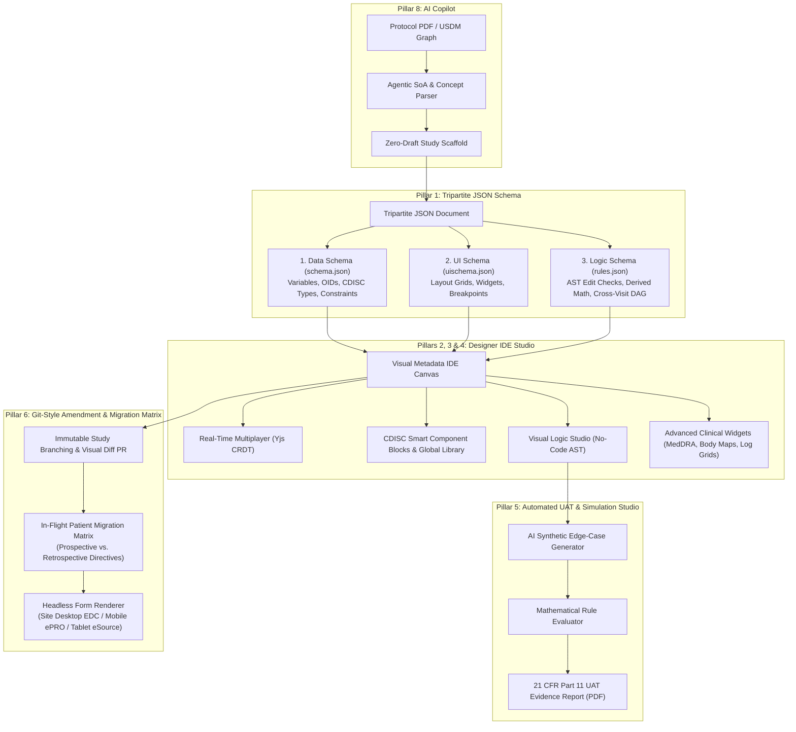

# ADR-2231: AI-Enhanced CDISC-Native Visual Metadata IDE and Tripartite eCRF Designer Standard

- **Status:** Accepted
- **Date:** 2026-08-28
- **Authors:** @fderuiter
- **Deciders:** @fderuiter
* **Requirements:** `PRD-CRF-001`, `PRD-CRF-004`, `PRD-CRF-009`, `PRD-CRF-010`, `PRD-CRF-012`, `PRD-DDF-001`, `PRD-SYS-001`, `PRD-SYS-050`, `PRD-SYS-051`

---

## 1. Context & Problem Statement

Historically in the eClinical industry, legacy Electronic Data Capture (EDC) systems (such as Medidata Rave, Oracle Clinical, and Veeva Vault EDC) treat clinical study builds as disjointed, highly technical software programming tasks. Form layout design, database DDL provisioning, edit check programming (often requiring proprietary scripting languages like Rave Custom Functions, C#, or PL/SQL), and manual User Acceptance Testing (UAT) are conducted in isolated silos. Consequently, launching a new clinical study build or implementing a protocol amendment typically consumes **8 to 12 weeks** of expensive technical effort.

Furthermore, mapping form fields directly to relational database columns (e.g., generating physical `demographics` tables with `age` and `gender` columns) creates architectural gridlock during mid-study **Protocol Amendments**, necessitating system downtime, risky database migrations, and severe data integrity exposure under **FDA 21 CFR Part 11** and **ICH GCP E6(R2)**.

To leapfrog the entire industry, the Cadence eCRF Designer is established not as a generic drag-and-drop web form builder, but as an **AI-Enhanced, CDISC-Native, Visual Metadata Integrated Development Environment (IDE)** for Clinical Data Managers, Biostatisticians, and Study Designers. The Designer acts as the declarative visual configuration frontend feeding directly into the foundational Metadata-Driven Engine Architecture.

---

## 2. Decision Drivers & Constraints

* **The Golden Rule: The Form is Data, Not Code (Decoupled Tripartite Schema)**: Form definitions must never generate physical relational columns or require backend DDL migrations. The form must exist strictly as a versioned tripartite JSON document aligned with the CDISC Dataset-JSON and USDM standards.
* **Isomorphic Execution**: Business logic, skip logic, and validation rules must be defined as declarative Abstract Syntax Trees (ASTs) that execute identically in the browser (for immediate reactive feedback) and on the backend server (for strict GxP validation).
* **GxP Non-Destructive Versioning (21 CFR Part 11 § 11.10(e))**: Protocol amendments must branch immutably. Historical observations must evaluate against their pinned schema versions, while new subjects evaluate against the active amendment.
* **Multi-Persona Collaboration & Zero-Code Authoring**: Eliminate custom code and proprietary scripting entirely. Provide low-code visual canvases for data managers while maintaining multi-party real-time review.
* **Automated Qualification & UAT (GAMP 5 Category 4)**: Replace weeks of manual data entry UAT with automated synthetic edge-case generation and mathematical compliance proof generation.

---

## 3. Options Considered

### Option 1: **Option A (Selected) — AI-Enhanced Visual Metadata IDE & Tripartite JSON Schema Architecture**:

- **Overview:** - Complete decoupling of Data, UI, and Logic schemas without relational DDL generation.
   - Isomorphic AST rule execution across browser JavaScript and backend Python runtimes.
   - Automated AI synthetic edge-case generation and 30-second 21 CFR Part 11 UAT evidence report.
   - In-Flight Patient Migration Matrix supporting prospective and retrospective amendment directives.
- ***Pros:***
  - ✅ Satisfies architectural requirements
- ***Cons:***
  - ❌ Requires implementation and maintenance overhead

### Option 2: **Option B — Relational DDL Code Generation & Scripting (Legacy Paradigm)**:

- **Overview:** - Generate SQL table schemas and execute Python/C# scripts for rules.
   - *Rejected*: Fragile mid-study amendments, severe security exposure (RCE), 8–12 week build latency.
- ***Pros:***
  - ✅ Satisfies architectural requirements
- ***Cons:***
  - ❌ Requires implementation and maintenance overhead

### Option 3: **Option C — Generic Drag-and-Drop Web Form Builder**:

- **Overview:** - Utilize off-the-shelf form builders (Formik/JSONSchema-only) without clinical standards.
   - *Rejected*: Lacks CDISC CDASH/SDTM metadata bindings, medical dictionary auto-coding, GxP audit trails, and clinical UAT qualification.

---
- ***Pros:***
  - ✅ Satisfies architectural requirements
- ***Cons:***
  - ❌ Requires implementation and maintenance overhead

## 4. Decision Outcome

**Chosen Option:** **Option A**. The Cadence eCRF Designer is established as an AI-Enhanced, CDISC-Native, Visual Metadata IDE grounded in the Tripartite JSON Schema Architecture.

### Pillar 1: The Core Architecture — The Tripartite JSON Schema
The form architecture decouples completely from physical SQL storage into three distinct, version-controlled JSON schemas:
1. **Data Schema (`schema.json`)**: Defines *what* is collected (Variables, Data Types, CDISC OIDs, Codelists, Value-Level Constraints like Min/Max).
2. **UI Schema (`uischema.json`)**: Defines *how* it looks (Responsive CSS Grid definitions, Widget types like sliders vs. dropdowns, multi-column layouts, pagination, visibility breakpoints).
3. **Logic Schema (`rules.json`)**: Defines *how* it behaves (UREE AST edit checks, conditional visibility predicates, cascading nullifications, derived variable math, cross-visit dependencies).

The live execution application utilizes a **Headless Form Renderer** in Vue 3 that ingests this JSON trio and renders the clinical workspace dynamically with zero code compilation.

### Pillar 2: The UX Paradigm — "Figma for Clinical Trials"
* **Real-Time Multiplayer Collaboration**: Implemented via WebSockets and Conflict-free Replicated Data Types (CRDTs via Yjs). Data Managers, Biostatisticians, and Medical Monitors can edit the same form canvas concurrently with live remote cursor rendering and contextual field-level comment threads.
* **Omni-Channel WYSIWYG Preview**: Instant runtime viewport toggle between:
  - **Site Desktop EDC**: Dense high-throughput clinical grid layout for CRCs.
  - **Patient Mobile ePRO/eDiary**: Accessible, high-contrast, touch-optimized mobile interface (WCAG 2.1 AA).
  - **Tablet eSource/eCOA**: Bedside clinical touch layout.
* **Contextual Properties Inspector**: Dedicated sidebar configuring field-level metadata: Source Data Verification (SDV) tier, PHI/PII masking flags for unblinded isolation, and mandatory 21 CFR Part 11 reason-for-change prompt requirements.

### Pillar 3: CDISC-Native Global Library (Standards by Default)
* **Smart Component Blocks**: Clinical authors drag pre-configured domain blocks (e.g. Vital Signs Panel, Concomitant Medications Log, Adverse Event Form) rather than raw inputs. Dropping a block embeds validated CDASH/SDTM metadata bindings (`VS.VSORRES`, `AE.AETERM`), standard UCUM units (`mmHg`, `kg`, `g/dL`), and baseline laboratory reference intervals.
* **Smart Inheritance & Upstream Subscriptions**: Sponsors maintain a Central Global Library. When corporate standard forms advance (e.g., AE Form v1.0 $\to$ v2.0), downstream active study drafts receive a Git-style notification (`Update Available: View Diff / Accept Update`), allowing localized study customizations while tracking provenance.

### Pillar 4: Visual Logic Studio (No-Code Rules Engine)
* **Node-Based Dependency Canvas**: Visual query builder compiling conditions (`IF [Visit 1.AE.Start Date] IS BEFORE [Visit 1.Consent.Date]`) to actions (`THEN [Fire Hard Query: "AE cannot start before consent"] AND [Prevent Save]`).
* **Isomorphic AST Execution**: Serializes logic to `packages/engine_core/rules/` AST (JSONLogic / Google CEL compatible), running identically in browser JavaScript memory and backend Python 3.14+ services.
* **Cross-Visit Chronology Engine**: Horizontal patient journey dependency mapping (e.g. Discontinuing treatment at Visit 3 dynamically suppresses subsequent visits and instantiates Early Termination forms).
* **Excel-Style Derived Math**: Natural formula authoring (`= Weight / ((Height / 100) ^ 2)`) with reactive client evaluation and physiological plausibility boundary gating.

### Pillar 5: Automated UAT & Simulation Studio
* **Integrated Split-Screen Playground**: Real-time test harness pairing the visual builder directly with a live interactive form preview.
* **Agentic Synthetic Edge-Case Generation**: The AI Gateway analyzes the Tripartite Schema and generates thousands of targeted boundary payloads (null values, out-of-range dates, extreme laboratory spikes, contradictory logical inputs).
* **Mathematical Compliance Proof**: The engine evaluates generated test vectors through the stateless Rules Evaluator and compiles an immutable, 21 CFR Part 11 compliant **UAT Evidence Report (PDF)** verifying 100% edit check branch coverage in sub-30 seconds.

### Pillar 6: Git-Style Version Control for Protocol Amendments
* **Immutable Branching & Merging**: Live production studies are strictly immutable. Amendments are scaffolded as isolated branches (`Amendment_2_Draft`), edited, and previewed without affecting ongoing operations.
* **Visual Semantic Diffing**: Pre-publication PR review highlighting structural additions, field deletions, and rule modifications.
* **In-Flight Patient Migration Matrix**: Dynamic execution policy governing active subjects without database DDL migrations:
  - **Prospective**: Applied strictly to subjects enrolled after the amendment effective date.
  - **Retrospective**: Retroactively applied across all active subjects with automated missing-data queries dispatched for historical encounters.

### Pillar 7: Native Advanced Clinical Widgets
* **Medical Dictionary Auto-Coding**: Integrated MedDRA / WHODrug lookup widget performing real-time term suggestions and background SOC/PT and ATC hierarchy coding.
* **Interactive Body Maps & VAS**: Visual pain location selection and calibrated continuous Visual Analog Scale sliders with coordinate persistence.
* **Dynamic Repeating Log Grids**: High-density tabular logs for multi-instance records (Adverse Events, ConMeds, Medical History) supporting reactive column aggregations (e.g. cumulative daily dose).
* **Sensor & EHR Data Bindings**: Configurable field source mapping (`MANUAL_ENTRY`, `SMART_ON_FHIR_PULL`, `IOT_SENSOR_STREAM`).

### Pillar 8: AI Copilot — Protocol-to-CRF Generation
* **Document Ingestion & Parsing**: End-to-end PDF protocol ingestion extracting Schedule of Activities (SoA) matrices, inclusion/exclusion criteria, and trial endpoints.
* **Zero-Draft Auto-Scaffolding**: Automatically populates the study visit schedule, instantiates Global Library Smart Blocks, and synthesizes baseline AST edit check rules, shifting the Data Manager's role from manual transcription to supervisory review and approval.

---

## 5. Consequences & Trade-offs

* **Positive**:
  - Reduces clinical study build and UAT timeline from **8–12 weeks to under 3 days**.
  - Eliminates database schema migrations and downtime during mid-study protocol amendments.
  - Provides 100% automated 21 CFR Part 11 and ICH GCP E6(R2) compliance evidence.
  - Empowers non-programmer Clinical Data Managers to visually orchestrate complex trials.
* **Negative**:
  - Requires maintaining robust Tripartite Schema compilers, AST runtimes, and headless renderer synchronization.

---

## 6. Implementation & Verification

* **Core Packages & Models**:
  - `packages/ddf/` & `packages/engine_core/`: Tripartite schema models (`DataSchema`, `UiSchema`, `LogicSchema`), AST compilers, and headless render contracts.
  - `apps/designer/`: Visual IDE APIs, Global Library inheritance, and amendment branching.
  - `apps/ai_gateway/`: Protocol-to-CRF ingestion and synthetic UAT generation.
  - `apps/web/src/views/` & `apps/web/src/components/crf/`: Figma-style multiplayer canvas, Omni-Channel preview, Visual Logic Studio, and split-screen UAT playground.
* **Verification Suite**:
  - Unit tests for Tripartite JSON validation and Isomorphic AST rule evaluation.
  - Property-based testing for In-Flight Patient Migration Matrix resolution.
  - Automated Playwright E2E tests verifying multiplayer CRDT syncing and omni-channel rendering.
  - GxP compliance synced via `uv run python scripts/sync_gxp.py` for `@req:PRD-CRF-001` through `@req:PRD-CRF-012`.

