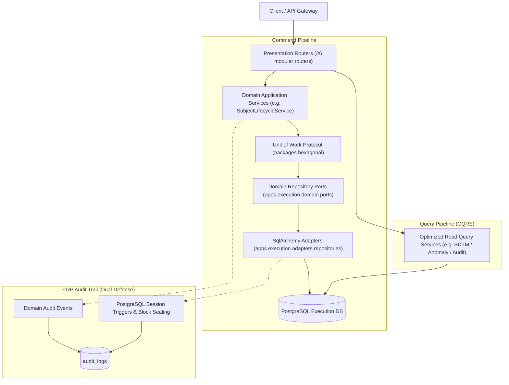

# ADR-2229: Hybrid CQRS Unit of Work and Dual-Defense GxP Audit Architecture

- **Status:** Superseded by [ADR-2428](2026-09-02-core-service-architecture-cqrs-transactional-outbox-and-gxp-interceptor-standard.md)
- **Date:** 2026-08-28
- **Authors:** @fderuiter
- **Deciders:** @fderuiter

---

> [!NOTE]
> **Superseded Notice (2026-09-02):** This record documented the legacy Python/SQLAlchemy CQRS and audit architecture. It is formally superseded for .NET 10 by [ADR-2428](2026-09-02-core-service-architecture-cqrs-transactional-outbox-and-gxp-interceptor-standard.md). Refer to `docs/MIGRATION_WORKFLOW.md` for current implementation standards.

---

## 1. Context & Problem Statement

As the Cadence Clinical Execution Engine (`apps/execution`) grew, the monolithic `main.py` entry point accumulated over 4,400 lines of mixed concerns: direct database ORM transactions, analytical SDTM export algorithms, cross-domain anomaly scans, and presentation route definitions. This tight coupling introduced multiple architectural challenges:

1. **Leaky Database Abstractions:** Raw SQLAlchemy session calls and inline ORM queries were scattered directly across API endpoints, complicating test isolation and violating Hexagonal architecture boundaries.
2. **Impedance Mismatch for High-Throughput Read Models:** Forcing complex analytical reads (such as multi-domain CDISC SDTM extractions, ADaM derivations, and biostat wizard aggregations) through pure entity repository ports introduced unnecessary object hydration overhead.
3. **Transaction & Audit Orchestration:** Multi-aggregate clinical operations (e.g., subject enrollment checking site compliance and creating an initial consent record) required explicit atomic boundaries without leaking ORM `AsyncSession` instances into application domain services.

Reference requirement: `PRD-SYS-001`, `PRD-SYS-004`, `PRD-SYS-042`.

---

## 2. Decision Drivers & Constraints

- **Strict 21 CFR Part 11 & GxP Traceability:** Every state mutation, electronic signature, and clinical data entry must generate an immutable, tamper-evident audit record with `user_id`, `change_reason`, timestamp, and before/after values.
- **100ms Internal Microservice SLA:** High-throughput queries (SDTM extractions, form submission listings, site compliance checks) must avoid object-relational mapping bloat.
- **Hermetic Test Isolation:** Application use cases and domain logic must be 100% testable using in-memory repository fakes (`InMemoryRepository[T]`) without spinning up live database instances or Docker containers.
- **PEP 695 Strict Typing & Python 3.14+ Standards:** All generic ports, adapters, and repositories must utilize native type parameter syntax (`class RepositoryPort[T]:`).

---

## 3. Options Considered

### Option 1: **Option 1 (Selected): Hybrid CQRS with Hexagonal Unit of Work and Dual-Defense Audit Logging**

- **Overview:** - **Command Side:** Encapsulate domain aggregate mutations behind strict `RepositoryPort[T]` interfaces and an asynchronous `UnitOfWork` protocol that manages transaction lifecycles.
  - **Query Side:** Implement specialized Read-Model Query Services and SQL-optimized projections for high-volume exports (SDTM/ADaM/Audit) without hydrating domain entity aggregates.
  - **GxP Audit Trail:** Combine application-level domain event dispatching (capturing structured business rationale and 21 CFR Part 11 signature manifests) with database-level trigger context (`cadence.current_user_id` / `cadence.current_change_reason`) and cryptographic block-sealing.
- _**Pros:**_
  - ✅ Satisfies architectural requirements
- _**Cons:**_
  - ❌ Requires implementation and maintenance overhead

### Option 2: **Option 2: Pure Repository Port Pattern for All Read and Write Operations**

- **Overview:** - Direct all queries and projections through generic repository ports.
  - _Trade-off:_ Significant performance degradation and query inflexibility for complex multi-table joins in CDISC dataset generators.
- _**Pros:**_
  - ✅ Satisfies architectural requirements
- _**Cons:**_
  - ❌ Requires implementation and maintenance overhead

### Option 3: **Option 3: Direct ORM Queries in Presentation Routers with Ad-Hoc Sessions**

- **Overview:** - Keep analytical queries in FastAPI router functions.
  - _Trade-off:_ Boundary leakage, inability to unit test use cases without a live database, and high risk of regression.

---

- _**Pros:**_
  - ✅ Satisfies architectural requirements
- _**Cons:**_
  - ❌ Requires implementation and maintenance overhead

## 4. Decision Outcome

- **Chosen Option:** Option 1
- **Justification:** We chose **Option 1: Hybrid CQRS with Hexagonal Unit of Work and Dual-Defense GxP Audit Logging**.

### Architecture Overview

### Key Architectural Tenets

1. **Decomposed Presentation Layer:** `apps/execution/main.py` is reduced from 4,500 lines to ~350 lines, serving solely as the FastAPI app kernel mounting 26 modular domain presentation routers under `apps/execution/presentation/routers/`.
2. **Domain Repository Ports & In-Memory Fakes:** All domain entities (`Subject`, `SubjectConsent`, `AuditLog`, `DelegationOfAuthority`) declare abstract ports in `apps/execution/domain/ports.py` implemented by SQLAlchemy adapters and in-memory test doubles (`packages.testing.fakes`).
3. **Dual-Defense GxP Compliance:** Audit trails are enforced at both application domain boundaries (explicit justification & signature manifests) and persistence layers (PostgreSQL trigger-level user/reason tracking).

---

## 5. Consequences & Trade-offs

- **Positive:**
  - Complete decoupling of domain business logic from database frameworks.
  - Sub-second unit test execution using in-memory repository fakes (`packages.testing.fakes`).
  - High performance on analytical SDTM and biostat exports without sacrificing domain model purity.
  - Full adherence to 21 CFR Part 11, ICH GCP E6(R2), and FDA predicate rule compliance.
- **Negative:**
  - Additional abstraction layers (ports, adapters, and UoW protocols) require disciplined maintenance.
  - Developers must distinguish between domain aggregate mutations (Command) and read-only projections (Query).

---

## 6. Implementation & Verification

- **Modified Components:**
  - `apps/execution/main.py`: Decomposed to clean microservice kernel mounting modular routers.
  - `apps/execution/presentation/routers/`: 26 domain routers (`subjects.py`, `visits.py`, `observations.py`, `forms.py`, `rules.py`, `exports.py`, etc.).
  - `apps/execution/domain/ports.py`: PEP 695 domain repository ports (`SubjectRepositoryPort`, `ConsentRepositoryPort`, `AuditRepositoryPort`, `DOARepositoryPort`).
  - `apps/execution/adapters/repositories.py`: SqlAlchemy repository adapters.
  - `packages/hexagonal/`: Core generic repository and UoW protocols.
- **Automated Verification:**
  - `apps/execution/tests/test_subject_lifecycle_service.py`
  - `apps/execution/tests/test_form_submissions.py`
  - `apps/execution/tests/test_execution_eligibility.py`
  - `apps/execution/tests/test_clinical_engine.py`
