# BOUNDED_CONTEXT_MIGRATION_MATRIX.md: Domain Decomposition & Migration Sequencing

**Project:** Cadence Clinical Research Software Platform
**Target Runtime:** .NET 10 (C# 14 / ASP.NET Core 10 Minimal APIs)
**Governing ADRs:** [ADR-2233](../adr/2026-09-02-migration-to-dotnet-10-architecture-and-standards.md), [ADR-2234](../adr/2026-09-02-core-service-architecture-cqrs-transactional-outbox-and-gxp-interceptor-standard.md)
**Regulatory Standards:** 21 CFR Part 11, ICH GCP E6(R2), PRD-SYS-053

---

## 1. Bounded Context Decomposition & Domain Boundaries

Cadence decomposes into 18 isolated bounded contexts, each adhering to **Single-Assembly Clean Architecture** (`Domain/`, `Application/`, `Infrastructure/`, `Endpoints/`):

```mermaid
flowchart TD
    subgraph Protocol & Metadata Design Context
        Designer[Cadence.Apps.Designer: Neo4j USDM]
        Knowledge[Cadence.Apps.Knowledge: SOPs]
        AiGateway[Cadence.Apps.AiGateway: Medical Coding & LLM]
    end

    subgraph Clinical Execution & Data Capture Context
        Execution[Cadence.Apps.Execution: EDC Core & RTSM]
        Org[Cadence.Apps.Org: Directory & DOA]
        Ctms[Cadence.Apps.Ctms: Site Operations & Greenlight]
        Tickets[Cadence.Apps.Tickets: Discrepancy SLA Hub]
        Payments[Cadence.Apps.Payments: Grants & Compensation]
    end

    subgraph Regulatory & Safety Context
        Etmf[Cadence.Apps.Etmf: TMF Repository]
        Eisf[Cadence.Apps.Eisf: Site Binders]
        Safety[Cadence.Apps.Safety: PV & ICSR E2B]
        Quality[Cadence.Apps.Quality: CAPA & CSM Forensics]
        Compliance[Cadence.Apps.Compliance: GxP IQ/OQ/PQ]
    end

    subgraph Patient Engagement & Infrastructure Context
        Gateway[Cadence.Apps.Gateway: OIDC & HMAC Proxy]
        Econsent[Cadence.Apps.Econsent: Dynamic Informed Consent]
        Notifications[Cadence.Apps.Notifications: Multi-Channel Alerts]
        Interop[Cadence.Apps.Interop: FHIR & Sensor Streaming]
        Fileshare[Cadence.Apps.Fileshare: StoragePort & Transcoding]
        Imaging[Cadence.Apps.Imaging: Blinded DICOM Viewer]
    end

    Designer -->|USDM Protocol Spec| Execution
    Execution -->|Clinical Events| Ctms
    Execution -->|Outbox Events| Notifications
    Execution -->|Adverse Events| Safety
    Ctms -->|Greenlight Approval| Execution
    Econsent -->|Consent Clearance| Execution
    Gateway --> Designer
    Gateway --> Execution
    Gateway --> Etmf
```



### Context Catalog & Responsibilities

| Bounded Context            | Project Assembly             | Domain Boundary & Primary Aggregates                                                                        | State Persistence Layer                       |
| :------------------------- | :--------------------------- | :---------------------------------------------------------------------------------------------------------- | :-------------------------------------------- |
| **MDR / Protocol Design**  | `Cadence.Apps.Designer`      | `Study`, `StudyArm`, `StudyEpoch`, `Encounter`, `Activity`, `BiomedicalConcept`, `SoaMatrix`                | Neo4j Graph DB (USDM v3/v4)                   |
| **EDC Execution Runtime**  | `Cadence.Apps.Execution`     | `Subject`, `ClinicalObservation`, `FormSubmission`, `ClinicalQuery`, `RandomizationRecord`, `LabAssessment` | PostgreSQL (`cadence_edc`)                    |
| **Identity & Gateway**     | `Cadence.Apps.Gateway`       | Reverse-proxy router, token translation, Keycloak OIDC introspection, HMAC signing                          | Stateless (In-Memory Route Table)             |
| **Trial Master File**      | `Cadence.Apps.Etmf`          | `TmfZone`, `TmfSection`, `TmfArtifact`, `EdlRecord`, `EtmfDocument`, `QcTask`                               | PostgreSQL (`cadence_etmf`) + S3              |
| **Investigator Site File** | `Cadence.Apps.Eisf`          | `SiteBinder`, `RegulatoryBinderDocument`, `PiAttestationLedger`                                             | PostgreSQL / SQLite (`cadence_eisf`)          |
| **CTMS Operations**        | `Cadence.Apps.Ctms`          | `ClinicalSite`, `MonitoringVisitReport`, `SiteGreenlightChecklist`, `DoaTaskDelegation`                     | PostgreSQL (`cadence_ctms`)                   |
| **Quality & Governance**   | `Cadence.Apps.Quality`       | `ProtocolDeviation`, `CapaInvestigation`, `CsmForensicScan`, `AuditInspection`                              | PostgreSQL (`cadence_quality`)                |
| **Safety & PV**            | `Cadence.Apps.Safety`        | `SafetyCase`, `AdverseEventReport`, `CtcaeGradingRecord`, `IcsrTransmission`                                | PostgreSQL / SQLite (`cadence_safety`)        |
| **Clinical Issue Hub**     | `Cadence.Apps.Tickets`       | `SupportTicket`, `DiscrepancyQuery`, `TicketComment`, `SlaTimer`                                            | PostgreSQL / SQLite (`cadence_tickets`)       |
| **Notifications**          | `Cadence.Apps.Notifications` | `NotificationMessage`, `ChannelConfiguration`, `DispatchReceipt`                                            | PostgreSQL / SQLite (`cadence_notifications`) |
| **Electronic Consent**     | `Cadence.Apps.Econsent`      | `ConsentTemplate`, `SubjectConsentState`, `CryptographicSignatureManifest`                                  | PostgreSQL / SQLite (`cadence_econsent`)      |
| **Organization Directory** | `Cadence.Apps.Org`           | `Organization`, `SiteLocation`, `PersonnelProfile`, `DelegationLog`                                         | PostgreSQL (`cadence_edc`)                    |
| **Site Payments**          | `Cadence.Apps.Payments`      | `SiteBudget`, `PayableCalculation`, `ParticipantWallet`, `TaxRecord1099`                                    | PostgreSQL / SQLite (`cadence_payments`)      |
| **EHR Interoperability**   | `Cadence.Apps.Interop`       | `FhirResourceDraft`, `CrcReconciliationItem`, `SensorBiometricStream`                                       | PostgreSQL / SQLite (`cadence_interop`)       |
| **Clinical AI Gateway**    | `Cadence.Apps.AiGateway`     | `MedicalCodingMatch`, `DeidTokenMap`, `ReasoningTask`, `RagKnowledgeSlice`                                  | Ephemeral Vector Cache / REST                 |
| **Storage & Media**        | `Cadence.Apps.Fileshare`     | `DocumentEnvelope`, `StoragePort`, `TranscodeTask`, `VirusScanResult`                                       | MinIO / S3 + PostgreSQL / SQLite              |
| **Oncology Imaging**       | `Cadence.Apps.Imaging`       | `DicomSeries`, `BlindedReaderReview`, `RecistEvaluation`, `AdjudicationTask`                                | PostgreSQL / SQLite (`cadence_imaging`)       |
| **SOP Knowledge Hub**      | `Cadence.Apps.Knowledge`     | `KnowledgeArticle`, `ArticleVersion`, `CategoryTree`, `ContextualRule`                                      | PostgreSQL / SQLite (`cadence_knowledge`)     |

---

## 2. Coupling Scorecard & Architecture Sentinels

To prevent cross-boundary pollution and enforce GxP modularity, the coupling rules are codified into `tests/Cadence.ArchitectureTests.csproj` using **ArchUnitNET**:

| Coupling Dimension                  | Legacy Python Risk                                                                                | Target .NET 10 Constraint                                                                               | Enforcement Mechanism                                                                          |
| :---------------------------------- | :------------------------------------------------------------------------------------------------ | :------------------------------------------------------------------------------------------------------ | :--------------------------------------------------------------------------------------------- |
| **Database Sharing**                | `apps/org` and `apps/execution` shared `cadence_edc` connection string.                           | Zero cross-service entity mapping. Distinct `DbContext` per microservice with independent migrations.   | ArchUnitNET rule: `DbContext` classes cannot reference sibling entities.                       |
| **Synchronous In-Process Coupling** | Direct Python module imports between services (e.g. `apps.execution.models` in `apps.ctms`).      | Strictly prohibited. Services interact exclusively via REST endpoints using `Cadence.Contracts`.        | ArchUnitNET rule: `Cadence.Apps.<A>` cannot reference `Cadence.Apps.<B>`.                      |
| **Direct Shared State Mutations**   | Direct updates to foreign tables without audit logging.                                           | Cross-service mutations must execute via Transactional Outbox domain events or authenticated REST APIs. | Compiler-enforced boundary + `IGxPAuditable` on all entity aggregates.                         |
| **Domain Purity**                   | Leaking web framework or ORM types into business logic (`from fastapi import Request` in domain). | Domain layers (`Domain/`) have zero external references—only pure C# 14 and `Cadence.Core.Domain`.      | ArchUnitNET rule: `Types().That().ResideInNamespace("*.Domain").Should().NotDependOnAny(...)`. |

---

## 3. Migration Graph & Phased Execution Sequence

Migration must follow a disciplined, topologically sorted dependency graph across four distinct tiers:

```mermaid
graph TD
    subgraph Tier 1: Leaf Nodes & Shared Foundations
        T1A[Cadence.Core.Domain]
        T1B[Cadence.Security]
        T1C[Cadence.Contracts]
        T1D[Cadence.Database]
        T1E[Cadence.Testing]
        T1F[Cadence.Cli]
    end

    subgraph Tier 2: Core Entities & Persistent Engines
        T2A[Cadence.Apps.Execution: EDC Engine]
        T2B[Cadence.Apps.Designer: Neo4j USDM]
        T2C[Cadence.Apps.Org: Directory & DOA]
    end

    subgraph Tier 3: Orchestrators & Regulatory Services
        T3A[Cadence.Apps.Ctms]
        T3B[Cadence.Apps.Etmf]
        T3C[Cadence.Apps.Eisf]
        T3D[Cadence.Apps.Quality]
        T3E[Cadence.Apps.Safety]
        T3F[Cadence.Apps.Econsent]
        T3G[Cadence.Apps.Payments]
        T3H[Cadence.Apps.Tickets]
    end

    subgraph Tier 4: Edge, Consumers & Gateways
        T4A[Cadence.Apps.Gateway]
        T4B[Cadence.Apps.Notifications]
        T4C[Cadence.Apps.Interop]
        T4D[Cadence.Apps.AiGateway]
        T4E[Cadence.Apps.Fileshare]
        T4F[Cadence.Apps.Imaging]
        T4G[Cadence.Apps.Knowledge]
        T4H[Cadence.Apps.Compliance]
    end

    T1A --> T2A
    T1A --> T2B
    T1B --> T2A
    T1C --> T2A
    T1D --> T2A
    T1E --> T2A

    T2A --> T3A
    T2A --> T3B
    T2A --> T3D
    T2A --> T3E
    T2A --> T3F
    T2A --> T3G
    T2A --> T3H

    T3A --> T4A
    T3E --> T4B
    T3H --> T4B
    T2A --> T4C
    T2B --> T4D
```

### Tier 1: Leaf Nodes & Shared Foundations (Prerequisites — Completed in Tracer Bullet)

- **`Cadence.Core.Domain` (`packages/engine_core`):** Fundamental domain abstractions (`AggregateRoot<T>`, `Entity<T>`, `ValueObject`, `Result<T, DomainError>`, `IGxPAuditable`, USDM v3/v4 protocol primitives).
- **`Cadence.Security` (`packages/security`):** HMAC-SHA256 signature generator (`HmacSigner`), canonical RFC 8785 JSON serializer, `sig_token` re-authentication verifier, and Keycloak JWT validation filters.
- **`Cadence.Database` (`packages/database`):** EF Core `DbContext` base configurations, `GxPAuditInterceptor` with SHA-256 Merkle block hashing, and PostgreSQL connection resiliency.
- **`Cadence.Contracts` (`packages/contracts`):** Inter-service DTO records, HTTP API client interfaces (`IExecutionApiClient`, `IDesignerApiClient`), and MassTransit event contracts.
- **`Cadence.Testing` (`packages/testing`):** Entity factories (`SubjectFactory`), in-memory repository fakes (`InMemoryRepository<T>`), and mock security context helpers.
- **`Cadence.Deid` (`packages/deid`):** HIPAA Safe Harbor & Expert Determination rule engine with high-throughput compiled C# 14 regex PHI redactors and SHA-256 date-shifting.
- **`Cadence.Storage` (`packages/storage`):** Multi-backend storage port (`StoragePort`) with AWS S3 envelope encryption, local disk spooling, and Google Drive API v3 video evidence uploads.
- **`Cadence.Ddf` (`packages/ddf`):** Digital Data Flow compiler, tripartite transformer, and Dataset-JSON 1.0 columnar ETL pipeline.
- **`Cadence.Cli` (`packages/cli`):** Native developer CLI built with `Spectre.Console`.

### Tier 2: Core Entities & Persistent Engines (Tracer Bullet Slices)

- **`Cadence.Apps.Execution` (`apps/execution`):** Core EDC engine handling subject enrollment, dynamic schema projection, eCRF form entries, real-time edit checks, and lab reference ranges.
- **`Cadence.Apps.Designer` (`apps/designer`):** CDISC USDM protocol authoring, Neo4j graph driver, high-density Schedule of Activities (SoA) matrix compiler, and protocol amendment diffing.
- **`Cadence.Apps.Org` (`apps/org`):** Organization hierarchy, site directories, user credentials, and Principal Investigator electronic Delegation of Authority (DOA) log.

### Tier 3: Orchestrators & Regulatory Services

- **`Cadence.Apps.Ctms` (`apps/ctms`):** Clinical trial site milestones, monitoring visit reports (MVR), 6-facet greenlight activation engine.
- **`Cadence.Apps.Etmf` (`apps/etmf`):** DIA TMF Reference Model v3.2.0 document ingestion, automated QC review stages, and document expiration tracking.
- **`Cadence.Apps.Eisf` (`apps/eisf`):** Investigator Site File binders, PI sign-offs, and bidirectional synchronization with eTMF.
- **`Cadence.Apps.Quality` (`apps/quality`):** Protocol deviation tracking, CAPA workflows, and Centralized Statistical Monitoring (CSM) forensics. Sequenced in Tier 3 following `Cadence.Execution` and utilizing typed `IExecutionApiClient` contracts (ADR-2239).
- **`Cadence.Apps.Safety` (`apps/safety`):** Adverse event intake, CTCAE laboratory toxicity evaluation, ICH E2B(R3) ISO 27953-2 XML generation, and B2B AS2 transmission.
- **`Cadence.Apps.Econsent` (`apps/econsent`):** Dynamic informed consent templates, Flesch-Kincaid readability grading, cryptographic signature stamping, and protocol amendment re-consent gating.
- **`Cadence.Apps.Payments` (`apps/payments`):** Procedure-based grant budgets, CRA SDV trigger-based payables, participant stipends, and 1099 reporting enforcing the Universal Decimal Precision Standard (`System.Decimal`) under ADR-2239.
- **`Cadence.Apps.Tickets` (`apps/tickets`):** Clinical discrepancy escalation hub, dual-target SLA tracking, and 21 CFR Part 11 reopening reason audit logs.

### Tier 4: Edge, Consumers & External Integrations

- **`Cadence.Apps.Gateway` (`apps/gateway`):** Central reverse proxy router, Keycloak OIDC authentication, HMAC injection, and dynamic HTTP OpenAPI aggregation (ADR-2239).
- **`Cadence.Apps.Notifications` (`apps/notifications`):** Asynchronous multi-channel dispatch engine (SMTP email via MailKit, SMS, and HMAC signed webhooks).
- **`Cadence.Apps.Interop` (`apps/interop`):** SMART on FHIR USCDI clinical ingestion, split-screen CRC reconciliation drawer, and continuous biometric sensor streams.
- **`Cadence.Apps.AiGateway` (`apps/ai_gateway`):** Outbound PHI/PII de-identification air-gap, three-tier model router, and hybrid semantic medical coding (MedDRA / WHODrug).
- **`Cadence.Apps.Fileshare` (`apps/fileshare`):** Binary blob storage broker, MinIO/S3 presigned transfer URLs, and media transcoding pipelines (`FFMpegCore`, `nClam`).
- **`Cadence.Apps.Imaging` (`apps/imaging`):** Blinded dual-reader RECIST 1.1 oncology adjudication and WebGL multi-planar reconstruction (MPR) viewer.
- **`Cadence.Apps.Knowledge` (`apps/knowledge`):** Contextual SOP delivery, hierarchical specificity scoring, and two-tier controlled article governance.
- **`Cadence.Compliance` (`packages/compliance`):** Automated IQ/OQ/PQ regulatory test runner, RTM synchronization, and 21 CFR Part 11 verification.
- **`apps/web` (`apps/web`):** Primary Clinical Investigator, CRC, and Data Manager Vue 3 SPA frontend.
- **`apps/subject-portal` (`apps/subject-portal`):** Patient/Subject-facing eCOA and eConsent Vue 3 application.
