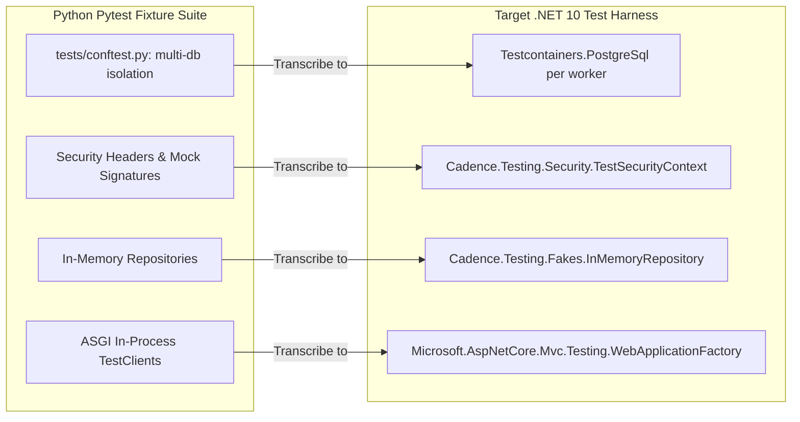

# DEPENDENCY_AND_PARITY_CATALOG.md: Phase 0 Ecosystem Mapping & Test Parity Baseline

**Project:** Cadence Clinical Research Software Platform
**Target Runtime:** .NET 10 (C# 14 / ASP.NET Core 10 Minimal APIs)
**Governing ADRs:** [ADR-2233](file:///Volumes/SanDisk%20External%20SSD/Code/cadence-clinical/docs/adr/2026-09-02-migration-to-dotnet-10-architecture-and-standards.md), [ADR-2234](file:///Volumes/SanDisk%20External%20SSD/Code/cadence-clinical/docs/adr/2026-09-02-core-service-architecture-cqrs-transactional-outbox-and-gxp-interceptor-standard.md)
**Regulatory Standards:** 21 CFR Part 11, ICH GCP E6(R2), PRD-SYS-053

---

## 1. Dependency Cross-Walk & Ecosystem Mapping

This mapping cross-walk translates every Python library dependency across `pyproject.toml` and workspace packages into high-performance, Native AOT-ready .NET 10 equivalents managed via Central Package Management (CPM) in `Directory.Packages.props`.

| Python 3.14+ Dependency               | Target .NET 10 / C# 14 Package                                                 | Architecture Role & Modernization Rationale                                                                                                                 |
| :------------------------------------ | :----------------------------------------------------------------------------- | :---------------------------------------------------------------------------------------------------------------------------------------------------------- |
| `fastapi` (0.141.0)                   | `Microsoft.AspNetCore.App` (Minimal APIs)                                      | Direct endpoint mapping (`app.MapGroup()`) with zero reflection overhead, `TypedResults.Ok<T>()`, and `IEndpointFilter` for cross-cutting GxP security.     |
| `uvicorn[standard]` (0.52.0)          | Kestrel HTTP Server (Native in ASP.NET Core 10)                                | Ultra-high throughput HTTP/1.1, HTTP/2, and HTTP/3 server with Native AOT support, pooling, and socket optimizations.                                       |
| `pydantic` (2.6.0+) / `pydantic-core` | C# 14 `record` types + `FluentValidation` (11.11.0)                            | Immutable records with primary constructors; compile-time validation via `FluentValidation`; zero runtime dictionary reflection.                            |
| `sqlalchemy` (2.0.28+) / `sqlmodel`   | `Microsoft.EntityFrameworkCore` (10.0.0-preview)                               | Entity Framework Core 10 with Fluent API configuration (`IEntityTypeConfiguration<T>`), compiled queries, and `.AsNoTracking()`.                            |
| `asyncpg` (0.29.0)                    | `Npgsql.EntityFrameworkCore.PostgreSQL` (10.0.0-preview)                       | High-performance ADO.NET / EF Core PostgreSQL driver supporting JSONB, connection pooling, and binary streaming.                                            |
| `neo4j` (5.18.0)                      | `Neo4j.Driver` (5.28.1)                                                        | Official async .NET driver with reactive session pooling for USDM protocol graph queries.                                                                   |
| `redis` (5.0.0+)                      | `StackExchange.Redis` / `Microsoft.Extensions.Caching.StackExchangeRedis`      | Thread-safe multiplexed Redis client for distributed 60s step-up signature replay prevention and cache invalidation.                                        |
| `python-jose[cryptography]` / `ecdsa` | `System.IdentityModel.Tokens.Jwt` (8.6.0) + `Microsoft.IdentityModel.Tokens`   | High-throughput, FIPS-compliant JWT validation, RS256 token verification, RSA-PSS signatures, and SHA-256 HMAC operations.                                  |
| `usdm` (0.65.0)                       | `Cadence.Core.Domain` (USDM v3/v4 models)                                      | Strongly-typed C# 14 USDM class hierarchy with source-generated JSON converters for CDISC protocol metadata.                                                |
| `defusedxml` (0.7.1)                  | `System.Xml` (`XmlReaderSettings`)                                             | Native XML parser with `DtdProcessing.Prohibit` and `XmlResolver = null` to permanently prevent XXE injection vulnerabilities in CDISC ODM/XML and E2B(R3). |
| `jinja2` (3.1.6)                      | `Fluid.Core` (2.11.0) or `Scriban`                                             | Fast, sandboxed liquid-syntax template engine for clinical email alerts, ICF generation, and narrative formatting.                                          |
| `python-multipart`                    | ASP.NET Core Form Reader (`IFormFile`)                                         | Native multipart streaming with memory limits for clinical trial artifact uploads.                                                                          |
| `PyMuPDF` (1.24.0) / `weasyprint`     | `QuestPDF` / `PuppeteerSharp`                                                  | Fluent C# layout engine generating pixel-perfect, deterministic PDF/A documents for regulatory archival and eConsent.                                       |
| `python-docx` / `docxtpl`             | `DocumentFormat.OpenXml` (3.2.0)                                               | Official Microsoft OpenXML SDK for generating validated protocol synopsis and clinical study report Word documents.                                         |
| `aioboto3` / `boto3`                  | `AWSSDK.S3` (3.7+)                                                             | AWS SDK for .NET with async presigned URL generation, multipart uploads, and MinIO compatibility.                                                           |
| `aiosmtplib` (3.0.1)                  | `MailKit` (4.9.0) + `MimeKit` (4.9.0)                                          | High-performance RFC-compliant MIME and SMTP client supporting STARTTLS and DKIM signing.                                                                   |
| `alembic` (1.13.0)                    | `Microsoft.EntityFrameworkCore.Design` (`dotnet ef migrations`)                | Audited, idempotent schema migrations generated via `powershell .\scripts\manage_migrations.ps1` with Part 11 change tracking.                              |
| `rapidfuzz` (3.14.5)                  | `FuzzySharp` (2.0.2)                                                           | Fast Levenshtein and token-sort string matching for medical dictionary coding (MedDRA / WHODrug).                                                           |
| `typer` (0.12.0) / `rich` (13.7.0)    | `Spectre.Console` (0.49.1) + `Spectre.Console.Cli`                             | Rich, interactive developer CLI with formatted tables, progress spinners, and interactive wizards (`dotnet cadence`).                                       |
| `litellm` (1.97.0)                    | `Microsoft.Extensions.AI` / `SemanticKernel`                                   | Microsoft AI abstractions providing multi-provider routing (OpenAI, Gemini, Azure) with token tracking and air-gap proxies.                                 |
| `pydicom` (3.0.2)                     | `fo-dicom` (Fellow Oak DICOM 5.1.0)                                            | Native DICOM reader, de-identifier, and MPR pixel pipeline for blinded imaging adjudication.                                                                |
| `jsonschema` (4.20.0)                 | `JsonSchema.Net` (7.2.0)                                                       | High-performance JSON schema compilation and validation for eCRF dynamic form structures.                                                                   |
| Asynchronous Queues & Outbox          | `MassTransit` (8.3.6) + `MassTransit.EntityFrameworkCore`                      | Production-grade messaging bus with PostgreSQL Transactional Outbox, circuit breakers, and dead-letter queues.                                              |
| Background Scheduling                 | `Microsoft.Extensions.Hosting.BackgroundService` + `System.Threading.Channels` | High-throughput, bounded in-process asynchronous queues for anomaly detection and Merkle block sealing.                                                     |
| Observability                         | `OpenTelemetry.Extensions.Hosting` (1.11.1) + Prometheus                       | OpenTelemetry standard for traces, metrics (`System.Diagnostics.Metrics`), and structured logging.                                                          |
| Resilience & Retries                  | `Polly` (8.5.2) + `Microsoft.Extensions.Http.Polly`                            | Reactive fault handling: exponential backoff, jitter, circuit breakers, and bulkhead isolation for typed HTTP clients.                                      |
| Gateway Reverse Proxy                 | `Yarp.ReverseProxy` (2.2.0)                                                    | High-performance Strangler Fig dynamic reverse-proxy routing and downstream `/openapi.json` schema aggregation (ADR-2239).                                  |
| Video Transcoding                     | `FFMpegCore` (5.1.0)                                                           | Asynchronous, strongly-typed .NET wrapper for FFmpeg HLS/DASH video encoding pipelines.                                                                     |
| Anti-Malware Scanning                 | `nClam` (7.0.0)                                                                | Asynchronous ClamAV client communicating with clamd daemon over TCP/Unix sockets for uploaded eTMF/fileshare attachments.                                   |
| Cloud Storage & Golden Path Uploads   | `Google.Apis.Drive.v3` (1.68.0) + `AWSSDK.S3` (3.7+)                           | Multi-backend storage provider implementing `StoragePort` with Google Drive API v3 video evidence uploads and AWS S3 envelope encryption.                   |
| Unit Testing                          | `xunit.v3` (1.1.0) + `FluentAssertions` (8.0.1)                                | Fast, parallel async test execution with expressive assertion syntax.                                                                                       |
| Mocking & Test Fakes                  | `NSubstitute` (5.3.0) + `Cadence.Testing.Fakes`                                | Strongly-typed interface mocking and in-memory transactional repository doubles.                                                                            |
| Integration Testing                   | `Testcontainers.PostgreSql` + `Testcontainers.Neo4j` (4.3.0)                   | Hermetic Docker container lifecycle management for isolated PostgreSQL and Neo4j integration tests.                                                         |
| Architecture Sentinels                | `ArchUnitNET.xUnit` (0.11.1)                                                   | Automated compile/test gates verifying Clean Architecture layer isolation and `IGxPAuditable` conformance.                                                  |

---

## 2. Parity & Test Harness Harvesting

To guarantee 100% functional parity between Python and .NET 10 implementations under 21 CFR Part 11, all test assets and fixtures must be cataloged and transcribed into `Cadence.Testing` and `Cadence.UnitTests`.

### 2.1 Pytest Fixture Taxonomy & C# Equivalents



1. **Database Isolation & Lifecycle Fixtures (`tests/conftest.py`):**
   - _Python:_ `create_databases_async()` and `drop_databases_async()` dynamically create isolated PostgreSQL databases per test run (`cadence_edc_{run_uid}_{worker_id}`).
   - _.NET Target:_ `CadenceWebApplicationFactory<Program>` initializes an isolated PostgreSQL container via `Testcontainers.PostgreSql`, executing EF Core migrations (`db.Database.MigrateAsync()`) on startup and destroying the container on dispose.
2. **Security & Cryptographic Signature Fixtures (`tests/conftest.py`):**
   - _Python:_ `ALLOW_MOCK_SIGNATURES=1`, `create_test_hmac_headers(url, body, method, secret)`.
   - _.NET Target:_ `TestSecurityContext.CreateHmacHeaders(path, method, body, secret)` located in `packages/testing/src/Cadence.Testing.csproj`. Generates identical canonical JSON payloads (RFC 8785) and SHA-256 hashes.
3. **In-Memory Domain Repository Fakes:**
   - _Python:_ `InMemorySubjectRepository`, `InMemoryObservationRepository` in `apps/execution/tests/`.
   - _.NET Target:_ `InMemoryRepository<TEntity, TId>` in `Cadence.Testing.Fakes` implementing `IRepository<TEntity, TId>` with thread-safe `ConcurrentDictionary` storage.
4. **Asynchronous HTTP Test Clients:**
   - _Python:_ `httpx.AsyncClient(transport=ASGITransport(app=app), base_url="http://test")`.
   - _.NET Target:_ `HttpClient` created from `WebApplicationFactory.CreateClient()` with pre-configured gateway signature handlers.

---

### 2.2 Golden Datasets & Algorithmic Validation Vectors

The repository contains authoritative golden datasets used to test core clinical algorithms. Functional parity requires passing identical inputs through .NET 10 implementations and verifying exact JSON/XML output matching:

1. **CDISC USDM Protocol Structure Dataset:**
   - **File:** `tests/fixtures/sample_usdm_v3.json`
   - **Target Consumer:** `Cadence.Apps.Designer` (Neo4j ingestion, SoA matrix builder, and DDF compiler).
   - **Parity Test:** Verify that deserializing this JSON into C# `UsdmStudy` records produces identical graph nodes, visit schedules, and epoch timelines.
2. **CDISC Dataset-JSON 1.0.0 Biostatistical Datasets:**
   - **Files:** `apps/execution/domain/sdtm/` (`sdtm_models.py`).
   - **Target Consumer:** `Cadence.Apps.Execution` biostatistical export engine.
   - **Parity Test:** Validate that exported SDTM `DM` (Demographics), `VS` (Vital Signs), and `LB` (Laboratory Tests) Dataset-JSON files match the CDISC validation rules with byte-for-byte metadata precision.
3. **ICH E2B(R3) ICSR ISO 27953-2 Safety XML Vectors:**
   - **Files:** `apps/safety/tests/` (`test_safety_e2b_xml.py`).
   - **Target Consumer:** `Cadence.Apps.Safety`.
   - **Parity Test:** Validate generated XML against the official FDA/EMA E2B(R3) schema definition using `System.Xml.Schema.XmlSchemaSet`.
4. **NCI-CTCAE Toxicity Grading Tables:**
   - **Files:** `apps/execution/domain/lab_assessment_models.py` and `apps/safety/models.py`.
   - **Target Consumer:** `Cadence.Apps.Execution` and `Cadence.Apps.Safety`.
   - **Parity Test:** Ensure Grade 1 through Grade 4 adverse event toxicity thresholds for lab values (e.g. Potassium, ALT, AST, Bilirubin) evaluate to identical clinical severity grades.
5. **Flesch-Kincaid Readability & eConsent Calculation Vectors:**
   - **Files:** `apps/econsent/tests/test_readability_harmonizer.py`.
   - **Target Consumer:** `Cadence.Apps.Econsent`.
   - **Parity Test:** Verify that syllable counting, word count, and Flesch-Kincaid Grade Level formulas produce matching floating-point scores.

---

### 2.3 Regulatory Traceability Dual-Tagging Standard (PRD-SYS-053)

Under 21 CFR Part 11, every test migrated from Python to .NET 10 must retain complete requirement traceability:

```csharp
namespace Cadence.UnitTests.Execution;

using Xunit;
using FluentAssertions;
using Cadence.Core.Domain;
using Cadence.Apps.Execution.Domain;
using Cadence.Testing.Fakes;

public sealed class SubjectEnrollmentTests
{
    [Fact]
    [Trait("Category", "GxP_OQ")]
    [GxPRequirement("PRD-SYS-053")]
    public async Task EnrollSubject_WithValidProtocolAmendment_RecordsAuditLedger()
    {
        /// <summary>
        /// Asserts that enrolling a subject generates a 21 CFR Part 11 audit entry with cryptographic hash.
        /// @req:PRD-SYS-053
        /// </summary>

        // Arrange
        var repository = new InMemoryRepository<Subject, string>();
        var subjectResult = Subject.Register("SITE-01", "SUBJ-1001", "investigator@ccrsoft.com", "Initial Screening");

        // Act
        subjectResult.IsSuccess.Should().BeTrue();
        await repository.AddAsync(subjectResult.Value);

        // Assert
        var persisted = await repository.GetByIdAsync(subjectResult.Value.Id);
        persisted.Should().NotBeNull();
        persisted!.VersionIndex.Should().Be(1);
        persisted.CreatedBy.Should().Be("investigator@ccrsoft.com");
    }
}
```
