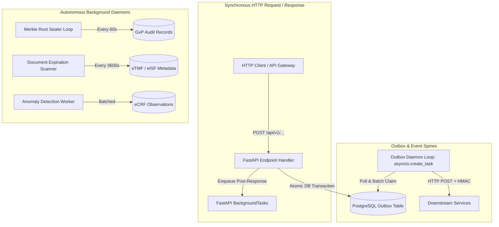
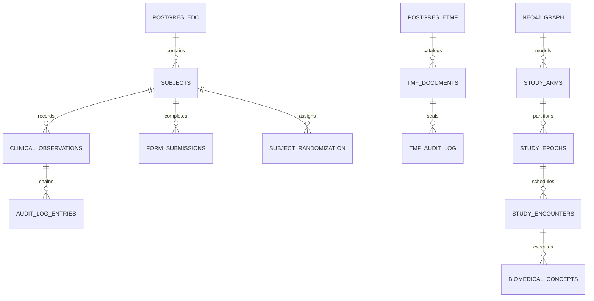

# SYSTEM_TOPOLOGY_AUDIT.md: Phase 0 Macro Architectural Baseline

**Project:** Cadence Clinical Research Software Platform
**Target Runtime:** .NET 10 (C# 14 / ASP.NET Core 10 Minimal APIs)
**Governing ADRs:** [ADR-2233](../adr/2026-09-02-migration-to-dotnet-10-architecture-and-standards.md), [ADR-2428](../adr/2026-09-02-core-service-architecture-cqrs-transactional-outbox-and-gxp-interceptor-standard.md)
**Regulatory Standards:** 21 CFR Part 11, ICH GCP E6(R2), PRD-SYS-053

---

## 1. Surface Topology & Entry Point Inventory

### 1.1 Synchronous Web/API Service Surface

Cadence is structured as a microservices fabric fronted by a reverse-proxy gateway. All Python backend services utilize **FastAPI** with ASGI runners (**Uvicorn**), structured around modular `APIRouter` endpoint controllers.

| Service Directory          | Port   | Primary Entry Point                     | Routing Paradigm                                                                                                          | Middleware & Security Filter Chain                                                                    | Error Pipeline                                                         |
| :------------------------- | :----- | :-------------------------------------- | :------------------------------------------------------------------------------------------------------------------------ | :---------------------------------------------------------------------------------------------------- | :--------------------------------------------------------------------- |
| `apps/gateway`             | `8000` | `apps/gateway/main.py`                  | Reverse proxy dispatch to downstream endpoints; OpenAPI aggregation                                                       | `GatewayAuthMiddleware`, OIDC JWT Bearer (`RS256`), `HMACSigner` injection, `CorrelationIdMiddleware` | RFC 7807 `ProblemDetails` via custom exception handler                 |
| `apps/designer`            | `8001` | `apps/designer/main.py`                 | Sub-routers: `designer_routes`, `digitization`, `cohort_feasibility`, `amendments`                                        | `HMACAuthMiddleware` (`X-Gateway-Signature`), `RoleAuthorizationMiddleware`                           | RFC 7807 handlers for `ValidationException`, `GraphTraversalException` |
| `apps/execution`           | `8002` | `apps/execution/main.py`                | Sub-routers: `subjects`, `observations`, `forms`, `rtsm`, `labs`, `rules`, `sdv`, `biostat`, `unblinding`, `dictionaries` | `HMACAuthMiddleware`, `X-Sig-Token` Re-Auth Filter, `StudyContextMiddleware`                          | Centralized `DomainException` to RFC 7807 handler                      |
| `apps/etmf`                | `8003` | `apps/etmf/main.py`                     | Sub-routers: `documents`, `binders`, `edl`, `qc`, `archive`, `email_webhook`                                              | `HMACAuthMiddleware`, Inbound Email HMAC Verifier, Tenant Scoping                                     | RFC 7807 `TmfException` filter                                         |
| `apps/interop`             | `8004` | `apps/interop/main.py`                  | Sub-routers: `fhir`, `esource`, `sensors`, `cdr`                                                                          | `HMACAuthMiddleware`, OAuth2 SMART on FHIR backend token filter                                       | RFC 7807 `InteropMappingException` handler                             |
| `apps/quality`             | `8005` | `apps/quality/main.py`                  | Sub-routers: `deviations`, `capa`, `csm_forensics`, `audits`                                                              | `HMACAuthMiddleware`, RBAC QA/Monitor Role checks                                                     | RFC 7807 `QualityDomainException` handler                              |
| `apps/notifications`       | `8006` | `apps/notifications/main.py`            | Sub-routers: `notifications`, `templates`, `preferences`, `webhooks`                                                      | `HMACAuthMiddleware`, Webhook Signature Verifier                                                      | RFC 7807 `NotificationDeliveryException` handler                       |
| `apps/ctms`                | `8007` | `apps/ctms/main.py`                     | Sub-routers: `sites`, `milestones`, `monitoring_visits`, `greenlight`, `doa`                                              | `HMACAuthMiddleware`, Role Check (`cra_monitor`, `sponsor_designer`)                                  | RFC 7807 `CtmsException` handler                                       |
| `apps/safety`              | `8008` | `apps/safety/main.py`                   | Sub-routers: `safety`, `icsr_e2b`, `ctcae`, `as2_gateway`, `unblinding`                                                   | `HMACAuthMiddleware`, `X-Sig-Token` step-up re-auth, Salted Safety Token                              | RFC 7807 `SafetyRegulatoryException` handler                           |
| `apps/tickets`             | `8009` | `apps/tickets/main.py`                  | Sub-routers: `tickets`, `comments`, `sla`, `queues`                                                                       | `HMACAuthMiddleware`, Role Scoping (`data_manager`, `site_crc`)                                       | RFC 7807 `TicketDomainException` handler                               |
| `apps/eisf`                | `8010` | `apps/eisf/main.py`                     | Sub-routers: `binders`, `documents`, `sync_etmf`, `investigator_cert`                                                     | `HMACAuthMiddleware`, Site PI Authorization Filter                                                    | RFC 7807 `EisfValidationException` handler                             |
| `apps/econsent`            | `8011` | `apps/econsent/main.py`                 | Sub-routers: `econsent`, `icf_templates`, `signatures`, `reconsent_gate`                                                  | `HMACAuthMiddleware`, `SubjectRoleMiddleware`, Cryptographic Seal Verifier                            | RFC 7807 `ConsentViolationException` handler                           |
| `apps/org`                 | `8012` | `apps/org/main.py`                      | Sub-routers: `organizations`, `sites`, `personnel`, `doa_log`                                                             | `HMACAuthMiddleware`, `X-Sig-Token` step-up re-auth for DOA logs                                      | RFC 7807 `OrgValidationException` handler                              |
| `apps/ai_gateway`          | `8013` | `apps/ai_gateway/main.py`               | Sub-routers: `coding`, `deid`, `reasoning`, `rag`                                                                         | `HMACAuthMiddleware`, Air-Gap Tokenizer Filter                                                        | RFC 7807 `ModelInferenceException` handler                             |
| `apps/payments`            | `8014` | `apps/payments/main.py`                 | Sub-routers: `budgets`, `payables`, `stipends`, `receipts`, `tax_1099`                                                    | `HMACAuthMiddleware`, Finance Officer Role Verification                                               | RFC 7807 `FinancialLedgerException` handler                            |
| `apps/imaging`             | `8015` | `apps/imaging/main.py`                  | Sub-routers: `dicom`, `series`, `adjudication_recist`, `discrepancy`                                                      | `HMACAuthMiddleware`, Blinded Reader Role Isolator                                                    | RFC 7807 `ImagingException` handler                                    |
| `apps/fileshare`           | `8018` | `apps/fileshare/main.py`                | Sub-routers: `files`, `presigned`, `transcode`, `scan`                                                                    | `HMACAuthMiddleware`, Tenant Path Partition Guard                                                     | RFC 7807 `StoragePortException` handler                                |
| `apps/knowledge`           | `8019` | `apps/knowledge/main.py`                | Sub-routers: `articles`, `categories`, `search`, `dynamic_help`                                                           | `HMACAuthMiddleware`, Reader/Author RBAC                                                              | RFC 7807 `KnowledgeException` handler                                  |
| `apps/web`                 | `3000` | `apps/web/src/main.js`                  | Primary Investigator & EDC Clinical Portal (Vue 3 + Pinia + TailwindCSS)                                                  | Keycloak OIDC Bearer Token, Route Navigation Guards, Inactivity Timeout                               | Toast notification & RFC 7807 error modal display                      |
| `apps/subject-portal`      | `3001` | `apps/subject-portal/src/index.js`      | Patient/Subject eCOA & eConsent Portal (Vue 3 + Vite + fake-indexeddb)                                                    | OIDC Bearer Auth, Offline IndexedDB Sync Queue, E-Signature Pad                                       | Offline fallback banner & retry toast display                          |
| `packages/gateway-rewrite` | `8000` | `packages/gateway-rewrite/src/index.ts` | NestJS/TypeScript Reverse Proxy Rewrite Layer                                                                             | `IngressHeaderSanitizerMiddleware`, `JwksCoalescerService`, `RateLimiterGuard`                        | RFC 7807 JSON Problem Details response                                 |

---

### 1.2 Asynchronous & Background Workloads

Asynchronous tasks and long-running daemons in the Python codebase operate across three distinct patterns:



#### A. FastAPI Request-Scoped Background Tasks (`BackgroundTasks`)

- **Study Digitization & Feasibility (`apps/designer`):** `cohort_feasibility.py` (executing asynchronous cohort queries against USDM graph), `digitization.py` (multi-stage DAG protocol extraction).
- **eCRF & Terminology Import (`apps/execution`):** `dictionaries.py` (background WHODrug B3 and MedDRA ASCII pipe-delimited vocabulary ingests), `labs.py` (asynchronous panic-range safety alerts), `observations.py` (asynchronous edit check dependency evaluations), `rtsm.py` (unblinding notification dispatch).
- **Regulatory Reporting (`apps/safety`):** `safety.py` (background compilation and validation of ICH E2B(R3) ISO 27953-2 XML ICSR files and AS2 transmissions).
- **Escalations & Alerts (`apps/tickets`):** `tickets.py` (dispatching SLA breach warnings to responsible study roles).

#### B. Autonomous Long-Running Event Loops & Daemons (`asyncio.create_task`)

1. **Cryptographic Sealer Daemons (`sealer_loop()`):**
   - Implemented in `apps/execution/database/sealer.py` and `apps/etmf/sealer.py`.
   - Continuous loop waking every 60 seconds (or upon trigger threshold) to aggregate unsealed `audit_log` records, compute a SHA-256 Merkle tree root hash, seal the block, and store the block certificate.
2. **Transactional Outbox Dispatchers (`outbox_lifecycle_worker()`):**
   - Implemented in `apps/execution/workers/outbox_worker.py` and `apps/etmf/workers/outbox_worker.py`.
   - Polls `integration_outbox` table, batches pending domain events, dispatches over HTTP with HMAC signatures to target consumers, and marks events `COMMITTED` or handles exponential backoff.
3. **Clinical Query SLA Escalation Engine (`escalation_loop()`):**
   - Implemented in `apps/execution/queries_escalation.py` and `apps/tickets/escalation.py`.
   - Runs periodic scans comparing `opened_at` timestamps against study protocol SLA thresholds (acknowledgment SLA vs clinical resolution SLA), escalating breached queries.
4. **Clinical Observation Anomaly Detection Daemon (`anomaly_lifecycle_worker()`):**
   - Implemented in `apps/execution/workers/anomaly_worker.py`.
   - Performs asynchronous statistical scans across new observation rows using NCI-CTCAE toxicity criteria and multivariate outlier thresholds.
5. **Document Intelligence & Expiration Scanners:**
   - `apps/etmf/expiration_scanner.py`: Scans expected document expiration dates and emits notification events.
   - `apps/etmf/workers/document_intelligence_worker.py`: Autonomous OCR and DIA TMF taxonomy classification worker.
6. **Binary Media Conversion & Transcoding Workers:**
   - `apps/fileshare/workers/conversion_worker.py`: PDF/A rendering and thumbnail generation.
   - `apps/fileshare/workers/transcode_worker.py`: WebGL DICOM and patient video assent transcoding.
7. **Multi-Channel Notification Dispatcher (`apps/notifications/workers/notification_worker.py`):**
   - Polls `notifications` database table and dispatches via SMTP (`aiosmtplib`), SMS, or HMAC webhooks.

---

### 1.3 CLI & Operational Scripts Inventory

1. **Native Cadence CLI (`packages/cli`):**
   - Entry point: `packages/cli/main.py` (`cadence` command).
   - Commands:
     - `cadence db reset`: Drops and provisions multi-service databases.
     - `cadence db seed`: Seeds USDM protocol fixtures and synthetic patients.
     - `cadence mcp`: Starts the native Model Context Protocol (MCP) server for clinical graph introspection.
2. **De-Identification Scanner CLI (`packages/deid`):**
   - Entry point: `packages/deid/cli.py` (`deid-scan` command).
   - Scans tabular or unstructured files for HIPAA Safe Harbor 18 identifiers.
3. **Operational Engineering Scripts (`scripts/`):**
   - `scripts/reset_db.py`: Orchestrates multi-database resets across Postgres and Neo4j.
   - `scripts/introspect_pg_schema.py`: Compares live PostgreSQL schema against SQLAlchemy metadata.
   - `scripts/sync_gxp.py`: Central regulatory sync script parsing `@req:PRD-SYS-XXX` tags, parsing test results, and regenerating the RTM.
   - `scripts/manage_migrations.sh` / `.ps1`: EF Core migration management.
   - `scripts/migrate_service_wizard.sh` / `.ps1`: Scaffolds Clean Architecture service skeletons.
   - `scripts/decommission_service_wizard.sh` / `.ps1`: Guided retirement of Python services.

---

### 1.4 Configuration & Secret Matrix

| Environment Variable         | Target Consumer Services       | Default Fallback Value                 | Purpose & GxP Regulatory Rationale                                                          |
| :--------------------------- | :----------------------------- | :------------------------------------- | :------------------------------------------------------------------------------------------ |
| `APP_ENV`                    | All services                   | `development`                          | Dictates fail-closed security assertions (`production` requires strict cryptographic keys). |
| `CADENCE_TEST_MODE`          | All services                   | `false`                                | When `true`, disables outbound external API/LLM calls.                                      |
| `DEBUG`                      | All services                   | `false`                                | Controls debug logging and OpenAPI docs exposure.                                           |
| `GATEWAY_SECRET`             | Gateway + all microservices    | _None (Required)_                      | HMAC-SHA256 inter-service shared secret for `X-Gateway-Signature`.                          |
| `SIGNING_SECRET`             | Designer, Execution, eConsent  | _None (Required)_                      | Cryptographic key for signing protocol amendments and document seals.                       |
| `AUDIT_LOG_SECRET_KEY`       | Execution, etmf, ctms, quality | _None (Required)_                      | Cryptographic HMAC key for 21 CFR Part 11 Merkle tree block chaining.                       |
| `INBOUND_EMAIL_HMAC_SECRET`  | eTMF                           | _None (Required)_                      | HMAC validation secret for SendGrid/Mailgun inbound regulatory document emails.             |
| `SAFETY_SALT`                | Safety, Execution              | _None (Required)_                      | Salt used for blinded subject hashing in safety reports.                                    |
| `REDIS_URL`                  | Security, eConsent             | `None` (Falls back to in-memory)       | Redis connection string for single-use `sig_token` replay prevention.                       |
| `KEYCLOAK_URL`               | Gateway, Security              | `http://localhost:8080`                | Base URL for Keycloak IAM server.                                                           |
| `KEYCLOAK_REALM`             | Gateway, Security              | `cadence`                              | Keycloak realm name.                                                                        |
| `KEYCLOAK_CLIENT_ID`         | Gateway, Security              | `cadence-clinical`                     | OIDC Client ID.                                                                             |
| `NEO4J_URI`                  | Designer                       | `bolt://localhost:7687`                | Neo4j Bolt protocol URI for clinical protocol graph.                                        |
| `NEO4J_USER`                 | Designer                       | `neo4j`                                | Neo4j database username.                                                                    |
| `NEO4J_PASSWORD`             | Designer                       | _None (Required)_                      | Neo4j database password.                                                                    |
| `DATABASE_URL`               | Execution, Org                 | `postgresql+asyncpg://...`             | Connection string for EDC core PostgreSQL database (`cadence_edc`).                         |
| `ETMF_DATABASE_URL`          | eTMF                           | `postgresql+asyncpg://...`             | Connection string for eTMF PostgreSQL database (`cadence_etmf`).                            |
| `CTMS_DATABASE_URL`          | CTMS                           | `postgresql+asyncpg://...`             | Connection string for CTMS PostgreSQL database (`cadence_ctms`).                            |
| `QUALITY_DATABASE_URL`       | Quality                        | `postgresql+asyncpg://...`             | Connection string for Quality PostgreSQL database (`cadence_quality`).                      |
| `SAFETY_DATABASE_URL`        | Safety                         | `sqlite+aiosqlite:///safety.db`        | Local/Container SQLite database path for Safety service.                                    |
| `INTEROP_DATABASE_URL`       | Interop                        | `sqlite+aiosqlite:///interop.db`       | Local/Container SQLite database path for FHIR Interop service.                              |
| `TICKETS_DATABASE_URL`       | Tickets                        | `sqlite+aiosqlite:///tickets.db`       | Local/Container SQLite database path for Clinical Issue Hub.                                |
| `NOTIFICATIONS_DATABASE_URL` | Notifications                  | `sqlite+aiosqlite:///notifications.db` | Local/Container SQLite database path for Notifications service.                             |
| `ECONSENT_DATABASE_URL`      | eConsent                       | `sqlite+aiosqlite:///econsent.db`      | Local/Container SQLite database path for eConsent service.                                  |
| `EISF_DATABASE_URL`          | eISF                           | `sqlite+aiosqlite:///eisf.db`          | Local/Container SQLite database path for eISF service.                                      |
| `STORAGE_BACKEND`            | Fileshare, eTMF                | `local`                                | Document storage engine: `local` filesystem or `s3` / `minio`.                              |
| `STORAGE_LOCAL_DIR`          | Fileshare, eTMF                | `storage`                              | Local directory root when `STORAGE_BACKEND=local`.                                          |
| `SMTP_HOST` / `SMTP_PORT`    | Notifications                  | `localhost:1025`                       | Mail server coordinates for clinical alert delivery.                                        |

---

## 2. Data Topology & State Persistence Analysis

### 2.1 Relational, Graph & Document Models

The Cadence datastore topology is heterogeneous by design:



1. **Relational PostgreSQL Datastores:**
   - **`cadence_edc` (`apps/execution`):** 35+ tables including `subjects`, `clinical_observations`, `form_submissions`, `clinical_queries`, `rtsm_strata`, `rtsm_kits`, `lab_reference_ranges`, `lab_test_master`, `meddra_hierarchy`, `whodrug_record`, `audit_log`, `integration_outbox`.
   - **`cadence_etmf` (`apps/etmf`):** 12 tables mapped to the DIA TMF Reference Model v3.2.0 (`tmf_zones`, `tmf_sections`, `tmf_artifacts`, `edl_records`, `etmf_documents`, `qc_review_tasks`, `etmf_audit_trail`).
   - **`cadence_ctms` (`apps/ctms`):** Tables managing clinical trial sites, CRA monitoring visit reports (MVR), 6-facet greenlight activation checklists, and electronic delegation of authority (DOA).
   - **`cadence_quality` (`apps/quality`):** Protocol deviations, CAPA investigations, root-cause trees, and centralized statistical monitoring (CSM) run logs.
2. **SQLite Microservice Datastores (Targeted for PostgreSQL Consolidation in .NET 10):**
   - `safety.db`: Adverse events, CTCAE laboratory toxicity grades, suspect drugs, E2B transmissions.
   - `interop.db`: SMART on FHIR USCDI resources, CRC reconciliation drawers, biometric sensor streams.
   - `tickets.db`: Multi-module discrepancy tickets, SLA timers, change-reason reopening ledgers.
   - `notifications.db`: Notification message queues, dispatch attempt histories, channel configurations.
   - `econsent.db`: ICF version templates, subject signature manifests, re-consent flags.
   - `eisf.db`: Site investigator binders, TMF bidirectional sync receipts.
   - `fileshare.db`: Storage envelopes, Merkle digests, transcoding states.
   - `knowledge.db`: Two-tier SOP articles and category trees.
3. **Graph Datastore (Neo4j):**
   - `apps/designer`: Study design graph under CDISC USDM v3.0/v4.0. Nodes: `Study`, `StudyVersion`, `StudyArm`, `StudyEpoch`, `Encounter`, `Activity`, `BiomedicalConcept`, `BiomedicalConceptProperty`. Relationships: `HAS_VERSION`, `HAS_ARM`, `HAS_EPOCH`, `HAS_ENCOUNTER`, `IN_EPOCH`, `TRIGGERED_BY`.
4. **Binary Object Storage (MinIO / S3):**
   - Tenant-partitioned blob pathing: `/{tenant_id}/{study_id}/{document_id}/{version_hash}`.

---

### 2.2 Schema Management & Migration Engines

- **Alembic Services:** `apps/ctms`, `apps/etmf`, `apps/fileshare`, `apps/quality` maintain standard `alembic/versions/` directories.
- **Custom Execution Engine (`apps/execution/database/migrate.py`):**
  - Manages table provisioning directly from SQLAlchemy metadata.
  - Automatically deploys **database-level write-protection and shadow triggers**:
    - Trigger function `cadence_enforce_immutability()`: Raises exception if direct `UPDATE` or `DELETE` is executed against historical audit records.
    - Trigger function `cadence_capture_audit_shadow()`: Intercepts table mutations and writes previous row state, user session context (`current_setting('cadence.current_user_id')`), and timestamp to shadow tables.

---

### 2.3 Dynamic Columns & Implicit Schemas

A significant portion of the platform relies on unstructured PostgreSQL `JSON` / `JSONB` columns to handle dynamic clinical variability:

1. **`ClinicalObservation.additional_properties` (`apps/execution`):**
   - Implemented in `apps/execution/database/models/observation.py`.
   - Stores variable laboratory metrics. Implicit application schema:
     ```json
     {
       "lab_source": "central | local",
       "lab_site_id": "string",
       "lab_indicator": "NORMAL | HIGH | LOW | CRITICAL",
       "lab_out_of_range": true,
       "matched_normal_bounds": "string",
       "range_indicator": "string",
       "is_out_of_range": true,
       "reference_range_low": 3.5,
       "reference_range_high": 5.0
     }
     ```
2. **`FormSubmission.form_data` (`apps/execution`):**
   - Stores user data entered into dynamic CDASH eCRF forms.
   - Keys correspond to dynamic USDM DataElement IDs (`q_vital_systolic`, `q_vital_diastolic`).
3. **`AuditLogEntry.details` / `AuditLogEntry.changes` (`packages/compliance`, `apps/execution`):**
   - Stores delta property mutations: `{"property_name": {"old": "val1", "new": "val2"}}`.
4. **`NotificationRecord.metadata` (`apps/notifications`):**
   - Stores channel dispatch parameters: email recipient list, Jinja context dictionary, webhook headers.

---

### 2.4 Caching & Ephemeral State Management

- **Distributed Signature Replay Cache (`packages/security/sig_token_verifier.py`):**
  - Uses Redis (`REDIS_URL`) with fallback to thread-safe in-memory dictionary.
  - Key pattern: `esign_replay:{jti_or_token}` with TTL set to match JWT token expiration (typically 60 seconds).
  - Atomicity guaranteed via Redis `SET ... EX ... NX`.
- **eConsent Cache Invalidation:**
  - Redis Pub/Sub channel: `econsent_cache_invalidation` and `econsent_consent_completed`.
- **In-Memory Terminology Caches:**
  - `apps/execution/presentation/routers/dictionaries.py`: In-memory caching for MedDRA and WHODrug terms.
  - `apps/designer/adapters/cdisc/terminology_cache.py`: In-memory cache for NCI EVS concept lookups.

---

## 3. "Dark Debt" & Dynamic Behavior Audit

### 3.1 Dynamic Typing & Shape Shifting

1. **Polymorphic Responses & DTOs:**
   - In `apps/designer/presentation/routers/designer_routes.py`, endpoints return polymorphic dictionaries representing either high-level summaries or full USDM graph trees depending on the `depth` query parameter.
   - In `apps/execution/biostat/models.py`, `DatasetJSON` items accommodate variable schema-less column types via `list[Any]`.
2. **Unconstrained JSON Payload Ingestion:**
   - eCRF submission endpoints accept `dict[str, Any]` without compile-time type verification.

### 3.2 Duck Typing & Truthiness Pitfalls

1. **Empty Container Evaluation (`if not x:`):**
   - Python code extensively uses `if not observations:` or `if not value:` to test for absence. In C# 14, an empty list (`[]`) is truthy (not null). Direct transcription causes false-positive skips unless translated to `observations.Count == 0` or `string.IsNullOrEmpty(value)`.
   - Boolean truthiness on zero: `if value:` where `value = 0.0` (valid lab result of 0.0 evaluated as false).
2. **Dynamic Reflection (`hasattr` & `getattr`):**
   - Over **750 occurrences** of `getattr(obj, "property", default)` and **250 occurrences** of `hasattr(obj, "property")` across `apps/designer/content_assembly.py`, `apps/designer/adapters/document_renderer.py`, and `apps/ai_gateway/adapters/litellm_adapter.py`.
   - Used to navigate nested USDM graph models where properties might be missing. In C# 14, this must be replaced with strongly-typed interfaces, pattern matching (`obj is USDMConcept c`), or nullable navigation (`obj?.Property ?? defaultValue`).

### 3.3 Metaprogramming & Metaclasses

1. **SQLAlchemy Declarative Metaclasses:**
   - Models dynamically configure table arguments and relationship mappers via `declared_attr` functions.
2. **Pydantic Dynamic Field Validators:**
   - `@model_validator(mode="before")` mutating incoming dictionary shapes prior to model construction. In .NET 10, this must be translated to `FluentValidation` rules or custom `System.Text.Json` converter logic.
3. **Pydantic Model Dump Dynamic Invocations:**
   - Pervasive `hasattr(d, "model_dump") and callable(getattr(d, "model_dump"))` used in comparison routines (`apps/designer/comparison.py`).

### 3.4 Threading & Async Event Loop Hazards

1. **Synchronous Blocking Calls inside Async Endpoints:**
   - In `tests/conftest.py`, `run_sync()` uses `concurrent.futures.ThreadPoolExecutor` to run async coroutines synchronously. In `apps/designer/db.py`, `run_async()` spawns single-worker `ThreadPoolExecutor` instances inside ASGI requests.
   - Synchronous file I/O (`with open(...) as f:`) and PDF rendering (`weasyprint.HTML(...).write_pdf()`) invoked directly inside `async def` routes without `await asyncio.to_thread(...)`, blocking the single-threaded Python event loop. In ASP.NET Core 10, asynchronous non-blocking I/O (`await File.ReadAllBytesAsync()`) and managed thread-pool dispatch eliminate this entire class of bottleneck.

### 3.5 Dynamic Upward Session Reflection in Core Security

`packages/security/audit_logger.py` (`resolve_current_session()`) utilizes `importlib.import_module` at runtime to dynamically inspect higher-level service database contexts (`apps.execution.database.context`, `apps.eisf.adapters.database`, `apps.etmf.adapters.database`, `apps.quality.adapters.database`). This circular dependency violates clean architectural layering. In .NET 10, this is eradicated by delegating audit capture to Entity Framework Core 10 `ISaveChangesInterceptor` (`GxPAuditInterceptor`) registered per-service in DI.

### 3.6 In-Process OpenAPI Schema Aggregation in Gateway

`apps/gateway/main.py` dynamically loads downstream Python modules (`apps.{name}.main`) in-process to build a unified `/openapi.json` Swagger schema. Under [ADR-2239](../adr/2026-09-03-universal-decimal-financial-precision-dynamic-openapi-gateway-discovery-and-tier-2-quality-realignment.md), the Gateway decouples from Python reflection by polling downstream HTTP `/openapi.json` endpoints with fallback to build-time precompiled JSON specifications.

### 3.7 IEEE-754 Floating-Point Financial Precision Defect

`apps/payments/domain/models.py` declared all monetary values, procedure costs, overhead percentages, withholding deductions, participant stipends, and invoice balances as Python binary `float`. Under [ADR-2239](../adr/2026-09-03-universal-decimal-financial-precision-dynamic-openapi-gateway-discovery-and-tier-2-quality-realignment.md) and the `Universal Decimal Precision Standard`, all financial properties must be transcribed to C# 14 `decimal` (`System.Decimal`) mapped to PostgreSQL `numeric(18, 4)` with explicit banker's rounding (`MidpointRounding.ToEven`).

### 3.8 Native Subprocess & External Daemon Bindings

`apps/fileshare/workers/transcode_worker.py` invokes `ffmpeg` as an asynchronous subprocess for multi-variant HLS/DASH video encoding, while `apps/fileshare/adapters/clamav_adapter.py` binds to the `clamd` Unix domain socket or TCP port for anti-malware verification. In .NET 10, these operations are isolated behind dependency-injected ports (`IMediaTranscoder`, `IAntiVirusScanner`) backed by `FFMpegCore` and `nClam`.
