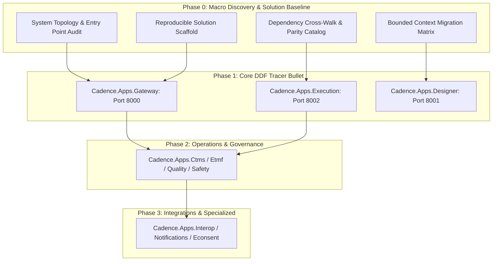

# .NET 10 Modernization Hub: Phase 0 Architectural Baseline

> [!NOTE]
> **Status: historical.** The Python-to-.NET 10 port this hub planned is complete. Current work is the kernel roadmap ([spec §15](../kernel/CLINICAL_KERNEL_SPECIFICATION.md#15-roadmap)). The documents in this folder are kept for traceability and for porting the remaining Python reference sources (#4789).

**Platform Target:** .NET 10 (C# 14 / ASP.NET Core 10 Minimal APIs)
**Governing Architecture Records:** [ADR-2233](../adr/2026-09-02-migration-to-dotnet-10-architecture-and-standards.md), [ADR-2425](../adr/2026-09-02-core-service-architecture-cqrs-transactional-outbox-and-gxp-interceptor-standard.md), [ADR-2238](../adr/2026-09-03-universal-postgresql-persistence-standard-and-hybrid-jsonb-record-projection.md)
**Regulatory Standards:** 21 CFR Part 11, ICH GCP E6(R2), PRD-SYS-053
**Implementation Playbook:** [MIGRATION_WORKFLOW.md](../MIGRATION_WORKFLOW.md)

---

## Executive Summary

The Cadence Clinical Research Software Platform is executing a clean-break architectural modernization from Python 3.14+ (FastAPI, SQLAlchemy, Pydantic) to **.NET 10 (C# 14 / ASP.NET Core 10 Minimal APIs)**. Existing Python implementations serve as the authoritative behavioral reference and specification baseline to be systematically transcribed and phased out.

This documentation suite establishes the exhaustive Phase 0 Macro Architectural Baseline, decomposing the platform into 18 bounded contexts, mapping dependencies, harvesting test parity harnesses, and providing a reproducible solution scaffold.

---

## Modernization Document Catalog

| Document                                                                       | File Path                                            | Focus Areas & Contents                                                                                                                                                                                                              |
| :----------------------------------------------------------------------------- | :--------------------------------------------------- | :---------------------------------------------------------------------------------------------------------------------------------------------------------------------------------------------------------------------------------- |
| **[1. Surface & Data Topology Audit](SYSTEM_TOPOLOGY_AUDIT.md)**               | `docs/migration/SYSTEM_TOPOLOGY_AUDIT.md`            | Exhaustive catalog of all 18 FastAPI entry points, background task daemons, operational scripts, configuration/secret matrix, relational/graph persistence layout, dynamic JSON schemas, and Python "dark debt" audit.              |
| **[2. Dependency & Test Parity Catalog](DEPENDENCY_AND_PARITY_CATALOG.md)**    | `docs/migration/DEPENDENCY_AND_PARITY_CATALOG.md`    | Comprehensive 1-to-1 package cross-walk replacing Python libraries with Native AOT .NET 10 equivalents, plus pytest fixture taxonomy, golden datasets (USDM, Dataset-JSON, E2B XML), and 21 CFR Part 11 test requirement standards. |
| **[3. Bounded Context Migration Matrix](BOUNDED_CONTEXT_MIGRATION_MATRIX.md)** | `docs/migration/BOUNDED_CONTEXT_MIGRATION_MATRIX.md` | Clean Architecture domain decomposition across 18 microservices, architectural coupling scorecard, ArchUnitNET sentinels, and a strict 4-tier dependency migration sequence.                                                        |
| **[4. Solution Scaffold Guide](SCAFFOLD_GUIDE.md)**                            | `docs/migration/SCAFFOLD_GUIDE.md`                   | Step-by-step developer instructions for running and verifying the automated .NET 10 solution scaffold (`scripts/scaffold_dotnet_solution.sh`), configuring Central Package Management (CPM), and building `Cadence.sln`.            |
| **[5. Forensic Readiness Audit](Migration_Phase0_Readiness_Audit.md)**         | `docs/migration/Migration_Phase0_Readiness_Audit.md` | Forensic gap analysis, orphan code audit, floating-point precision risks, dynamic import seams, and Tier 1 leaf-node ordering traps.                                                                                                |
| **[6. Service Migration Workflow](../MIGRATION_WORKFLOW.md)**                  | `docs/MIGRATION_WORKFLOW.md`                         | The authoritative 6-step service transcription SOP and 4-step Python decommissioning recipe.                                                                                                                                        |
| **[7. Executive Discovery Deliverable](PHASE0_DOMAIN_DECOMPOSITION_AND_SCAFFOLD.md)** | `docs/migration/PHASE0_DOMAIN_DECOMPOSITION_AND_SCAFFOLD.md` | Condensed decision-ready output: Executive Repository Map, an evidence-based Migration Sequence Matrix (built from a verified runtime HTTP coupling graph, not just domain inference), and a `dotnet new`-driven CLI scaffold for the remaining unbuilt Tier 1 packages and 15 app services. |

---

## Core Settled Architectural Standards

1. **Universal PostgreSQL Persistence ([ADR-2238](../adr/2026-09-03-universal-postgresql-persistence-standard-and-hybrid-jsonb-record-projection.md)):**
   All 18 platform microservices (including the 7 operational services previously utilizing SQLite—safety, interop, tickets, notifications, econsent, eisf, fileshare) standardize on PostgreSQL 14+ with logical database or schema-level multi-tenant isolation. This enables uniform deployment of Entity Framework Core 10, compiled models, and `GxPAuditInterceptor` with SHA-256 Merkle block hashing under 21 CFR Part 11.
2. **Hybrid Strongly-Typed JSONB Record Projection ([ADR-2238](../adr/2026-09-03-universal-postgresql-persistence-standard-and-hybrid-jsonb-record-projection.md)):**
   Dynamic clinical observation fields (`ClinicalObservation.additional_properties`) and eCRF submissions (`FormSubmission.form_data`) are mapped to strongly-typed C# 14 record hierarchies serialized to PostgreSQL `jsonb` via `System.Text.Json` source generation, paired with fallback unmapped property dictionaries for forward compatibility.
3. **MassTransit Transactional Outbox Event Spine ([ADR-2425](../adr/2026-09-02-core-service-architecture-cqrs-transactional-outbox-and-gxp-interceptor-standard.md)):**
   Domain entity state mutations and outbound event messages are committed atomically into PostgreSQL within the same EF Core database transaction, eliminating dual-write failure windows under 21 CFR Part 11.
4. **Single-Assembly Clean Architecture ([ADR-2233](../adr/2026-09-02-migration-to-dotnet-10-architecture-and-standards.md)):**
   Each microservice encapsulates internal namespace layers (`Domain/`, `Application/`, `Infrastructure/`, `Endpoints/`) in a single project assembly (`Cadence.Apps.<Service>.csproj`), preventing multi-assembly bloat while strictly enforcing unidirectional dependency flow via `ArchUnitNET`.
