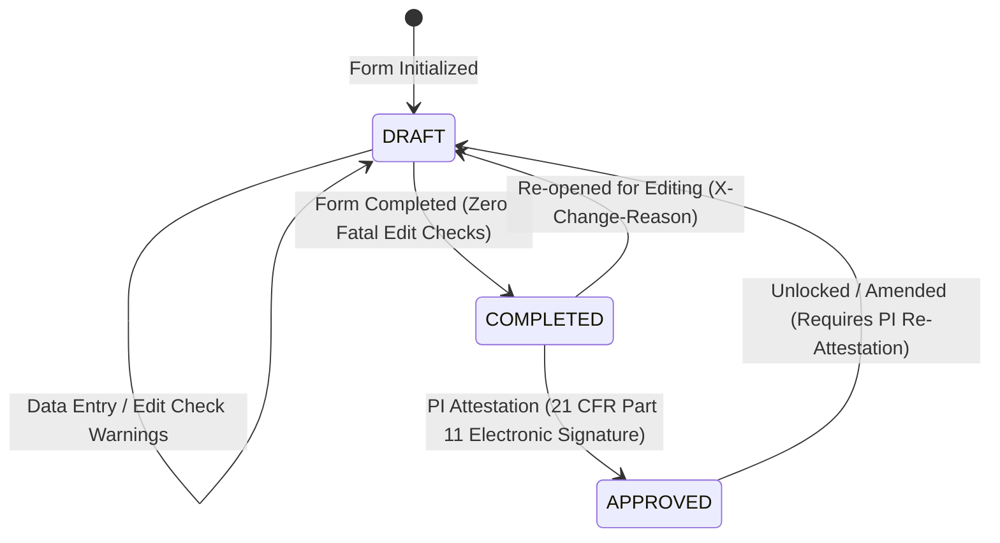
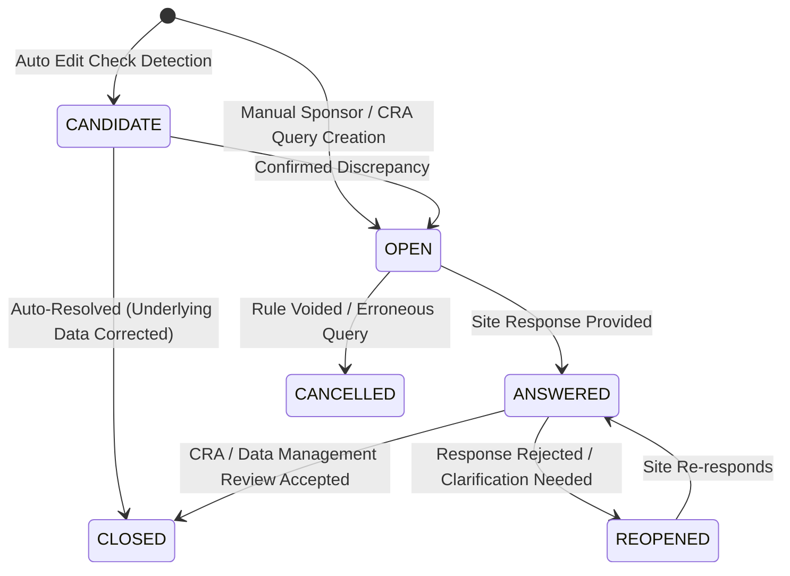

# Behavioral & Invariant Specification: Clinical Observations, Form Submissions & Dynamic Projections

**Slice:** `execution-observations`  
**Bounded Context:** `Cadence.Apps.Execution` (EDC Execution Runtime)  
**Source Python Files:**

- `apps/execution/database/models/observation.py` (`ClinicalObservation`)
- `apps/execution/database/models/form.py` (`FormSubmission`, `FormSubmissionStatus`)
- `apps/execution/database/models/query.py` (`ClinicalQuery`, `QueryStatus`)
- `apps/execution/presentation/routers/observations.py`
- `apps/execution/presentation/routers/forms.py`
- `apps/execution/presentation/routers/queries.py`
- `apps/execution/edit_checks.py` (`BatchEvaluationContext`, `evaluate_ast`, predecessor-visit checks)
- `apps/execution/ucum.py` (UCUM unit conversion and canonical representation)
- `apps/execution/lab_ranges.py` & `apps/execution/lab_range_cache.py`
- `apps/execution/outliers.py`
- `apps/execution/trial_lock.py`

**Governing Regulatory & Architecture Standards:**

- 21 CFR Part 11 (Electronic Records, Electronic Signatures, Immutable Audit Trails)
- ICH GCP E6(R2) §4.9 (Accurate, Complete, and Verifiable Source Data / eCRF Entries)
- CDISC ODM v1.3.2 / v2.0 & USDM v3.0 / v4.0 (Clinical Observation and Biomedical Concept Domains)
- PRD-SYS-001, PRD-SYS-002, PRD-SYS-004, PRD-SYS-042, PRD-SYS-053, PRD-SYS-121, PRD-SUB-001, PRD-TRN-002
- ADR-2332 (Dynamic JSONB Property Mapping for Observations), ADR-2202 (21 CFR Part 11 Signatures & Audit Logs), ADR-2233 / ADR-2428 (Single-Assembly Clean Architecture)

---

## 1. Scope & Domain Context

The `execution-observations` slice encompasses the core electronic data capture (EDC) transactional engine within `Cadence.Apps.Execution`. It governs:

1. **Clinical Observations:** Ingestion, validation, and storage of discrete clinical measurements (vitals, laboratory findings, physical findings) with dynamic JSONB extension properties, UCUM unit conversions, and statistical outlier flags.
2. **Form Submissions:** Multi-field eCRF page submissions with stateful lifecycle progression (`DRAFT` -> `COMPLETED` -> `APPROVED`), cryptographic 21 CFR Part 11 signature attestation, and frozen/read-only immutability safeguards.
3. **Clinical Queries (Discrepancy Management):** Tracking and life cycle of data discrepancy queries (`CANDIDATE` -> `OPEN` -> `ANSWERED` -> `CLOSED`), origin tracking (manual CRC vs. automated edit check rule), and auditable resolutions.
4. **Edit Check Evaluation Engine:** Synchronous cross-field and asynchronous cross-form / longitudinal invariant evaluation via batch database loading (`BatchEvaluationContext`) preventing connection pool congestion.

---

## 2. Ingestion Schemas & API Contract Boundaries

### 2.1 Clinical Observation Ingestion (`ObservationCreate`)

- **Route:** `POST /api/v1/execution/observations`
- **Headers:** `X-Change-Reason` (GxP justification if amending existing observation), `Authorization` (Bearer JWT / HMAC)
- **Payload Schema:**
  | Field                    | Type         | Required | Default | Validation & Invariants                                                                                                                                                                                                              |
  | :----------------------- | :----------- | :------: | :-----: | :----------------------------------------------------------------------------------------------------------------------------------------------------------------------------------------------------------------------------------- |
  | `subject_id`             | `string`     |   Yes    |    -    | Non-empty domain subject code (e.g. `SUBJ-001`).                                                                                                                                                                                     |
  | `study_id`               | `string`     |   Yes    |    -    | Clinical study identifier (e.g. `STUDY-001`).                                                                                                                                                                                        |
  | `site_id`                | `string`     |    No    | `null`  | Sovereign site code. Subject to mutation authorization.                                                                                                                                                                              |
  | `visit_id`               | `string`     |    No    | `null`  | Planned or unplanned clinical encounter identifier.                                                                                                                                                                                  |
  | `domain`                 | `string`     |   Yes    |    -    | CDISC observation domain code (e.g. `VS`, `LB`, `PE`, `AE`). Max 50 chars.                                                                                                                                                           |
  | `test_code`              | `string`     |   Yes    |    -    | Standardized parameter code (e.g. `SYSBP`, `PULSE`, `GLUC`). Max 100 chars.                                                                                                                                                          |
  | `test_name`              | `string`     |   Yes    |    -    | Human-readable test name. Max 255 chars.                                                                                                                                                                                             |
  | `value`                  | `float`      |    No    | `null`  | Numeric measurement value. Required if `value_string` is omitted.                                                                                                                                                                    |
  | `value_string`           | `string`     |    No    | `null`  | Qualitative or textual finding.                                                                                                                                                                                                      |
  | `unit`                   | `string`     |    No    | `null`  | Raw reported unit string (e.g. `mmHg`, `mg/dL`, `beats/min`).                                                                                                                                                                        |
  | `observation_date`       | `datetime`   |   Yes    |    -    | Timestamp when observation occurred (valid time). Required since #4769: the legacy `UtcNow` default collapsed valid time into recorded time, so requests and form payloads without it are rejected with `OBSERVATION_DATE_REQUIRED`. |
  | `page_id`                | `string`     |    No    | `null`  | Associated eCRF page instance identifier.                                                                                                                                                                                            |
  | `protocol_version_tag`   | `string`     |    No    | `null`  | Applicable protocol amendment tag.                                                                                                                                                                                                   |
  | `protocol_version_index` | `int`        |    No    | `null`  | Monotonic protocol version sequence index.                                                                                                                                                                                           |
  | `additional_properties`  | `dictionary` |    No    |  `{}`   | Dynamic JSONB bag for laboratory bounds, device metadata, and custom flags.                                                                                                                                                          |

### 2.2 Dynamic JSONB Projection (ADR-2332)

To avoid wide, sparse relational schemas across heterogeneous clinical domains while preserving zero-allocation query capabilities, laboratory and domain-specific attributes are projected into a JSONB `additional_properties` column with typed accessors:

| Dynamic Property        | JSON Type | Strongly Typed Accessor       | Description / Invariant                                                |
| :---------------------- | :-------- | :---------------------------- | :--------------------------------------------------------------------- |
| `lab_source`            | `string`  | `string? LabSource`           | Central lab vs. local lab identifier (`CENTRAL`, `LOCAL`).             |
| `lab_site_id`           | `string`  | `string? LabSiteId`           | Specific laboratory facility identifier.                               |
| `lab_indicator`         | `string`  | `string? LabIndicator`        | Clinical significance indicator (`NORMAL`, `LOW`, `HIGH`, `CRITICAL`). |
| `lab_out_of_range`      | `boolean` | `bool? LabOutOfRange`         | True if numeric value falls outside age/sex adjusted reference bounds. |
| `matched_normal_bounds` | `string`  | `string? MatchedNormalBounds` | String representation of reference range (e.g. `70.0 - 99.0`).         |
| `range_indicator`       | `string`  | `string? RangeIndicator`      | Qualitative range code (`L`, `H`, `N`, `PANIC`).                       |
| `reference_range_low`   | `float`   | `double? ReferenceRangeLow`   | Numeric lower bound of reference interval.                             |
| `reference_range_high`  | `float`   | `double? ReferenceRangeHigh`  | Numeric upper bound of reference interval.                             |

### 2.3 Form Submission Ingestion (`FormSubmissionCreate`)

- **Route:** `POST /api/v1/execution/forms`
- **Payload Schema:**
  | Field              | Type         | Required | Default | Validation & Invariants                             |
  | :----------------- | :----------- | :------: | :-----: | :-------------------------------------------------- |
  | `study_id`         | `string`     |   Yes    |    -    | Target study identifier.                            |
  | `site_id`          | `string`     |   Yes    |    -    | Target clinical site identifier.                    |
  | `subject_id`       | `string`     |   Yes    |    -    | Clinical subject code.                              |
  | `visit_id`         | `string`     |    No    | `null`  | Visit encounter ID.                                 |
  | `form_id`          | `string`     |   Yes    |    -    | Form / eCRF template identifier (e.g. `CRF_VS_01`). |
  | `protocol_version` | `string`     |    No    | `null`  | Active protocol amendment index or tag.             |
  | `payload`          | `dictionary` |    No    |  `{}`   | Complete structured field data payload (JSONB).     |

### 2.4 Form Approval Schema (`FormSubmissionApprove`)

- **Route:** `POST /api/v1/execution/forms/{id}/approve`
- **Headers:** `X-Change-Reason` (Attestation statement)
- **Payload Schema:**
  | Field                | Type     | Required | Invariants & Constraints                                                                                                                                          |
  | :------------------- | :------- | :------: | :---------------------------------------------------------------------------------------------------------------------------------------------------------------- |
  | `signing_reason`     | `string` |   Yes    | Must belong to predefined set: `"I attest that this data is accurate and complete."`, `"PI approval and sign-off."`, `"PI_SIGN_OFF"`, `"COMPLIANCE_ATTESTATION"`. |
  | `signature_manifest` | `object` |   Yes    | Cryptographic attestation envelope containing `signer_id`, `signer_role`, `signed_at`, `payload_hash`, `hmac_signature`.                                          |

---

## 3. State Machines & Invariant Transitions

### 3.1 Form Submission Lifecycle

1. **`DRAFT`:**
   - Open for concurrent data capture by CRC and Site Investigators.
   - Edit checks execute in real-time or asynchronously; warnings/queries may attach without blocking saves.
2. **`COMPLETED`:**
   - All mandatory fields populated. Zero unresolved fatal blocking edit checks.
   - Ready for Principal Investigator review.
3. **`APPROVED`:**
   - Principal Investigator has executed electronic signature attestation.
   - Form state transitions to `APPROVED`, setting `is_readonly = true`.
   - Mutation is blocked unless explicitly unlocked via administrative override accompanied by mandatory 21 CFR Part 11 `ReasonForChange`.

### 3.2 Clinical Query Lifecycle

---

## 4. Business Rules & Regulatory Invariants

### Rule 1: Dynamic Property Projection & Storage (ADR-2332)

- `ClinicalObservation.additional_properties` is backed by PostgreSQL `jsonb` with GIN indexing for fast querying by dynamic criteria (e.g. `additional_properties ->> 'lab_source' = 'CENTRAL'`).
- The domain model provides strongly-typed getters and setters that mutate the underlying dictionary and emit property-changed events for change-tracking interceptors.

### Rule 2: UCUM Unit Normalization

- For observations with standard numeric measurements and recognizable UCUM units (e.g. temperature `[degF]` -> `Cel`, pressure `[psi]` -> `mm[Hg]`, glucose `mg/dL` -> `mmol/L`):
  - `normalized_value` and `normalized_unit` are computed synchronously upon ingestion.
  - Raw `value` and `unit` remain completely immutable as captured from the original clinical source.

### Rule 3: 21 CFR Part 11 Cryptographic Signature Attestation

- Executing `FormSubmission.Approve` requires:
  1. Principal Investigator role validation (`ROLE_SITE_INVESTIGATOR`).
  2. Validation that `signing_reason` matches regulatory approved attestation dictionaries.
  3. Verification that `signature_manifest.payload_hash` matches SHA-256 hash of current canonical form payload.
  4. Merkle audit record creation recording user identity, UTC timestamp, reason, and signature manifest.

### Rule 4: Outlier & Normal Range Evaluation

- If demographic data (subject birthdate, sex) and active lab reference ranges are present:
  - Match specific reference interval based on `(test_code, sex, age_at_observation)`.
  - Set `lab_out_of_range = true` if `value < reference_range_low` or `value > reference_range_high`.
  - Set `is_outlier = true` if value deviates beyond 3.5 interquartile ranges from historical cohort baseline.

### Rule 5: Batch-Evaluated Cross-Form & Longitudinal Edit Checks

- Cross-form edit checks (e.g. "Screening baseline glucose must not exceed Week 4 glucose by > 50%") must execute using `BatchEvaluationContext` loaded via three bounded bulk queries:
  1. Subject visits (`ClinicalVisit`)
  2. Subject form submissions (`FormSubmission`)
  3. Subject clinical observations (`ClinicalObservation`)
- Eliminates $N+1$ query explosion and prevents database connection pool exhaustion.

### Rule 6: Trial Lock Mutation Freezing

- When a trial or site is placed under Soft or Hard Lock (ADR-2202):
  - `FormSubmission` and `ClinicalObservation` records in the locked scope reject all updates (`HTTP 423 Locked`).
  - No new observations or form edits may be submitted unless an approved lock exception is granted.
