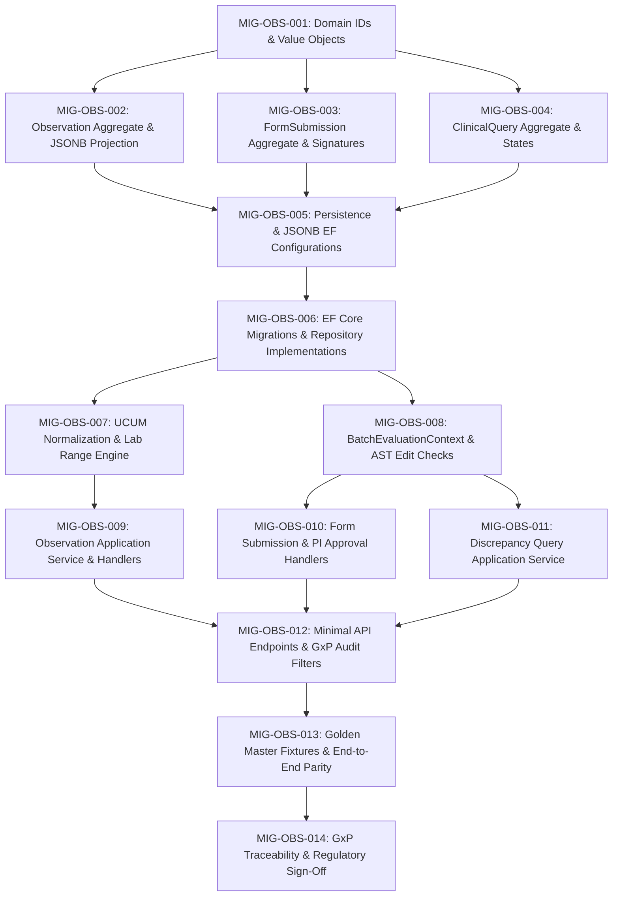

# Tracer-Bullet Development Tickets: EXECUTION-OBSERVATIONS

**Slice:** `execution-observations` · **Bounded Context:** `Cadence.Apps.Execution` · **Standard:** 6-Step Service Transcription SOP (`docs/MIGRATION_WORKFLOW.md`)

---

## Ticket Dependency Graph

---

## Phase 1: Domain Modeling & Value Objects (Step 1)

### [ ] `MIG-OBS-001`: Strongly-Typed Domain Identifiers & Enums
- **Description:** Implement immutable, strongly-typed record identifiers and status enums for observations, forms, and clinical queries.
- **Files:**
  - `Domain/Observations/ObservationId.cs`
  - `Domain/Observations/DomainCode.cs`
  - `Domain/Observations/TestCode.cs`
  - `Domain/Forms/FormSubmissionId.cs`
  - `Domain/Forms/FormId.cs`
  - `Domain/Forms/FormSubmissionStatus.cs` (`Draft`, `Completed`, `Approved`)
  - `Domain/Queries/QueryId.cs`
  - `Domain/Queries/QueryStatus.cs` (`Candidate`, `Open`, `Answered`, `Closed`, `Reopened`, `Cancelled`)
- **Acceptance Criteria:**
  - [ ] Non-empty invariant validation on creation.
  - [ ] Custom JSON serialization converter for Native AOT.
  - [ ] Unit tests with 100% boundary coverage.

---

## Phase 2: Domain Aggregates & Invariant Enforcers (Step 2)

### [ ] `MIG-OBS-002`: ClinicalObservation Aggregate Root & JSONB Projection
- **Description:** Implement `ClinicalObservation` aggregate root inheriting from `AggregateRootBase<ObservationId>` and implementing `IGxPAuditable`.
- **Files:**
  - `Domain/Observations/ClinicalObservation.cs`
  - `Domain/Observations/ObservationAdditionalProperties.cs`
  - `Domain/Observations/Errors/ObservationErrors.cs`
- **Acceptance Criteria:**
  - [ ] ADR-0117 dynamic property mapping (lab source, bounds, out of range indicators).
  - [ ] SDV verification and flagging state methods (`VerifySdv`, `FlagSdv`).
  - [ ] Domain events emitted upon observation recording and verification.

### [ ] `MIG-OBS-003`: FormSubmission Aggregate Root & 21 CFR Part 11 Signature Attestation
- **Description:** Implement `FormSubmission` aggregate root managing multi-field eCRF page status and cryptographic PI sign-off.
- **Files:**
  - `Domain/Forms/FormSubmission.cs`
  - `Domain/Forms/SignatureManifest.cs`
  - `Domain/Forms/Errors/FormErrors.cs`
- **Acceptance Criteria:**
  - [ ] Invariant: Transition to `Completed` blocked if fatal edit checks are active.
  - [ ] Invariant: `Approve` requires authorized PI role and valid attestation reason.
  - [ ] Invariant: Immutable / Read-only once approved (`IsReadonly = true`).

### [ ] `MIG-OBS-004`: ClinicalQuery Aggregate Root & Discrepancy State Machine
- **Description:** Implement `ClinicalQuery` aggregate root tracking clinical discrepancies and query resolutions.
- **Files:**
  - `Domain/Queries/ClinicalQuery.cs`
  - `Domain/Queries/Errors/QueryErrors.cs`
- **Acceptance Criteria:**
  - [ ] Full query lifecycle transitions (`Candidate` -> `Open` -> `Answered` -> `Closed`).
  - [ ] Audit trail capturing responder and resolver user identifiers with timestamps.

---

## Phase 3: Ports & Persistence Infrastructure (Step 3)

### [ ] `MIG-OBS-005`: Entity Framework Core 10 JSONB Configurations
- **Description:** Configure EF Core entity mappings with PostgreSQL JSONB and GIN index optimizations.
- **Files:**
  - `Infrastructure/Persistence/Configurations/ClinicalObservationConfiguration.cs`
  - `Infrastructure/Persistence/Configurations/FormSubmissionConfiguration.cs`
  - `Infrastructure/Persistence/Configurations/ClinicalQueryConfiguration.cs`
- **Acceptance Criteria:**
  - [ ] Observation `AdditionalProperties` mapped to PostgreSQL `jsonb`.
  - [ ] Composite lookup index on `(StudyId, SubjectId, VisitId, Domain, TestCode)`.
  - [ ] Form submission coordinates index on `(StudyId, SubjectId, VisitId, FormId)`.

### [ ] `MIG-OBS-006`: EF Core Migrations & Repositories
- **Description:** Scaffold and execute EF Core migrations for observation tables and implement domain repository ports.
- **Files:**
  - `Domain/Ports/IObservationRepository.cs`
  - `Domain/Ports/IFormSubmissionRepository.cs`
  - `Domain/Ports/IClinicalQueryRepository.cs`
  - `Infrastructure/Persistence/Repositories/ObservationRepository.cs`
  - `Infrastructure/Persistence/Repositories/FormSubmissionRepository.cs`
  - `Infrastructure/Persistence/Repositories/ClinicalQueryRepository.cs`
- **Acceptance Criteria:**
  - [ ] All read queries explicitly enforce `.AsNoTracking()`.
  - [ ] EF Core migration idempotent script verified.
  - [ ] In-memory fakes registered in `Cadence.Testing`.

---

## Phase 4: Application Services & Edit Check Engine (Step 4)

### [ ] `MIG-OBS-007`: UCUM Normalization & Reference Range Engine
- **Description:** Implement UCUM unit conversion and demographic reference range matcher.
- **Files:**
  - `Application/Abstractions/IUcumNormalizationService.cs`
  - `Application/Abstractions/ILabRangeService.cs`
  - `Infrastructure/Normalization/UcumNormalizationService.cs`
  - `Infrastructure/Normalization/LabRangeService.cs`
- **Acceptance Criteria:**
  - [ ] Standard clinical unit conversions (e.g. `mg/dL` <-> `mmol/L`, `degF` <-> `degC`).
  - [ ] Age/sex-adjusted normal range lookup.

### [ ] `MIG-OBS-008`: BatchEvaluationContext & AST Edit Check Engine
- **Description:** Implement 3-query bulk loading evaluation context and AST evaluation engine.
- **Files:**
  - `Application/EditChecks/BatchEvaluationContext.cs`
  - `Application/EditChecks/IEditCheckEngine.cs`
  - `Infrastructure/EditChecks/BatchEvaluationContextLoader.cs`
  - `Infrastructure/EditChecks/AstEditCheckEngine.cs`
- **Acceptance Criteria:**
  - [ ] Consolidated loading of visits, submissions, and observations in 3 queries.
  - [ ] Longitudinal cross-visit AST evaluation without $N+1$ queries.
  - [ ] Auto-generation of `ClinicalQuery` when blocking rule fires.

### [ ] `MIG-OBS-009`: Observation Application Service & Handlers
- **Description:** Implement CQRS commands and queries for discrete observation management.
- **Files:**
  - `Application/Observations/CreateObservationCommand.cs`
  - `Application/Observations/VerifyObservationSdvCommand.cs`
  - `Application/Observations/GetObservationDetailQuery.cs`
  - `Application/Observations/ObservationApplicationService.cs`
- **Acceptance Criteria:**
  - [ ] Automatic unit normalization on creation.
  - [ ] GxP change reason enforcement on mutations.

### [ ] `MIG-OBS-010`: Form Submission & Attestation Handlers
- **Description:** Implement CQRS commands for form completion and PI sign-off.
- **Files:**
  - `Application/Forms/CreateFormSubmissionCommand.cs`
  - `Application/Forms/UpdateFormPayloadCommand.cs`
  - `Application/Forms/CompleteFormSubmissionCommand.cs`
  - `Application/Forms/ApproveFormSubmissionCommand.cs`
  - `Application/Forms/FormSubmissionApplicationService.cs`
- **Acceptance Criteria:**
  - [ ] Cryptographic SHA-256 payload verification before signature recording.
  - [ ] Frozen read-only state transition after approval.

### [ ] `MIG-OBS-011`: Discrepancy Query Application Service
- **Description:** Implement query management workflows.
- **Files:**
  - `Application/Queries/CreateQueryCommand.cs`
  - `Application/Queries/AnswerQueryCommand.cs`
  - `Application/Queries/CloseQueryCommand.cs`
  - `Application/Queries/ClinicalQueryApplicationService.cs`
- **Acceptance Criteria:**
  - [ ] Role validation for CRA/DM close actions.

---

## Phase 5: Presentation & Endpoints (Step 5)

### [ ] `MIG-OBS-012`: Minimal API Routes & GxP Endpoint Filters
- **Description:** Expose ASP.NET Core 10 Minimal API endpoints for observations, forms, and queries.
- **Files:**
  - `Endpoints/ObservationEndpoints.cs`
  - `Endpoints/FormEndpoints.cs`
  - `Endpoints/QueryEndpoints.cs`
  - `Application/Serialization/ExecutionJsonContext.cs`
- **Acceptance Criteria:**
  - [ ] Strongly-typed results (`Results<Ok<T>, Created<T>, ProblemHttpResult>`).
  - [ ] Endpoint filter integration for HMAC gateway tokens and change reasons.
  - [ ] Full Native AOT JSON source generation.

---

## Phase 6: Verification & Regulatory Sign-Off (Step 6)

### [ ] `MIG-OBS-013`: Golden Master Fixtures & Cross-Stack Parity
- **Description:** Execute golden master regression suite against Python test baseline fixtures.
- **Files:**
  - `tests/Execution/Observations/ObservationGoldenMasterTests.cs`
  - `tests/Execution/Forms/FormSubmissionGoldenMasterTests.cs`
  - `tests/Execution/EditChecks/BatchEditCheckTests.cs`
- **Acceptance Criteria:**
  - [ ] 100% behavioral parity with Python baseline.
  - [ ] Concurrency and stress tests for batch evaluation.

### [ ] `MIG-OBS-014`: GxP Traceability & Regulatory Sign-Off
- **Description:** Generate and synchronize GxP compliance matrix for all observation requirements.
- **Acceptance Criteria:**
  - [ ] All tests tagged with `@req:PRD-SYS-001`, `@req:PRD-SYS-004`, `@req:PRD-SYS-121`.
  - [ ] `python scripts/sync_gxp.py` passes cleanly and updates RTM.
  - [ ] Formal sign-off in `04_implementation_signoff.md`.
