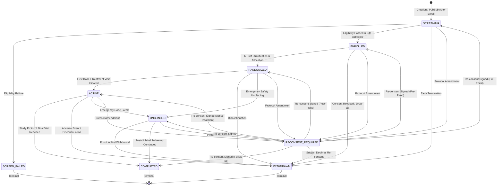

# Behavioral & Invariant Specification: Subject Lifecycle & Enrollment

**Slice:** `execution-subjects`
**Bounded Context:** `Cadence.Apps.Execution` (EDC Execution Runtime)
**Source Python Files:**

- `apps/execution/subject_lifecycle.py`
- `apps/execution/database/models/subject.py`
- `apps/execution/application/services.py` (`SubjectLifecycleService`)
- `apps/execution/domain/ports.py` (`ISubjectRepository`, `IConsentRepository`)
- `apps/execution/demographics.py`
- `apps/execution/presentation/routers/subjects.py`
- `apps/execution/workers/consent_subscriber.py`

**Governing Regulatory & Architecture Standards:**

- 21 CFR Part 11 (Audit trails, immutable records, electronic signatures)
- ICH GCP E6(R2) (Protocol compliance, participant safety, subject identification)
- PRD-SYS-001, PRD-SYS-042, PRD-SYS-053, PRD-SYS-121, PRD-SUB-001, PRD-SUB-007, PRD-SSU-003
- ADR-2202, ADR-2233, ADR-2234, ADR-2238

---

## 1. Contract Boundary & Data Schemas

### 1.1 Ingestion Schemas (Requests)

#### `SubjectCreate`

- **Route:** `POST /api/v1/execution/subjects`
- **Payload Schema:**
  | Field          | Type     | Required | Default | Invariants & Validation                                              |
  | :------------- | :------- | :------: | :-----: | :------------------------------------------------------------------- |
  | `subject_id`   | `string` |   Yes    |    -    | Non-empty domain subject code (e.g. `SUBJ-001`). Max length: 255.    |
  | `study_id`     | `string` |   Yes    |    -    | Clinical study identifier (e.g. `STUDY-001`). Max length: 255.       |
  | `site_id`      | `string` |    No    | `null`  | Site identifier. Triggers sovereign site mutation check if provided. |
  | `arm_id`       | `string` |    No    | `null`  | Initial assigned study arm (maps to `treatment_group`).              |
  | `demographics` | `object` |    No    | `null`  | Optional patient demographics payload to be encrypted.               |
- **`Demographics` Schema:**
  | Field       | Type     | Required | Default | Invariants                                                                |
  | :---------- | :------- | :------: | :-----: | :------------------------------------------------------------------------ |
  | `name`      | `string` |    No    | `null`  | Direct PII, strictly encrypted at rest via AES-GCM.                       |
  | `birthdate` | `string` |    No    | `null`  | ISO 8601 date string (`YYYY-MM-DD`). Encrypted at rest.                   |
  | `gender`    | `string` |    No    | `null`  | Encrypted at rest. Normalized on evaluation to CDISC SEX (`M`, `F`, `U`). |
  | `race`      | `string` |    No    | `null`  | Encrypted at rest.                                                        |

#### `SubjectConsentRequest`

- **Route:** `POST /api/v1/execution/subjects/{subject_id}/consent` & `.../consents`
- **Payload Schema:**
  | Field                | Type       | Required | Default | Invariants                                                                         |
  | :------------------- | :--------- | :------: | :-----: | :--------------------------------------------------------------------------------- |
  | `protocol_version`   | `object`   |   Yes    |    -    | Contains `study_id` (`string`), `version_tag` (`string`), `version_index` (`int`). |
  | `icf_signed`         | `bool`     |   Yes    |    -    | Whether the Informed Consent Form was signed.                                      |
  | `icf_signed_date`    | `datetime` |    No    | `null`  | If omitted in Python, defaults to UTC now.                                         |
  | `requires_reconsent` | `bool`     |    No    | `false` | If an amendment requires re-consent.                                               |
  | `is_paper_override`  | `bool`     |    No    | `false` | Sovereign site paper consent waiver indicator.                                     |

#### `SubjectStateUpdateRequest`

- **Route:** `PATCH /api/v1/execution/subjects/{id}/state`
- **Headers:** `X-Change-Reason` (Required 21 CFR Part 11 justification string)
- **Payload Schema:**
  | Field    | Type     | Required | Default | Invariants                                                    |
  | :------- | :------- | :------: | :-----: | :------------------------------------------------------------ |
  | `status` | `string` |    No    | `null`  | Target state name (e.g. `ENROLLED`, `WITHDRAWN`).             |
  | `state`  | `string` |    No    | `null`  | Alternative property name for `status`. One must be non-null. |

#### `SubjectDemographicsUpdateRequest`

- **Route:** `PUT /api/v1/execution/subjects/{id}/demographics`
- **Headers:** `X-Change-Reason` (Required)
- **Payload Schema:**
  | Field           | Type                | Required | Default | Invariants                                         |
  | :-------------- | :------------------ | :------: | :-----: | :------------------------------------------------- |
  | `demographics`  | `object`            |    No    | `null`  | Replacement patient demographics payload.          |
  | `strat_factors` | `dict<string, any>` |    No    | `null`  | Stratification factors. Locked post-randomization. |

---

### 1.2 Egress Schemas (Responses)

#### `SubjectResponse`

- **HTTP Status:** 200 OK / 201 Created
- **Fields:**
  | Field                     | Type     | Nullable | Description                                             |
  | :------------------------ | :------- | :------: | :------------------------------------------------------ |
  | `id`                      | `string` |    No    | Primary key UUID.                                       |
  | `subject_id`              | `string` |    No    | Domain-specific subject identifier.                     |
  | `study_id`                | `string` |    No    | Study identifier.                                       |
  | `site_id`                 | `string` |   Yes    | Clinical site code.                                     |
  | `treatment_group`         | `string` |   Yes    | Assigned treatment arm (if unblinded/authorized).       |
  | `status`                  | `string` |    No    | Lifecycle state string (`SCREENING`, `ENROLLED`, etc.). |
  | `active_protocol_version` | `string` |   Yes    | Currently active protocol version (default `1.0.0`).    |
  | `encrypted_demographics`  | `string` |   Yes    | Ciphertext payload. Raw PII never leaked.               |

#### `SubjectDetailResponse`

- **Route:** `GET /api/v1/execution/subjects/{subject_id}`
- **Blinding Rule:** RTSM fields (`treatment_group`, `randomization_seed`, `investigational_product_id`) are redacted (`null`) if caller holds a blinded role (e.g., CRC, CRA, Investigator) unless explicitly unblinded.
- **Fields:** `subject_id`, `study_id`, `status`, `site_id`, `treatment_group`, `randomization_seed`, `investigational_product_id`.

#### `SubjectConsentResponse`

- **HTTP Status:** 200 OK
- **Fields:** `id`, `subject_id`, `study_id`, `version_tag`, `version_index`, `icf_signed`, `icf_signed_date`, `requires_reconsent`, `is_paper_override`, `version`.

---

## 2. Invariants & Algorithmic Rules

### 2.1 Regulated State Machine Transition Graph

The clinical trial subject state machine enforces strict directional progress to prevent protocol deviations and safeguard statistical integrity:

### 2.2 Invariant Rules

1. **Rule 1: Stratification Factor Immutability Post-Randomization:**
   - Pre-randomization (`SCREENING`, `ENROLLED`): Stratification factors (`strat_factors`) and demographics may be edited with justification.
   - Post-randomization (`RANDOMIZED`, `ACTIVE`, `COMPLETED`, `UNBLINDED`, `WITHDRAWN`): Any attempt to modify `strat_factors` or demographics MUST fail immediately with `422 Unprocessable Entity` (`LOCKED_FACTOR_MUTATION`).
2. **Rule 2: Sovereign Site Activation Gate for Enrollment:**
   - Advancing a subject to `ENROLLED` (via screening evaluation or state update) is gated on site compliance.
   - The site must possess a verified milestone `SITE_ACTIVATION` entry in `SiteComplianceCache` with `is_complete == true`.
   - If the site is non-compliant or missing, enrollment is blocked, an immutable `BLOCKED_ENROLLMENT` audit entry is created, and an HTTP `400 Bad Request` is returned.
3. **Rule 3: Re-Consent Cascading & Clearance:**
   - When a subject signs a new consent form version (`icf_signed == true` or `is_paper_override == true`) and `requires_reconsent == false`, all prior consent records for that subject with `requires_reconsent == true` MUST be automatically cleared to `requires_reconsent = false`.
4. **Rule 4: Version Gating for Form Data Entry:**
   - Before allowing eCRF form submission, `validate_subject_version_gating` verifies whether the study amendment requires re-consent. If the subject's active protocol version does not match and no signed consent exists for the active version, form submission must fail with `ReConsentRequiredException` (HTTP 428 / 403).
5. **Rule 5: Sequential Zero-Based Enrollment Index:**
   - Every subject enrolled in a study receives a monotonically increasing `enrollment_index` (0, 1, 2, ...).
   - Must be concurrency-safe and immutable once assigned.
6. **Rule 6: 21 CFR Part 11 Audit Trail:**
   - Every mutation (`ENROLL_SUBJECT`, `RECORD_CONSENT`, `TRANSITION_<STATE>`, `UPDATE_DEMOGRAPHICS`) must capture:
     - `table_name`, `record_id`, `action`, `user_id`, `change_reason`, UTC timestamp, `old_values`, `new_values`.
   - Must link into the cryptographically verifiable audit trail.

---

## 3. Dynamic Python Traps & Pitfalls

| Python Pattern in Source                                               | Legacy Risk                                                                                             | Target .NET 10 Fix                                                                                                                 |
| :--------------------------------------------------------------------- | :------------------------------------------------------------------------------------------------------ | :--------------------------------------------------------------------------------------------------------------------------------- |
| `datetime.now()` in `subject_lifecycle.py:179`                         | Emits naive local system time, causing timezone drift and timestamp mismatch across servers.            | Standardize on `DateTimeOffset.UtcNow` across all models and services.                                                             |
| `if not site_id:` in `check_site_compliance_for_enrollment`            | Evaluates empty string `""` as falsy, unintentionally bypassing site compliance checks.                 | Use `string.IsNullOrWhiteSpace(siteId)` and treat whitespace as invalid or non-compliant.                                          |
| `normalize_state()` accepting `Any`                                    | Implicit string conversion on unexpected objects (e.g. dictionaries, numbers) producing strange states. | Strongly-typed `enum SubjectState` with explicit JSON converter; reject unmapped strings.                                          |
| `max_idx = await repo.get_max_enrollment_index()` race condition       | Concurrent enrollments can read the same max index, causing duplicate `enrollment_index` values.        | Execute inside PostgreSQL transaction with row-level lock or dedicated study sequence.                                             |
| Hardcoded Fernet encryption key in `demographics.py`                   | Insecure key management; binary payload incompatible with .NET standard algorithms.                     | Implement `IDemographicsEncryptionService` using .NET `System.Security.Cryptography.AesGcm` with key from configuration.           |
| `eval_list = []` loop in `subjects.py:500`                             | N+1 object mapping allocations on screening response.                                                   | Use LINQ collection expressions `[..evaluations.Select(...)]` with pre-sized capacity.                                             |
| Dual route declarations (`/api/v1/execution/subjects` and `/subjects`) | Route collision and maintenance overhead.                                                               | Define canonical route group `/api/v1/execution/subjects` with optional fallback middleware if backward compatibility is required. |

---

## 4. Test Scenarios from Code (Legacy Test Reverse-Engineering)

The following test suites were reverse-engineered to establish the functional parity test baseline:

1. `apps/execution/tests/test_subject_lifecycle_service.py`
2. `apps/execution/tests/test_subject_randomization_lifecycle.py`
3. `apps/execution/tests/test_pubsub_auto_enrollment.py`

### Reverse-Engineered Assertions

- **SCN-001: Sequential Enrollment & Audit Trail**
  - Given an empty study `STUDY-001`
  - When `SUBJ-001` is enrolled
  - Then status is `SCREENING`, `enrollment_index` is `0`, demographics are encrypted, and an audit log with action `ENROLL_SUBJECT` is saved.
  - When `SUBJ-002` is enrolled in the same study
  - Then status is `SCREENING`, `enrollment_index` is `1`.

- **SCN-002: Re-Consent Cascading Clearance**
  - Given subject with consent version 1 having `requires_reconsent == true`
  - When subject executes consent version 2 with `icf_signed == true` and `requires_reconsent == false`
  - Then consent version 1 is updated to `requires_reconsent == false`, and consent version 2 is persisted with `requires_reconsent == false`.

- **SCN-003: State Machine Allowed vs Forbidden Pathways**
  - Given subject in `SCREENING`
  - Allowed transitions: `SCREEN_FAILED`, `ENROLLED`, `WITHDRAWN`, `RECONSENT_REQUIRED`.
  - Forbidden transition: `ACTIVE`, `RANDOMIZED`, `COMPLETED` -> Throws `InvalidStateTransitionException`.
  - Given subject in `ENROLLED`
  - Allowed transitions: `RANDOMIZED`, `WITHDRAWN`, `RECONSENT_REQUIRED`.
  - Forbidden transition: `ACTIVE`, `SCREENING` -> Throws `InvalidStateTransitionException`.
  - Given subject in `RANDOMIZED`
  - Allowed transitions: `ACTIVE`, `WITHDRAWN`, `UNBLINDED`, `RECONSENT_REQUIRED`.
  - Forbidden transition: `SCREENING`, `ENROLLED` -> Throws `InvalidStateTransitionException`.
  - Given subject in `COMPLETED`, `WITHDRAWN`, or `SCREEN_FAILED`
  - All outgoing transitions are forbidden (terminal states).

- **SCN-004: Stratification Factors Immutability Post-Randomization**
  - Given subject in `SCREENING`
  - Updating `strat_factors` from `{"site": "A"}` to `{"site": "B"}` succeeds.
  - When subject transitions to `ENROLLED` and then `RANDOMIZED`
  - Updating `strat_factors` to `{"site": "C"}` throws `LockedFactorMutationException` (HTTP 422).
  - Updating demographics to a modified payload throws `LockedFactorMutationException` (HTTP 422).
  - Calling `DELETE /demographics` throws `SoftDeleteBlockedException` (HTTP 403).

- **SCN-005: Sovereign Site Compliance Gating**
  - Given subject in `SCREENING` at site `SITE-101`
  - When site has no completed `SITE_ACTIVATION` milestone
  - Attempting to transition subject to `ENROLLED` (via screening or state update) fails with HTTP 400 and records `BLOCKED_ENROLLMENT` audit log.
  - When site receives eTMF completeness webhook and is activated
  - Transition to `ENROLLED` succeeds.
