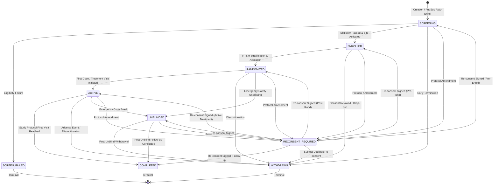

# Behavioral & Invariant Specification: Subject Lifecycle & Enrollment

**Slice:** `execution-subjects`
**Bounded Context:** `Cadence.Apps.Execution` (EDC Execution Runtime)
**Source Python Files:**

- `apps/execution/subject_lifecycle.py`
- `apps/execution/database/models/subject.py`
- `apps/execution/application/services.py` (`SubjectLifecycleService`)
- `apps/execution/domain/ports.py` (`ISubjectRepository`, `IConsentRepository`)
- `apps/execution/demographics.py`
- `apps/execution/presentation/routers/subjects.py`
- `apps/execution/workers/consent_subscriber.py`
- `apps/execution/database/models/compliance.py` (`SiteComplianceCache`)

**Cross-Cutting Dependencies (Out of Slice):** the following are imported by the files above but are shared infrastructure owned by other slices/specs, and are referenced here only to explain observable behavior — their internals are not re-specified in this document:

- `apps/execution/database/audit.py` — a session-flush write-guard shared by every write-guarded slice. It independently raises a plain `PermissionError("Re-Consent Required - Demographics & Visit Forms Locked")` (caught by the global handler in `apps/execution/main.py`, lines 481-494, mapping to HTTP 423) whenever a subject has an outstanding `requires_reconsent` consent row and no `is_paper_override` consent exists — this is a _second_, independent enforcement path for the same re-consent contract documented in Rule 4 below (see §5, raise site #7).
- `apps/execution/eligibility_service.py` — screening eligibility evaluation (`evaluate_subject_eligibility`, `verify_subject_eligible_for_randomization`); its own rule engine is out of scope for this slice, which only documents how its `eligible` verdict drives the `SCREENING → SCREEN_FAILED / ENROLLED` transition.
- `apps/execution/site_execution_gatekeeper.py` — `require_site_mutation_authorization`, invoked on subject creation when both `study_id` and `site_id` are supplied; the sovereign-site authorization rule itself belongs to a separate spec.
- `apps/execution/cryptography.py` (`AllocationKeyManager`) — RTSM allocation-envelope decryption used by `get_subject_detail`; the randomization/RTSM key-management contract belongs to the randomization slice.
- `apps/execution/econsent_client.py` — external eConsent service client; the eConsent service's own API is out of scope.
- **`ExecutionDOAUseCase`** (in `apps/execution/application/services.py`) **/ `IExecutionDOARepository`** (in `apps/execution/domain/ports.py`) — Delegation-of-Authority code — remain excluded per the Phase 1 validation report's scoping note; DOA branches, raises, and dynamic-trap sites are not counted anywhere in this document.

**Governing Regulatory & Architecture Standards:**

- 21 CFR Part 11 (Audit trails, immutable records, electronic signatures)
- ICH GCP E6(R2) (Protocol compliance, participant safety, subject identification)
- PRD-SYS-001, PRD-SYS-042, PRD-SYS-053, PRD-SYS-121, PRD-SUB-001, PRD-SUB-007, PRD-SSU-003
- ADR-2202, ADR-2233, ADR-2234, ADR-2238

---

## 1. Contract Boundary & Data Schemas

### 1.1 Ingestion Schemas (Requests)

#### `SubjectCreate`

- **Route:** `POST /api/v1/execution/subjects`
- **Payload Schema:**
  | Field          | Type     | Required | Default | Invariants & Validation                                              |
  | :------------- | :------- | :------: | :-----: | :------------------------------------------------------------------- |
  | `subject_id`   | `string` |   Yes    |    -    | Non-empty domain subject code (e.g. `SUBJ-001`). Max length: 255.    |
  | `study_id`     | `string` |   Yes    |    -    | Clinical study identifier (e.g. `STUDY-001`). Max length: 255.       |
  | `site_id`      | `string` |    No    | `null`  | Site identifier. Triggers sovereign site mutation check if provided. |
  | `arm_id`       | `string` |    No    | `null`  | Initial assigned study arm (maps to `treatment_group`).              |
  | `demographics` | `object` |    No    | `null`  | Optional patient demographics payload to be encrypted.               |
- **`Demographics` Schema:**
  | Field       | Type     | Required | Default | Invariants                                                                |
  | :---------- | :------- | :------: | :-----: | :------------------------------------------------------------------------ |
  | `name`      | `string` |    No    | `null`  | Direct PII, strictly encrypted at rest via AES-GCM.                       |
  | `birthdate` | `string` |    No    | `null`  | ISO 8601 date string (`YYYY-MM-DD`). Encrypted at rest.                   |
  | `gender`    | `string` |    No    | `null`  | Encrypted at rest. Normalized on evaluation to CDISC SEX (`M`, `F`, `U`). |
  | `race`      | `string` |    No    | `null`  | Encrypted at rest.                                                        |

#### `SubjectConsentRequest`

- **Route:** `POST /api/v1/execution/subjects/{subject_id}/consent` & `.../consents`
- **Payload Schema:**
  | Field                | Type       | Required | Default | Invariants                                                                         |
  | :------------------- | :--------- | :------: | :-----: | :--------------------------------------------------------------------------------- |
  | `protocol_version`   | `object`   |   Yes    |    -    | Contains `study_id` (`string`), `version_tag` (`string`), `version_index` (`int`). |
  | `icf_signed`         | `bool`     |   Yes    |    -    | Whether the Informed Consent Form was signed.                                      |
  | `icf_signed_date`    | `datetime` |    No    | `null`  | If omitted in Python, defaults to UTC now.                                         |
  | `requires_reconsent` | `bool`     |    No    | `false` | If an amendment requires re-consent.                                               |
  | `is_paper_override`  | `bool`     |    No    | `false` | Sovereign site paper consent waiver indicator.                                     |

#### `SubjectStateUpdateRequest`

- **Route:** `PATCH /api/v1/execution/subjects/{id}/state`
- **Headers:** `X-Change-Reason` (Required 21 CFR Part 11 justification string)
- **Payload Schema:**
  | Field    | Type     | Required | Default | Invariants                                                    |
  | :------- | :------- | :------: | :-----: | :------------------------------------------------------------ |
  | `status` | `string` |    No    | `null`  | Target state name (e.g. `ENROLLED`, `WITHDRAWN`).             |
  | `state`  | `string` |    No    | `null`  | Alternative property name for `status`. One must be non-null. |

#### `SubjectDemographicsUpdateRequest`

- **Route:** `PUT /api/v1/execution/subjects/{id}/demographics`
- **Headers:** `X-Change-Reason` (Required)
- **Payload Schema:**
  | Field           | Type                | Required | Default | Invariants                                         |
  | :-------------- | :------------------ | :------: | :-----: | :------------------------------------------------- |
  | `demographics`  | `object`            |    No    | `null`  | Replacement patient demographics payload.          |
  | `strat_factors` | `dict<string, any>` |    No    | `null`  | Stratification factors. Locked post-randomization. |

#### `ETMFCompletenessWebhookPayload`

- **Route:** `POST /api/v1/execution/webhooks/etmf`
- **Payload Schema:**
  | Field               | Type           | Required | Default | Invariants                                                                     |
  | :------------------ | :------------- | :------: | :-----: | :----------------------------------------------------------------------------- |
  | `study_id`          | `string`       |   Yes    |    -    | Clinical study identifier.                                                     |
  | `site_id`           | `string`       |    No    | `null`  | Site identifier.                                                               |
  | `milestone`         | `string`       |   Yes    |    -    | Compliance milestone name (e.g. `SITE_ACTIVATION`).                            |
  | `is_complete`       | `bool`         |   Yes    |    -    | Whether the milestone is fully satisfied.                                      |
  | `missing_artifacts` | `list<string>` |    No    |  `[]`   | Persisted as a comma-joined string on `SiteComplianceCache.missing_documents`. |
- **Behavior:** upserts the `SiteComplianceCache` row keyed by `(study_id, site_id, milestone)`. If a row exists, its `version` is incremented by 1 (optimistic version counter, not a concurrency token check); otherwise a new row is inserted with `version = 1`. No audit-log entry is written for this mutation (unlike the site-activation and enrollment-blocking paths, which always write one).

#### `SiteActivationRequest`

- **Route:** `POST /api/v1/execution/sites/{site_id}/activate`
- **Payload Schema:**
  | Field      | Type     | Required | Default | Invariants                 |
  | :--------- | :------- | :------: | :-----: | :------------------------- |
  | `study_id` | `string` |   Yes    |    -    | Clinical study identifier. |
- **Behavior:** re-reads the `SiteComplianceCache` row for `(study_id, site_id, "SITE_ACTIVATION")`. If missing or `is_complete == false`, writes a `BLOCKED_ACTIVATION` audit-log entry (in its own nested session/transaction, committed independently of the outer one) and fails — see §5, raise site #9. Otherwise writes a `SITE_ACTIVATION` audit-log entry and succeeds. This endpoint does not itself flip `SiteComplianceCache.is_complete`; that only happens via the eTMF webhook above.

---

### 1.2 Egress Schemas (Responses)

#### `SubjectResponse`

- **HTTP Status:** 200 OK / 201 Created
- **Fields:**
  | Field                     | Type     | Nullable | Description                                             |
  | :------------------------ | :------- | :------: | :------------------------------------------------------ |
  | `id`                      | `string` |    No    | Primary key UUID.                                       |
  | `subject_id`              | `string` |    No    | Domain-specific subject identifier.                     |
  | `study_id`                | `string` |    No    | Study identifier.                                       |
  | `site_id`                 | `string` |   Yes    | Clinical site code.                                     |
  | `treatment_group`         | `string` |   Yes    | Assigned treatment arm (if unblinded/authorized).       |
  | `status`                  | `string` |    No    | Lifecycle state string (`SCREENING`, `ENROLLED`, etc.). |
  | `active_protocol_version` | `string` |   Yes    | Currently active protocol version (default `1.0.0`).    |
  | `encrypted_demographics`  | `string` |   Yes    | Ciphertext payload. Raw PII never leaked.               |

#### `SubjectDetailResponse`

- **Route:** `GET /api/v1/execution/subjects/{subject_id}`
- **Blinding Rule:** RTSM fields (`treatment_group`, `randomization_seed`, `investigational_product_id`) are redacted (`null`) if caller holds a blinded role (e.g., CRC, CRA, Investigator) unless explicitly unblinded.
- **Fields:** `subject_id`, `study_id`, `status`, `site_id`, `treatment_group`, `randomization_seed`, `investigational_product_id`.

#### `SubjectConsentResponse`

- **HTTP Status:** 200 OK
- **Fields:** `id`, `subject_id`, `study_id`, `version_tag`, `version_index`, `icf_signed`, `icf_signed_date`, `requires_reconsent`, `is_paper_override`, `version`.

#### `ComplianceStatusResponse`

- **Route:** `GET /api/v1/execution/sites/{site_id}/compliance-status`
- **Query Params:** `study_id` (required), `milestone` (optional, default `"SITE_ACTIVATION"`).
- **HTTP Status:** 200 OK (always — a missing cache row is not an error)
- **Fields:**
  | Field               | Type           | Nullable | Description                                                              |
  | :------------------ | :------------- | :------: | :----------------------------------------------------------------------- |
  | `study_id`          | `string`       |    No    | Echoes the query/cache-row study.                                        |
  | `site_id`           | `string`       |   Yes    | Echoes the path/cache-row site.                                          |
  | `milestone`         | `string`       |    No    | Echoes the query/cache-row milestone.                                    |
  | `is_complete`       | `bool`         |    No    | `false` when no cache row exists yet (not an error/404).                 |
  | `missing_documents` | `list<string>` |    No    | Split from the cache row's comma-joined string; `[]` when no row exists. |

#### Site Activation & eTMF Webhook Responses (untyped success envelopes)

- `POST /api/v1/execution/sites/{site_id}/activate` success → `200 OK`, `{"status": "success", "message": "Site {site_id} activated successfully."}`.
- `POST /api/v1/execution/webhooks/etmf` success → `200 OK`, `{"status": "success", "message": "Compliance cache updated successfully."}`.
- Neither response uses a Pydantic response model in the legacy code (`dict[str, Any]` return type) — the .NET port should still define typed response records for these two envelopes rather than reproduce the untyped shape.

---

## 2. Invariants & Algorithmic Rules

### 2.1 Regulated State Machine Transition Graph

The clinical trial subject state machine enforces strict directional progress to prevent protocol deviations and safeguard statistical integrity:

### 2.2 Invariant Rules

1. **Rule 1: Stratification Factor Immutability Post-Randomization:**
   - Pre-randomization (`SCREENING`, `ENROLLED`): Stratification factors (`strat_factors`) and demographics may be edited with justification.
   - Post-randomization (`RANDOMIZED`, `ACTIVE`, `COMPLETED`, `UNBLINDED`, `WITHDRAWN`): Any attempt to modify `strat_factors` or demographics MUST fail immediately with `422 Unprocessable Entity` (`LOCKED_FACTOR_MUTATION`).
2. **Rule 2: Sovereign Site Activation Gate for Enrollment:**
   - Advancing a subject to `ENROLLED` (via screening evaluation or state update) is gated on site compliance.
   - The site must possess a verified milestone `SITE_ACTIVATION` entry in `SiteComplianceCache` with `is_complete == true`.
   - If the site is non-compliant or missing, enrollment is blocked, an immutable `BLOCKED_ENROLLMENT` audit entry is created, and an HTTP `400 Bad Request` is returned.
3. **Rule 3: Re-Consent Cascading & Clearance:**
   - When a subject signs a new consent form version (`icf_signed == true` or `is_paper_override == true`) and `requires_reconsent == false`, all prior consent records for that subject with `requires_reconsent == true` MUST be automatically cleared to `requires_reconsent = false`.
4. **Rule 4: Version Gating for Form Data Entry:**
   - Before allowing eCRF form submission, `validate_subject_version_gating` verifies whether the study amendment requires re-consent. If the subject's active protocol version does not match and no signed consent exists for the active version, form submission must fail with `ReConsentRequiredException` (**HTTP 423 Locked** — corrected from an earlier "428 / 403" claim; see §5 raise site #7 for the verified source of this mapping and the adjacent, independent 423 write-guard documented in §5.2).
5. **Rule 5: Sequential Zero-Based Enrollment Index:**
   - Every subject enrolled in a study receives a monotonically increasing `enrollment_index` (0, 1, 2, ...).
   - Must be concurrency-safe and immutable once assigned.
6. **Rule 6: 21 CFR Part 11 Audit Trail:**
   - Every mutation (`ENROLL_SUBJECT`, `RECORD_CONSENT`, `TRANSITION_<STATE>`, `UPDATE_DEMOGRAPHICS`) must capture:
     - `table_name`, `record_id`, `action`, `user_id`, `change_reason`, UTC timestamp, `old_values`, `new_values`.
   - Must link into the cryptographically verifiable audit trail.
   - **GxP audit-context bridge (out-of-slice mechanism, documented here only because it changes what a .NET `GxPAuditInterceptor` must replicate):** `current_user_id` / `current_change_reason` (Python `contextvars`) are propagated by a `before_flush` session-event listener in `apps/execution/database/audit.py` (not one of this slice's own source files) into **PostgreSQL session-config variables** — `SELECT set_config('cadence.current_user_id', ...)`, `('cadence.current_change_reason', ...)`, `('cadence.app_writing', 'true', ...)` — for a **database-level trigger** (installed separately via `deploy_database_triggers`) to consume when writing the actual audit trail. This is a materially different architecture from the `AuditLog`-table writes `SubjectLifecycleService` performs explicitly in application code (Rule 6's main bullet): the DB-trigger path is a second, independent, session-variable-driven audit-capture mechanism operating underneath the ORM, not a property the `ClinicalSubject`/`SubjectConsent` entities themselves carry — **neither entity in this slice has `CreatedBy`/`UpdatedBy`/`ReasonForChange`-style columns** (`AuditedModel` only defines `id`, `version`, `is_deleted`). The .NET port's `GxPAuditInterceptor` (ADR-2234) is an EF Core `SaveChangesInterceptor` — i.e. application-layer, not a database trigger — so this is a genuine architectural divergence to resolve deliberately in Phase 2, not a detail to silently drop: confirm whether the target interceptor must still write to a trigger-populated ledger table, or whether the DB-trigger mechanism is superseded entirely by the interceptor for this slice's audited tables.

7. **Rule 7: Demographics Derivation, Normalization & Encryption Semantics** (`apps/execution/demographics.py`):
   - **Encryption:** `encrypt_demographics`/`decrypt_demographics` use symmetric Fernet (AES-128-CBC + HMAC) with a hardcoded, non-configurable key derived from a fixed 32-byte ASCII string — already flagged in §3's dynamic-traps table as a hard blocker for the .NET port (must become a configured `AesGcm` key, never a literal).
   - **Gender/sex normalization** (`normalize_gender`): case-insensitive, whitespace-trimmed mapping to CDISC SEX codes:
     | Input (any case/whitespace)                                                                                                          | Output                                                                           |
     | :----------------------------------------------------------------------------------------------------------------------------------- | :------------------------------------------------------------------------------- |
     | `M`, `MALE`, `BOY`, `MAN`                                                                                                            | `M`                                                                              |
     | `F`, `FEMALE`, `GIRL`, `WOMAN`                                                                                                       | `F`                                                                              |
     | `U`, `UNKNOWN`, `UNK`, empty/`null`                                                                                                  | `U`                                                                              |
     | Anything else, `preserve_custom=False`                                                                                               | `U`                                                                              |
     | Anything else, `preserve_custom=True`                                                                                                | The trimmed, upper-cased input verbatim (not normalized to any fixed vocabulary) |
     | `get_safe_demographics` always calls this with `preserve_custom` forwarded from its own caller-supplied parameter (default `False`). |
   - **Age calculation** (`calculate_age`, `_parse_date_string`): accepts `birthdate`/`observation_date` independently as `date`, `datetime` (time-of-day discarded), a string, or `None`.
     - String parsing tries ISO-8601 first (`datetime.fromisoformat`, with a literal `Z` suffix rewritten to `+00:00` before parsing when a `T` separator is present), then falls back to splitting on whitespace and parsing only the leading token as a bare `date` (handles `"YYYY-MM-DD HH:MM:SS"`-style strings that aren't valid `fromisoformat` input); returns `None` if both attempts fail.
     - Age is `(observation_date − birthdate).days / 365.25` — a fixed average-year-length approximation, **not** a calendar-accurate (leap-aware) year count. The .NET port must reproduce the `/ 365.25` divisor exactly for golden-master parity rather than substituting `Period`/calendar-based age math, which will disagree at the margins.
     - Any missing input, unparseable string, or unexpected exception during computation returns `None` (logged at `warning`, never raised) — the function **never throws**.
   - **`get_safe_demographics` fallback contract:** always returns the shape `{"gender": "U", "age": None}` at minimum, and never raises, regardless of input:
     - Accepts `subject` as a `ClinicalSubject`-like object (via `.encrypted_demographics`), a `dict` (via `["encrypted_demographics"]`), or a raw ciphertext `string` directly.
     - Missing/falsy ciphertext, a decrypted payload that isn't a `dict`, an `InvalidToken` (wrong/corrupted ciphertext), or any other exception during decrypt/parse — all silently fall back to the default shape with a `warning` log; none of these are ever surfaced to the caller as an error.
     - **Decision for the .NET port (per Phase 1 remediation directive):** preserve this silent-fallback-to-default contract. This function is consumed exclusively by read-only reference-range/eligibility evaluation logic that requires a non-throwing, always-safe demographic profile; it is _not_ the authoritative demographics **write** path (that path — `update_subject_demographics_endpoint` — already has its own explicit `404`/`422` error handling and must continue to fail loudly on genuine errors). Do not unify these two code paths' error-handling behavior.

8. **Rule 8: PubSub Auto-Enrollment (Background Consent-Completion Trigger)** (`apps/execution/workers/consent_subscriber.py`):
   - On receiving a Redis pub/sub message with `action == "consent_completed"` on channel `REDIS_CHANNEL_CONSENT` (default `econsent_consent_completed`), `handle_consent_completed_message` runs inside one DB transaction:
     1. **Idempotency:** looks up an existing `ClinicalSubject` by `subject_id` OR internal `id` matching the event's `subject_id`. If found, auto-creation is skipped entirely (log-only, no error, no duplicate).
     2. **Sequential enrollment index:** if no existing subject, computes `next_idx = (MAX(enrollment_index) WHERE study_id = event.study_id) + 1`, or `0` if the study has no subjects yet, inside the same transaction as the insert — same concurrent-race concern already flagged for `SubjectLifecycleService.enroll_subject` in §3's traps table (two pub/sub messages for the same study processed concurrently can compute the same `max_idx`).
     3. Creates the `ClinicalSubject` with `status = "SCREENING"` and writes an `AuditLog` (`action="INSERT"`, `user_id="system-pubsub"`).
     4. **Independently**, ensures a matching `SubjectConsent` cache row exists for `(subject_id, study_id, version_index)` — if not, creates one with `icf_signed=True`, `requires_reconsent=False`, `icf_signed_date=now(UTC)`, and writes a second `AuditLog` row. This consent-cache population happens even if step 1 found the subject already existing (i.e., consent-cache backfill is idempotent-but-independent of subject-creation idempotency).
     - Malformed events (`subject_id` or `study_id` missing/falsy) are dropped with a `warning` log — no error is raised, no dead-letter/retry occurs.
   - **Process lifecycle:** the subscriber thread does not start at all when running under `pytest` (`"pytest" in sys.modules`), when `TESTING=true`, or when `REDIS_HOST` is unset — in all three cases `start_consent_subscriber` returns immediately and silently. When running, `_run_subscriber_sync` reconnects with a 5-second backoff on any Redis connection failure or per-message processing exception (both logged at `warning`, loop continues) and never terminates on its own outside of `stop_consent_subscriber()`.
   - **MIG-06 (hard blocker — do not transcribe as-is):** per `docs/migration/phase0/03_migration_plan.md` (Action Item Register, MIG-06), this fire-and-forget Redis pub/sub channel has no delivery durability and is documented as _currently dormant_ in the reference stack. The .NET port of this behavior **must not** be a literal Redis-subscriber background thread; it must be redesigned onto the platform's MassTransit transactional-outbox event spine (ADR-2234), consuming an `EConsentCompletedEvent`-equivalent domain event with at-least-once delivery, while preserving exactly the idempotency (existing-subject skip), same-transaction sequential-index-assignment, and independent consent-cache-backfill semantics documented above — those are the observable behavioral contract; the transport mechanism is the part MIG-06 requires changing.

9. **Rule 9: Subject Resolution, Context-Fallback & Field-Merge Semantics:**
   - **Dual-lookup by ID or code:** `SubjectLifecycleService.advance_subject_state` and `.update_demographics` (`apps/execution/application/services.py`) resolve their `subject_id` parameter by trying `subject_repo.get_by_id(...)` first, falling back to `subject_repo.get_by_subject_code(...)` if that returns nothing. The parameter is accepted as _either_ the internal UUID primary key or the domain `subject_id` code, interchangeably; `SubjectNotFoundError` is only raised once both lookups fail. `update_subject_state_endpoint`'s own pre-check (§5 raise site #15) duplicates this same dual-lookup independently before calling the service.
   - **Demographics dual-type acceptance:** `enroll_subject` and `update_demographics` both accept their `demographics` argument as either a `dict` (encrypted via `encrypt_demographics` before storage) or an already-encrypted `str` (stored as-is, assumed pre-encrypted by the caller). Callers must not be able to pass an arbitrary plaintext string expecting it to be encrypted — only the `dict` branch encrypts.
   - **Consent field-merge precedence on re-submission:** when `record_consent` finds an existing `SubjectConsent` row for `(subject_id, study_id, version_index)`, the merge is field-by-field, not a full overwrite:
     - `version_tag`, `icf_signed`, `requires_reconsent`, `is_paper_override` are unconditionally replaced from the incoming payload.
     - `icf_signed_date`: replaced only if the incoming payload supplies one; otherwise the existing value is kept, _unless_ the existing row has no date at all, in which case it is defaulted to "now" (UTC).
     - `protocol_version`: replaced only if the incoming payload supplies a truthy value — an omitted/empty `protocol_version` on a re-submission leaves the existing stored value untouched rather than nulling it out.
   - **`normalize_state`** (`apps/execution/subject_lifecycle.py`) is the single funnel both sides of every transition check pass through: `None` → `None`; an `Enum` member → its `.value` first; anything else → `str(x).strip().upper().replace(" ", "_")` (so e.g. `"in progress"` → `"IN_PROGRESS"`).
   - **Same-state is always a no-op:** `guard_subject_transition` returns immediately, without error, whenever normalized current and target states are equal — including for terminal states (re-submitting `WITHDRAWN → WITHDRAWN` succeeds silently rather than raising). This check runs _before_ the `None`-current and unknown-state checks below.
   - **Unknown/malformed state strings are rejected identically to legal-but-forbidden transitions:** after the same-state and `None`-current checks, if either normalized string doesn't match a known `SubjectState` value, `InvalidStateTransitionError` is raised with no distinct error code from a well-formed-but-illegal transition (§5 raise site #6) — callers cannot distinguish "typo'd state name" from "that transition isn't allowed" from the response body alone.
   - **Initial transition guard:** when current state is `None` (brand-new subject), the only legal target is `SCREENING`; any other target raises `InvalidStateTransitionError("None", target)` (§5 raise site #5).
   - **Context-var fallback in `evaluate_and_transition_screening`:** `current_user_id.get()` and `current_change_reason.get()` (Python `contextvars.ContextVar.get()` with no default registered) each raise `LookupError` when unset rather than returning `None`. `subjects.py` catches each independently: an unset `current_user_id` falls back to the literal string `"system"`; an unset `current_change_reason` falls back to the request's `X-Change-Reason` header value if present, else the literal string `"system_operation"`. This is the only place in the slice that catches `LookupError` from these context vars — every other reader (e.g. `create_subject`, `update_subject_state_endpoint`) uses `current_user_id.get() or "system"`/similar truthy-fallback idioms instead, which behave the same for an unset var but would NOT behave the same if a caller ever explicitly set the var to `None` (that raises no `LookupError`, so the `or` fallback still catches it, but a hypothetical `.get()`-without-`or` call elsewhere would not). The .NET equivalent (`AsyncLocal<T>`) should use one consistent default-resolution pattern across all readers rather than reproducing this two-different-idioms split.
   - **`SubjectResponse` under-population on 3 of its 4 return sites (newly identified during this remediation pass, not in the Phase 1 report):** `create_subject` (line ~212) is the only handler that populates every field of `SubjectResponse`. `update_subject_state_endpoint` (line ~646), `update_subject_demographics_endpoint` (line ~716), and `delete_subject_demographics_endpoint` (line ~767) all construct the response with only `id`, `subject_id`, `study_id`, and `encrypted_demographics` — leaving `site_id` and `treatment_group` as `null` and, more consequentially, leaving `status` and `active_protocol_version` at the Pydantic model's **hardcoded literal defaults** (`"SCREENING"` and `"1.0.0"` respectively) regardless of the subject's actual current values. Concretely: `PATCH .../state` that successfully transitions a subject to `ENROLLED` returns a body whose `status` field still reads `"SCREENING"`. **This is a real behavioral quirk of the legacy system, not a fixture error** — the golden-master fixtures in `fixtures/` reproduce it verbatim. It is an explicit decision point for Phase 2: reproduce the under-population as-is (byte-for-byte parity with a system whose response body already disagrees with its own database), or treat it as a bug fix and fully populate the DTO (a deliberate, documented behavioral improvement, not a silent one). This document does not mandate either choice — it only records that the ambiguity exists and must be resolved explicitly rather than accidentally.

---

## 3. Dynamic Python Traps & Pitfalls

| Python Pattern in Source                                                                                                                                                                                                                                                                                                                                                                                                                                                                                                                                                                                                                                                                                                                                                                                                                                                                                                                                                                                                                                                                                                                                                 | Legacy Risk                                                                                                                                                                                                                                                                                                                                                                                                                                                                                                                                                            | Target .NET 10 Fix                                                                                                                                                                                                                                                  |
| :----------------------------------------------------------------------------------------------------------------------------------------------------------------------------------------------------------------------------------------------------------------------------------------------------------------------------------------------------------------------------------------------------------------------------------------------------------------------------------------------------------------------------------------------------------------------------------------------------------------------------------------------------------------------------------------------------------------------------------------------------------------------------------------------------------------------------------------------------------------------------------------------------------------------------------------------------------------------------------------------------------------------------------------------------------------------------------------------------------------------------------------------------------------------- | :--------------------------------------------------------------------------------------------------------------------------------------------------------------------------------------------------------------------------------------------------------------------------------------------------------------------------------------------------------------------------------------------------------------------------------------------------------------------------------------------------------------------------------------------------------------------- | :------------------------------------------------------------------------------------------------------------------------------------------------------------------------------------------------------------------------------------------------------------------ |
| `datetime.now()` in `subject_lifecycle.py:179` (`unblind_subject_model`) **and `:187`** (`withdraw_subject_model`)                                                                                                                                                                                                                                                                                                                                                                                                                                                                                                                                                                                                                                                                                                                                                                                                                                                                                                                                                                                                                                                       | Both emit naive local system time, causing timezone drift and timestamp mismatch across servers. Every other timestamp in this slice (audit logs, `record_consent`'s `icf_signed_date` default, the pubsub subscriber's `icf_signed_date`) uses `datetime.now(UTC)` — these two are the only naive-time outliers.                                                                                                                                                                                                                                                      | Standardize on `DateTimeOffset.UtcNow` across all models and services.                                                                                                                                                                                              |
| `if not site_id:` in `check_site_compliance_for_enrollment`                                                                                                                                                                                                                                                                                                                                                                                                                                                                                                                                                                                                                                                                                                                                                                                                                                                                                                                                                                                                                                                                                                              | Evaluates empty string `""` as falsy, unintentionally bypassing site compliance checks.                                                                                                                                                                                                                                                                                                                                                                                                                                                                                | Use `string.IsNullOrWhiteSpace(siteId)` and treat whitespace as invalid or non-compliant.                                                                                                                                                                           |
| `normalize_state()` accepting `Any`                                                                                                                                                                                                                                                                                                                                                                                                                                                                                                                                                                                                                                                                                                                                                                                                                                                                                                                                                                                                                                                                                                                                      | Implicit string conversion on unexpected objects (e.g. dictionaries, numbers) producing strange states.                                                                                                                                                                                                                                                                                                                                                                                                                                                                | Strongly-typed `enum SubjectState` with explicit JSON converter; reject unmapped strings.                                                                                                                                                                           |
| `max_idx = await repo.get_max_enrollment_index()` race condition                                                                                                                                                                                                                                                                                                                                                                                                                                                                                                                                                                                                                                                                                                                                                                                                                                                                                                                                                                                                                                                                                                         | Concurrent enrollments can read the same max index, causing duplicate `enrollment_index` values. Identical race exists independently in `consent_subscriber.py`'s `handle_consent_completed_message` (see Rule 8).                                                                                                                                                                                                                                                                                                                                                     | Execute inside PostgreSQL transaction with row-level lock or dedicated study sequence; apply to both call sites.                                                                                                                                                    |
| Hardcoded Fernet encryption key in `demographics.py`                                                                                                                                                                                                                                                                                                                                                                                                                                                                                                                                                                                                                                                                                                                                                                                                                                                                                                                                                                                                                                                                                                                     | Insecure key management; binary payload incompatible with .NET standard algorithms.                                                                                                                                                                                                                                                                                                                                                                                                                                                                                    | Implement `IDemographicsEncryptionService` using .NET `System.Security.Cryptography.AesGcm` with key from configuration.                                                                                                                                            |
| `eval_list = []` loop in `subjects.py:500`                                                                                                                                                                                                                                                                                                                                                                                                                                                                                                                                                                                                                                                                                                                                                                                                                                                                                                                                                                                                                                                                                                                               | N+1 object mapping allocations on screening response.                                                                                                                                                                                                                                                                                                                                                                                                                                                                                                                  | Use LINQ collection expressions `[..evaluations.Select(...)]` with pre-sized capacity.                                                                                                                                                                              |
| Dual route declarations (`/api/v1/execution/subjects` and `/subjects`)                                                                                                                                                                                                                                                                                                                                                                                                                                                                                                                                                                                                                                                                                                                                                                                                                                                                                                                                                                                                                                                                                                   | Route collision and maintenance overhead.                                                                                                                                                                                                                                                                                                                                                                                                                                                                                                                              | Define canonical route group `/api/v1/execution/subjects` with optional fallback middleware if backward compatibility is required.                                                                                                                                  |
| Broad `except Exception:` decrypt-failure swallow in `subjects.py:556` (`get_subject_detail`, RTSM allocation decrypt)                                                                                                                                                                                                                                                                                                                                                                                                                                                                                                                                                                                                                                                                                                                                                                                                                                                                                                                                                                                                                                                   | Any decrypt failure — corrupted ciphertext, wrong key, malformed payload — is silently mapped to the literal string `treatment_group = "Decryption Failed"`, which then flows through `apply_rtsm_blinded_filter` as if it were a genuine (unblinded) treatment-group value.                                                                                                                                                                                                                                                                                           | Raise a typed decryption-failure exception and let the caller/response-mapping layer decide the safe blinded/error presentation; never smuggle an error state through a field that is otherwise a real clinical data value.                                         |
| `with suppress(Exception):` decrypt-failure swallow in `subjects.py:698-701` (`update_subject_demographics_endpoint`)                                                                                                                                                                                                                                                                                                                                                                                                                                                                                                                                                                                                                                                                                                                                                                                                                                                                                                                                                                                                                                                    | A corrupted/undecryptable `encrypted_demographics` ciphertext is silently treated as "no demographics on file" (`current_demo = {}`), which then makes the post-randomization lock check at line 704 (`current_demo != new_demo`) spuriously see _any_ non-empty submitted payload as a mutation — a `LOCKED_FACTOR_MUTATION` 422 can fire for a subject whose stored ciphertext is merely corrupted, not one whose demographics actually changed.                                                                                                                     | Fail loudly (5xx or a dedicated `DECRYPTION_FAILED` 4xx) instead of silently defaulting to an empty dict when the _existing_ ciphertext fails to decrypt on a locked-state comparison path; do not let a storage-integrity failure masquerade as "no prior data."   |
| `(o_dt - b_dt).days / 365.25` in `demographics.py:166` (`calculate_age`)                                                                                                                                                                                                                                                                                                                                                                                                                                                                                                                                                                                                                                                                                                                                                                                                                                                                                                                                                                                                                                                                                                 | Fixed average-year-length division rather than calendar-accurate (leap-aware) age computation; an intentional simplification, not a bug, but one that must be reproduced bit-for-bit for golden-master parity.                                                                                                                                                                                                                                                                                                                                                         | Compute age as `(observationDate.DayNumber - birthDate.DayNumber) / 365.25` (or equivalent `TimeSpan.Days / 365.25`) — do **not** substitute `Period.Between`/calendar-based year math, which disagrees with the legacy value near year boundaries.                 |
| Full truthiness (`if (not )?x:`) site inventory beyond the one already-mitigated `site_id` check — same empty-string/falsy-collection ambiguity as the mitigated row above. Mechanically re-verified against current source with `grep -nE '^\s*(el)?if \(?not? ?[A-Za-z_][A-Za-z0-9_.]*\)?:'` during this remediation pass (not just re-copied from the Phase 1 report): `services.py:121,124,126,130,185,187,218,220` (`SubjectLifecycleService` only — the identical pattern at `services.py:259,264,296,331,360,390` is inside the out-of-scope `ExecutionDOAUseCase` and is excluded here, correcting the Phase 1 report's inclusion of `:390`); `subject_lifecycle.py:225,251`; `demographics.py:66,97,114,210`; `subjects.py:290,300,334,442,446,449,472,533,548,597,607,609,616,677,697,746,757`; `consent_subscriber.py:59,102,209` — **35 in-scope sites** by this mechanical count (36 including the already-mitigated `site_id` row above), vs. the Phase 1 report's raw count of 37; the residual difference is attributable to the DOA exclusion plus minor grep-methodology variance and does not change which fields are risk-bearing (see next column). | Each site treats an empty string / empty collection identically to a semantically-`null`/absent value. For most of these the ambiguity is harmless (e.g. `if rand:` on an ORM query result, `if existing:` on a merge branch), but on fields that gate behavior — `study_id` (446/449), `target_state` (597), `gender_str`/`date_str`/`encrypted_str` (`demographics.py`) — an empty string silently takes the same branch as "not provided," which may not be the intended contract when a caller can distinguish "field omitted" from "field explicitly sent empty." | Use `string.IsNullOrWhiteSpace(...)`/explicit null checks per-field rather than a blanket falsy check, and decide per-field (during Phase 2 domain modeling) whether an empty string should be treated as invalid input (validation error) rather than as "absent." |

---

## 4. Test Scenarios from Code (Legacy Test Reverse-Engineering)

The following test suites were reverse-engineered to establish the functional parity test baseline:

1. `apps/execution/tests/test_subject_lifecycle_service.py`
2. `apps/execution/tests/test_subject_randomization_lifecycle.py`
3. `apps/execution/tests/test_pubsub_auto_enrollment.py`

### Reverse-Engineered Assertions

- **SCN-001: Sequential Enrollment & Audit Trail**
  - Given an empty study `STUDY-001`
  - When `SUBJ-001` is enrolled
  - Then status is `SCREENING`, `enrollment_index` is `0`, demographics are encrypted, and an audit log with action `ENROLL_SUBJECT` is saved.
  - When `SUBJ-002` is enrolled in the same study
  - Then status is `SCREENING`, `enrollment_index` is `1`.

- **SCN-002: Re-Consent Cascading Clearance**
  - Given subject with consent version 1 having `requires_reconsent == true`
  - When subject executes consent version 2 with `icf_signed == true` and `requires_reconsent == false`
  - Then consent version 1 is updated to `requires_reconsent == false`, and consent version 2 is persisted with `requires_reconsent == false`.

- **SCN-003: State Machine Allowed vs Forbidden Pathways**
  - Given subject in `SCREENING`
  - Allowed transitions: `SCREEN_FAILED`, `ENROLLED`, `WITHDRAWN`, `RECONSENT_REQUIRED`.
  - Forbidden transition: `ACTIVE`, `RANDOMIZED`, `COMPLETED` -> Throws `InvalidStateTransitionException`.
  - Given subject in `ENROLLED`
  - Allowed transitions: `RANDOMIZED`, `WITHDRAWN`, `RECONSENT_REQUIRED`.
  - Forbidden transition: `ACTIVE`, `SCREENING` -> Throws `InvalidStateTransitionException`.
  - Given subject in `RANDOMIZED`
  - Allowed transitions: `ACTIVE`, `WITHDRAWN`, `UNBLINDED`, `RECONSENT_REQUIRED`.
  - Forbidden transition: `SCREENING`, `ENROLLED` -> Throws `InvalidStateTransitionException`.
  - Given subject in `COMPLETED`, `WITHDRAWN`, or `SCREEN_FAILED`
  - All outgoing transitions are forbidden (terminal states).

- **SCN-004: Stratification Factors Immutability Post-Randomization**
  - Given subject in `SCREENING`
  - Updating `strat_factors` from `{"site": "A"}` to `{"site": "B"}` succeeds.
  - When subject transitions to `ENROLLED` and then `RANDOMIZED`
  - Updating `strat_factors` to `{"site": "C"}` throws `LockedFactorMutationException` (HTTP 422).
  - Updating demographics to a modified payload throws `LockedFactorMutationException` (HTTP 422).
  - Calling `DELETE /demographics` throws `SoftDeleteBlockedException` (HTTP 403).

- **SCN-005: Sovereign Site Compliance Gating**
  - Given subject in `SCREENING` at site `SITE-101`
  - When site has no completed `SITE_ACTIVATION` milestone
  - Attempting to transition subject to `ENROLLED` (via screening or state update) fails with HTTP 400 and records `BLOCKED_ENROLLMENT` audit log.
  - When site receives eTMF completeness webhook and is activated
  - Transition to `ENROLLED` succeeds.

- **SCN-006: Pre-Randomization Demographics Update Succeeds** _(source: `test_update_demographics`, `test_subject_lifecycle_service.py:181`)_
  - Given a subject enrolled with initial demographics `{"weight": 70.5}` (status `SCREENING`, i.e. pre-randomization)
  - When `SubjectLifecycleService.update_demographics` is called with `{"weight": 71.0, "height": 175}`
  - Then the call succeeds, `encrypted_demographics` is updated (re-encrypted), and an audit log with action `UPDATE_DEMOGRAPHICS` is saved.
  - Contrast with SCN-004, which covers the same operation's _rejection_ once the subject is post-randomization.

- **SCN-007: Model-Layer Initial-State Persistence Under an Active Audit Context** _(source: `test_subject_initial_state_and_persistence`, `test_subject_randomization_lifecycle.py:97`)_
  - Given `current_user_id` context var set to `"investigator_1"` and `current_change_reason` set to `"Enrolling new subject SUBJ-001"`
  - When a `ClinicalSubject` is created and flushed directly against the ORM inside a `@transactional`-decorated unit of work (not via the HTTP/service layer — this is a lower-level persistence check than SCN-001)
  - Then the persisted row's initial state is `status="SCREENING"`, `strat_factors` equals the supplied dict, `is_unblinded=False`, `randomization_id=None`, `kit_reference=None`.
  - **Correction made during this remediation pass:** this test's own assertions cover only the field values above — it does _not_ assert that the audit-context values land on the entity itself (`ClinicalSubject` has no `CreatedBy`/`UpdatedBy`-style columns to assert against). The context vars it sets are exercised by the separate, out-of-slice DB-trigger audit bridge documented in Rule 6 above; this scenario's purpose for the .NET port is narrower than its docstring implies: confirm that entity construction with an active audit context still produces the correct initial field values, no more.

- **SCN-008: Unblinding & Withdrawal Field Capture** _(source: `test_unblinding_and_withdrawal_behavior`, `test_subject_randomization_lifecycle.py:279`)_
  - Given a subject transitioned `SCREENING → ENROLLED → RANDOMIZED`
  - When `subject.unblind(unblinded_by="doctor_smith", reason="SAE-Life-Threatening-Event")` is invoked
  - Then `status="UNBLINDED"`, `is_unblinded=True`, `unblinded_by="doctor_smith"`, `unblinded_reason="SAE-Life-Threatening-Event"`, `unblinded_at` is a timestamp (naive local time — see §3 dynamic-traps table).
  - When `subject.withdraw(reason="Subject withdrew consent")` is subsequently invoked
  - Then `status="WITHDRAWN"`, `withdrawal_reason="Subject withdrew consent"`, `withdrawn_at` is a timestamp (also naive local time).
  - These field-capture writes bypass the `@validates("status")` transition guard's normal HTTP-layer error translation entirely — `unblind`/`withdraw` set `.status` directly, so an illegal call sequence (e.g. `withdraw()` on an already-terminal subject) surfaces as a raw `InvalidStateTransitionError` to whatever caller invoked the model method, not as a pre-formatted HTTP response.

- **SCN-009: PubSub Auto-Enrollment on Consent Completion** _(source: `test_pubsub_auto_enrollment_screening`, `test_pubsub_auto_enrollment.py:93`)_
  - Given no existing subject `SUBJ-AUTO-01` in study `STUDY-AUTO`
  - When a `{"action": "consent_completed", "subject_id": "SUBJ-AUTO-01", "study_id": "STUDY-AUTO", "site_id": "SITE-AUTO-01", "version_tag": "1.0", "version_index": 1}` event is dispatched to `handle_consent_completed_message`
  - Then a `ClinicalSubject` is auto-created with `status="SCREENING"`, `enrollment_index=0`, an `AuditLog` row (`action="INSERT"`, `table_name="clinical_subjects"`) is written, and a `SubjectConsent` cache row is auto-created with `icf_signed=True`, `is_paper_override=False`, `requires_reconsent=False`.
  - See Rule 8 for the full idempotency/backoff/MIG-06 contract this scenario is a slice of.

- **SCN-010: Manual Paper-Consent Override Bypasses the Re-Consent Write Guard** _(source: `test_manual_physical_paper_consent_override`, `test_pubsub_auto_enrollment.py:247`)_
  - Given a newly-created subject with no consent on file, and the eConsent service unreachable (`fetch_subject_consent_status` raising 404)
  - When a write requiring active consent is attempted (e.g. `POST /api/v1/execution/visits`)
  - Then it fails with **HTTP 423** and detail `"Re-Consent Required - Demographics & Visit Forms Locked"` — this is the cross-cutting `apps/execution/database/audit.py` write-guard (`PermissionError` → global handler), **not** this slice's own `ReConsentRequiredException`/423 path (§5, raise site #7); the two are independent mechanisms that happen to agree on status code today.
  - When `POST /subjects/{id}/consent` is then called with `is_paper_override=True`, `icf_signed=True`, `requires_reconsent=False`
  - Then the consent record is saved (`is_paper_override=True` echoed in the response) and, per Rule 3, clears `requires_reconsent` cascading.
  - When the same write is retried
  - Then it now succeeds (`200 OK`) — the paper-override consent row satisfies the write guard's `has_any_paper_override` check.

---

## 5. Error Taxonomy & Response Envelopes

**Response envelope shape:** every error response in this slice — whether raised directly as `HTTPException(status_code, detail=...)` in a router, or raised as a domain exception caught by one of `main.py`'s three relevant global handlers (`LockedFactorMutationError`, `InvalidStateTransitionError`, `PermissionError`) — serializes as the bare two-field shape `{"detail": "<string>"}`. This slice **never** uses the richer `ProblemDetails` model (`type`/`title`/`status`/`instance`/`code`) that other handlers in `main.py` (e.g. `SubjectEligibilityError`, `CodingAssignmentNotFoundError`) already use. The .NET 10 port's `IProblemDetailsService` mapping must, at minimum, populate `detail` and `status` to match the table below for wire-compatible golden-master parity; upgrading the remaining fields to the full RFC 9457 shape for consistency with the rest of the app is a Phase 2 design choice, not a behavior this table mandates preserving as-is.

**No global not-found handler exists for this slice's own domain exceptions.** Every other error family raised in this slice (`LockedFactorMutationError`, `InvalidStateTransitionError`, `PermissionError`, FastAPI's `RequestValidationError`) has a registered `@app.exception_handler` in `apps/execution/main.py`. `SubjectNotFoundError` (and its base classes `EntityNotFoundError`/`DomainError` from `packages/hexagonal`) does not — its 404 mapping exists today only because the one call site that can trigger it in production HTTP traffic (`update_subject_state_endpoint`) happens to wrap the service call in a local `try/except`. **.NET decision:** register a global handler for the `EntityNotFoundError` family mapping to 404, consistent with how every sibling exception type is already handled, rather than relying on call-site-local catches.

**Corrections to the Phase 1 validation report**, verified directly against the current source during this remediation pass:

- **`ReConsentRequiredException` is HTTP 423, not "428 / 403".** The only router call site that catches it (`apps/execution/presentation/routers/amendments.py`, lines 364-368, on `/api/v1/execution/amendments/validate-gating`) maps it to `status.HTTP_423_LOCKED`. Rule 4 (§2.2) and raise site #7 below reflect the corrected code.
- **`subjects.py`'s screening-transition catch (line 496) is not a bare `except Exception as e:` catch-all.** It is scoped specifically to `InvalidStateTransitionError`, raised when the `ClinicalSubject.status` ORM `@validates` guard rejects the `SCREEN_FAILED`/`ENROLLED` assignment made a few lines earlier in the same block. The _actual_ bare catch-all in this slice is at `subjects.py:643-644` (raise site #19 below) — a distinct location from the one the Phase 1 report named.

### 5.1 Full Raise-Site Inventory (25 of 25 mapped)

| #   | Raise Site                                                                        | Exception                                       | HTTP Status                                                                    | Response Body                                                                                                                       | Notes / .NET Mapping                                                                                                                                                                                                                                                                                                                                                                                                                                                          |
| --- | --------------------------------------------------------------------------------- | ----------------------------------------------- | ------------------------------------------------------------------------------ | ----------------------------------------------------------------------------------------------------------------------------------- | ----------------------------------------------------------------------------------------------------------------------------------------------------------------------------------------------------------------------------------------------------------------------------------------------------------------------------------------------------------------------------------------------------------------------------------------------------------------------------- |
| 1   | `services.py:188` (`advance_subject_state`)                                       | `SubjectNotFoundError`                          | 404 _(only via the one caller's local catch — see raise site #17)_             | `{"detail": "Subject not found"}`                                                                                                   | No global handler backs this — see callout above. Register one.                                                                                                                                                                                                                                                                                                                                                                                                               |
| 2   | `services.py:221` (`update_demographics`)                                         | `SubjectNotFoundError`                          | _(unreachable from HTTP today)_                                                | n/a                                                                                                                                 | `update_subject_demographics_endpoint` bypasses the service layer and does its own inline query/404 (raise site #20); this service method is exercised only by SCN-006's unit test. Preserve the same domain not-found type in .NET regardless, so a future HTTP caller is covered by the global handler above.                                                                                                                                                               |
| 3   | `database/models/subject.py:79` (`validate_strat_factors`)                        | `LockedFactorMutationError`                     | 422 (global handler)                                                           | `{"detail": "LOCKED_FACTOR_MUTATION"}`                                                                                              | Already scenario'd (SCN-004). ORM-level enforcement path — see #21/#23 for the router-level duplicate.                                                                                                                                                                                                                                                                                                                                                                        |
| 4   | `subject_lifecycle.py:156` (`guard_subject_transition`, known-but-forbidden)      | `InvalidStateTransitionError`                   | 400 (global handler or router-local, see #18)                                  | `{"detail": "INVALID_STATE_TRANSITION"}`                                                                                            | Already scenario'd (SCN-003).                                                                                                                                                                                                                                                                                                                                                                                                                                                 |
| 5   | `subject_lifecycle.py:143` (initial transition, current=`None`)                   | `InvalidStateTransitionError`                   | 400                                                                            | `{"detail": "INVALID_STATE_TRANSITION"}`                                                                                            | Closed by Rule 9. Same type/status as #4, distinct branch (any first transition other than `→ SCREENING`).                                                                                                                                                                                                                                                                                                                                                                    |
| 6   | `subject_lifecycle.py:149` (unknown/malformed state string)                       | `InvalidStateTransitionError`                   | 400                                                                            | `{"detail": "INVALID_STATE_TRANSITION"}`                                                                                            | Closed by Rule 9. No distinct error code from #4 — a typo'd state name and a legitimately-forbidden transition are indistinguishable to the caller.                                                                                                                                                                                                                                                                                                                           |
| 7   | `subject_lifecycle.py:252` (`validate_subject_version_gating`)                    | `ReConsentRequiredException`                    | **423** (corrected from the Phase 1 report's "428 / 403")                      | `{"detail": "Protocol Amendment {version} is active. Subject {id} must execute re-consent before data entry on visit {visit_id}."}` | Only reachable via `POST /api/v1/execution/amendments/validate-gating` (outside this slice's own router, but the exception type is defined in `subject_lifecycle.py`). The unrelated `audit.py` write-guard (out-of-slice `PermissionError`) independently produces the same 423 status with a fixed message for the `/visits` write path — see SCN-010. .NET should not conflate the two into one exception type unless intentionally consolidating both enforcement layers. |
| 8   | `subject_lifecycle.py:226` (`validate_subject_version_gating`, subject not found) | bare `ValueError`                               | 404 _(only because `amendments.py:369-373` specifically catches `ValueError`)_ | `{"detail": "Subject {subject_id} not found."}`                                                                                     | **Gap.** Inconsistent typing vs. every other not-found site in this slice (`SubjectNotFoundError`). .NET should raise the same typed not-found exception here.                                                                                                                                                                                                                                                                                                                |
| 9   | `subjects.py:381-384` (`activate_site_endpoint`)                                  | `HTTPException`                                 | 400                                                                            | `{"detail": "Site activation blocked: Site {site_id} is not compliant in eTMF. Missing expected documents."}`                       | New endpoint, documented in §1.1/§1.2. Writes a `BLOCKED_ACTIVATION` audit entry first.                                                                                                                                                                                                                                                                                                                                                                                       |
| 10  | `subjects.py:443` (`evaluate_and_transition_screening`)                           | `HTTPException`                                 | 404                                                                            | `{"detail": "Clinical subject not found."}`                                                                                         | Not-found site 1 of 5. Detail string differs from the other four ("Clinical subject not found." vs "Subject not found") — .NET should standardize on one message.                                                                                                                                                                                                                                                                                                             |
| 11  | `subjects.py:450-453`                                                             | `HTTPException`                                 | 400                                                                            | `{"detail": "Study ID must be provided in the payload or resolved from the ClinicalSubject."}`                                      | Missing/unresolvable `study_id`.                                                                                                                                                                                                                                                                                                                                                                                                                                              |
| 12  | `subjects.py:496-497` (`except InvalidStateTransitionError as e:`)                | `InvalidStateTransitionError` → `HTTPException` | 400                                                                            | `{"detail": str(e)}` (free-text, e.g. `"Transition from SCREENING to ENROLLED is forbidden."`)                                      | **Not** a bare catch-all — see corrections callout above. Only site among #4-#6/#18 whose body is the exception's own message rather than the fixed `"INVALID_STATE_TRANSITION"` string; .NET should pick one response shape for this family.                                                                                                                                                                                                                                 |
| 13  | `subjects.py:534` (`get_subject_detail`)                                          | `HTTPException`                                 | 404                                                                            | `{"detail": "Subject not found"}`                                                                                                   | Not-found site 2 of 5.                                                                                                                                                                                                                                                                                                                                                                                                                                                        |
| 14  | `subjects.py:598-600` (`update_subject_state_endpoint`)                           | `HTTPException`                                 | 400                                                                            | `{"detail": "Either status or state must be provided."}`                                                                            | Missing both `status` and `state`.                                                                                                                                                                                                                                                                                                                                                                                                                                            |
| 15  | `subjects.py:610` (`update_subject_state_endpoint`, `ENROLLED`-gate pre-check)    | `HTTPException`                                 | 404                                                                            | `{"detail": "Subject not found"}`                                                                                                   | Not-found site 3 of 5; duplicates the dual-lookup that `advance_subject_state` performs again a few lines later.                                                                                                                                                                                                                                                                                                                                                              |
| 16  | `subjects.py:627-630` (`update_subject_state_endpoint`, `ENROLLED` gate)          | `HTTPException`                                 | 400                                                                            | `{"detail": "Subject enrollment blocked: Site {site_id} is not compliant."}`                                                        | Already scenario'd (SCN-005) — state-update path variant of #9's sibling pattern for enrollment rather than site activation.                                                                                                                                                                                                                                                                                                                                                  |
| 17  | `subjects.py:639-640` (`except SubjectNotFoundError:`)                            | `SubjectNotFoundError` → `HTTPException`        | 404                                                                            | `{"detail": "Subject not found"}`                                                                                                   | This is the one local catch that stands in for the missing global handler discussed in raise site #1.                                                                                                                                                                                                                                                                                                                                                                         |
| 18  | `subjects.py:641-642` (`except InvalidStateTransitionError:`)                     | `InvalidStateTransitionError` → `HTTPException` | 400                                                                            | `{"detail": "INVALID_STATE_TRANSITION"}`                                                                                            | Already scenario'd (SCN-003) — fixed-string variant (contrast #12's free-text variant).                                                                                                                                                                                                                                                                                                                                                                                       |
| 19  | `subjects.py:643-644` (`except Exception as e:`)                                  | any `Exception` → `HTTPException`               | 400                                                                            | `{"detail": str(e)}`                                                                                                                | **The genuine bare catch-all** in this slice (see corrections callout). Masks any unexpected failure (e.g. a database error) as a generic 400. .NET must not reproduce a blanket `catch (Exception) → 400`.                                                                                                                                                                                                                                                                   |
| 20  | `subjects.py:678` (`update_subject_demographics_endpoint`)                        | `HTTPException`                                 | 404                                                                            | `{"detail": "Subject not found"}`                                                                                                   | Not-found site 4 of 5.                                                                                                                                                                                                                                                                                                                                                                                                                                                        |
| 21  | `subjects.py:690-692` (strat_factors, post-rand)                                  | `HTTPException`                                 | 422                                                                            | `{"detail": "LOCKED_FACTOR_MUTATION"}`                                                                                              | Already scenario'd (SCN-004) — router-direct-raise path, contrast #3's ORM-level path.                                                                                                                                                                                                                                                                                                                                                                                        |
| 22  | `subjects.py:697-701` (`with suppress(Exception):` demographics decrypt)          | _(suppressed — no exception surfaces)_          | n/a                                                                            | n/a                                                                                                                                 | Also a Gate 5 dynamic trap (§3). Silently defaults to `current_demo = {}` on decrypt failure, which can spuriously trigger #23's `LOCKED_FACTOR_MUTATION` for a post-rand subject with merely-corrupted (not actually mutated) stored ciphertext. .NET should fail loudly here instead.                                                                                                                                                                                       |
| 23  | `subjects.py:705-707` (demographics, post-rand)                                   | `HTTPException`                                 | 422                                                                            | `{"detail": "LOCKED_FACTOR_MUTATION"}`                                                                                              | Already scenario'd (SCN-004).                                                                                                                                                                                                                                                                                                                                                                                                                                                 |
| 24  | `subjects.py:747` (`delete_subject_demographics_endpoint`)                        | `HTTPException`                                 | 404                                                                            | `{"detail": "Subject not found"}`                                                                                                   | Not-found site 5 of 5.                                                                                                                                                                                                                                                                                                                                                                                                                                                        |
| 25  | `subjects.py:758` (`delete_subject_demographics_endpoint`, post-rand)             | `HTTPException`                                 | 403                                                                            | `{"detail": "SOFT_DELETE_BLOCKED"}`                                                                                                 | Already scenario'd (SCN-004).                                                                                                                                                                                                                                                                                                                                                                                                                                                 |

### 5.2 Adjacent Out-of-Slice Error Surface (context only, not re-specified here)

| Mechanism                                                    | Exception                                             | HTTP Status | Response Body                                                           |
| ------------------------------------------------------------ | ----------------------------------------------------- | ----------- | ----------------------------------------------------------------------- |
| `apps/execution/database/audit.py` session-flush write-guard | `PermissionError` (global handler, `main.py:481-494`) | 423         | `{"detail": "Re-Consent Required - Demographics & Visit Forms Locked"}` |

This exists to explain SCN-010's observed behavior; the write-guard's own logic (which tables/operations it gates, its `has_any_paper_override`/`higher_reconsent` computation) belongs to whichever spec owns `apps/execution/database/audit.py` and is out of scope for this document beyond the fact of its interaction with this slice's consent records.
