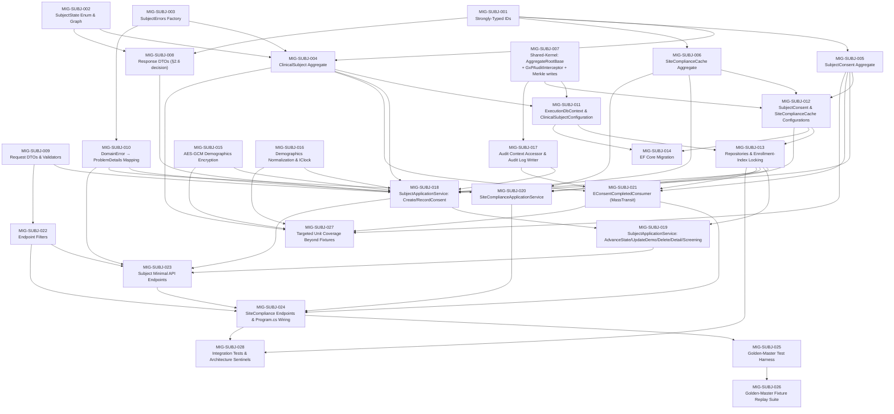

# Migration Backlog: EXECUTION-SUBJECTS

**Slice Code:** `SUBJ` · **Bounded Context:** `Cadence.Apps.Execution` · **Target Project:** `apps/execution/src/Cadence.Apps.Execution.csproj`
**Test Projects:** `tests/Cadence.UnitTests.csproj` (unit + golden-master + integration), `tests/Cadence.ArchitectureTests.csproj` (ArchUnitNET sentinels)

> **Source of truth:** `02_technical_design.md` (supersedes the pre-remediation `02_architecture.md` draft and the original, now-replaced version of this file). Grounded against `01_spec.md` (behavioral spec, 25/25 raise sites, SCN-001…010), `00_phase1_validation_report.md` §0 (the Phase 2 validation gate for this slice — **PHASE 2 UNBLOCKED**, all 5 gates PASS; this slice has no separately-named `00_phase2_validation_report.md`, the §0 re-audit addendum in the Phase 1 report serves that role), and `fixtures/*.json` (47 scenarios: 17 `SCN-*`, 11 `EDGE-*`, 21 `INV-*` scenario IDs joined across `input_valid_nominal.json` / `input_valid_edge_cases.json` / `input_invalid_validation_errors.json` / `output_expected_nominal.json` / `output_expected_errors.json`).
>
> **Verified against current repo state, not assumed:** `Cadence.Core.Domain.AggregateRoot<TId>` (`packages/engine_core/src/AggregateRoot.cs`), `Result<T>`/`DomainError` (`packages/engine_core/src/Result.cs`), `IGxPAuditable` (`packages/engine_core/src/IGxPAuditable.cs`), `AuditLogEntry` (`packages/engine_core/src/Audit/AuditLogEntry.cs`), and `GxPAuditInterceptor` (`packages/database/src/GxPAuditInterceptor.cs`) all already exist — and the interceptor **does** today pattern-match only `AggregateRoot<string>` exactly as `02_technical_design.md` §4.4 describes, confirming that gap is real, not speculative. `apps/execution/src/` currently contains only `Program.cs` (a placeholder health-check + empty `/subjects` list route) and the `.csproj` — this slice's domain, application, persistence, and endpoint code does not exist yet; every ticket below is new work, not a refactor. `tests/Cadence.UnitTests.csproj` does **not** yet reference `apps/execution/src/Cadence.Apps.Execution.csproj` or `packages/database/src/Cadence.Database.csproj` — MIG-SUBJ-001 adds both references so every later ticket's tests can compile. `tests/Cadence.ArchitectureTests.csproj` already references `Cadence.Apps.Execution` — no wiring needed there.

---

## 1. Backlog Summary & Execution Roadmap

**Total tickets:** 28 · **Total estimated effort:** ~111h (~14 engineer-days) · **Layers:** Domain (7), Application (7), Persistence (4), Presentation (3), Testing (4), Shared-Kernel (1), Contracts (2 — grouped under Application below), Resilience/Adapters (2 — grouped under Application below)

**Critical path** (longest dependency chain to a shippable, testable slice):
`MIG-SUBJ-001 → 004 → 007 → 011 → 013 → 018 → 019 → 023 → 025 → 026` (10 tickets, ~46h)

**Zero-dependency tickets — startable immediately, in parallel:** `MIG-SUBJ-001`, `MIG-SUBJ-002`, `MIG-SUBJ-003`, `MIG-SUBJ-007`, `MIG-SUBJ-009`, `MIG-SUBJ-015`, `MIG-SUBJ-016`

### 1.1 Mermaid Dependency Graph



### 1.2 Work Breakdown Structure (WBS)

| Ticket ID    | Title                                                                     | Layer         | Dependencies                                     | Est. Effort | Critical Path |
| ------------ | ------------------------------------------------------------------------- | ------------- | ------------------------------------------------ | ----------- | ------------- |
| MIG-SUBJ-001 | Strongly-Typed IDs & Value Objects                                        | Domain        | None                                             | 2h          | Yes           |
| MIG-SUBJ-002 | `SubjectState` Enum, Codec & Transition Graph                             | Domain        | None                                             | 2h          | No            |
| MIG-SUBJ-003 | `SubjectErrors` Domain Error Factory                                      | Domain        | None                                             | 1h          | No            |
| MIG-SUBJ-004 | `ClinicalSubject` Aggregate Root                                          | Domain        | 001, 002, 003                                    | 6h          | Yes           |
| MIG-SUBJ-005 | `SubjectConsent` Aggregate & `ProtocolVersionRef`                         | Domain        | 001                                              | 3h          | No            |
| MIG-SUBJ-006 | `SiteComplianceCache` Aggregate                                           | Domain        | 001                                              | 2h          | No            |
| MIG-SUBJ-007 | Shared-Kernel: `AggregateRootBase` & `GxPAuditInterceptor` Generalization | Shared-Kernel | None                                             | 4h          | Yes           |
| MIG-SUBJ-008 | Response DTOs & the §2.6 Under-Population Decision                        | Application   | 001, 002                                         | 3h          | No            |
| MIG-SUBJ-009 | Request DTOs & FluentValidation Validators                                | Application   | None                                             | 3h          | No            |
| MIG-SUBJ-010 | `DomainError` → `ProblemDetails` HTTP Mapping                             | Application   | 003                                              | 2h          | No            |
| MIG-SUBJ-011 | `ExecutionDbContext` & `ClinicalSubjectConfiguration`                     | Persistence   | 004, 007                                         | 5h          | Yes           |
| MIG-SUBJ-012 | `SubjectConsentConfiguration` & `SiteComplianceCacheConfiguration`        | Persistence   | 005, 006, 007                                    | 4h          | No            |
| MIG-SUBJ-013 | Repositories & Sequential Enrollment-Index Locking                        | Persistence   | 011, 012                                         | 6h          | Yes           |
| MIG-SUBJ-014 | EF Core Migration Generation                                              | Persistence   | 011, 012                                         | 2h          | No            |
| MIG-SUBJ-015 | AES-GCM Demographics Encryption Service                                   | Application   | None                                             | 3h          | No            |
| MIG-SUBJ-016 | Demographics Normalization Service & `IClock`                             | Application   | None                                             | 4h          | No            |
| MIG-SUBJ-017 | Audit Context Accessor & Audit Log Writer                                 | Application   | 007                                              | 3h          | No            |
| MIG-SUBJ-018 | `SubjectApplicationService` — `CreateAsync` / `RecordConsentAsync`        | Application   | 004, 005, 006, 008, 009, 010, 013, 015, 016, 017 | 6h          | Yes           |
| MIG-SUBJ-019 | `SubjectApplicationService` — Advance/UpdateDemo/Delete/Detail/Screening  | Application   | 013, 018                                         | 7h          | Yes           |
| MIG-SUBJ-020 | `SiteComplianceApplicationService`                                        | Application   | 006, 010, 012, 013                               | 4h          | No            |
| MIG-SUBJ-021 | `EConsentCompletedConsumer` (MassTransit Outbox)                          | Application   | 004, 005, 013, 017                               | 5h          | No            |
| MIG-SUBJ-022 | Endpoint Filters (`ChangeReasonHeaderFilter`, `ValidationFilter<T>`)      | Presentation  | 009                                              | 2h          | No            |
| MIG-SUBJ-023 | Subject Minimal API Endpoints                                             | Presentation  | 010, 018, 019, 022                               | 5h          | Yes           |
| MIG-SUBJ-024 | SiteCompliance Endpoints & `Program.cs` Wiring                            | Presentation  | 020, 021, 022, 023                               | 4h          | Yes           |
| MIG-SUBJ-025 | Golden-Master Test Harness (Fixture Loader & Assert)                      | Testing       | 024                                              | 4h          | Yes           |
| MIG-SUBJ-026 | Golden-Master Fixture Replay Suite (47 scenarios)                         | Testing       | 025                                              | 6h          | Yes           |
| MIG-SUBJ-027 | Targeted Unit Coverage Beyond Fixtures                                    | Testing       | 004, 005, 015, 016, 021                          | 6h          | No            |
| MIG-SUBJ-028 | Integration Tests & Architecture Sentinels                                | Testing       | 013, 024                                         | 7h          | No            |

---

## 2. Implementation Tickets

### [MIG-SUBJ-001] Implement Strongly-Typed IDs & Value Objects `[COMPLETED]`

- **Layer:** Domain
- **Complexity:** Small (2h)
- **Dependencies:** None
- **Parallelizable With:** MIG-SUBJ-002, MIG-SUBJ-003, MIG-SUBJ-007, MIG-SUBJ-009, MIG-SUBJ-015, MIG-SUBJ-016
- **Target Files (Create/Modify):**
  ```text
  apps/execution/src/Domain/Subjects/SubjectId.cs
  apps/execution/src/Domain/Subjects/SubjectConsentId.cs
  apps/execution/src/Domain/Subjects/SubjectCode.cs
  apps/execution/src/Domain/Subjects/StudyCode.cs
  apps/execution/src/Domain/Subjects/SiteCode.cs
  tests/Cadence.UnitTests.csproj (add <ProjectReference Include="..\apps\execution\src\Cadence.Apps.Execution.csproj" /> and <ProjectReference Include="..\packages\database\src\Cadence.Database.csproj" /> — neither reference exists yet and every later test ticket in this slice needs both)
  tests/Execution/Subjects/ValueObjectTests.cs
  ```
- **Legacy Python Source Being Replaced:**
  ```text
  apps/execution/database/models/subject.py (surrogate id PK + subject_id/study_id/site_id string columns)
  ```

#### Objective & Scope

Introduce the five strongly-typed primitives every other Domain/Application ticket in this slice compiles against: two `Guid`-backed `readonly record struct` surrogate keys (`SubjectId`, `SubjectConsentId`) and three validated string wrapper value objects (`SubjectCode`, `StudyCode`, `SiteCode`). Wire the two missing `ProjectReference`s into `Cadence.UnitTests.csproj` so this and every later ticket's tests can compile against `Cadence.Apps.Execution` and `Cadence.Database`. No aggregates, no persistence, no HTTP — value objects only.

#### Technical Implementation Details

Exactly per `02_technical_design.md` §2.1: `SubjectId`/`SubjectConsentId` as `readonly record struct` wrapping `Guid` with a static `New()` factory. `SubjectCode`/`StudyCode` throw `ArgumentException` in their constructor on `string.IsNullOrWhiteSpace` or length `> 255` (mirrors §1.1's `subject_id`/`study_id` max-length-255 non-empty invariant from `01_spec.md`). `SiteCode` is deliberately **nullable-by-design** at call sites (`SiteCode?`) — its own constructor still rejects whitespace-only _when constructed_, but callers may omit it entirely (per the `if not site_id:` truthiness trap in `01_spec.md` §3 — an explicitly-empty string must be rejected as invalid input, not silently treated as "absent"). All five override `ToString()` to return the raw value for interpolation/logging convenience.

#### Acceptance Criteria

- [x] Compiles with 0 warnings and 0 errors under `<TreatWarningsAsErrors>true</TreatWarningsAsErrors>`.
- [x] `#nullable enable` enforced; no suppression operators (`!`) without explicit justification comments.
- [x] Given an empty or whitespace-only string, when constructing `SubjectCode`/`StudyCode`/`SiteCode`, then an `ArgumentException` is thrown.
- [x] Given a 256-character string, when constructing `SubjectCode`/`StudyCode`, then an `ArgumentException` is thrown (255 is the max valid length).
- [x] Given `SubjectId.New()` called twice, when comparing results, then they are unequal (`Guid.NewGuid()` per call).
- [x] Boundary check: a 255-character string is accepted (upper boundary is inclusive).
- [x] Error condition: `SiteCode` constructed with `""` throws — distinct from a `SiteCode?` parameter left `null`, which is legal.

#### Verification & Test Requirements

`ValueObjectTests` — `[Theory]`/`[InlineData]` covering empty/whitespace/255-char/256-char boundaries for each of the three string value objects; equality tests for the two ID structs; confirms `tests/Cadence.UnitTests.csproj` builds after the `ProjectReference` additions (`dotnet build tests/Cadence.UnitTests.csproj`).

---

### [MIG-SUBJ-002] Implement `SubjectState` Enum, Codec & Transition Graph `[COMPLETED]`

- **Layer:** Domain
- **Complexity:** Small (2h)
- **Dependencies:** None
- **Parallelizable With:** MIG-SUBJ-001, MIG-SUBJ-003, MIG-SUBJ-007, MIG-SUBJ-009, MIG-SUBJ-015, MIG-SUBJ-016
- **Target Files (Create/Modify):**
  ```text
  apps/execution/src/Domain/Subjects/SubjectState.cs
  apps/execution/src/Domain/Subjects/SubjectStateCodec.cs
  apps/execution/src/Domain/Subjects/SubjectTransitionGraph.cs
  tests/Execution/Subjects/SubjectTransitionGraphTests.cs
  ```
- **Legacy Python Source Being Replaced:**
  ```text
  apps/execution/subject_lifecycle.py (normalize_state, guard_subject_transition)
  ```

#### Objective & Scope

Port the 9-state enum, the `UPPER_SNAKE_CASE` string codec (`normalize_state`'s exact shape), and the allowed-transition graph (`guard_subject_transition`) that every state-changing operation in this slice funnels through. This is the single highest-value correctness surface in the slice — SCN-003 and 9 of the 25 raise sites (#4–#6, #12, #18) depend on it.

#### Technical Implementation Details

`SubjectState` enum with all 9 members (`Screening, ScreenFailed, Enrolled, Randomized, Active, Unblinded, Completed, Withdrawn, ReconsentRequired`) per `02_technical_design.md` §2.2. `SubjectStateCodec.ToCode`/`TryParse` exactly as designed — `TryParse` trims, upper-cases, and replaces spaces with underscores before dictionary lookup, returning `false` (never throwing) on an unmapped string. `SubjectTransitionGraph.Guard(SubjectState? current, SubjectState target) -> Result<SubjectState>` implements Rule 9's exact check order: (1) same-state is **always** a silent no-op, including terminal→terminal (e.g. `WITHDRAWN → WITHDRAWN` succeeds); (2) `current is null` legally targets only `Screening`; (3) the `Allowed` `IReadOnlyDictionary<SubjectState, IReadOnlySet<SubjectState>>` lookup per the mermaid graph in `01_spec.md` §2.1. Unknown/malformed input is rejected at the `TryParse` boundary (by the caller, §3.2) with the identical `INVALID_STATE_TRANSITION` code as a legal-but-forbidden transition — do not add a distinct error code here, that indistinguishability is a documented legacy behavior (raise site #6).

#### Acceptance Criteria

- [x] Compiles with 0 warnings and 0 errors under `<TreatWarningsAsErrors>true</TreatWarningsAsErrors>`.
- [x] `#nullable enable` enforced; no suppression operators (`!`) without explicit justification comments.
- [x] Given any state `S`, when `Guard(S, S)` is called, then it succeeds (no-op), including for `ScreenFailed`, `Completed`, `Withdrawn`.
- [x] Given `current = null` and `target = Screening`, when `Guard` is called, then it succeeds; given `current = null` and any other target, then it fails with `INVALID_STATE_TRANSITION`.
- [x] Given every `(current, target)` pair in the `01_spec.md` §2.1 mermaid graph, when `Guard` is called, then allowed pairs succeed and all other pairs fail with `INVALID_STATE_TRANSITION`.
- [x] Boundary check: `ReconsentRequired` is the only state whose outbound set includes 7 of the other 8 states (every state except itself) — verify the full fan-out, not just a sample.
- [x] Error condition: `SubjectStateCodec.TryParse("in progress")` (lowercase, embedded space) returns `true` with `state = ` whichever member maps to `IN_PROGRESS` if one exists, else returns `false` — assert the actual unmapped-string case returns `false`, not a thrown exception.

#### Verification & Test Requirements

`SubjectTransitionGraphTests` — full `[Theory]` matrix over all 9×9 = 81 `(current, target)` combinations (SCN-003), asserting success/failure against the mermaid graph; `SubjectStateCodecTests` covering `ToCode`/`TryParse` round-trips for all 9 members plus malformed-input and whitespace/casing-normalization cases.

---

### [MIG-SUBJ-003] Implement `SubjectErrors` Domain Error Factory `[COMPLETED]`

- **Layer:** Domain
- **Complexity:** Small (1h)
- **Dependencies:** None
- **Parallelizable With:** MIG-SUBJ-001, MIG-SUBJ-002, MIG-SUBJ-007, MIG-SUBJ-009, MIG-SUBJ-015, MIG-SUBJ-016
- **Target Files (Create/Modify):**
  ```text
  apps/execution/src/Domain/Subjects/SubjectErrors.cs
  tests/Execution/Subjects/SubjectErrorsTests.cs
  ```
- **Legacy Python Source Being Replaced:**
  ```text
  apps/execution/domain/ports.py, apps/execution/subject_lifecycle.py, apps/execution/database/models/subject.py, apps/execution/presentation/routers/subjects.py (the 25-raise-site inventory, 01_spec.md §5.1)
  ```

#### Objective & Scope

A single static factory class producing every `DomainError` this slice raises, unifying the 25 legacy raise sites (`01_spec.md` §5.1) onto 7 stable, machine-readable codes. This ticket defines the codes/messages only — HTTP status mapping is MIG-SUBJ-010, and aggregate-level call sites are MIG-SUBJ-004.

#### Technical Implementation Details

Per `02_technical_design.md` §3.4, using the existing `Cadence.Core.Domain.DomainError`/`ErrorType` (`packages/engine_core/src/Result.cs`) — do not redefine either type: `NotFound(string subjectIdOrCode)` → `SUBJECT_NOT_FOUND` (unifies raise sites #1,#10,#13,#15,#17,#20,#24 on one message, closing the legacy "Clinical subject not found." vs "Subject not found" inconsistency deliberately); `InvalidStateTransition(from, to)` → `INVALID_STATE_TRANSITION` (#4,#5,#6,#12,#18); `LockedFactorMutation()` → `LOCKED_FACTOR_MUTATION` with `Type = ErrorType.Conflict` (record `with` expression — this code maps to HTTP 422, not 409, per MIG-SUBJ-010's override table) (#3,#21,#23); `SoftDeleteBlocked()` → `SOFT_DELETE_BLOCKED`, `ErrorType.Forbidden` (#25); `BlockedEnrollment(SiteCode?)` → `BLOCKED_ENROLLMENT` (#16); `BlockedActivation(string)` → `BLOCKED_ACTIVATION` (#9); `ReconsentRequired(versionTag, subjectId, visitId)` → `RECONSENT_REQUIRED` with `Type = ErrorType.Forbidden` (maps to 423 via MIG-SUBJ-010's override, not the `ErrorType.Forbidden` default of 403). **Raise site #19 (bare `except Exception`) and the identical pattern at #22 (suppressed decrypt failure) are explicitly not represented here** — no method on this factory exists for "unexpected exception," by design (`01_spec.md` §5's explicit "must not reproduce a blanket catch (Exception) -> 400" instruction); an unhandled exception falls through to the platform's global `IExceptionHandler`.

#### Acceptance Criteria

- [x] Compiles with 0 warnings and 0 errors under `<TreatWarningsAsErrors>true</TreatWarningsAsErrors>`.
- [x] `#nullable enable` enforced; no suppression operators (`!`) without explicit justification comments.
- [x] Given each of the 7 factory methods, when invoked, then the returned `DomainError.Code` matches the fixed string exactly (`SUBJECT_NOT_FOUND`, `INVALID_STATE_TRANSITION`, `LOCKED_FACTOR_MUTATION`, `SOFT_DELETE_BLOCKED`, `BLOCKED_ENROLLMENT`, `BLOCKED_ACTIVATION`, `RECONSENT_REQUIRED`).
- [x] Boundary check: `LockedFactorMutation()`'s `Type` is `ErrorType.Conflict` (not the `Validation` default that would otherwise apply if constructed via `DomainError.Validation`) — assert this explicitly since it drives the 422 override in MIG-SUBJ-010.
- [x] Error condition: `InvalidStateTransition` message text is human-readable free text (`"Transition from {from} to {to} is forbidden."`), not the fixed `INVALID_STATE_TRANSITION` string — the fixed string lives in `Code`, matching §3.4's "pick one response shape" resolution of raise sites #12 vs #18's legacy free-text/fixed-string split.

#### Verification & Test Requirements

`SubjectErrorsTests` — one `[Fact]` per factory method asserting `Code`/`Type`/message shape; a reconciliation test asserting all 7 codes are distinct strings (no accidental duplicate).

---

### [MIG-SUBJ-004] Implement `ClinicalSubject` Aggregate Root `[COMPLETED]`

- **Layer:** Domain
- **Complexity:** Large (6h)
- **Dependencies:** MIG-SUBJ-001, MIG-SUBJ-002, MIG-SUBJ-003
- **Parallelizable With:** MIG-SUBJ-005, MIG-SUBJ-006
- **Target Files (Create/Modify):**
  ```text
  apps/execution/src/Domain/Subjects/ClinicalSubject.cs
  tests/Execution/Subjects/ClinicalSubjectTests.cs
  ```
- **Legacy Python Source Being Replaced:**
  ```text
  apps/execution/database/models/subject.py (ClinicalSubject ORM model, @validates guards)
  apps/execution/subject_lifecycle.py (unblind_subject_model, withdraw_subject_model)
  ```

#### Objective & Scope

The aggregate root at the center of this slice: factory construction, stratification-factor/demographics mutation with post-randomization locking (Rule 1), and the four state-changing operations (`TransitionTo`, `Unblind`, `Withdraw`). Persistence mapping is out of scope here (MIG-SUBJ-011); this ticket is pure domain logic and in-memory invariants only.

#### Technical Implementation Details

Exactly per `02_technical_design.md` §2.3: `sealed class ClinicalSubject : AggregateRoot<SubjectId>, IGxPAuditable` (the `IGxPAuditable` implementation is inherited from `AggregateRoot<TId>` already — no redeclaration needed). Private parameterless constructor for EF Core; `Create(subjectCode, studyCode, siteCode, enrollmentIndex, encryptedDemographics, stratFactors)` static factory initializes `Status = SubjectState.Screening`. `IsPostRandomization()` returns true for `Randomized, Active, Completed, Unblinded, Withdrawn` — this predicate gates three independently-raising methods: `UpdateStratFactors`/`UpdateDemographics` → `SubjectErrors.LockedFactorMutation()` (raise sites #3/#21/#23) and `ClearDemographics` → `SubjectErrors.SoftDeleteBlocked()` (raise site #25, a **distinct** error family from the other two despite sharing the same guard predicate — do not collapse them). `TransitionTo(target)` delegates to `SubjectTransitionGraph.Guard(Status, target)` and only mutates `Status` on success. `Unblind(unblindedBy, reason, IClock clock)` and `Withdraw(reason, IClock clock)` **bypass the transition graph's error-translation convenience** by design (SCN-008 / Rule 9's documented quirk) — they still call `Guard` first and propagate its failure, but set `Status`, `IsUnblinded`/`UnblindedBy`/`UnblindedReason`/`UnblindedAt` (or `WithdrawalReason`/`WithdrawnAt`) directly via `clock.UtcNow`, standardizing on `DateTimeOffset` rather than the legacy's two naive `datetime.now()` call sites (`subject_lifecycle.py:179,187` — both dynamic traps, both fixed here, not just one).

#### Acceptance Criteria

- [x] Compiles with 0 warnings and 0 errors under `<TreatWarningsAsErrors>true</TreatWarningsAsErrors>`.
- [x] `#nullable enable` enforced; no suppression operators (`!`) without explicit justification comments.
- [x] Given a subject in `Screening`, when `UpdateStratFactors`/`UpdateDemographics` is called, then it succeeds (SCN-004 pre-rand case, SCN-006).
- [x] Given a subject in `Randomized`/`Active`/`Completed`/`Unblinded`/`Withdrawn`, when `UpdateStratFactors` or `UpdateDemographics` is called, then it fails with `LOCKED_FACTOR_MUTATION` (SCN-004 post-rand case).
- [x] Given a post-randomization subject, when `ClearDemographics` is called, then it fails with `SOFT_DELETE_BLOCKED` — verify this is a distinct `DomainError.Code` from `LOCKED_FACTOR_MUTATION`, not a reuse.
- [x] Given a subject `Screening → Enrolled → Randomized`, when `Unblind("doctor_smith", "SAE-Life-Threatening-Event", clock)` is called, then `Status == Unblinded`, `IsUnblinded == true`, `UnblindedBy`/`UnblindedReason` match, `UnblindedAt == clock.UtcNow` (SCN-008).
- [x] Given the same subject after unblinding, when `Withdraw("Subject withdrew consent", clock)` is called, then `Status == Withdrawn`, `WithdrawalReason` matches, `WithdrawnAt == clock.UtcNow`.
- [x] Boundary check: calling `Withdraw` a second time on an already-`Withdrawn` subject succeeds silently (same-state no-op per `SubjectTransitionGraph.Guard`), it does not throw.
- [x] Error condition: `Unblind`/`Withdraw` called when the underlying `Guard` transition is illegal (e.g. `Unblind` on a `Screening` subject) returns `Result<bool>.Failure` with `INVALID_STATE_TRANSITION` — the failure must propagate through `Unblind`/`Withdraw`'s own return, not throw.

#### Verification & Test Requirements

`ClinicalSubjectTests` covering: factory initial-state assertions (SCN-001, SCN-007's field-value subset only — the audit-context-propagation half of SCN-007 is out of scope for this ticket, see MIG-SUBJ-017); pre/post-randomization mutation lock matrix (SCN-004); unblind/withdraw field capture (SCN-008) using a fake `IClock`; `TransitionTo` delegating correctly to `SubjectTransitionGraph.Guard` (thin wrapper — full transition matrix already covered by MIG-SUBJ-002's tests, do not duplicate all 81 cases here).

---

### [MIG-SUBJ-005] Implement `SubjectConsent` Aggregate & `ProtocolVersionRef` `[COMPLETED]`

- **Layer:** Domain
- **Complexity:** Medium (3h)
- **Dependencies:** MIG-SUBJ-001
- **Parallelizable With:** MIG-SUBJ-004, MIG-SUBJ-006
- **Target Files (Create/Modify):**
  ```text
  apps/execution/src/Domain/Subjects/SubjectConsent.cs
  apps/execution/src/Domain/Subjects/ProtocolVersionRef.cs
  tests/Execution/Subjects/SubjectConsentTests.cs
  ```
- **Legacy Python Source Being Replaced:**
  ```text
  apps/execution/database/models/subject.py (SubjectConsent ORM model)
  apps/execution/application/services.py (SubjectLifecycleService.record_consent field-merge logic)
  ```

#### Objective & Scope

The consent aggregate and its embedded `ProtocolVersionRef` complex-type value, including the field-by-field (not full-overwrite) merge semantics on re-submission (Rule 9) and the re-consent cascade-clearance helper (Rule 3) — the cascade _invocation_ across multiple rows belongs to the application service (MIG-SUBJ-018); this ticket implements only the single-row mutation primitive it calls.

#### Technical Implementation Details

Per `02_technical_design.md` §2.4: `ProtocolVersionRef(StudyCode StudyCode, string VersionTag, int VersionIndex)` as a `sealed record`, no own PK (EF Core Complex Type, mapped in MIG-SUBJ-012). `SubjectConsent : AggregateRoot<SubjectConsentId>` with `Create(...)` defaulting `IcfSignedDate` to `clock.UtcNow` only when the caller supplies `null`. `MergeResubmission(versionTag, icfSigned, icfSignedDate, requiresReconsent, isPaperOverride, incomingProtocolVersion, clock)` implements Rule 9's exact four-category precedence, **do not simplify to a full overwrite**: `VersionTag`/`IcfSigned`/`RequiresReconsent`/`IsPaperOverride` always replace unconditionally; `IcfSignedDate` replaces only when the incoming value is non-null, otherwise keeps the existing value, _unless_ there was no existing date at all (then defaults to `clock.UtcNow`); `ProtocolVersion` replaces only when `incomingProtocolVersion` is non-null (an omitted resubmission value leaves the stored value untouched, it is not nulled out). `ClearReconsentRequirement()` sets `RequiresReconsent = false` — this is the per-row primitive the Rule 3 cascade (MIG-SUBJ-018) calls on every _other_ consent row for the same subject.

#### Acceptance Criteria

- [x] Compiles with 0 warnings and 0 errors under `<TreatWarningsAsErrors>true</TreatWarningsAsErrors>`.
- [x] `#nullable enable` enforced; no suppression operators (`!`) without explicit justification comments.
- [x] Given `icf_signed_date` omitted on `Create`, when the aggregate is constructed, then `IcfSignedDate == clock.UtcNow`.
- [x] Given an existing consent with `IcfSignedDate` set, when `MergeResubmission` is called with `icfSignedDate: null`, then the existing date is preserved unchanged (not overwritten, not re-defaulted to now).
- [x] Given an existing consent with `IcfSignedDate == null` (edge case), when `MergeResubmission` is called with `icfSignedDate: null`, then it defaults to `clock.UtcNow`.
- [x] Given `MergeResubmission` called with `incomingProtocolVersion: null`, when applied, then the stored `ProtocolVersion` is unchanged (not nulled).
- [x] Boundary check: `VersionTag`/`IcfSigned`/`RequiresReconsent`/`IsPaperOverride` are replaced even when the incoming values equal the existing ones (unconditional replace, not a no-op-on-equal optimization that could mask a bug).
- [x] Error condition: N/A — this aggregate has no failure-returning methods; `ClearReconsentRequirement` and `MergeResubmission` are always-succeed mutations by design.

#### Verification & Test Requirements

`SubjectConsentTests` — `[Theory]` covering each of the four `MergeResubmission` field categories independently (SCN-002's re-submission half) plus the `IcfSignedDate` null/non-null/no-prior-date 3-way matrix explicitly called out in `02_technical_design.md` §6.2.

---

### [MIG-SUBJ-006] Implement `SiteComplianceCache` Aggregate `[COMPLETED]`

- **Layer:** Domain
- **Complexity:** Small (2h)
- **Dependencies:** MIG-SUBJ-001
- **Parallelizable With:** MIG-SUBJ-004, MIG-SUBJ-005
- **Target Files (Create/Modify):**
  ```text
  apps/execution/src/Domain/Compliance/SiteComplianceCache.cs
  tests/Execution/Compliance/SiteComplianceCacheTests.cs
  ```
- **Legacy Python Source Being Replaced:**
  ```text
  apps/execution/database/models/compliance.py (SiteComplianceCache)
  ```

#### Objective & Scope

The eTMF-completeness cache aggregate keyed by `(study, site, milestone)`, with upsert-on-webhook semantics (Rule 2's compliance gate data source) and its own plain-integer version counter — deliberately **not** an EF concurrency token (see MIG-SUBJ-012).

#### Technical Implementation Details

Per `02_technical_design.md` §2.5: `SiteComplianceCache : AggregateRoot<Guid>` (note: `Guid`, not a dedicated strongly-typed ID — no domain code equivalent exists for this entity, matching the legacy model). `Create(studyCode, siteCode, milestone, isComplete, missingDocuments)` initializes `Version = 1`. `ApplyWebhookUpdate(isComplete, missingDocuments)` **always** overwrites `IsComplete` and replaces the `_missingDocuments` list contents, then increments `Version` — this is a plain upsert-increment counter per `01_spec.md` §1.1 ("if a row exists, its `version` is incremented by 1 ... not a concurrency token check"), never a compare-and-swap; do not add optimistic-conflict rejection logic to this method.

#### Acceptance Criteria

- [x] Compiles with 0 warnings and 0 errors under `<TreatWarningsAsErrors>true</TreatWarningsAsErrors>`.
- [x] `#nullable enable` enforced; no suppression operators (`!`) without explicit justification comments.
- [x] Given `Create(...)`, when constructed, then `Version == 1` and `MissingDocuments` matches the supplied collection exactly.
- [x] Given an existing cache row, when `ApplyWebhookUpdate` is called twice in sequence, then `Version` increments by exactly 1 each call (2 total after two calls), with no compare-and-swap rejection on either call.
- [x] Given `ApplyWebhookUpdate(isComplete: true, missingDocuments: [])`, when applied to a row whose prior `MissingDocuments` was non-empty, then the list is fully replaced (cleared, not merged/appended).
- [x] Boundary check: `MissingDocuments` is exposed as `IReadOnlyList<string>` — attempting to cast back to a mutable list and modify it from outside the aggregate must not affect the aggregate's internal state (defensive backing-field encapsulation).
- [x] Error condition: N/A — this aggregate has no failure-returning methods.

#### Verification & Test Requirements

`SiteComplianceCacheTests` — factory initial-state assertion; `ApplyWebhookUpdate` version-increment and full-replacement-not-merge behavior across 2+ sequential calls.

---

### [MIG-SUBJ-007] Shared-Kernel Prerequisite: `AggregateRootBase` & `GxPAuditInterceptor` Generalization `[COMPLETED]`

- **Layer:** Domain (shared-kernel — outside this slice's own project, a hard prerequisite for it)
- **Complexity:** Medium (4h)
- **Dependencies:** None
- **Parallelizable With:** MIG-SUBJ-001, MIG-SUBJ-002, MIG-SUBJ-003, MIG-SUBJ-009, MIG-SUBJ-015, MIG-SUBJ-016
- **Target Files (Create/Modify):**
  ```text
  packages/engine_core/src/AggregateRootBase.cs (new)
  packages/engine_core/src/AggregateRoot.cs (modify: AggregateRoot<TId> : AggregateRootBase, remove the four now-inherited properties from the generic class body)
  packages/database/src/GxPAuditInterceptor.cs (modify: pattern-match AggregateRootBase instead of AggregateRoot<string>; append Merkle-chained AuditLogEntry writes)
  tests/Execution/Persistence/GxPAuditInterceptorMerkleChainTests.cs
  ```
- **Legacy Python Source Being Replaced:**
  ```text
  apps/execution/database/audit.py (before_flush listener; **not ported as a DB trigger**, this ticket is the .NET application-layer replacement) — cross-slice mechanism, documented in 01_spec.md Rule 6 and resolved as an explicit Phase 2 decision in 02_technical_design.md §4.4
  ```

#### Objective & Scope

Verified against the current repo (`packages/engine_core/src/AggregateRoot.cs`, `packages/database/src/GxPAuditInterceptor.cs`): `GxPAuditInterceptor` today pattern-matches only the closed generic `AggregateRoot<string>`, so it silently skips `CreatedAt`/`CreatedBy`/`VersionIndex` stamping for **every** aggregate in this slice (`ClinicalSubject : AggregateRoot<SubjectId>`, `SubjectConsent : AggregateRoot<SubjectConsentId>`, `SiteComplianceCache : AggregateRoot<Guid>` — none is `AggregateRoot<string>`). This is a genuine, already-confirmed blocking gap, not a hypothetical one. This ticket also closes the second gap `02_technical_design.md` §4.4 identifies: the interceptor stamps entity fields but never writes an `AuditLogEntry` row or computes its Merkle chain, despite `AuditLogEntry.ComputeBlockHash` already existing unused in `packages/engine_core/src/Audit/AuditLogEntry.cs`. **This ticket touches shared-kernel packages consumed by other apps (`Cadence.Apps.Gateway`, `Cadence.Apps.Designer`) — coordinate before merging, per the technical design's explicit call to raise this "as its own small PR before or alongside this slice's implementation ticket."**

#### Technical Implementation Details

Introduce `public abstract class AggregateRootBase : IGxPAuditable` in a new file, `AggregateRootBase.cs`, alongside the existing `packages/engine_core/src` classes, carrying the four settable properties (`CreatedAt`, `CreatedBy`, `ReasonForChange`, `VersionIndex`) verbatim as they exist today on `AggregateRoot<TId>`. Change `AggregateRoot<TId>` to `: AggregateRootBase`, deleting the now-duplicate property declarations from its own body (keep `Id`/constructors as-is). In `GxPAuditInterceptor.SavingChangesAsync`, change both `entry.Entity is AggregateRoot<string> ...` pattern matches to `entry.Entity is AggregateRootBase agg` (collapsing the `Added`/`Modified` branches onto one shared variable name is fine, but preserve the existing `Added` vs `Modified` behavioral split — `Added` sets `CreatedAt`/`CreatedBy`/`VersionIndex = 1`, `Modified` only increments `VersionIndex`). After the existing field-stamping loop, for each `IGxPAuditable` entry in state `Added`/`Modified`/`Deleted`, construct one `AuditLogEntry` via `AuditLogEntry.ComputeBlockHash(entityName, entityId, action, timestamp, userId, versionIndex, changesJson, predecessorHash)` chained to the previous entry's `BlockHash` **for that same `EntityName`** (per-entity-type chain, not one global chain), and add it to `eventData.Context.ChangeTracker` via `eventData.Context!.Add(...)` so it commits inside the identical `SaveChangesAsync` transaction. Source `ReasonForChange`/user id from the interceptor's existing `currentUserProvider` delegate parameter — do **not** introduce `ICurrentAuditContextAccessor` here, that is MIG-SUBJ-017's application-layer concern and this interceptor must remain infrastructure-only with no dependency on this slice's abstractions. `Action` must be the caller-supplied semantic string already present via `ReasonForChange`/entity-state convention, since raw `EntityState.Modified` cannot distinguish "consent recorded" from "state transitioned" (§4.4) — pass it through via a lightweight per-request scope if one does not already exist; if none exists in the shared kernel today, use `EntityState.ToString()` as an interim `Action` value for this ticket and flag the semantic-action-string wiring as this slice's own follow-up in MIG-SUBJ-017/018/019 rather than blocking this ticket on it.

#### Acceptance Criteria

- [x] Compiles with 0 warnings and 0 errors under `<TreatWarningsAsErrors>true</TreatWarningsAsErrors>` across **all** consumers of `AggregateRoot<TId>` in the solution (`Cadence.Apps.Gateway`, `Cadence.Apps.Designer`, not just `Cadence.Apps.Execution`) — run `dotnet build Cadence.sln`, not just this slice's project.
- [x] `#nullable enable` enforced; no suppression operators (`!`) without explicit justification comments.
- [x] Given an entity of type `AggregateRoot<SubjectId>` (a non-`string` TId), when added and `SaveChangesAsync` is called, then `CreatedAt`/`CreatedBy`/`VersionIndex` are stamped (regression test for the exact gap this ticket closes).
- [x] Given two sequential `SaveChangesAsync` calls mutating the same entity type, when both complete, then the second `AuditLogEntry.PredecessorHash` equals the first `AuditLogEntry.BlockHash` for that `EntityName`.
- [x] Given entities of two different `EntityName`s modified in the same `SaveChangesAsync` call, when audit entries are written, then each entity type's chain is independent (entity A's second entry does not chain off entity B's first entry).
- [x] Boundary check: an entity implementing `IGxPAuditable` but **not** inheriting `AggregateRootBase` (if any exist elsewhere in the solution) is still field-stamped by the pre-existing `IGxPAuditable`-typed `ChangeTracker.Entries<IGxPAuditable>()` enumeration, but does not need to satisfy the `AggregateRootBase` pattern match for the `AuditLogEntry` write path — verify this doesn't regress for any such entity if one exists today.
- [x] Error condition: `eventData.Context is null` still short-circuits to `base.SavingChangesAsync(...)` exactly as today — do not remove this existing guard.

#### Verification & Test Requirements

`GxPAuditInterceptorMerkleChainTests` — two sequential `SaveChangesAsync` calls on the same entity type asserting `BlockHash[n].PredecessorHash == BlockHash[n-1].BlockHash` (per `02_technical_design.md` §6.2); a regression test using a non-`string`-`TId` aggregate (e.g. a minimal `AggregateRoot<Guid>` test double) asserting field-stamping now occurs; full-solution build (`dotnet build Cadence.sln --warnaserror`) as part of CI gating for this ticket specifically, since it changes a type shared across apps.

---

### [MIG-SUBJ-008] Implement Response DTOs & the §2.6 Under-Population Decision `[COMPLETED]`

- **Layer:** Application
- **Complexity:** Medium (3h)
- **Dependencies:** MIG-SUBJ-001, MIG-SUBJ-002
- **Parallelizable With:** MIG-SUBJ-009, MIG-SUBJ-010, MIG-SUBJ-015, MIG-SUBJ-016
- **Target Files (Create/Modify):**
  ```text
  apps/execution/src/Application/Subjects/SubjectResponse.cs
  apps/execution/src/Application/Subjects/SubjectDetailResponse.cs
  apps/execution/src/Application/Subjects/SubjectConsentResponse.cs
  apps/execution/src/Application/Compliance/ComplianceStatusResponse.cs
  apps/execution/src/Application/OperationEnvelopeResponse.cs
  apps/execution/src/Program.cs (register the shared snake_case JsonNamingPolicy once, if not already present from another slice)
  tests/Execution/Subjects/SubjectResponseTests.cs
  ```
- **Legacy Python Source Being Replaced:**
  ```text
  apps/execution/presentation/dtos.py (SubjectResponse, SubjectDetailResponse, SubjectConsentResponse Pydantic models)
  apps/execution/presentation/routers/subjects.py (the 4 SubjectResponse construction sites, create_subject/update_subject_state_endpoint/update_subject_demographics_endpoint/delete_subject_demographics_endpoint)
  ```

#### Objective & Scope

Implement the 5 response record types and, most consequentially, encode the **deliberate, tracked** `SubjectResponse` under-population quirk as one shared private-factory method rather than three copy-pasted call sites. This is a byte-for-byte legacy-parity requirement verified against `fixtures/output_expected_nominal.json` (`EDGE-010` and the `SCN-003-A` family) — **do not "fix" this as a bug**, it is graded against the golden-master fixtures as ground truth.

#### Technical Implementation Details

Per `02_technical_design.md` §2.6: `SubjectResponse(SubjectId, SubjectCode, StudyCode, SiteCode?, string? TreatmentGroup, string Status, string? ActiveProtocolVersion, string? EncryptedDemographics)` with two static factories — `FromAggregate(ClinicalSubject)` (full population, used **only** by `CreateAsync`) and `Underpopulated(SubjectId, SubjectCode, StudyCode, string? EncryptedDemographics)` which hardcodes `Status: "SCREENING"`, `ActiveProtocolVersion: "1.0.0"`, `SiteId: null`, `TreatmentGroup: null` **regardless of the aggregate's actual current values** — this is what `AdvanceStateAsync`, `UpdateDemographicsAsync`, and `DeleteDemographicsAsync` (MIG-SUBJ-019) must call instead of `FromAggregate`. Annotate `Underpopulated` with a code comment referencing this ticket/design section (`TODO(CADENCE-EXEC-SUBJ-001)`-style, per the design doc) so the quirk is visibly a tracked decision, not a silent bug reintroduction. `SubjectDetailResponse`, `SubjectConsentResponse`, `ComplianceStatusResponse`, `OperationEnvelopeResponse` are full-population records per `01_spec.md` §1.2's field lists — no under-population applies to these. All records use `JsonPropertyName`/a registered snake_case naming policy for wire compatibility (`subject_id`, `study_id`, `site_id`, `treatment_group`, `active_protocol_version`, `encrypted_demographics`, etc.) — register the policy once in `Program.cs`, do not annotate every property individually if a policy-based approach is already the platform convention (check the respective `Program.cs` files in `apps/gateway` and `apps/designer` for the existing pattern before introducing a second one).

#### Acceptance Criteria

- [x] Compiles with 0 warnings and 0 errors under `<TreatWarningsAsErrors>true</TreatWarningsAsErrors>`.
- [x] `#nullable enable` enforced; no suppression operators (`!`) without explicit justification comments.
- [x] Given a `ClinicalSubject` in state `Enrolled` with a non-null `SiteCode`, when `SubjectResponse.FromAggregate(subject)` is called, then `Status == "ENROLLED"` and `SiteId` matches the aggregate's actual value.
- [x] Given the same subject, when `SubjectResponse.Underpopulated(id, code, study, demographics)` is called, then `Status == "SCREENING"` and `ActiveProtocolVersion == "1.0.0"` **regardless** of the subject's real `Enrolled` status — this is the documented quirk, assert it explicitly rather than treating a mismatch as a test failure to "fix."
- [x] Boundary check: `Underpopulated`'s `SiteId` and `TreatmentGroup` are always `null` in its output, even when called for a subject that does have a site/treatment group assigned.
- [x] Error condition: N/A — these are pure data-shaping factories with no failure path.
- [x] Serialized JSON property names match `01_spec.md` §1.2's snake_case field list exactly (`subject_id`, not `subjectId`).

#### Verification & Test Requirements

`SubjectResponseTests` asserting `FromAggregate` vs `Underpopulated` produce different `Status`/`ActiveProtocolVersion` values for the identical input aggregate — this divergence _is_ the test, matching golden-master fixture `EDGE-010`'s explicit assertion of the quirk (full fixture-replay verification happens in MIG-SUBJ-026, this ticket only unit-tests the DTO construction logic in isolation).

---

### [MIG-SUBJ-009] Implement Request DTOs & FluentValidation Validators `[COMPLETED]`

- **Layer:** Application
- **Complexity:** Medium (3h)
- **Dependencies:** None
- **Parallelizable With:** MIG-SUBJ-001, MIG-SUBJ-002, MIG-SUBJ-003, MIG-SUBJ-007, MIG-SUBJ-008, MIG-SUBJ-015, MIG-SUBJ-016
- **Target Files (Create/Modify):**
  ```text
  apps/execution/src/Application/Subjects/SubjectCreateRequest.cs (+ DemographicsPayload, SubjectCreateRequestValidator)
  apps/execution/src/Application/Subjects/SubjectConsentRequest.cs (+ ProtocolVersionPayload, SubjectConsentRequestValidator)
  apps/execution/src/Application/Subjects/SubjectStateUpdateRequest.cs (+ SubjectStateUpdateRequestValidator)
  apps/execution/src/Application/Subjects/SubjectDemographicsUpdateRequest.cs
  apps/execution/src/Application/Compliance/EtmfCompletenessWebhookPayload.cs (+ EtmfCompletenessWebhookPayloadValidator)
  apps/execution/src/Application/Compliance/SiteActivationRequest.cs
  tests/Execution/Subjects/RequestValidatorTests.cs
  ```
- **Legacy Python Source Being Replaced:**
  ```text
  apps/execution/presentation/dtos.py (Pydantic request models)
  apps/execution/presentation/routers/subjects.py (raise sites #11, #14 — the two missing-field 400s)
  ```

#### Objective & Scope

All 6 request DTO shapes and their FluentValidation validators, including the two truthiness-sensitive fields (`SubjectStateUpdateRequest`'s `status`/`state` alternative-name pair, and the `SiteId` empty-string trap) that `01_spec.md` §3 flags by name.

#### Technical Implementation Details

Per `02_technical_design.md` §2.7: `SubjectCreateRequest(string SubjectId, string StudyId, string? SiteId, string? ArmId, DemographicsPayload? Demographics)` with `SubjectCreateRequestValidator` enforcing `NotEmpty().MaximumLength(255)` on `SubjectId`/`StudyId` and `MaximumLength(255).When(x => x.SiteId is not null)` on `SiteId` — **do not use a blanket `NotEmpty()` on `SiteId`** since it is legitimately optional. `SubjectConsentRequest(ProtocolVersionPayload ProtocolVersion, bool IcfSigned, DateTimeOffset? IcfSignedDate, bool RequiresReconsent = false, bool IsPaperOverride = false)` with nested validation on `ProtocolVersion.StudyId`/`VersionTag`. `SubjectStateUpdateRequest(string? Status, string? State) { string? Target => Status ?? State; }` — **both fields must stay nullable, not defaulted to `""`**, per the general "distinguish omitted from explicitly empty" instruction; its validator uses `Must(x => !string.IsNullOrWhiteSpace(x.Status) || !string.IsNullOrWhiteSpace(x.State))` with `.WithErrorCode("MISSING_TARGET_STATE")`, closing raise site #14. `EtmfCompletenessWebhookPayload(string StudyId, string? SiteId, string Milestone, bool IsComplete, IReadOnlyList<string>? MissingArtifacts)` requires `StudyId`/`Milestone` non-empty. `SiteActivationRequest(string StudyId)` needs no dedicated validator beyond model binding (single required field). `X-Change-Reason` is **not** a DTO property on any of these — it is bound via the `IEndpointFilter` built in MIG-SUBJ-022, do not add a header-mirroring property here.

#### Acceptance Criteria

- [x] Compiles with 0 warnings and 0 errors under `<TreatWarningsAsErrors>true</TreatWarningsAsErrors>`.
- [x] `#nullable enable` enforced; no suppression operators (`!`) without explicit justification comments.
- [x] Given `SubjectCreateRequest` with `SiteId: null`, when validated, then it passes (site is optional).
- [x] Given `SubjectCreateRequest` with `SiteId: ""`, when validated, then it passes model-shape validation (empty string is a _valid_ string for this DTO's own rules) — the empty-string-as-absent ambiguity is resolved at the domain layer (`SiteCode`'s constructor, MIG-SUBJ-001), not suppressed here.
- [x] Given `SubjectStateUpdateRequest(Status: null, State: null)`, when validated, then it fails with error code `MISSING_TARGET_STATE`.
- [x] Given `SubjectStateUpdateRequest(Status: null, State: "ENROLLED")`, when validated, then it passes and `.Target == "ENROLLED"`.
- [x] Boundary check: `SubjectCreateRequest.SubjectId`/`StudyId` at exactly 255 characters passes; 256 characters fails `MaximumLength(255)`.
- [x] Error condition: `EtmfCompletenessWebhookPayload` with `StudyId: ""` fails `NotEmpty()` (whitespace-only strings also fail — FluentValidation's `NotEmpty()` treats them as empty).

#### Verification & Test Requirements

`RequestValidatorTests` — `[Theory]` per validator covering the required/optional field matrix above; explicit coverage of the `Status`/`State` either-or rule (raise site #14) and the 255/256-character boundary (raise sites tied to `SubjectId`/`StudyId` max length in `01_spec.md` §1.1).

---

### [MIG-SUBJ-010] Implement `DomainError` → `ProblemDetails` HTTP Mapping

- **Layer:** Application
- **Complexity:** Small (2h)
- **Dependencies:** MIG-SUBJ-003
- **Parallelizable With:** MIG-SUBJ-008, MIG-SUBJ-009
- **Target Files (Create/Modify):**
  ```text
  apps/execution/src/Domain/Subjects/DomainErrorHttpMapping.cs
  apps/execution/src/Domain/Subjects/DomainErrorExtensions.cs (ToProblemResult())
  apps/execution/src/Program.cs (register IProblemDetailsService.CustomizeProblemDetails)
  tests/Execution/Subjects/DomainErrorHttpMappingTests.cs
  ```
- **Legacy Python Source Being Replaced:**
  ```text
  apps/execution/main.py (lines 481–494 and the LockedFactorMutationError/InvalidStateTransitionError/PermissionError global exception handlers)
  ```

#### Objective & Scope

Translate every `SubjectErrors`-produced `DomainError` into an RFC 9457 `ProblemDetails` HTTP response with the correct status code, including the two codes that deviate from their `ErrorType`'s default mapping.

#### Technical Implementation Details

Per `02_technical_design.md` §3.4's table: default `ErrorType` → status mapping is `Validation`→400, `NotFound`→404, `Conflict`→409, `Forbidden`→403, `Unauthorized`→401; **two explicit overrides by `Code`, not `Type`:** `LOCKED_FACTOR_MUTATION` → **422** (despite `Type = Conflict`, whose default would be 409) and `RECONSENT_REQUIRED` → **423** (despite `Type = Forbidden`, whose default would be 403). Implement `DomainErrorHttpMapping` as a small static lookup consulted by a `ToProblemResult()` extension method on `DomainError` — do not scatter status-code literals across handlers. Also register a global handler for the `EntityNotFoundError`/`SUBJECT_NOT_FOUND` family mapping to 404 uniformly (per `01_spec.md` §5's explicit "no global not-found handler exists in the legacy system, .NET should add one" decision) — since this slice's application service (MIG-SUBJ-018/019) already returns `Result<T>` uniformly rather than throwing, this global-handler registration is a defense-in-depth measure for any call site that might bypass the `Result<T>` path, not the primary mechanism.

#### Acceptance Criteria

- [ ] Compiles with 0 warnings and 0 errors under `<TreatWarningsAsErrors>true</TreatWarningsAsErrors>`.
- [ ] `#nullable enable` enforced; no suppression operators (`!`) without explicit justification comments.
- [ ] Given `SubjectErrors.LockedFactorMutation()`, when `.ToProblemResult()` is called, then the resulting HTTP status is **422**, not 409.
- [ ] Given `SubjectErrors.ReconsentRequired(...)`, when `.ToProblemResult()` is called, then the resulting HTTP status is **423**, not 403.
- [ ] Given `SubjectErrors.NotFound(...)`, when `.ToProblemResult()` is called, then the resulting HTTP status is 404 (default `NotFound` mapping, no override needed).
- [ ] Given `SubjectErrors.SoftDeleteBlocked()`, when `.ToProblemResult()` is called, then the resulting HTTP status is 403 (default `Forbidden` mapping — confirms this code does _not_ need an override, only `RECONSENT_REQUIRED` does despite sharing `Type = Forbidden`).
- [ ] Boundary check: the override table is keyed by `Code`, not `Type` — verify a hypothetical second `Conflict`-typed error (if one existed) would still map to 409, proving the override is scoped to the named code only.
- [ ] Error condition: an exception that is _not_ wrapped in a `DomainError` (falls through to ASP.NET Core's global `IExceptionHandler`) produces a generic 500 — assert this is not intercepted or downgraded to 400 by this ticket's code (closing raise site #19, the bare-catch-all that must not be reproduced).

#### Verification & Test Requirements

`DomainErrorHttpMappingTests` — one `[Theory]` case per `SubjectErrors` factory method asserting the exact resulting HTTP status, with explicit assertions on the two overrides (422, 423) as the highest-value cases.

---

### [MIG-SUBJ-011] Implement `ExecutionDbContext` & `ClinicalSubjectConfiguration` `[COMPLETED]`

- **Layer:** Persistence
- **Complexity:** Large (5h)
- **Dependencies:** MIG-SUBJ-004, MIG-SUBJ-007
- **Parallelizable With:** MIG-SUBJ-012
- **Target Files (Create/Modify):**
  ```text
  apps/execution/src/Infrastructure/Persistence/ExecutionDbContext.cs
  apps/execution/src/Infrastructure/Persistence/Configurations/ClinicalSubjectConfiguration.cs
  apps/execution/src/Cadence.Apps.Execution.csproj (add Npgsql.EntityFrameworkCore.PostgreSQL, Microsoft.EntityFrameworkCore package references and a ProjectReference to packages/database/src/Cadence.Database.csproj if not already present)
  tests/Execution/Persistence/ClinicalSubjectConfigurationTests.cs
  ```
- **Legacy Python Source Being Replaced:**
  ```text
  apps/execution/database/models/subject.py (ClinicalSubject SQLAlchemy model + Alembic column/index definitions)
  ```

#### Objective & Scope

EF Core mapping for the `clinical_subjects` table: strongly-typed-ID conversions, the `strat_factors` jsonb column, the two unique indexes (Rule 5's `(study_code, enrollment_index)` and the domain-code uniqueness), and the interceptor wiring from MIG-SUBJ-007.

#### Technical Implementation Details

Per `02_technical_design.md` §4.1: `ExecutionDbContext` registers `GxPAuditInterceptor` via `AddInterceptors` in its `OnConfiguring`/DI registration (this is the runtime dependency on MIG-SUBJ-007 — without that ticket's fix, `ClinicalSubject`'s audit fields will silently not populate, since `ClinicalSubject : AggregateRoot<SubjectId>` fails today's `AggregateRoot<string>` pattern match). `ClinicalSubjectConfiguration.Configure`: `ToTable("clinical_subjects")`; `Id` via `HasConversion(id => id.Value, v => new SubjectId(v))`; `SubjectCode` unique-indexed string conversion, `MaxLength(255)`, required; `StudyCode` string conversion with a **composite unique index on `(StudyCode, EnrollmentIndex)`** (Rule 5 — the sequential-index invariant enforced at the DB level as a backstop to the application-level advisory lock in MIG-SUBJ-013); `SiteCode` as a nullable conversion (`c.HasValue ? c.Value.Value : null` / reverse); `Status` via `SubjectStateCodec.ToCode`/`TryParse` conversion, `MaxLength(32)`, with `TryParse` failure throwing `InvalidOperationException` on read (a corrupt stored value is a storage-integrity bug, not a normal domain-error path — do not wrap this in `Result<T>`); `_stratFactors` backing field mapped via `UsePropertyAccessMode(PropertyAccessMode.Field)` + JSON `HasConversion` to a `jsonb` column (arbitrary untyped `Dictionary<string, object?>` values rule out EF's typed `.ToJson()` owned-entity mapping, per the design's explicit rationale — do not attempt `.ToJson()` here); a shadow `_version` `long` property via `IsRowVersion()` as the EF optimistic-concurrency token (distinct from Rule 5's enrollment-index lock, and distinct from `SiteComplianceCache.Version`, MIG-SUBJ-012). `EncryptedDemographics` maps with `HasMaxLength(int.MaxValue)` (unbounded ciphertext).

#### Acceptance Criteria

- [x] Compiles with 0 warnings and 0 errors under `<TreatWarningsAsErrors>true</TreatWarningsAsErrors>`.
- [x] `#nullable enable` enforced; no suppression operators (`!`) without explicit justification comments.
- [x] Given a `ClinicalSubject` persisted and reloaded via `ExecutionDbContext`, when compared to the original, then `SubjectCode`/`StudyCode`/`SiteCode`/`Status`/`_stratFactors` round-trip exactly (including `null` `SiteCode`).
- [x] Given two subjects with the same `StudyCode` and `EnrollmentIndex` inserted in the same transaction, when `SaveChangesAsync` is called, then the second insert fails on the unique index (DB-level enforcement of Rule 5, backstopping the app-level lock).
- [x] Given a subject added via `ExecutionDbContext` with `GxPAuditInterceptor` registered, when `SaveChangesAsync` is called, then `CreatedAt`/`CreatedBy`/`VersionIndex` are populated (regression test proving MIG-SUBJ-007's fix is actually wired up in this context, not just unit-tested in isolation).
- [x] Boundary check: `_stratFactors` containing nested objects/arrays (not just flat key-value pairs) round-trips through the `jsonb` conversion without data loss.
- [x] Error condition: a corrupted `Status` string value read from the database (e.g. manually set to an invalid string via raw SQL in a test) throws `InvalidOperationException` on materialization, not a silent default or a `Result<T>` failure.

#### Verification & Test Requirements

`ClinicalSubjectConfigurationTests` using EF Core's InMemory or SQLite provider for fast configuration-shape assertions (index presence, conversion round-trips); the corrupted-status and duplicate-enrollment-index cases specifically require a relational provider (SQLite is sufficient for unique-index enforcement; full Postgres-specific behavior — e.g. `jsonb` operators — is exercised by MIG-SUBJ-028's Testcontainers integration tests, not here).

---

### [MIG-SUBJ-012] Implement `SubjectConsentConfiguration` & `SiteComplianceCacheConfiguration`

- **Layer:** Persistence
- **Complexity:** Medium (4h)
- **Dependencies:** MIG-SUBJ-005, MIG-SUBJ-006, MIG-SUBJ-007
- **Parallelizable With:** MIG-SUBJ-011
- **Target Files (Create/Modify):**
  ```text
  apps/execution/src/Infrastructure/Persistence/Configurations/SubjectConsentConfiguration.cs
  apps/execution/src/Infrastructure/Persistence/Configurations/SiteComplianceCacheConfiguration.cs
  apps/execution/src/Infrastructure/Persistence/ExecutionDbContext.cs (add the two DbSet<T> properties and ApplyConfiguration calls)
  tests/Execution/Persistence/SubjectConsentConfigurationTests.cs
  tests/Execution/Persistence/SiteComplianceCacheConfigurationTests.cs
  ```
- **Legacy Python Source Being Replaced:**
  ```text
  apps/execution/database/models/subject.py (SubjectConsent)
  apps/execution/database/models/compliance.py (SiteComplianceCache)
  ```

#### Objective & Scope

EF Core mapping for `subject_consents` (with `ProtocolVersionRef` as a Complex Type) and `site_compliance_cache` (with `missing_documents` as a native `text[]`, correcting the legacy comma-joined-string storage artifact).

#### Technical Implementation Details

Per `02_technical_design.md` §4.1/§4.3: `SubjectConsentConfiguration` maps `Id` via the `SubjectConsentId` conversion; `ProtocolVersion` via EF Core 10's `ComplexProperty` (not `OwnsOne`) since it has no independent PK per the design's explicit choice — configure its three scalar members (`StudyCode`, `VersionTag`, `VersionIndex`) within the complex-property builder. `SiteComplianceCacheConfiguration` maps `_missingDocuments` to a native Npgsql `text[]` column (**not** a delimited string — `01_spec.md` §1.1 documents the legacy comma-join as a storage artifact, not an observable contract, since `ComplianceStatusResponse.MissingDocuments` is already `list<string>` on both sides) and maps `Version` as a **plain `int` column**, explicitly **not** `[Timestamp]`/`IsRowVersion()` — the entity's own shadow `_version` EF concurrency token (mirroring MIG-SUBJ-011's pattern) is the actual optimistic-concurrency guard for `SaveChangesAsync`; `SiteComplianceCache.Version` is domain data being persisted, not infrastructure, and mixing the two would silently change the legacy "always overwrite and bump" upsert contract into a compare-and-swap rejection.

#### Acceptance Criteria

- [ ] Compiles with 0 warnings and 0 errors under `<TreatWarningsAsErrors>true</TreatWarningsAsErrors>`.
- [ ] `#nullable enable` enforced; no suppression operators (`!`) without explicit justification comments.
- [ ] Given a `SubjectConsent` persisted and reloaded, when compared, then `ProtocolVersion.{StudyCode,VersionTag,VersionIndex}` round-trip exactly via the Complex Type mapping.
- [ ] Given a `SiteComplianceCache` with `MissingDocuments = ["Form-A", "Form-B"]` persisted and reloaded, when compared, then the array round-trips as a native Postgres array (verify the underlying column type is `text[]`, not a delimited `text` scalar).
- [ ] Given a `SiteComplianceCache.Version` field, when the entity is configured, then it is mapped as a plain `int`/`long` column with **no** `[Timestamp]`/`IsRowVersion()` attribute — assert this via EF Core metadata inspection (`IsConcurrencyToken == false` on that property specifically), distinguishing it from the separate shadow `_version` property which **is** the concurrency token.
- [ ] Boundary check: `ApplyWebhookUpdate` incrementing `Version` twice in the same `SaveChangesAsync` batch (two separate calls, one save) persists the final incremented value, not an intermediate one.
- [ ] Error condition: N/A for this configuration ticket — behavioral upsert-vs-CAS semantics are exercised at the aggregate level (MIG-SUBJ-006) and the repository level (MIG-SUBJ-013).

#### Verification & Test Requirements

`SubjectConsentConfigurationTests`/`SiteComplianceCacheConfigurationTests` using EF Core InMemory/SQLite for shape assertions; explicit EF metadata inspection (`context.Model.FindEntityType(...).FindProperty("Version").IsConcurrencyToken`) to prove the two version-like fields on this slice's three aggregates (`SiteComplianceCache.Version` domain data vs. each aggregate's shadow `_version` EF token) are not conflated.

---

### [MIG-SUBJ-013] Implement Repositories & Sequential Enrollment-Index Locking

- **Layer:** Persistence
- **Complexity:** Large (6h)
- **Dependencies:** MIG-SUBJ-011, MIG-SUBJ-012
- **Parallelizable With:** MIG-SUBJ-014
- **Target Files (Create/Modify):**
  ```text
  apps/execution/src/Domain/Ports/ISubjectRepository.cs
  apps/execution/src/Domain/Ports/IConsentRepository.cs
  apps/execution/src/Domain/Ports/ISiteComplianceRepository.cs
  apps/execution/src/Infrastructure/Persistence/Repositories/SubjectRepository.cs
  apps/execution/src/Infrastructure/Persistence/Repositories/ConsentRepository.cs
  apps/execution/src/Infrastructure/Persistence/Repositories/SiteComplianceRepository.cs
  apps/execution/src/Program.cs (register resilience pipeline for SaveChangesAsync)
  tests/Execution/Persistence/SubjectRepositoryTests.cs
  ```
- **Legacy Python Source Being Replaced:**
  ```text
  apps/execution/adapters/repositories.py, apps/execution/infrastructure/repositories/execution_repositories.py (get_max_enrollment_index, dual-lookup query methods)
  ```

#### Objective & Scope

The three repository ports/adapters, most importantly `ISubjectRepository.EnrollNextIndexAsync(StudyCode)` — the single shared, transaction-scoped, advisory-locked code path both `SubjectApplicationService.CreateAsync` (MIG-SUBJ-018) and `EConsentCompletedConsumer` (MIG-SUBJ-021) must call, closing the identical concurrency race `01_spec.md` flags independently for both legacy call sites.

#### Technical Implementation Details

Per `02_technical_design.md` §4.2: `EnrollNextIndexAsync(StudyCode)` opens `Database.BeginTransactionAsync(IsolationLevel.RepeatableRead)`, acquires a PostgreSQL advisory lock via `pg_advisory_xact_lock(hashtext(studyCode.Value))` (serializes concurrent enrollments for the _same_ study only — must not block enrollments for different studies), then runs the equivalent of `SELECT MAX(enrollment_index) FROM clinical_subjects WHERE study_code = @study FOR UPDATE`, returning `maxIndex + 1` (or `0` for an empty study) — all inside the transaction that the subsequent `INSERT` also participates in, so the lock is held for the shortest span that still closes the race. `ISubjectRepository` also exposes `GetByIdAsync(SubjectId-or-code-string)` and `GetByCodeAsync(string)` as **separate** methods — the dual-lookup _sequencing_ (try ID, fall back to code) is the application service's responsibility (MIG-SUBJ-018/019), not the repository's; do not fold the fallback logic into the repository itself, since `EConsentCompletedConsumer`'s idempotency check needs the code-only lookup in isolation. `IConsentRepository.ExistsAsync(SubjectCode, StudyCode, int versionIndex)` backs the consumer's independent consent-cache-backfill check. `ISiteComplianceRepository.GetAsync(StudyCode, SiteCode?, string milestone)` backs the enrollment/activation compliance gates. Register a `DbUpdateConcurrencyException` retry policy (3 attempts, exponential backoff, `Microsoft.Extensions.Resilience`/Polly) scoped to `SaveChangesAsync`, applied uniformly across all three repositories via a shared base class or extension method — do not duplicate the retry wrapper three times.

#### Acceptance Criteria

- [ ] Compiles with 0 warnings and 0 errors under `<TreatWarningsAsErrors>true</TreatWarningsAsErrors>`.
- [ ] `#nullable enable` enforced; no suppression operators (`!`) without explicit justification comments.
- [ ] Given an empty study, when `EnrollNextIndexAsync(studyCode)` is called, then it returns `0`.
- [ ] Given a study with subjects at indices `{0, 1, 2}`, when `EnrollNextIndexAsync(studyCode)` is called, then it returns `3`.
- [ ] Given two concurrent `EnrollNextIndexAsync` calls for the **same** study (simulated via parallel tasks against a shared connection pool in a Testcontainers-backed test — the InMemory provider cannot exercise a real advisory lock), when both complete, then they return two distinct sequential indices, never a duplicate (this specific scenario is deferred to MIG-SUBJ-028's integration test, but the repository method under test here must be structurally correct — i.e. the lock/transaction scoping compiles and passes a single-caller smoke test in this ticket).
- [ ] Boundary check: `EnrollNextIndexAsync` for study `A` does not block or wait behind a concurrent, held advisory lock for study `B` (different `hashtext` values) — verify via a unit-level assertion that the lock key is derived from the study code, not a global constant.
- [ ] Error condition: `GetByIdAsync`/`GetByCodeAsync` return `null` (not throw) when no matching row exists — not-found handling is the application service's responsibility (`SubjectErrors.NotFound`), not the repository's.

#### Verification & Test Requirements

`SubjectRepositoryTests` covering sequential-index assignment (single-caller cases only — concurrent-race coverage lives in MIG-SUBJ-028), dual-lookup method isolation (`GetByIdAsync`/`GetByCodeAsync` each independently return `null` on miss), and `ConsentRepository.ExistsAsync`/`SiteComplianceRepository.GetAsync` basic CRUD round-trips. Use SQLite or a lightweight Testcontainers-backed Postgres instance for these — the advisory-lock call itself is Postgres-specific and cannot be exercised against SQLite/InMemory, so at minimum smoke-test that the method executes without error against a real Postgres connection.

---

### [MIG-SUBJ-014] EF Core Migration Generation

- **Layer:** Persistence
- **Complexity:** Small (2h)
- **Dependencies:** MIG-SUBJ-011, MIG-SUBJ-012
- **Parallelizable With:** MIG-SUBJ-013
- **Target Files (Create/Modify):**
  ```text
  apps/execution/src/Infrastructure/Persistence/Migrations/<timestamp>_AddExecutionSubjectsSlice.cs (generated via dotnet ef migrations add)
  apps/execution/src/Infrastructure/Persistence/Migrations/ExecutionDbContextModelSnapshot.cs (generated)
  ```
- **Legacy Python Source Being Replaced:**
  ```text
  apps/execution/database/models/subject.py, apps/execution/database/models/compliance.py (Alembic migration equivalents)
  ```

#### Objective & Scope

Generate and verify the single EF Core migration creating `clinical_subjects`, `subject_consents`, and `site_compliance_cache` with all indexes, the `jsonb`/`text[]` columns, and the complex-type mapping from MIG-SUBJ-011/012 — no hand-written migration code beyond what `dotnet ef migrations add` produces plus a manual review pass.

#### Technical Implementation Details

Run `dotnet ef migrations add AddExecutionSubjectsSlice --project apps/execution/src --context ExecutionDbContext` once MIG-SUBJ-011/012 land. Manually review the generated `Up()`/`Down()` for: the composite unique index on `(study_code, enrollment_index)`, the `jsonb` column type for `strat_factors`, the `text[]` column type for `missing_documents` (Npgsql-specific — verify the migration does not fall back to a generic `text` column, which would silently break the array mapping), and correct `Down()` reversibility (drop tables/indexes in dependency order). Apply against a local/Testcontainers Postgres instance and verify `dotnet ef database update` succeeds cleanly, then `dotnet ef migrations remove` and re-add to confirm no snapshot drift.

#### Acceptance Criteria

- [ ] Compiles with 0 warnings and 0 errors under `<TreatWarningsAsErrors>true</TreatWarningsAsErrors>`.
- [ ] Given the generated migration, when `dotnet ef database update` is run against a clean Postgres instance, then it succeeds without error.
- [ ] Given the migration applied, when inspecting the resulting schema, then `strat_factors` is column type `jsonb` and `missing_documents` is column type `text[]` (not `text`).
- [ ] Given the migration applied, when inspecting indexes, then a unique index on `(study_code, enrollment_index)` exists on `clinical_subjects`.
- [ ] Boundary check: `dotnet ef migrations remove` followed by re-running `dotnet ef migrations add` produces an identical (or behaviorally equivalent) migration — no snapshot drift from manual edits made after generation.
- [ ] Error condition: applying the migration a second time (idempotency check via `dotnet ef database update` run twice) does not error or duplicate schema objects.

#### Verification & Test Requirements

Manual `dotnet ef database update`/`migrations remove`/re-add cycle against a local Testcontainers Postgres instance (documented as a one-time verification step, not an automated test); MIG-SUBJ-028's integration tests implicitly re-verify this migration applies correctly as part of their `Testcontainers.PostgreSql` fixture setup.

---

### [MIG-SUBJ-015] Implement AES-GCM Demographics Encryption Service `[COMPLETED]`

- **Layer:** Application
- **Complexity:** Medium (3h)
- **Dependencies:** None
- **Parallelizable With:** MIG-SUBJ-001 through MIG-SUBJ-009, MIG-SUBJ-016
- **Target Files (Create/Modify):**
  ```text
  apps/execution/src/Application/Abstractions/IDemographicsEncryptionService.cs
  apps/execution/src/Infrastructure/Security/AesGcmDemographicsEncryptionService.cs
  apps/execution/src/Infrastructure/Security/DemographicsEncryptionOptions.cs
  apps/execution/src/Infrastructure/Security/DemographicsDecryptionFailedException.cs
  tests/Execution/Security/AesGcmDemographicsEncryptionServiceTests.cs
  ```
- **Legacy Python Source Being Replaced:**
  ```text
  apps/execution/demographics.py (encrypt_demographics/decrypt_demographics, Fernet/AES-128-CBC+HMAC with a hardcoded key)
  ```

#### Objective & Scope

Replace the legacy's hardcoded-key Fernet symmetric encryption with `System.Security.Cryptography.AesGcm` sourced from configuration — this is the dynamic-trap fix `01_spec.md` §3 flags as "a hard blocker for the .NET port." Fail loudly on any decrypt error rather than the legacy's two silent-swallow patterns (raise sites #22, and the `subjects.py:553` RTSM-decrypt swallow which belongs to a different slice but sets the pattern this service must not repeat).

#### Technical Implementation Details

Per `02_technical_design.md` §5.1: `IDemographicsEncryptionService.Encrypt(IReadOnlyDictionary<string, object?>)` → base64 string; `.Decrypt(string) -> IReadOnlyDictionary<string, object?>`, throwing `DemographicsDecryptionFailedException` (never returning a sentinel/default value) on any failure. `AesGcmDemographicsEncryptionService` reads its key via `IOptions<DemographicsEncryptionOptions>.KeyBase64`, decoded once in the constructor — **never a literal key in source**, closing the exact trap named in `01_spec.md`. `Encrypt`: JSON-serialize the payload, generate a random nonce (`AesGcm.NonceByteSizes.MaxSize`), encrypt with a fresh `AesGcm` instance, concatenate `nonce + ciphertext + tag` via a C# 14 collection expression, base64-encode. `Decrypt`: reverse the slicing (`AsSpan` over the three segments by their known fixed byte sizes), catching only `CryptographicException`, `FormatException`, and `JsonException` and rethrowing each as `DemographicsDecryptionFailedException` with the original as `InnerException` — **do not catch a bare `Exception`** here, since an unexpected exception type escaping unwrapped is a legitimate signal that something is more wrong than "bad ciphertext."

#### Acceptance Criteria

- [x] Compiles with 0 warnings and 0 errors under `<TreatWarningsAsErrors>true</TreatWarningsAsErrors>`.
- [x] `#nullable enable` enforced; no suppression operators (`!`) without explicit justification comments.
- [x] Given a demographics dictionary, when `Encrypt` then `Decrypt` is called with the same key, then the round-tripped dictionary equals the original.
- [x] Given ciphertext with a single bit flipped (tamper simulation), when `Decrypt` is called, then it throws `DemographicsDecryptionFailedException` (AES-GCM authentication tag failure), never silently returning garbage or an empty dict.
- [x] Given a syntactically-invalid base64 string, when `Decrypt` is called, then it throws `DemographicsDecryptionFailedException` wrapping a `FormatException`.
- [x] Given valid ciphertext whose decrypted plaintext is valid JSON but not a JSON object (e.g. a bare array), when `Decrypt` is called, then it throws `DemographicsDecryptionFailedException` with the message "Decrypted payload was not a JSON object."
- [x] Boundary check: the encryption key is never present as a literal string anywhere in `AesGcmDemographicsEncryptionService.cs` — sourced exclusively via `IOptions<DemographicsEncryptionOptions>`.
- [x] Error condition: `Decrypt` given ciphertext produced with a _different_ key throws `DemographicsDecryptionFailedException` (wrong-key case, indistinguishable from tampering at the AES-GCM tag-verification level — this is expected and correct, not a gap).

#### Verification & Test Requirements

`AesGcmDemographicsEncryptionServiceTests` — round-trip test; tamper-detection test (bit-flip in ciphertext, in nonce, in tag — three separate cases); malformed-base64 test; non-object-JSON-payload test; wrong-key test. Assert no plaintext PII appears in any exception message (`DemographicsDecryptionFailedException.Message` must not echo the failed plaintext or ciphertext content).

---

### [MIG-SUBJ-016] Implement Demographics Normalization Service & `IClock` `[COMPLETED]`

- **Layer:** Application
- **Complexity:** Medium (4h)
- **Dependencies:** None
- **Parallelizable With:** MIG-SUBJ-001 through MIG-SUBJ-009, MIG-SUBJ-015
- **Target Files (Create/Modify):**
  ```text
  apps/execution/src/Application/Abstractions/IDemographicsNormalizationService.cs
  apps/execution/src/Infrastructure/Security/DemographicsNormalizationService.cs
  apps/execution/src/Application/Abstractions/IClock.cs
  apps/execution/src/Infrastructure/SystemClock.cs
  tests/Execution/Security/DemographicsNormalizationServiceTests.cs
  ```
- **Legacy Python Source Being Replaced:**
  ```text
  apps/execution/demographics.py (normalize_gender, calculate_age, _parse_date_string, get_safe_demographics)
  ```

#### Objective & Scope

Rule 7's gender-normalization table, age-calculation algorithm (with its deliberate `/365.25` non-calendar-accurate approximation), and the read-only `get_safe_demographics` silent-fallback contract — the **one place in this slice** that intentionally never throws, per `01_spec.md`'s explicit "preserve this silent-fallback contract" decision. Also defines the `IClock` testability seam every other ticket needing `DateTimeOffset.UtcNow` depends on.

#### Technical Implementation Details

`IClock { DateTimeOffset UtcNow { get; } }`, registered as a Singleton (`SystemClock` wraps `DateTimeOffset.UtcNow`) — this seam is what lets MIG-SUBJ-004's `Unblink`/`Withdraw` tests and MIG-SUBJ-005's `MergeResubmission` tests assert exact timestamps without wall-clock flakiness. `NormalizeGender(string? input, bool preserveCustom = false)` implements the exact case-insensitive, whitespace-trimmed mapping table from `01_spec.md` Rule 7 (`M/MALE/BOY/MAN → "M"`, `F/FEMALE/GIRL/WOMAN → "F"`, `U/UNKNOWN/UNK/empty/null → "U"`, anything else → `"U"` if `!preserveCustom` else the trimmed-uppercased input verbatim). `CalculateAge(DateOnly? birthDate, DateOnly? observationDate)` computes `(observationDate.Value.DayNumber - birthDate.Value.DayNumber) / 365.25` — **do not substitute `Period.Between` or any calendar-accurate leap-aware calculation**, this fixed-average-year-length approximation is a deliberate legacy behavior that must reproduce bit-for-bit for golden-master parity; returns `null` for any missing input or unparseable date string, and **never throws** (catch-and-log-at-warning internally, matching the legacy's own never-raise contract). `_parseDateString` equivalent: tries ISO-8601 first (rewriting a trailing literal `Z` to `+00:00` when a `T` separator is present), falls back to splitting on whitespace and parsing only the leading token as a bare date. `GetSafeDemographics(object subjectOrDictOrString, bool preserveCustom = false)` accepts the same three input shapes as the legacy function and **always** returns `{"gender": "U", "age": null}` at minimum, silently swallowing decrypt failures, non-dict payloads, and any other exception — this function must take an `IDemographicsEncryptionService` dependency to attempt decryption, but must **not** let any exception from it propagate; this is the one intentional exception to the platform's `Result<T>`-over-exceptions convention, documented as such in a code comment referencing this ticket.

#### Acceptance Criteria

- [x] Compiles with 0 warnings and 0 errors under `<TreatWarningsAsErrors>true</TreatWarningsAsErrors>`.
- [x] `#nullable enable` enforced; no suppression operators (`!`) without explicit justification comments.
- [x] Given every input in the Rule 7 gender-mapping table, when `NormalizeGender` is called with `preserveCustom: false`, then the output matches the table exactly.
- [x] Given an unmapped input `"NB"` with `preserveCustom: true`, when `NormalizeGender` is called, then the output is `"NB"` (trimmed, upper-cased verbatim) — with `preserveCustom: false`, the same input yields `"U"`.
- [x] Given `birthDate = 2000-01-01`, `observationDate = 2020-01-01`, when `CalculateAge` is called, then the result equals `(DateOnly Jan-1-2020.DayNumber - DateOnly Jan-1-2000.DayNumber) / 365.25` exactly (assert the literal computed float value, not merely "approximately 20").
- [x] Given a malformed date string that fails both the ISO-8601 and whitespace-split-fallback parse attempts, when `CalculateAge` is called, then it returns `null`, not an exception.
- [x] Given `GetSafeDemographics` called with ciphertext that fails to decrypt, when invoked, then it returns `{"gender": "U", "age": null}` and does **not** throw — this is the one call site in the slice permitted to swallow a `DemographicsDecryptionFailedException`.
- [x] Boundary check: `GetSafeDemographics` accepts all three legacy input shapes (a `ClinicalSubject`-like object via its `EncryptedDemographics` property, a raw ciphertext `string` directly, and — if a dict-shaped equivalent is meaningful in C# — an `IReadOnlyDictionary` containing an `"encrypted_demographics"` key) without throwing on any of them.
- [x] Error condition: N/A by design — every public method on `IDemographicsNormalizationService` is non-throwing; this absence-of-exceptions is itself the behavior under test.

#### Verification & Test Requirements

`DemographicsNormalizationServiceTests` — full `[Theory]` over the Rule 7 gender table (both `preserveCustom` values, per `02_technical_design.md` §6.2); fixed input/expected-output pairs for `CalculateAge` lifted directly from the legacy `calculate_age` behavior, including both date-string-parsing fallback paths; `GetSafeDemographics` fallback-contract tests covering all documented failure modes (missing ciphertext, `InvalidToken`/tamper, non-dict decrypted payload) asserting the default shape and no thrown exception in every case.

---

### [MIG-SUBJ-017] Implement Audit Context Accessor & Audit Log Writer `[COMPLETED]`

- **Layer:** Application
- **Complexity:** Medium (3h)
- **Dependencies:** MIG-SUBJ-007
- **Parallelizable With:** MIG-SUBJ-015, MIG-SUBJ-016
- **Target Files (Create/Modify):**
  ```text
  apps/execution/src/Application/Abstractions/ICurrentAuditContextAccessor.cs
  apps/execution/src/Infrastructure/Security/HttpCurrentAuditContextAccessor.cs
  apps/execution/src/Infrastructure/Security/SystemAuditContextAccessor.cs
  apps/execution/src/Application/Abstractions/IAuditLogWriter.cs
  apps/execution/src/Infrastructure/Persistence/EfAuditLogWriter.cs
  tests/Execution/Security/CurrentAuditContextAccessorTests.cs
  ```
- **Legacy Python Source Being Replaced:**
  ```text
  apps/execution/subject_lifecycle.py/apps/execution/presentation/routers/subjects.py (current_user_id/current_change_reason contextvars.ContextVar readers, the two-idiom LookupError-catch vs. truthy-or split documented in Rule 9)
  ```

#### Objective & Scope

Replace Python `contextvars.ContextVar` with `IHttpContextAccessor`-backed defaults, unifying the legacy's two inconsistent fallback idioms (`.get()` + `LookupError` catch vs. `.get() or "system"`) onto one consistently-defaulting accessor, plus the explicit-action-string `IAuditLogWriter` the application service (MIG-SUBJ-018/019) calls for every mutation (Rule 6).

#### Technical Implementation Details

Per `02_technical_design.md` §4.4: `ICurrentAuditContextAccessor { string UserId { get; } string ChangeReason { get; } }`. `HttpCurrentAuditContextAccessor(IHttpContextAccessor)`: `UserId` reads the `"sub"` claim, defaulting to `"system"` when absent/empty; `ChangeReason` reads the `X-Change-Reason` request header, defaulting to `"system_operation"` when absent/empty — **one resolution path for both properties**, not the legacy's two-idiom split (this closes the Rule 9 finding directly; do not reintroduce a distinction between "explicitly unset" and "empty" here, both should resolve to the same default). `SystemAuditContextAccessor`: fixed `UserId = "system-pubsub"`, `ChangeReason = "Automated consent-completion enrollment"`, registered scoped-per-consume for `EConsentCompletedConsumer` (MIG-SUBJ-021) via MassTransit's own DI scope, matching the legacy subscriber's fixed values exactly. `IAuditLogWriter.WriteAsync(tableName, recordId, action, userId, changeReason, oldValues, newValues, ct)` is the explicit-call interface the application service uses for Rule 6 audit entries (`ENROLL_SUBJECT`, `RECORD_CONSENT`, `TRANSITION_<STATE>`, `UPDATE_DEMOGRAPHICS`, `BLOCKED_ENROLLMENT`) — its EF-backed implementation appends an `AuditLogEntry` to the same `DbContext`'s `ChangeTracker` so it commits inside the same `SaveChangesAsync` call as the entity mutation (per §4.4's "commits inside the same transaction" requirement), using `AuditLogEntry.ComputeBlockHash` chained per `EntityName` exactly as MIG-SUBJ-007's interceptor-level chain does — this ticket's writer is for **application-initiated, semantically-named** audit rows (the ones MIG-SUBJ-007's automatic interceptor cannot label, since `EntityState.Modified` alone can't distinguish "consent recorded" from "state transitioned"), operating alongside (not instead of) the interceptor's own field-stamping.

#### Acceptance Criteria

- [x] Compiles with 0 warnings and 0 errors under `<TreatWarningsAsErrors>true</TreatWarningsAsErrors>`.
- [x] `#nullable enable` enforced; no suppression operators (`!`) without explicit justification comments.
- [x] Given no `HttpContext.User` claims and no `X-Change-Reason` header, when `HttpCurrentAuditContextAccessor.UserId`/`.ChangeReason` are read, then they return `"system"`/`"system_operation"` respectively.
- [x] Given a `"sub"` claim present and an `X-Change-Reason` header present, when read, then both return the actual header/claim values, not the defaults.
- [x] Given `SystemAuditContextAccessor`, when `.UserId`/`.ChangeReason` are read, then they always return the fixed `"system-pubsub"`/`"Automated consent-completion enrollment"` values regardless of any ambient `HttpContext` state.
- [x] Given `IAuditLogWriter.WriteAsync` called twice for the same `tableName`/`recordId` combination within one logical audit stream, when both complete, then the second `AuditLogEntry.PredecessorHash` chains to the first's `BlockHash`.
- [x] Boundary check: an explicitly-empty (whitespace-only, not absent) `X-Change-Reason` header resolves to the same `"system_operation"` default as a fully-absent header — one consistent falsy-check, not a `null`-only check that would treat `""` differently.
- [x] Error condition: N/A — both accessors are non-throwing by design (always resolve to a default rather than raising on missing context).

#### Verification & Test Requirements

`CurrentAuditContextAccessorTests` covering the present/absent/empty-string matrix for both `HttpCurrentAuditContextAccessor` properties using a fake `IHttpContextAccessor`; a dedicated assertion that `SystemAuditContextAccessor`'s values are compile-time constants, not configurable (matching the legacy's hardcoded pubsub identity).

---

### [MIG-SUBJ-018] `SubjectApplicationService` — `CreateAsync` & `RecordConsentAsync`

- **Layer:** Application
- **Complexity:** Large (6h)
- **Dependencies:** MIG-SUBJ-004, MIG-SUBJ-005, MIG-SUBJ-006, MIG-SUBJ-008, MIG-SUBJ-009, MIG-SUBJ-010, MIG-SUBJ-013, MIG-SUBJ-015, MIG-SUBJ-016, MIG-SUBJ-017
- **Parallelizable With:** MIG-SUBJ-020
- **Target Files (Create/Modify):**
  ```text
  apps/execution/src/Application/Subjects/ISubjectApplicationService.cs
  apps/execution/src/Application/Subjects/SubjectApplicationService.cs (partial: CreateAsync, RecordConsentAsync only — remaining methods are MIG-SUBJ-019)
  tests/Execution/Subjects/SubjectApplicationServiceCreateTests.cs
  tests/Execution/Subjects/SubjectApplicationServiceConsentTests.cs
  ```
- **Legacy Python Source Being Replaced:**
  ```text
  apps/execution/application/services.py (SubjectLifecycleService.enroll_subject, .record_consent)
  ```

#### Objective & Scope

The two "creation-shaped" application-service methods: subject enrollment (sequential index, dual demographics-input acceptance, full audit trail — SCN-001) and consent recording (field-merge-on-resubmission delegation, Rule 3's cross-row cascade clearance — SCN-002). Declares the full `ISubjectApplicationService` interface (all 7 methods) so MIG-SUBJ-019 can implement the remainder as a `partial class` continuation without a second interface-authoring pass.

#### Technical Implementation Details

Per `02_technical_design.md` §3.1/§3.3: `ISubjectApplicationService` declares all 7 methods (`CreateAsync`, `RecordConsentAsync`, `AdvanceStateAsync`, `UpdateDemographicsAsync`, `DeleteDemographicsAsync`, `GetDetailAsync`, `EvaluateAndTransitionScreeningAsync`) up front in this ticket. `CreateAsync(SubjectCreateRequest, ct)`: accepts `Demographics` as the structured `DemographicsPayload?` (the request DTO's own dict-vs-str legacy ambiguity, Rule 9, is resolved at the DTO boundary — `SubjectCreateRequest` only accepts the structured shape, an already-encrypted string is never a valid `Demographics` value in the .NET contract, closing that ambiguity deliberately rather than porting it); when `Demographics` is present, calls `IDemographicsEncryptionService.Encrypt(...)` before constructing the aggregate. Calls `subjects.EnrollNextIndexAsync(studyCode, ct)` (MIG-SUBJ-013's locked path) then `ClinicalSubject.Create(...)`, persists via `subjects.AddAsync`+`SaveChangesAsync`, writes an `ENROLL_SUBJECT` audit entry via `IAuditLogWriter`, and returns `SubjectResponse.FromAggregate(subject)` — the **one** call site in this slice that uses `FromAggregate` rather than `Underpopulated` (§2.6). `RecordConsentAsync(subjectIdOrCode, SubjectConsentRequest, ct)`: dual-lookup the subject (reuse the same pattern MIG-SUBJ-019's `AdvanceStateAsync` will use — extract a small private `ResolveSubjectAsync` helper both methods share, do not duplicate the two-step lookup inline in each); look up an existing `SubjectConsent` for `(subjectCode, studyCode, versionIndex)` — if found, call `.MergeResubmission(...)` (MIG-SUBJ-005); if not, call `SubjectConsent.Create(...)`. When the incoming consent has `RequiresReconsent == false` and (`IcfSigned == true` or `IsPaperOverride == true`), fetch every _other_ consent row for the same subject with `RequiresReconsent == true` and call `.ClearReconsentRequirement()` on each (Rule 3's cascade — SCN-002), persisting all rows in the same `SaveChangesAsync`. Writes a `RECORD_CONSENT` audit entry.

#### Acceptance Criteria

- [ ] Compiles with 0 warnings and 0 errors under `<TreatWarningsAsErrors>true</TreatWarningsAsErrors>`.
- [ ] `#nullable enable` enforced; no suppression operators (`!`) without explicit justification comments.
- [ ] Given an empty study, when `CreateAsync` enrolls `SUBJ-001` then `SUBJ-002`, then their `enrollment_index` values are `0` and `1` respectively, both persisted with `Status == Screening` and an `ENROLL_SUBJECT` audit entry each (SCN-001).
- [ ] Given a `SubjectCreateRequest` with a populated `Demographics` payload, when `CreateAsync` is called, then the persisted `EncryptedDemographics` is non-null ciphertext, never the plaintext payload serialized directly.
- [ ] Given a subject with an existing consent (version 1, `RequiresReconsent == true`), when `RecordConsentAsync` is called with a new consent (version 2, `IcfSigned == true`, `RequiresReconsent == false`), then consent version 1 is updated to `RequiresReconsent == false` and version 2 is persisted with `RequiresReconsent == false` (SCN-002).
- [ ] Given `RecordConsentAsync` called for a `(subjectCode, studyCode, versionIndex)` with no existing row, when invoked, then a new `SubjectConsent` is created (not a merge).
- [ ] Boundary check: `RecordConsentAsync`'s cascade clearance targets only _other_ consent rows for the same subject — a consent row for a **different** subject with `RequiresReconsent == true` is untouched.
- [ ] Error condition: `RecordConsentAsync` called with `subjectIdOrCode` matching no subject by either ID or code returns `SubjectErrors.NotFound(...)`, not an unhandled exception.

#### Verification & Test Requirements

`SubjectApplicationServiceCreateTests`: SCN-001's sequential-index/audit assertions, demographics-encryption-on-write assertion, using `InMemoryRepository`-style fakes (`packages/testing/src/InMemoryRepository.cs`) or the real EF repositories against SQLite — prefer the existing shared fake if its generic shape fits `ISubjectRepository`, otherwise a slice-local fake is acceptable and should be added under a new `Fakes` folder inside `packages/testing/src` for reuse by MIG-SUBJ-019/021/026. `SubjectApplicationServiceConsentTests`: SCN-002's cascade-clearance assertion plus the create-vs-merge branch.

---

### [MIG-SUBJ-019] `SubjectApplicationService` — Advance/UpdateDemographics/Delete/Detail/Screening

- **Layer:** Application
- **Complexity:** Large (7h)
- **Dependencies:** MIG-SUBJ-013, MIG-SUBJ-018
- **Parallelizable With:** MIG-SUBJ-020, MIG-SUBJ-021
- **Target Files (Create/Modify):**
  ```text
  apps/execution/src/Application/Subjects/SubjectApplicationService.cs (continuation: AdvanceStateAsync, UpdateDemographicsAsync, DeleteDemographicsAsync, GetDetailAsync, EvaluateAndTransitionScreeningAsync)
  tests/Execution/Subjects/SubjectApplicationServiceStateTests.cs
  tests/Execution/Subjects/SubjectApplicationServiceDemographicsTests.cs
  tests/Execution/Subjects/SubjectApplicationServiceDetailTests.cs
  ```
- **Legacy Python Source Being Replaced:**
  ```text
  apps/execution/application/services.py (SubjectLifecycleService.advance_subject_state, .update_demographics)
  apps/execution/presentation/routers/subjects.py (get_subject_detail, evaluate_and_transition_screening, update_subject_demographics_endpoint, delete_subject_demographics_endpoint business-logic portions, RTSM-blinding filter)
  ```

#### Objective & Scope

The remaining 5 application-service methods, covering 16 of the 25 raise sites (#1,#2,#8,#10,#11,#13,#15–#17,#20–#25) and SCN-003 through SCN-007. This is the largest single ticket in the backlog by raise-site density — do not split further, since the dual-lookup helper and the §2.6 under-population decision are shared context across all 5 methods and splitting would force either duplication or an awkward partial-file boundary.

#### Technical Implementation Details

Per `02_technical_design.md` §3.2 (the representative `AdvanceStateAsync` implementation is given verbatim in the design and must be followed exactly): dual-lookup via the shared `ResolveSubjectAsync` helper from MIG-SUBJ-018; `SubjectStateCodec.TryParse` failure maps to `SubjectErrors.InvalidStateTransition` (closing raise site #6 uniformly with #4/#5); the sovereign-site-activation gate (Rule 2) fires **only** when `target == SubjectState.Enrolled`, checking `ISiteComplianceRepository.GetAsync(study, site, "SITE_ACTIVATION")` and writing a `BLOCKED_ENROLLMENT` audit entry **even on the blocking path** (the legacy writes an audit row for the _rejected_ attempt too, not just successes) before returning `SubjectErrors.BlockedEnrollment(site)` (SCN-005); on success, returns `SubjectResponse.Underpopulated(...)` per §2.6 — **not** `FromAggregate`. `UpdateDemographicsAsync`: dual-lookup (closing raise site #2's legacy inconsistency — the legacy's inline endpoint query bypassed the service's own dual-lookup; this port uses the service-layer dual-lookup uniformly for every call site, a deliberate, documented closing of that gap, not a hidden behavior change); accepts demographics as either a fresh plaintext payload (re-encrypt) — the "already-encrypted string" acceptance branch from Rule 9 is, like `CreateAsync`, deliberately not exposed on this DTO's contract; calls `ClinicalSubject.UpdateDemographics`/`UpdateStratFactors` (MIG-SUBJ-004's lock guard), returns `SubjectErrors.LockedFactorMutation()` on failure (raise sites #21/#23), else `Underpopulated(...)` plus a `UPDATE_DEMOGRAPHICS` audit entry (SCN-004 failure path, SCN-006 success path). **Corrupted-ciphertext-on-the-lock-comparison-path handling:** when comparing "does this update actually change demographics" for the lock check, a decrypt failure on the _existing_ stored ciphertext must **fail loudly** (propagate `DemographicsDecryptionFailedException`, mapped via the global handler to a dedicated 4xx) — do **not** default to treating the existing value as an empty dict, which is exactly raise site #22's legacy bug (a corrupted-but-unchanged ciphertext must not spuriously trigger `LOCKED_FACTOR_MUTATION`). `DeleteDemographicsAsync`: dual-lookup, `ClinicalSubject.ClearDemographics()`, `SubjectErrors.SoftDeleteBlocked()` on failure (raise site #25), else `Underpopulated(...)`. `GetDetailAsync(subjectId, isBlindedCaller, ct)`: single lookup (not dual — matches `get_subject_detail`'s legacy contract, `01_spec.md` §1.2), returns `SubjectErrors.NotFound` on miss (raise site #13); when `isBlindedCaller`, redacts `TreatmentGroup`/`RandomizationSeed`/`InvestigationalProductId` to `null` in the response (the RTSM blinding filter) — the RTSM allocation-decrypt mechanism itself (`AllocationKeyManager`) belongs to the randomization slice and is out of scope here; treat its output as an opaque already-decrypted value this method may redact but not itself decrypt. `EvaluateAndTransitionScreeningAsync(subjectId, ct)`: single lookup, `SubjectErrors.NotFound` on miss (raise site #10, standardized message — do not reproduce the legacy's distinct "Clinical subject not found." string); resolves audit-context user/reason via `ICurrentAuditContextAccessor` (MIG-SUBJ-017 — this is the one call site Rule 9 singles out for the `LookupError`-catch-vs-truthy-`or` idiom split, now unified onto one accessor); delegates the actual eligibility verdict to the out-of-slice eligibility service (accept it as an injected `Func<...>`/port for this ticket's purposes — the eligibility rule engine itself is out of scope per `01_spec.md`'s explicit boundary) and transitions to `ScreenFailed` or `Enrolled` accordingly, the latter still subject to the same Rule 2 site-compliance gate as `AdvanceStateAsync`.

#### Acceptance Criteria

- [ ] Compiles with 0 warnings and 0 errors under `<TreatWarningsAsErrors>true</TreatWarningsAsErrors>`.
- [ ] `#nullable enable` enforced; no suppression operators (`!`) without explicit justification comments.
- [ ] Given a subject at a non-compliant site, when `AdvanceStateAsync` targets `Enrolled`, then it fails with `BLOCKED_ENROLLMENT`, an audit entry is written for the blocked attempt, and this holds identically whether reached via `AdvanceStateAsync` or `EvaluateAndTransitionScreeningAsync` (SCN-005).
- [ ] Given a successful `AdvanceStateAsync` call transitioning a subject to `Enrolled`, when the response is inspected, then `Status == "SCREENING"` (the §2.6 under-population quirk, not the real post-transition value) — assert this explicitly as correct, not as a bug to fix.
- [ ] Given a post-randomization subject, when `UpdateDemographicsAsync` is called with a changed payload, then it fails with `LOCKED_FACTOR_MUTATION`; given a pre-randomization subject with the same call shape, then it succeeds (SCN-004/SCN-006 contrast).
- [ ] Given a subject whose _existing_ stored ciphertext is corrupted (fails to decrypt), when `UpdateDemographicsAsync` is called on a post-randomization subject, then the call fails with a decryption-failure error, **not** `LOCKED_FACTOR_MUTATION` — this is the explicit fix for raise site #22's legacy bug; assert the error type/code differs from the lock-mutation case.
- [ ] Given `isBlindedCaller: true`, when `GetDetailAsync` is called for an unblinded-role-restricted subject, then `TreatmentGroup`/`RandomizationSeed`/`InvestigationalProductId` are all `null` in the response.
- [ ] Boundary check: `DeleteDemographicsAsync` on a pre-randomization subject succeeds and returns `Underpopulated(...)`; on a post-randomization subject it fails with `SOFT_DELETE_BLOCKED`, a **distinct** error code from `LOCKED_FACTOR_MUTATION` despite both gating on `IsPostRandomization()`.
- [ ] Error condition: every one of `AdvanceStateAsync`/`UpdateDemographicsAsync`/`DeleteDemographicsAsync`/`GetDetailAsync`/`EvaluateAndTransitionScreeningAsync` returns `SubjectErrors.NotFound(...)` (never throws, never an inconsistent message string) when the resolved subject does not exist, closing raise sites #1,#8,#10,#13,#15,#17,#20,#24 onto one uniform path.

#### Verification & Test Requirements

`SubjectApplicationServiceStateTests`: SCN-003 (state-machine integration through the service, not just the domain graph), SCN-005 (site-compliance gate, both blocked and unblocked paths), the §2.6 under-population assertion. `SubjectApplicationServiceDemographicsTests`: SCN-004 (lock matrix), SCN-006 (pre-rand success), the corrupted-ciphertext-fails-loudly regression test for raise site #22. `SubjectApplicationServiceDetailTests`: RTSM-blinding redaction matrix (blinded vs. unblinded caller).

---

### [MIG-SUBJ-020] `SiteComplianceApplicationService`

- **Layer:** Application
- **Complexity:** Medium (4h)
- **Dependencies:** MIG-SUBJ-006, MIG-SUBJ-010, MIG-SUBJ-012, MIG-SUBJ-013
- **Parallelizable With:** MIG-SUBJ-018, MIG-SUBJ-019, MIG-SUBJ-021
- **Target Files (Create/Modify):**
  ```text
  apps/execution/src/Application/Compliance/ISiteComplianceApplicationService.cs
  apps/execution/src/Application/Compliance/SiteComplianceApplicationService.cs
  tests/Execution/Compliance/SiteComplianceApplicationServiceTests.cs
  ```
- **Legacy Python Source Being Replaced:**
  ```text
  apps/execution/presentation/routers/subjects.py (etmf_completeness_webhook, activate_site_endpoint, get_site_compliance_status)
  ```

#### Objective & Scope

The eTMF webhook upsert, the site-activation gate-check endpoint's business logic, and the always-200 compliance-status query — closing raise site #9 and the two previously-undocumented endpoints `00_phase1_validation_report.md` §2.1 flagged as entirely missing from the original spec draft.

#### Technical Implementation Details

`ApplyEtmfWebhookAsync(EtmfCompletenessWebhookPayload, ct)`: looks up `SiteComplianceCache` by `(study, site, milestone)`; if found, calls `.ApplyWebhookUpdate(...)` (MIG-SUBJ-006); if not, calls `SiteComplianceCache.Create(...)` with `Version = 1`. **No audit-log entry is written for this mutation** — `01_spec.md` §1.1 explicitly documents this webhook as the one mutation in this slice that does not audit-log, unlike the site-activation and enrollment-blocking paths; do not add one "for consistency," that would be a behavior change beyond this slice's scope. `ActivateSiteAsync(siteId, SiteActivationRequest, ct)`: re-reads the `SiteComplianceCache` row for `(study, site, "SITE_ACTIVATION")` — if missing or `IsComplete == false`, writes a `BLOCKED_ACTIVATION` audit entry **first**, then returns `SubjectErrors.BlockedActivation(siteId)` (raise site #9); otherwise writes a `SITE_ACTIVATION` audit entry and succeeds. This endpoint does **not** itself flip `IsComplete` — that only happens via the eTMF webhook, per `01_spec.md` §1.1's explicit note; do not add a shortcut that marks the site complete on successful activation. `GetComplianceStatusAsync(siteId, studyId, milestone, ct)`: **always returns HTTP 200** — a missing cache row is not a 404, it returns `ComplianceStatusResponse` with `IsComplete: false`, `MissingDocuments: []`; this method therefore has no failure path and does not return `Result<T>`, it returns the response directly (matching §3.3's endpoint registration, which has no `ProducesProblem` for this route).

#### Acceptance Criteria

- [ ] Compiles with 0 warnings and 0 errors under `<TreatWarningsAsErrors>true</TreatWarningsAsErrors>`.
- [ ] `#nullable enable` enforced; no suppression operators (`!`) without explicit justification comments.
- [ ] Given no existing `SiteComplianceCache` row, when `ApplyEtmfWebhookAsync` is called, then a new row is created with `Version == 1` and **no** audit-log entry is written.
- [ ] Given an existing row, when `ApplyEtmfWebhookAsync` is called again for the same key, then `Version` increments and no audit-log entry is written (both branches share the "no audit" rule).
- [ ] Given a non-compliant/missing site, when `ActivateSiteAsync` is called, then it fails with `BLOCKED_ACTIVATION` and a `BLOCKED_ACTIVATION` audit entry is written **before** the failure is returned.
- [ ] Given a compliant site, when `ActivateSiteAsync` is called, then it succeeds and writes a `SITE_ACTIVATION` audit entry, and the underlying `SiteComplianceCache.IsComplete` flag is **unchanged** by this call (it was already `true` from a prior webhook, not flipped by activation itself).
- [ ] Boundary check: `GetComplianceStatusAsync` for a `(study, site, milestone)` combination with no cache row returns `IsComplete: false, MissingDocuments: []` with **no exception and no `Result<T>.Failure`** — verify the method signature itself has no failure return path.
- [ ] Error condition: N/A for `GetComplianceStatusAsync` (always succeeds); `ApplyEtmfWebhookAsync` has no documented failure path either (always upserts) — only `ActivateSiteAsync` has a failure path (`BLOCKED_ACTIVATION`).

#### Verification & Test Requirements

`SiteComplianceApplicationServiceTests` — webhook upsert-vs-create branch with explicit "no audit log row" assertions (query the audit table/fake writer's call count, assert zero calls); activation blocked/success paths with audit-entry-ordering assertion (audit write happens before the failure result is returned, matching `01_spec.md` §1.1's "writes a BLOCKED_ACTIVATION audit entry first" language); always-200 compliance-status query for both the row-exists and no-row cases.

---

### [MIG-SUBJ-021] `EConsentCompletedConsumer` (MassTransit Transactional Outbox)

- **Layer:** Application
- **Complexity:** Large (5h)
- **Dependencies:** MIG-SUBJ-004, MIG-SUBJ-005, MIG-SUBJ-013, MIG-SUBJ-017
- **Parallelizable With:** MIG-SUBJ-019, MIG-SUBJ-020
- **Target Files (Create/Modify):**
  ```text
  apps/execution/src/Infrastructure/Consumers/EConsentCompletedEvent.cs
  apps/execution/src/Infrastructure/Consumers/EConsentCompletedConsumer.cs
  apps/execution/src/Program.cs (register AddMassTransit, AddEntityFrameworkOutbox<ExecutionDbContext>(), the consumer, and SystemAuditContextAccessor's scoped-per-consume registration)
  tests/Execution/Consumers/EConsentCompletedConsumerTests.cs
  ```
- **Legacy Python Source Being Replaced:**
  ```text
  apps/execution/workers/consent_subscriber.py (handle_consent_completed_message, _run_subscriber_sync) — **MIG-06 hard blocker**, not transcribed as a literal Redis-subscriber background thread per 01_spec.md Rule 8's explicit redesign mandate
  ```

#### Objective & Scope

The MassTransit-based replacement for the legacy's fire-and-forget Redis pub/sub auto-enrollment subscriber, preserving its exact idempotency/sequential-index/independent-consent-backfill behavioral contract (SCN-009) while closing MIG-06's documented delivery-durability gap via the transactional outbox.

#### Technical Implementation Details

Per `02_technical_design.md` §5.2 (implementation given near-verbatim in the design): `EConsentCompletedEvent(string SubjectId, string StudyId, string? SiteId, string VersionTag, int VersionIndex)`. `EConsentCompletedConsumer.Consume`: malformed events (empty/whitespace `SubjectId` or `StudyId`) are **dropped silently** — no exception, no dead-letter, matching the legacy's warning-log-only behavior exactly (do not "improve" this into a validation failure or a retry). Idempotency: `subjects.GetByCodeAsync(subjectCode.Value, ct)` — if found, **skip subject creation entirely**, log-only, no error. If not found: `subjects.EnrollNextIndexAsync(studyCode, ct)` (the **same** MIG-SUBJ-013 locked path `CreateAsync` uses — this is the explicit closing of the "identical race exists independently in both places" finding from `01_spec.md` Rule 8; do not implement a second, separate index-assignment code path here), then `ClinicalSubject.Create(...)` with `ReasonForChange = "Automated consent-completion enrollment"`, persisted, with an `INSERT` audit entry via `IAuditLogWriter` using `SystemAuditContextAccessor`'s fixed `"system-pubsub"` identity. **Independently** of the subject-creation idempotency check (i.e. this backfill runs even when the subject already existed): check `consents.ExistsAsync(subjectCode, studyCode, versionIndex, ct)`; if no consent-cache row exists, create one with `IcfSigned: true, RequiresReconsent: false, IsPaperOverride: false, IcfSignedDate: clock.UtcNow`, with its own `INSERT` audit entry. Both writes commit in **one** `SaveChangesAsync` call (one transaction). Register `AddEntityFrameworkOutbox<ExecutionDbContext>()` so at-least-once redelivery is safe — every write here is already idempotent (existing-subject skip; consent-cache existence check), so redelivery of the same event is a documented no-op, not new behavior requiring additional dedup logic. **Do not** port the legacy's `pytest`/`TESTING`/`REDIS_HOST`-unset no-start conditions — per §5.2, test isolation is achieved structurally via `ITestHarness`/in-memory transport, not an environment-variable gate; do not add any such gate to this consumer.

#### Acceptance Criteria

- [ ] Compiles with 0 warnings and 0 errors under `<TreatWarningsAsErrors>true</TreatWarningsAsErrors>`.
- [ ] `#nullable enable` enforced; no suppression operators (`!`) without explicit justification comments.
- [ ] Given no existing subject `SUBJ-AUTO-01` in study `STUDY-AUTO`, when an `EConsentCompletedEvent` is consumed, then a `ClinicalSubject` is created with `Status == Screening`, `EnrollmentIndex == 0`, an `INSERT` audit entry (`table_name == "clinical_subjects"`), and a `SubjectConsent` cache row with `IcfSigned == true, IsPaperOverride == false, RequiresReconsent == false` (SCN-009).
- [ ] Given a malformed event (`SubjectId` empty/whitespace), when consumed, then no exception is thrown, no subject is created, and the consumer completes normally (silent drop).
- [ ] Given the **same** event delivered twice (redelivery simulation), when both are consumed, then exactly one `ClinicalSubject` exists afterward (idempotent skip on the second delivery), not two.
- [ ] Given a subject that already exists but has no consent-cache row for the event's `(studyCode, versionIndex)`, when the event is consumed, then the subject is **not** re-created but the consent-cache row **is** backfilled — proving the two idempotency checks are independent, not coupled.
- [ ] Boundary check: the subject-creation path and the `EConsentCompletedEvent`-triggered enrollment-index assignment share the exact same repository method (`EnrollNextIndexAsync`) as `SubjectApplicationService.CreateAsync` — verify via a shared-code-path assertion (e.g. both call sites reference the same `ISubjectRepository` method, not two separately-implemented index queries) rather than merely matching output values.
- [ ] Error condition: a downstream persistence failure (e.g. simulated `DbUpdateException`) during `Consume` propagates to MassTransit's own retry/outbox handling rather than being caught and swallowed by this consumer — do not wrap the body in a broad try/catch that suppresses infrastructure failures alongside the one documented silent-drop case (malformed input only).

#### Verification & Test Requirements

`EConsentCompletedConsumerTests` using `MassTransit.Testing.ITestHarness` per `02_technical_design.md` §6.2 — idempotency-on-redelivery test, independent-consent-backfill test (subject-exists-but-consent-missing case), malformed-event silent-drop test, and an explicit assertion that zero duplicate subjects result from concurrent/redelivered consumption of the same event.

---

### [MIG-SUBJ-022] Implement Endpoint Filters — `ChangeReasonHeaderFilter` & `ValidationFilter<T>`

- **Layer:** Presentation
- **Complexity:** Small (2h)
- **Dependencies:** MIG-SUBJ-009
- **Parallelizable With:** MIG-SUBJ-018, MIG-SUBJ-019, MIG-SUBJ-020, MIG-SUBJ-021
- **Target Files (Create/Modify):**
  ```text
  apps/execution/src/Endpoints/Filters/ChangeReasonHeaderFilter.cs
  apps/execution/src/Endpoints/Filters/ValidationFilter.cs (generic ValidationFilter<TRequest>, verified not to already exist in the shared kernel — this is new, reusable infrastructure for this slice, not yet present anywhere in packages/)
  tests/Execution/Endpoints/ChangeReasonHeaderFilterTests.cs
  tests/Execution/Endpoints/ValidationFilterTests.cs
  ```
- **Legacy Python Source Being Replaced:**
  ```text
  apps/execution/presentation/routers/subjects.py (the X-Change-Reason header presence checks preceding update_subject_state_endpoint/update_subject_demographics_endpoint/delete_subject_demographics_endpoint)
  ```

#### Objective & Scope

Two small, generic `IEndpointFilter` implementations consumed by MIG-SUBJ-023/024's route registrations. Verified against the current repo: no `IEndpointFilter` implementation of any kind exists yet anywhere in the solution, and no generic `ValidationFilter<T>` exists in `packages/` — both are new shared-shape infrastructure being introduced by this slice, written generically enough that other slices' endpoints can reuse them without modification.

#### Technical Implementation Details

`ChangeReasonHeaderFilter`: an `IEndpointFilter` inspecting `HttpContext.Request.Headers["X-Change-Reason"]` — short-circuits with `Results.Problem(statusCode: 400, detail: "X-Change-Reason header is required.")` when absent or whitespace-only, otherwise calls `next(context)`. Apply only to the three routes `01_spec.md` §1.1 marks as requiring it (`PATCH .../state`, `PUT .../demographics`; note `DELETE .../demographics` in the current `02_technical_design.md` §3.3 registration also reads the header via `Headers["X-Change-Reason"].FirstOrDefault()!` — apply the filter there too rather than leaving that route's null-forgiving `!` unguarded, since an absent header on that route would otherwise null-reference at runtime instead of failing validation cleanly). `ValidationFilter<TRequest>`: resolves `IValidator<TRequest>` from DI, runs it against the bound request parameter (located via `EndpointFilterInvocationContext.GetArgument<TRequest>(...)` at the correct parameter index), and short-circuits with `Results.ValidationProblem(result.ToDictionary())` on failure — generic enough to apply to `SubjectCreateRequest`, `SubjectConsentRequest`, `SubjectStateUpdateRequest`, and `EtmfCompletenessWebhookPayload` alike (MIG-SUBJ-009's validators).

#### Acceptance Criteria

- [ ] Compiles with 0 warnings and 0 errors under `<TreatWarningsAsErrors>true</TreatWarningsAsErrors>`.
- [ ] `#nullable enable` enforced; no suppression operators (`!`) without explicit justification comments — in particular, resolve the `.FirstOrDefault()!` pattern noted above by relying on the filter's short-circuit guarantee, not by leaving the `!` in place.
- [ ] Given a request with no `X-Change-Reason` header, when routed through `ChangeReasonHeaderFilter`, then the response is 400 and the downstream endpoint delegate is never invoked.
- [ ] Given a request with `X-Change-Reason: ""` (present but empty), when routed through the filter, then it is also rejected (whitespace-only counts as absent — do not accept an empty header value as satisfying the requirement).
- [ ] Given a request whose body fails `IValidator<TRequest>` validation, when routed through `ValidationFilter<TRequest>`, then the response is a `400` validation-problem body and the endpoint delegate is never invoked.
- [ ] Boundary check: `ValidationFilter<TRequest>` correctly locates the `TRequest`-typed argument regardless of its parameter position among the endpoint delegate's other parameters (e.g. `(string subjectId, SubjectConsentRequest request, ...)` — the DTO is not always the first parameter).
- [ ] Error condition: a request with a valid header but an unrelated validation failure elsewhere in the pipeline is not affected by `ChangeReasonHeaderFilter` (the two filters are independent and composable on the same route).

#### Verification & Test Requirements

`ChangeReasonHeaderFilterTests`/`ValidationFilterTests` using `EndpointFilterInvocationContext` test doubles (or a minimal `WebApplicationFactory`-based smoke test if constructing the context type directly proves impractical) — present/absent/whitespace-only header matrix; valid/invalid-body matrix for the generic validation filter against at least two different `TRequest` shapes to prove genericity.

---

### [MIG-SUBJ-023] Implement Subject Minimal API Endpoints

- **Layer:** Presentation
- **Complexity:** Large (5h)
- **Dependencies:** MIG-SUBJ-010, MIG-SUBJ-018, MIG-SUBJ-019, MIG-SUBJ-022
- **Parallelizable With:** None (integrates the full application-service surface)
- **Target Files (Create/Modify):**
  ```text
  apps/execution/src/Endpoints/SubjectEndpoints.cs
  tests/Execution/Endpoints/SubjectEndpointsRoutingTests.cs
  ```
- **Legacy Python Source Being Replaced:**
  ```text
  apps/execution/presentation/routers/subjects.py (all subject-scoped route handlers, lines 180–773)
  ```

#### Objective & Scope

`MapSubjectEndpoints` wiring all 6 subject routes (create, record-consent + its alias, advance-state, get-detail, update-demographics, delete-demographics) to `ISubjectApplicationService`, with the correct filter/OpenAPI annotations per route.

#### Technical Implementation Details

Per `02_technical_design.md` §3.3, verbatim route shapes: `POST /api/v1/execution/subjects` → `CreateAsync`, `Results.Created($"/api/v1/execution/subjects/{r.SubjectId_}", r)` on success, `AddEndpointFilter<ValidationFilter<SubjectCreateRequest>>()`. `POST /{subjectId}/consent` → `RecordConsentAsync`, plus a **second**, undocumented-in-OpenAPI alias route `POST /{subjectId}/consents` (plural) — `.ExcludeFromDescription()`, reproducing the legacy's dual-route declaration (`01_spec.md` §3 trap table) as a deliberate, minimal compatibility alias rather than removing it outright, since removing a live route is a breaking API change out of this ticket's scope. `PATCH /{subjectId}/state` → `AdvanceStateAsync`, with **both** `ChangeReasonHeaderFilter` and `ValidationFilter<SubjectStateUpdateRequest>` applied. `GET /{subjectId}` → `GetDetailAsync`, resolving `isBlindedCaller` from `ICurrentUserAccessor.HasBlindedRole` (an existing platform abstraction — verify its exact name/location against the Gateway/Designer app conventions before assuming `02_technical_design.md`'s placeholder name is final; if no such accessor exists yet anywhere in the solution, that is a cross-cutting gap to flag back to the technical design, not silently invent a one-off in this slice). `PUT /{subjectId}/demographics` → `UpdateDemographicsAsync`, `ChangeReasonHeaderFilter` applied. `DELETE /{subjectId}/demographics` → `DeleteDemographicsAsync`, `ChangeReasonHeaderFilter` applied (closing MIG-SUBJ-022's noted `!`-safety gap). Every delegate takes `CancellationToken ct` as its last parameter and threads it unbroken to the application-service call — no method swallows or defaults it. All routes carry `WithName`/`WithTags("Subjects")`/`Produces<T>`/`ProducesProblem` OpenAPI annotations per the design's per-route table.

#### Acceptance Criteria

- [ ] Compiles with 0 warnings and 0 errors under `<TreatWarningsAsErrors>true</TreatWarningsAsErrors>`.
- [ ] `#nullable enable` enforced; no suppression operators (`!`) without explicit justification comments.
- [ ] Given a valid `POST /api/v1/execution/subjects` request, when handled, then the response is `201 Created` with a `Location` header pointing at `/api/v1/execution/subjects/{subject_id}`.
- [ ] Given `PATCH .../state` with no `X-Change-Reason` header, when handled, then the response is `400` and `AdvanceStateAsync` is never invoked (filter short-circuit, not an application-layer check).
- [ ] Given `POST .../consents` (plural alias), when handled, then it behaves identically to `POST .../consent` and does **not** appear in the generated OpenAPI document.
- [ ] Given `GET /{subjectId}` for a blinded-role caller on a randomized-and-unblinded-restricted subject, when handled, then the response body has `treatment_group: null` (delegating to `GetDetailAsync`'s redaction, this ticket only verifies the wiring, not the redaction logic itself).
- [ ] Boundary check: every route's `CancellationToken` parameter is honored — cancelling the request mid-flight (simulated in a routing test via a pre-cancelled token) results in an `OperationCanceledException`/499-equivalent rather than the request completing anyway.
- [ ] Error condition: a `SubjectErrors.NotFound` result from any handler maps through `.ToProblemResult()` to a `404` response body with the standardized `"Subject not found"` detail, consistently across all 5 not-found-capable routes.

#### Verification & Test Requirements

`SubjectEndpointsRoutingTests` using `WebApplicationFactory<Program>` — one routing-shape test per route (status code, filter short-circuit behavior, OpenAPI-exclusion for the alias route); full behavioral correctness (the actual business-logic assertions) is delegated to MIG-SUBJ-026's golden-master suite, this ticket's tests should focus on routing/filter wiring, not re-deriving the application-service's own test coverage.

---

### [MIG-SUBJ-024] Implement SiteCompliance Minimal API Endpoints & `Program.cs` Wiring

- **Layer:** Presentation
- **Complexity:** Medium (4h)
- **Dependencies:** MIG-SUBJ-020, MIG-SUBJ-021, MIG-SUBJ-022, MIG-SUBJ-023
- **Parallelizable With:** None (final integration point before test-harness tickets)
- **Target Files (Create/Modify):**
  ```text
  apps/execution/src/Endpoints/SiteComplianceEndpoints.cs
  apps/execution/src/Program.cs (final wiring: DI registrations for every service/repository/accessor from MIG-SUBJ-011 through MIG-SUBJ-022, MapSubjectEndpoints(), MapSiteComplianceEndpoints(), AddProblemDetails/CustomizeProblemDetails, MassTransit outbox)
  tests/Execution/Endpoints/SiteComplianceEndpointsRoutingTests.cs
  ```
- **Legacy Python Source Being Replaced:**
  ```text
  apps/execution/presentation/routers/subjects.py (etmf_completeness_webhook, activate_site_endpoint, get_site_compliance_status route declarations)
  apps/execution/main.py (app-level DI/middleware wiring equivalent)
  ```

#### Objective & Scope

The three site-compliance routes and the final `Program.cs` composition root wiring every piece built in MIG-SUBJ-001 through -022 together into a runnable service — this is the ticket after which `dotnet run --project apps/execution/src` serves a fully functional slice for the first time.

#### Technical Implementation Details

Per `02_technical_design.md` §3.3: `POST /api/v1/execution/webhooks/etmf` → `ApplyEtmfWebhookAsync`, returns `OperationEnvelopeResponse("success", "Compliance cache updated successfully.")` on success, `ValidationFilter<EtmfCompletenessWebhookPayload>` applied. `POST /api/v1/execution/sites/{siteId}/activate` → `ActivateSiteAsync`, `OperationEnvelopeResponse("success", $"Site {siteId} activated successfully.")` on success, `ProducesProblem(400)`. `GET /api/v1/execution/sites/{siteId}/compliance-status` → `GetComplianceStatusAsync`, **always** `Results.Ok(...)` (no `ProducesProblem` annotation — this route has no failure path per MIG-SUBJ-020). `Program.cs`: replace the placeholder `MapGet("/subjects", ...)` stub currently in the file with the real `MapSubjectEndpoints()`/`MapSiteComplianceEndpoints()` calls; register `ExecutionDbContext` (Scoped) with `GxPAuditInterceptor` via `AddInterceptors`; register all three repositories (Scoped); `IDemographicsEncryptionService`/`IDemographicsNormalizationService`/`IClock` (Singleton); `ISubjectApplicationService`/`ISiteComplianceApplicationService` (Scoped); `ICurrentAuditContextAccessor` → `HttpCurrentAuditContextAccessor` (Scoped, HTTP path) with `SystemAuditContextAccessor` registered specifically for the MassTransit consumer's own DI scope (not the ambient HTTP one); `AddMassTransit` with `AddEntityFrameworkOutbox<ExecutionDbContext>()` and the consumer; `AddProblemDetails` with the `CustomizeProblemDetails` callback from MIG-SUBJ-010; `AddFluentValidationAutoValidation`/manual validator registrations for every validator from MIG-SUBJ-009.

#### Acceptance Criteria

- [ ] Compiles with 0 warnings and 0 errors under `<TreatWarningsAsErrors>true</TreatWarningsAsErrors>`.
- [ ] `#nullable enable` enforced; no suppression operators (`!`) without explicit justification comments.
- [ ] Given the service started via `dotnet run`, when `GET /healthz` is called, then it still returns the existing health-check response unchanged (this ticket must not regress the pre-existing placeholder route).
- [ ] Given an eTMF webhook payload for a new `(study, site, milestone)`, when `POST /api/v1/execution/webhooks/etmf` is called, then the response is `200` with the exact success envelope shape from `01_spec.md` §1.2.
- [ ] Given a non-compliant site, when `POST /api/v1/execution/sites/{siteId}/activate` is called, then the response is `400` with detail `"Site activation blocked: Site {site_id} is not compliant in eTMF. Missing expected documents."`.
- [ ] Given any `(study, site, milestone)` combination with no cache row, when `GET .../compliance-status` is called, then the response is `200` (never `404`) with `is_complete: false, missing_documents: []`.
- [ ] Boundary check: all DI registrations resolve successfully at startup (`app.Services.GetRequiredService<T>()` for every interface registered in this ticket, exercised via a startup smoke test) — no missing-registration runtime failure on first request.
- [ ] Error condition: the MassTransit outbox/consumer registration does not require a live Redis/broker connection to start the app in a test host (in-memory transport for tests, per §5.2's "no environment-variable gate" decision — verify the app starts cleanly under `WebApplicationFactory` without an external broker).

#### Verification & Test Requirements

`SiteComplianceEndpointsRoutingTests` mirroring MIG-SUBJ-023's routing-focused approach; a dedicated startup smoke test (`WebApplicationFactory<Program>().CreateClient()` succeeding without throwing) as the primary verification that every DI registration in this ticket is complete and consistent — this smoke test becomes the foundation `ExecutionApiFactory` that MIG-SUBJ-025 formalizes for golden-master use.

---

### [MIG-SUBJ-025] Golden-Master Test Harness (Fixture Loader & Assert)

- **Layer:** Testing
- **Complexity:** Medium (4h)
- **Dependencies:** MIG-SUBJ-024
- **Parallelizable With:** None
- **Target Files (Create/Modify):**
  ```text
  packages/testing/src/GoldenMaster/GoldenMasterScenario.cs
  packages/testing/src/GoldenMaster/GoldenMasterFixtureLoader.cs
  packages/testing/src/GoldenMaster/GoldenMasterAssert.cs
  tests/Execution/ExecutionApiFactory.cs
  tests/Execution/GoldenMaster/GoldenMasterFixtureLoaderTests.cs
  ```
- **Legacy Python Source Being Replaced:**
  ```text
  N/A — this is new test infrastructure with no direct legacy analogue; it exists to replay the fixtures produced during Phase 1 remediation (fixtures/*.json) against the live .NET API.
  ```

#### Objective & Scope

Verified against the current repo: `GoldenMasterFixtureLoader`/`GoldenMasterAssert`/`ExecutionApiFactory` do not exist anywhere yet — this ticket builds them as shared, reusable infrastructure under `packages/testing/` (not slice-local) so any future slice's fixture-driven test suite can reuse the same loader/assert primitives, following this repo's existing convention of putting cross-cutting test helpers in `packages/testing/src/` (alongside `InMemoryRepository.cs`, `GxPRequirementAttribute.cs`).

#### Technical Implementation Details

Per `02_technical_design.md` §6.1: `GoldenMasterFixtureLoader.LoadScenarios(inputPath, outputPath)` joins `input_*.json`/`output_*.json` fixture files by `scenario_id`, returning `IEnumerable<GoldenMasterScenario>`, and **fails fast at test-collection time** (throw during `LoadScenarios`, not a skipped/silently-passing test) if a `scenario_id` is present on one side but not the other — an incomplete fixture pair must never silently pass by being excluded. `GoldenMasterScenario` carries the HTTP method/route/body/headers to send (`SendAsync(HttpClient)`) plus the expected status/body/detail and optional `DbAssertions`/`AuditAssertions`. `GoldenMasterAssert.BodyMatches(actual, expected)` performs a structural JSON comparison honoring three sentinel values the fixtures use in place of literal expected content: `"<opaque>"` (field must be present, non-null, value not compared — e.g. ciphertext/GUIDs), `"<unchanged>"` (field must equal whatever it was before the operation under test — requires the harness to have captured a pre-state snapshot), and `"<opaque-non-null>"` (present and non-null, stricter than `<opaque>` only in that it additionally forbids `null`). `GoldenMasterAssert.DbStateMatches`/`AuditLogContains` query `_factory.Services` directly against `ExecutionDbContext` for post-condition assertions the HTTP response body alone can't verify (e.g. an `enrollment_index` value, an audit-log row's exact `action` string). `ExecutionApiFactory : WebApplicationFactory<Program>` wraps the app from MIG-SUBJ-024 for test use, overriding the connection string to point at a per-test-collection database.

#### Acceptance Criteria

- [ ] Compiles with 0 warnings and 0 errors under `<TreatWarningsAsErrors>true</TreatWarningsAsErrors>`.
- [ ] `#nullable enable` enforced; no suppression operators (`!`) without explicit justification comments.
- [ ] Given the `input_valid_nominal.json` / `output_expected_nominal.json` pair (17 `SCN-*` scenario IDs) plus the `input_valid_edge_cases.json` / `output_expected_nominal.json` pair (the same output file, per the design's file-pairing — 11 `EDGE-*` IDs), when `LoadScenarios` is called against each pair, then it returns exactly the scenario count present in each pair with no exceptions.
- [ ] Given a deliberately-mismatched test fixture pair (one file has a `scenario_id` the other lacks, constructed as a test-only fixture pair for this ticket only — not a change to the real fixtures), when `LoadScenarios` is called, then it throws at load time rather than silently omitting the orphaned scenario.
- [ ] Given an expected-body field value of `"<opaque>"`, when `BodyMatches` compares an actual response with any non-null value in that field, then it passes; given the actual field is `null`, then it fails.
- [ ] Given an expected-body field value of `"<unchanged>"`, when `BodyMatches` is given a captured pre-state value and an actual post-state value that differ, then it fails; when they match, it passes.
- [ ] Boundary check: `"<opaque-non-null>"` fails when the actual value is `null`, distinguishing it from plain `"<opaque>"` which (per the design's naming) would also require non-null — confirm against the actual fixture usage whether `<opaque>` alone ever legitimately allows `null`, and encode whichever behavior the fixtures actually exercise, not an assumed symmetric pair.
- [ ] Error condition: `DbStateMatches`/`AuditLogContains` given an assertion that doesn't hold (e.g. expected `enrollment_index: 1`, actual `0`) produces a clear, scenario-ID-attributed failure message, not a generic assertion-library stack trace with no scenario context.

#### Verification & Test Requirements

`GoldenMasterFixtureLoaderTests` — the fail-fast-on-mismatched-pair test above is the highest-value case (it protects every downstream fixture-replay test from silently under-running); sentinel-matching unit tests for all three sentinel values against hand-constructed `JsonElement` fixtures, independent of the real fixture files.

---

### [MIG-SUBJ-026] Golden-Master Fixture Replay Suite (47 Scenarios)

- **Layer:** Testing
- **Complexity:** Large (6h)
- **Dependencies:** MIG-SUBJ-025
- **Parallelizable With:** None
- **Target Files (Create/Modify):**
  ```text
  tests/Execution/GoldenMaster/SubjectGoldenMasterTests.cs
  ```
- **Legacy Python Source Being Replaced:**
  ```text
  apps/execution/tests/test_subject_lifecycle_service.py, test_subject_randomization_lifecycle.py, test_pubsub_auto_enrollment.py (the 12 legacy test functions these 47 fixture scenarios were reverse-engineered from)
  ```

#### Objective & Scope

The `[Theory]`-driven replay of all 47 fixture scenarios (17 `SCN-*`, 11 `EDGE-*`, 21 `INV-*` — counts verified directly against the fixture files, not assumed from the design doc's scenario-ID range references) against the live API from MIG-SUBJ-024, via the harness from MIG-SUBJ-025. This is the slice's actual acceptance test — passing this suite is the operational definition of "golden-master parity" for `execution-subjects`.

#### Technical Implementation Details

Per `02_technical_design.md` §6.1, verbatim: three `[Theory]` methods (`NominalScenario_MatchesGoldenMaster`, `EdgeCaseScenario_MatchesGoldenMaster`, `ErrorScenario_MatchesExpectedStatusAndDetail`) each driven by a `[MemberData]` source calling `GoldenMasterFixtureLoader.LoadScenarios` against the appropriate fixture-file pair. Nominal/edge-case scenarios assert full status+body+optional DB/audit state via `GoldenMasterAssert`; error scenarios assert status+`ProblemDetails.Detail` only (per the design's narrower error-scenario assertion shape — the 21 `INV-*` scenarios are validation-shaped 400s where the detail string is the primary signal, not a full response-body structural match). Every fixture scenario must map to exactly one `[Theory]` case — none skipped, none `[Fact(Skip=...)]`'d for "known differences," since a documented behavioral quirk (like §2.6's under-population) is asserted as the _expected_ value in the fixture itself, not worked around in the test.

#### Acceptance Criteria

- [ ] Compiles with 0 warnings and 0 errors under `<TreatWarningsAsErrors>true</TreatWarningsAsErrors>`.
- [ ] `#nullable enable` enforced; no suppression operators (`!`) without explicit justification comments.
- [ ] Given all 17 `SCN-*` nominal scenarios, when replayed, then every one passes with the exact expected status/body per `output_expected_nominal.json`.
- [ ] Given all 11 `EDGE-*` scenarios (including `EDGE-010`, the §2.6 under-population fixture), when replayed, then every one passes, with `EDGE-010` specifically asserting the hardcoded `"SCREENING"`/`"1.0.0"` response fields on a post-transition subject.
- [ ] Given all 21 `INV-*` validation-error scenarios, when replayed, then every one produces the exact expected HTTP status and `ProblemDetails.Detail` string.
- [ ] Boundary check: `[Theory]` case count for each of the three methods matches the fixture file's actual scenario count exactly (17/11/21) — a test run reporting fewer cases than the fixture file contains is itself a failure of this ticket, not an acceptable partial pass.
- [ ] Error condition: a scenario whose `DbAssertions`/`AuditAssertions` fail (even if the HTTP response itself matched) fails the overall test case — HTTP-body-only matching is not sufficient when a fixture specifies deeper state assertions.
- [ ] 0 `[Fact(Skip=...)]`/commented-out/`#if false`'d scenarios anywhere in this file.

#### Verification & Test Requirements

This ticket **is** the verification requirement — `dotnet test --filter "FullyQualifiedName~SubjectGoldenMasterTests"` reporting 47/47 passing (or the true fixture-verified count if it differs slightly from this document's count — re-verify against the live fixture files at implementation time, do not hardcode "47" into the test code itself) is the ticket's own definition of done.

---

### [MIG-SUBJ-027] Targeted Unit Coverage Beyond Fixtures

- **Layer:** Testing
- **Complexity:** Large (6h)
- **Dependencies:** MIG-SUBJ-004, MIG-SUBJ-005, MIG-SUBJ-015, MIG-SUBJ-016, MIG-SUBJ-021
- **Parallelizable With:** MIG-SUBJ-026 (different test files, no shared state)
- **Target Files (Create/Modify):**
  ```text
  tests/Execution/Subjects/SubjectTransitionGraphFullMatrixTests.cs (if not already fully covered by MIG-SUBJ-002 — this ticket's job is to confirm/extend, not duplicate)
  tests/Execution/Security/CalculateAgeParityTests.cs
  tests/Execution/Security/NormalizeGenderParityTests.cs
  tests/Execution/Consumers/EConsentCompletedConsumerIdempotencyTests.cs (if MIG-SUBJ-021's own ticket coverage is judged sufficient at implementation time, this file may be a no-op/merge into that ticket's test file rather than a true duplicate)
  tests/Execution/Subjects/SubjectConsentMergePrecedenceTests.cs (if not already fully covered by MIG-SUBJ-005)
  tests/Execution/Persistence/GxPAuditInterceptorMerkleChainIntegrationTests.cs
  ```
- **Legacy Python Source Being Replaced:**
  ```text
  N/A — this ticket consolidates the 02_technical_design.md §6.2 coverage table's items that are not already fully satisfied by their originating ticket's own test requirements, as an explicit checkpoint rather than new legacy transcription.
  ```

#### Objective & Scope

`02_technical_design.md` §6.2 lists 6 specific coverage items as "unit-level coverage beyond the HTTP fixtures." Several are already required by earlier tickets' own Verification sections (the transition matrix by MIG-SUBJ-002, `CalculateAge`/`NormalizeGender` tables by MIG-SUBJ-016, `MergeResubmission` precedence by MIG-SUBJ-005, consumer idempotency by MIG-SUBJ-021, Merkle chain integrity by MIG-SUBJ-007). This ticket's actual job is a **coverage audit and gap-fill**, not a wholesale re-implementation — at implementation time, run coverage tooling against the §6.2 checklist, confirm each item's originating ticket already satisfies it, and write only the tests for whatever gap remains (most likely: an _integration-level_ re-check of the Merkle chain across this slice's actual three aggregates specifically, since MIG-SUBJ-007's own test uses a generic test double, not `ClinicalSubject`/`SubjectConsent`/`SiteComplianceCache` themselves).

#### Technical Implementation Details

Audit checklist (per `02_technical_design.md` §6.2, cross-referenced against this backlog):

1. `SubjectTransitionGraph.Guard` full 81-pair matrix — **already required by MIG-SUBJ-002**; this ticket only re-runs coverage tooling to confirm no untested pair slipped through.
2. `CalculateAge`/`365.25` divisor parity — **already required by MIG-SUBJ-016**; confirm coverage, no new tests expected.
3. `NormalizeGender` full mapping table — **already required by MIG-SUBJ-016**; confirm coverage.
4. `EConsentCompletedConsumer` idempotency + independent backfill — **already required by MIG-SUBJ-021**; confirm coverage.
5. `SubjectConsent.MergeResubmission` field-by-field precedence — **already required by MIG-SUBJ-005**; confirm coverage.
6. `GxPAuditInterceptor` Merkle chain integrity — MIG-SUBJ-007's own test uses a minimal test-double aggregate; **this ticket adds the slice-specific version** using actual `ClinicalSubject`/`SubjectConsent` instances persisted twice in sequence through `ExecutionDbContext`, confirming the generic shared-kernel fix (MIG-SUBJ-007) actually holds for this slice's real entity types, not just the abstract case.

#### Acceptance Criteria

- [ ] Compiles with 0 warnings and 0 errors under `<TreatWarningsAsErrors>true</TreatWarningsAsErrors>`.
- [ ] `#nullable enable` enforced; no suppression operators (`!`) without explicit justification comments.
- [ ] Given a code-coverage report run against the §6.2 checklist's 6 items, when reviewed, then all 6 are confirmed covered (by this ticket's new tests, or by citation of the originating ticket's existing tests — document which, in the PR description, not silently).
- [ ] Given two sequential `SaveChangesAsync` calls persisting the same `ClinicalSubject` instance through `ExecutionDbContext` (not a generic test double), when their audit entries are inspected, then the second's `PredecessorHash` chains to the first's `BlockHash`.
- [ ] Boundary check: the same Merkle-chain check performed independently for `SubjectConsent` and `SiteComplianceCache` — not just `ClinicalSubject` — since each is a distinct `EntityName` chain per MIG-SUBJ-007's per-entity-type chaining design.
- [ ] Error condition: N/A — this is an audit/gap-fill ticket, not new failure-path logic.

#### Verification & Test Requirements

A short written coverage-audit note (in the PR description, not a new doc file) mapping each of the 6 §6.2 items to the specific test method(s) that satisfy it; new test files only for genuine gaps found during the audit, with the Merkle-chain-against-real-entities check expected as the minimum new addition regardless of audit outcome.

---

### [MIG-SUBJ-028] Integration Tests & Architecture Sentinels

- **Layer:** Testing
- **Complexity:** Large (7h)
- **Dependencies:** MIG-SUBJ-013, MIG-SUBJ-024
- **Parallelizable With:** MIG-SUBJ-025, MIG-SUBJ-026, MIG-SUBJ-027 (distinct test projects/concerns, though in practice runs after 024 like the other Testing-layer tickets)
- **Target Files (Create/Modify):**
  ```text
  tests/Execution/Integration/EnrollmentIndexConcurrencyTests.cs
  tests/Execution/Integration/ExecutionPostgresFixture.cs (Testcontainers.PostgreSql fixture, migrations applied once per collection, transaction-per-test rollback)
  tests/ArchitectureSentinelTests.cs (extend the existing file with one new rule)
  ```
- **Legacy Python Source Being Replaced:**
  ```text
  N/A for the concurrency test (no equivalent exists in the legacy test suite — this is new regression coverage for a race the legacy system never had a dedicated test for, per 01_spec.md's own trap-table note); the architecture sentinel extends existing platform-wide tooling, not a legacy port.
  ```

#### Objective & Scope

The one scenario fixture-replay cannot exercise (concurrent-load, not sequential-request) plus the ArchUnitNET rule closing this slice's specific architectural boundary requirement from `02_technical_design.md` §1.1.

#### Technical Implementation Details

`ExecutionPostgresFixture`: one `Testcontainers.PostgreSql` container per test collection (`[CollectionDefinition]`), migrations (MIG-SUBJ-014's output) applied once at fixture startup, each test class runs inside a transaction rolled back on disposal for isolation — per `02_technical_design.md` §6.3. `EnrollmentIndexConcurrencyTests`: fires N (e.g. 20) concurrent `CreateAsync` calls for the same study via `Task.WhenAll`, asserting the resulting `enrollment_index` set is exactly `{0, 1, ..., N-1}` — no duplicates, no gaps. This is the direct regression test for the race `01_spec.md` flags twice (once for `SubjectLifecycleService.enroll_subject`, once for `consent_subscriber.py`) — run it against **both** entry points (`SubjectApplicationService.CreateAsync` directly, and a second variant firing concurrent `EConsentCompletedEvent`s through the consumer) since both share the same locked repository method (MIG-SUBJ-013/021) and both must independently prove race-free under load, not just one representative path. **Architecture sentinel:** extend `tests/ArchitectureSentinelTests.cs` with one new `[Fact]` verifying `Cadence.Apps.Execution.Domain` (this slice's `Domain.Subjects`/`Domain.Compliance`/`Domain.Ports` namespaces specifically) has zero references to `Microsoft.AspNetCore.*` or `MassTransit` — per `02_technical_design.md` §1.1's explicit "this design adds one rule" callout; use the existing file's `GetReferencedAssemblies()` pattern (already proven for the `EntityFrameworkCore`/`AspNetCore`/`Npgsql` checks) rather than introducing a second architecture-testing approach (e.g. actual `TngTech.ArchUnitNET` fluent rules) unless the existing assembly-reference-inspection pattern proves insufficient to scope the check to this slice's `Domain` namespace specifically (the existing test checks the whole `Cadence.Core.Domain` assembly; this slice's domain code lives inside the `Cadence.Apps.Execution` assembly instead, so the check must be namespace-scoped via reflection over types in `Cadence.Apps.Execution.Domain.*`, not assembly-scoped).

#### Acceptance Criteria

- [ ] Compiles with 0 warnings and 0 errors under `<TreatWarningsAsErrors>true</TreatWarningsAsErrors>`.
- [ ] `#nullable enable` enforced; no suppression operators (`!`) without explicit justification comments.
- [ ] Given 20 concurrent `CreateAsync` calls for the same study, when all complete, then the resulting `enrollment_index` values are exactly `{0, ..., 19}` with zero duplicates and zero gaps.
- [ ] Given 20 concurrent `EConsentCompletedEvent`s for the same study consumed near-simultaneously, when all complete, then the same zero-duplicate/zero-gap guarantee holds for that entry point independently.
- [ ] Given 20 concurrent `CreateAsync` calls split across **two different** studies (10 each), when all complete, then each study's index set is independently `{0, ..., 9}` and neither study's advisory lock blocks the other's throughput measurably (assert via elapsed-time comparison against a single-study 20-call baseline, not a hard latency threshold that would be flaky under CI load — a relative, not absolute, comparison).
- [ ] Boundary check: a type in `Cadence.Apps.Execution.Domain.Subjects` (e.g. `ClinicalSubject` itself) is confirmed, via the new architecture sentinel, to have zero transitive reference to `Microsoft.AspNetCore.Http` or `MassTransit.Abstractions` types in its own member signatures.
- [ ] Error condition: the concurrency test's `Task.WhenAll` surfaces any individual task's exception (e.g. an unexpected constraint violation) as a **test failure**, not a silently-swallowed background-task fault — verify exception propagation explicitly.

#### Verification & Test Requirements

`dotnet test --filter "FullyQualifiedName~EnrollmentIndexConcurrencyTests"` against a live Testcontainers-backed Postgres instance (this test cannot run against SQLite/InMemory — the advisory lock is Postgres-specific); `dotnet test tests/Cadence.ArchitectureTests.csproj` including the new sentinel rule; both integrated into the same CI gate that runs MIG-SUBJ-026's golden-master suite before this slice is considered mergeable.

---

## 3. Notes for the Implementing Team

- **MIG-SUBJ-007 is the one ticket outside this slice's own project boundaries.** It should be raised and reviewed as its own small PR against `packages/engine_core` and `packages/database` — per `02_technical_design.md` §4.4's own explicit instruction — potentially _before_ this backlog's other tickets start, since MIG-SUBJ-011/012/017 all depend on it functionally (their audit-field-population acceptance criteria will silently fail without it, even though their own code compiles fine without it).
- **Two open items are deliberately deferred, not forgotten** (per `02_technical_design.md` §7): full `SubjectResponse` population (a follow-up hardening ticket once this backlog's golden-master suite is green — do not fold it into MIG-SUBJ-008/019 as a "fix" now) and Rule 4's `ReConsentRequiredException`/423 consuming endpoint (belongs to the amendments-validation slice's own backlog, not this one — `SubjectErrors.ReconsentRequired` is defined here per MIG-SUBJ-003 for that other slice to consume, but no endpoint in this backlog calls it).
- **Re-verify exact scenario counts (17/11/21/25) against the live fixture files and `01_spec.md` §5.1 at MIG-SUBJ-026 implementation time** — this document's counts were confirmed by direct inspection during ticket authoring, but any subsequent fixture-file edit should be treated as the source of truth over this document.
