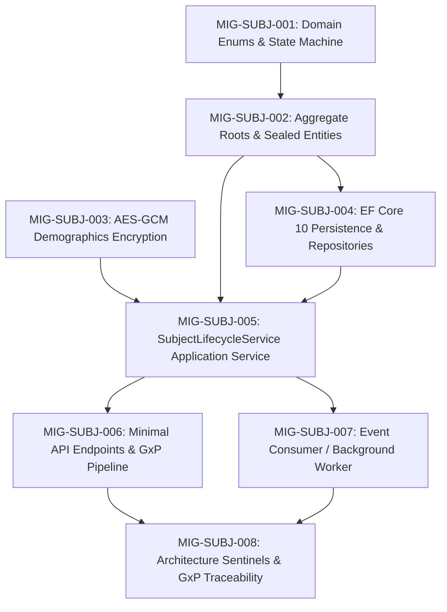

# Migration Backlog & Implementation Tickets: Subject Lifecycle & Enrollment

**Slice Code:** `SUBJ`
**Slice Name:** `execution-subjects`
**Target Solution:** `Cadence.sln`
**Target Project:** `Cadence.Apps.Execution` (`apps/execution/src/Cadence.Apps.Execution.csproj`)
**Test Project:** `Cadence.UnitTests` (`tests/Cadence.UnitTests.csproj`)

---

## Ticket Dependency Graph



---

### MIG-SUBJ-001: Implement Domain Enums, Exceptions, and Regulated State Machine

- **Ticket ID:** `MIG-SUBJ-001`
- **Title:** Implement Domain Enums, Custom Exceptions, and Subject State Machine Rule Engine
- **Python Source Files:**
  - `apps/execution/subject_lifecycle.py` (lines 1–158)
- **Target .NET Files:**
  ```text
  apps/execution/src/Domain/Enums/SubjectState.cs
  apps/execution/src/Domain/Exceptions/InvalidStateTransitionException.cs
  apps/execution/src/Domain/Exceptions/LockedFactorMutationException.cs
  apps/execution/src/Domain/Rules/SubjectStateMachine.cs
  tests/SubjectStateMachineTests.cs
  ```
- **Pre-requisites:** None
- **Acceptance Criteria:**
  - Implement `SubjectState` enum covering all 9 states: `Screening`, `ScreenFailed`, `Enrolled`, `Randomized`, `Active`, `Completed`, `Unblinded`, `Withdrawn`, `ReconsentRequired`.
  - Implement `SubjectStateMachine` using C# 14 `FrozenDictionary<SubjectState, FrozenSet<SubjectState>>` with zero runtime allocations.
  - Implement `CanTransition(SubjectState current, SubjectState target)` and `EnsureValidTransition(SubjectState current, SubjectState target)`.
  - Self-transitions (`current == target`) evaluate to `true` (idempotent).
  - Terminal states (`ScreenFailed`, `Completed`, `Withdrawn`) forbid all outgoing transitions.
  - `IsLockedPostRandomization(SubjectState state)` returns true for `Randomized`, `Active`, `Completed`, `Unblinded`, and `Withdrawn`.
  - Zero warnings under `<TreatWarningsAsErrors>true</TreatWarningsAsErrors>` and `<Nullable>enable</Nullable>`.
- **Parity Test Criteria:**
  - Unit tests in `SubjectStateMachineTests` validating all 81 transition permutations.
  - Reverse-engineered parity with `test_pure_python_transition_guard` from `test_subject_randomization_lifecycle.py`.
  - Tagged with `[GxPRequirement("PRD-SYS-042")]` and `[GxPRequirement("PRD-SUB-001")]`.

---

### MIG-SUBJ-002: Implement Sealed Aggregate Roots & Value Objects

- **Ticket ID:** `MIG-SUBJ-002`
- **Title:** Implement ClinicalSubject and SubjectConsent Aggregate Roots with Invariant Protection
- **Python Source Files:**
  - `apps/execution/database/models/subject.py` (lines 18–120)
  - `apps/execution/domain/models.py` (lines 246–275)
- **Target .NET Files:**
  ```text
  apps/execution/src/Domain/Models/SubjectIdentifiers.cs
  apps/execution/src/Domain/Models/ClinicalSubject.cs
  apps/execution/src/Domain/Models/SubjectConsent.cs
  tests/ClinicalSubjectAggregateTests.cs
  ```
- **Pre-requisites:** `MIG-SUBJ-001`
- **Acceptance Criteria:**
  - `ClinicalSubject` inherits `AggregateRoot<string>` and satisfies `IGxPAuditable`.
  - Strongly typed identifiers `SubjectCode`, `StudyId`, `SiteId` declared as `readonly record struct`.
  - Primary factory method `ClinicalSubject.Create(...)` initializes subject in `SubjectState.Screening` with `VersionIndex = 1`.
  - Encapsulated business methods: `AdvanceState`, `UpdateDemographics`, `UpdateStratificationFactors`, `ClearDemographicsPreRandomization`, `AssignRandomization`, `Unblind`, `Withdraw`.
  - Invariant: Modifying `StratificationFactors` or calling `UpdateDemographics` post-randomization throws `LockedFactorMutationException`.
  - Invariant: Calling `ClearDemographicsPreRandomization` post-randomization throws `InvalidOperationException` with message `SOFT_DELETE_BLOCKED`.
  - `SubjectConsent` aggregate root tracks protocol version tags, indices, signature dates, and re-consent flags.
- **Parity Test Criteria:**
  - Unit tests verifying aggregate factory methods, version index monotonicity, post-randomization factor mutation locks, and unblind/withdrawal state captures.
  - Tagged with `[GxPRequirement("PRD-SYS-001")]`, `[GxPRequirement("PRD-SYS-042")]`.

---

### MIG-SUBJ-003: Implement AES-GCM Demographics Encryption Port & Adapter

- **Ticket ID:** `MIG-SUBJ-003`
- **Title:** Implement IDemographicsEncryptionService and AES-GCM Cryptographic Adapter
- **Python Source Files:**
  - `apps/execution/demographics.py`
- **Target .NET Files:**
  ```text
  apps/execution/src/Domain/Ports/IDemographicsEncryptionService.cs
  apps/execution/src/Infrastructure/Cryptography/AesGcmDemographicsEncryptionService.cs
  tests/DemographicsEncryptionTests.cs
  ```
- **Pre-requisites:** None
- **Acceptance Criteria:**
  - Define `IDemographicsEncryptionService` interface in Domain Ports.
  - Implement `AesGcmDemographicsEncryptionService` using .NET `System.Security.Cryptography.AesGcm` (authenticated 256-bit AES with 12-byte nonce and 16-byte authentication tag).
  - Ciphertext payload encoded in URL-safe base64 string format: `nonce + ciphertext + tag`.
  - Plaintext demographic PII is never stored unencrypted or emitted to standard logging streams.
  - Corrupted or invalid payloads throw `CryptographicException` without leaking PII details.
- **Parity Test Criteria:**
  - Unit tests verifying round-trip JSON encryption/decryption of `DemographicsDto`.
  - Tests ensuring tamper detection (altering single bit in ciphertext fails authentication tag check).
  - Tagged with `[GxPRequirement("PRD-SYS-001")]`.

---

### MIG-SUBJ-004: Implement EF Core 10 PostgreSQL Persistence Layer & Repositories

- **Ticket ID:** `MIG-SUBJ-004`
- **Title:** Implement EF Core 10 Entity Configurations, DbContext, and Repository Adapters
- **Python Source Files:**
  - `apps/execution/database/models/subject.py`
  - `apps/execution/adapters/repositories.py`
  - `apps/execution/infrastructure/repositories/execution_repositories.py`
- **Target .NET Files:**
  ```text
  apps/execution/src/Domain/Ports/ISubjectRepository.cs
  apps/execution/src/Domain/Ports/IConsentRepository.cs
  apps/execution/src/Infrastructure/Persistence/ExecutionDbContext.cs
  apps/execution/src/Infrastructure/Persistence/Configurations/ClinicalSubjectConfiguration.cs
  apps/execution/src/Infrastructure/Persistence/Configurations/SubjectConsentConfiguration.cs
  apps/execution/src/Infrastructure/Persistence/Repositories/EfSubjectRepository.cs
  apps/execution/src/Infrastructure/Persistence/Repositories/EfConsentRepository.cs
  packages/testing/src/Fakes/InMemorySubjectRepository.cs
  packages/testing/src/Fakes/InMemoryConsentRepository.cs
  tests/SubjectRepositoryTests.cs
  ```
- **Pre-requisites:** `MIG-SUBJ-002`
- **Acceptance Criteria:**
  - EF Core 10 mappings for table `clinical_subjects` and `subject_consents` matching schema in PostgreSQL.
  - `StratificationFactors` mapped via `.OwnsOne(..., b => b.ToJson("strat_factors"))`.
  - Unique composite index on `(study_id, subject_id)`.
  - All query read operations apply `.AsNoTracking()`.
  - `GetMaxEnrollmentIndexAsync(studyId)` executes atomic `SELECT COALESCE(MAX(enrollment_index), -1)` SQL query.
  - `ClearReconsentOnOtherConsentsAsync` executes inside active unit of work transaction.
  - Provide in-memory repository fakes in test suite for fast test execution without database dependencies.
- **Parity Test Criteria:**
  - Repository persistence and query tests in `SubjectRepositoryTests`.
  - Validates sequential index calculation and concurrency token enforcement.
  - Tagged with `[GxPRequirement("PRD-SYS-001")]`.

---

### MIG-SUBJ-005: Implement SubjectLifecycleService Application Service

- **Ticket ID:** `MIG-SUBJ-005`
- **Title:** Implement SubjectLifecycleService Application Service and Workflow Orchestration
- **Python Source Files:**
  - `apps/execution/application/services.py` (`SubjectLifecycleService`, lines 27–240)
  - `apps/execution/subject_lifecycle.py` (`validate_subject_version_gating`)
- **Target .NET Files:**
  ```text
  apps/execution/src/Application/DTOs/SubjectDtos.cs
  apps/execution/src/Application/DTOs/ConsentDtos.cs
  apps/execution/src/Application/Services/SubjectLifecycleService.cs
  apps/execution/src/Domain/Ports/ISiteComplianceService.cs
  tests/SubjectLifecycleServiceTests.cs
  ```
- **Pre-requisites:** `MIG-SUBJ-002`, `MIG-SUBJ-003`, `MIG-SUBJ-004`
- **Acceptance Criteria:**
  - `EnrollSubjectAsync`: Atomically retrieves max enrollment index, encrypts demographics, creates `ClinicalSubject`, persists entity, and returns `Result<SubjectResponse>`.
  - `AdvanceSubjectStateAsync`: Validates subject existence, verifies site compliance via `ISiteComplianceService` if target is `Enrolled`, executes state transition guard, updates audit metadata, and persists.
  - `RecordConsentAsync`: Updates existing or creates new `SubjectConsent`, clears `RequiresReconsent` on prior consents if new consent is signed without re-consent requirement.
  - `ValidateVersionGatingAsync`: PRD-SUB-007 check verifying whether subject must execute re-consent prior to form submission.
  - Returns strongly-typed `Result<T>` monad with `DomainError` instead of uncaught domain exceptions.
- **Parity Test Criteria:**
  - Direct transcription of all assertions from `test_subject_lifecycle_service.py` to `SubjectLifecycleServiceTests`.
  - Tests verifying `EnrollSubject` sequential index (0 then 1), site compliance gating on `Enrolled`, and consent cascading.
  - Tagged with `[GxPRequirement("PRD-SYS-001")]`, `[GxPRequirement("PRD-SYS-042")]`, `[GxPRequirement("PRD-SUB-001")]`.

---

### MIG-SUBJ-006: Implement ASP.NET Core 10 Minimal API Endpoints & Filters

- **Ticket ID:** `MIG-SUBJ-006`
- **Title:** Implement Subject Minimal API Endpoints with 21 CFR Part 11 Justification Filter
- **Python Source Files:**
  - `apps/execution/presentation/routers/subjects.py` (lines 180–773)
- **Target .NET Files:**
  ```text
  apps/execution/src/Endpoints/Filters/ChangeJustificationFilter.cs
  apps/execution/src/Endpoints/SubjectEndpoints.cs
  apps/execution/src/Program.cs
  tests/SubjectEndpointTests.cs
  ```
- **Pre-requisites:** `MIG-SUBJ-005`
- **Acceptance Criteria:**
  - Map routes under `/api/v1/execution/subjects`:
    - `POST /`: Enrolls subject, returns `201 Created` with `SubjectResponse`.
    - `PATCH /{id}/state`: Advances subject state, returns `200 OK` or `400 BadRequest` / `404 NotFound`.
    - `POST /{subjectId}/consent`: Records consent, returns `200 OK`.
  - `ChangeJustificationFilter` inspects `X-Change-Reason` header on mutating requests; rejects with `400 BadRequest` if header is absent or whitespace.
  - Extracts `X-User-Id` header (or fallback to authenticated identity).
  - OpenApi documentation annotations (`WithName`, `WithSummary`, `Produces`, `ProducesProblem`).
  - Wire into `Program.cs` via `app.MapGroup("/api/v1/execution/subjects").MapSubjectEndpoints()`.
- **Parity Test Criteria:**
  - Functional endpoint tests in `SubjectEndpointTests`.
  - Verify 201 Created on valid enrollment, 400 Bad Request on missing `X-Change-Reason`, 400 on illegal state transition, 404 on unknown subject ID.
  - Tagged with `[GxPRequirement("PRD-SYS-053")]`, `[GxPRequirement("PRD-SUB-001")]`.

---

### MIG-SUBJ-007: Implement eConsent Completion Background Worker

- **Ticket ID:** `MIG-SUBJ-007`
- **Title:** Implement eConsent Background Event Consumer for Automated Subject Initialization
- **Python Source Files:**
  - `apps/execution/workers/consent_subscriber.py`
- **Target .NET Files:**
  ```text
  apps/execution/src/Infrastructure/BackgroundWorkers/ConsentSubscriberWorker.cs
  tests/ConsentSubscriberWorkerTests.cs
  ```
- **Pre-requisites:** `MIG-SUBJ-005`
- **Acceptance Criteria:**
  - Implement `IHostedService` background consumer for eConsent completion events.
  - Idempotently verifies if subject already exists; if not, calls `SubjectLifecycleService.EnrollSubjectAsync`.
  - Populates local `SubjectConsent` record to allow immediate data entry.
  - Captures 21 CFR Part 11 audit trail with `user_id = "system-pubsub"` and reason `"Automatically created via background eConsent completion trigger"`.
- **Parity Test Criteria:**
  - Worker unit tests verifying idempotent message handling, subject auto-creation, and duplicate event suppression.
  - Tagged with `[GxPRequirement("PRD-SUB-001")]`.

---

### MIG-SUBJ-008: Architecture Sentinels, GxP RTM Sync & Legacy Python Decommissioning

- **Ticket ID:** `MIG-SUBJ-008`
- **Title:** Enforce ArchUnitNET Boundary Sentinels, Sync GxP Documentation, and Decommission Legacy Files
- **Python Source Files:**
  - `apps/execution/subject_lifecycle.py`
  - `apps/execution/tests/test_subject_lifecycle_service.py`
  - `apps/execution/tests/test_subject_randomization_lifecycle.py`
- **Target .NET Files:**
  ```text
  tests/ArchitectureSentinelTests.cs
  docs/SDLC/Requirements_Traceability_Matrix.md
  docs/SDLC/IQ_OQ_PQ_Execution_Report.md
  ```
- **Pre-requisites:** `MIG-SUBJ-001` through `MIG-SUBJ-007`
- **Acceptance Criteria:**
  - ArchUnitNET sentinels in `tests/ArchitectureSentinelTests.cs` verify that:
    - `Cadence.Apps.Execution.Domain` has zero references to `Infrastructure`, `Endpoints`, `Microsoft.AspNetCore`, or database drivers.
    - All AggregateRoots implement `IGxPAuditable`.
  - Run `dotnet format Cadence.sln --verify-no-changes` with 0 warnings and 0 formatting changes.
  - Run `python scripts/sync_gxp.py` to regenerate and verify RTM matrix and IQ/OQ/PQ execution report.
  - Retain Python files as read-only reference until full service decommissioning via `dotnet cadence wizard decommission execution`.
- **Parity Test Criteria:**
  - 100% passing test execution across `dotnet test Cadence.sln`.
  - GxP RTM matrix reflects 100% coverage on `PRD-SYS-001`, `PRD-SYS-042`, `PRD-SYS-053`, `PRD-SUB-001`, `PRD-SUB-007`.
