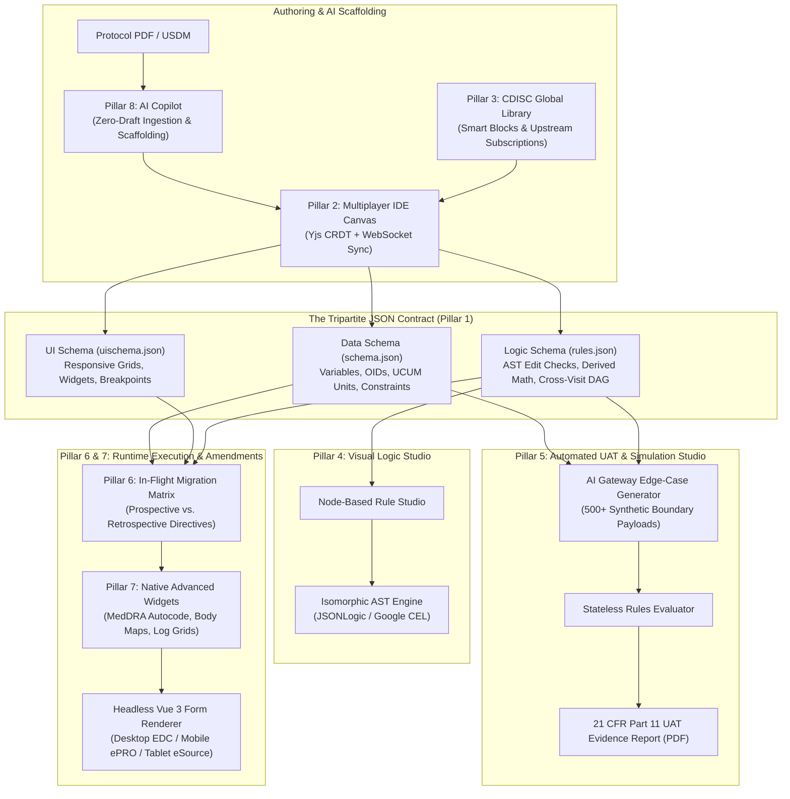

# System Specification: AI-Enhanced CDISC-Native Visual Metadata IDE & Tripartite eCRF Designer

**Document ID:** SPEC-CRF-2026-001  
**Target Domain:** `apps/designer`, `apps/execution`, `apps/ai_gateway`, `apps/web`, `packages/ddf`, `packages/engine_core`  
**GxP Compliance Standards:** FDA 21 CFR Part 11, EU Annex 11, ICH GCP E6(R2), GAMP 5 Category 4 (Configured Software)  
**Requirements Traceability:** `PRD-CRF-001`, `PRD-CRF-004`, `PRD-CRF-009`, `PRD-CRF-010`, `PRD-CRF-012`, `PRD-DDF-001`, `PRD-SYS-001`, `PRD-SYS-050`, `PRD-SYS-051`, `PRD-SYS-052`, `PRD-SYS-054`  
**Architectural Decision Record:** [ADR-2231](docs/adr/2026-08-28-ai-enhanced-cdisc-native-visual-metadata-ide-and-tripartite-ecrf-designer-standard.md)

---

## 1. Executive Summary & Clinical Mission

The Cadence eCRF Designer redefines clinical form authoring by replacing disjointed, procedural software builds with a **Visual Metadata Integrated Development Environment (IDE)**.

In legacy EDC systems (Medidata Rave, Oracle Clinical, Veeva Vault), building forms, writing edit checks in custom scripts, generating physical SQL tables, and performing manual User Acceptance Testing (UAT) requires 8 to 12 weeks per study. Mid-study protocol amendments demand risky database migrations and system downtime.

The Visual Metadata IDE solves these pain points through **The Golden Rule: The form is data, not code.** Decoupling form metadata into three distinct JSON schemas (`schema.json`, `uischema.json`, `rules.json`) guarantees instant headless rendering, real-time multiplayer collaboration, zero-downtime protocol amendments with dynamic patient routing, and 30-second automated UAT qualification.

---

## 2. The 8 Core Architectural Pillars



---

## 3. Detailed Technical Specifications

### 3.1 Pillar 1: The Tripartite JSON Schema Architecture
Form definitions must never generate physical relational tables or columns in PostgreSQL. The form definition is strictly a tripartite JSON document conforming to `packages.ddf.tripartite.TripartiteFormDefinition`:

1. **Data Schema (`schema.json`)**:
   - `variables`: List of clinical items with `id`, `name`, `data_type` (`string`, `integer`, `float`, `date`, `datetime`, `boolean`, `codelist`, `repeat_log`).
   - `cdisc`: Direct binding to `domain` (e.g. `VS`, `AE`, `DM`), `variable_name` (`VSORRES`), `oid` (`IT.VS.SYSBP`), and `ucum_unit` (`mmHg`).
   - `constraints`: `required`, `min_value`, `max_value`, `min_length`, `max_length`, `regex_pattern`, `allowed_values`.
   - `phi_pii_masked`: Boolean for unblinded isolation and PII de-identification.
   - `sdv_tier`: `SDV_100`, `TSDV_REPRESENTATIVE`, `NO_SDV`.
   - `part11_reason_required`: Mandatory prompt for change justification during edits.

2. **UI Schema (`uischema.json`)**:
   - `sections`: Structured 12-column responsive layout grids.
   - `widgets`: Widget assignment per variable (`TEXT_INPUT`, `NUMBER_INPUT`, `RADIO_GROUP`, `SELECT_DROPDOWN`, `SLIDER_VAS`, `BODY_MAP_COORDINATE`, `REPEATING_LOG_GRID`, `MEDICAL_AUTOCODE`, `SENSOR_STREAM_CARD`).
   - `grid_column_span`: Width (1 to 12).
   - `default_viewport`: `DESKTOP_EDC`, `MOBILE_EPRO`, `TABLET_ESOURCE`.
   - `theme_tokens`: Vanilla CSS semantic variable mappings.

3. **Logic Schema (`rules.json`)**:
   - `edit_checks`: AST expressions (`JSONLogic`/`CEL`) executing cross-field checks with `HARD` (blocks save) or `SOFT` (generates query) severity.
   - `derived_rules`: Reactive formula strings (`weight / ((height / 100) ^ 2)`) with unit converters and physiological plausibility envelopes.
   - `cross_visit_dependencies`: DAG triggers linking events across visits (e.g. Adverse Event with Discontinuation flag spawning Early Termination visit).

---

### 3.2 Pillar 2: UX Paradigm — "Figma for Clinical Trials"
* **Real-Time Multiplayer Collaboration (Yjs CRDT & Ephemeral Server)**:
  - Ephemeral in-memory Yjs doc server over WebSockets in `apps/designer`.
  - Debounced snapshot persistence to PostgreSQL JSONB upon session flush or manual checkpoint.
  - Field-level awareness, remote cursor rendering with persona color badges (`sponsor_designer`: Blue, `data_manager`: Purple, `medical_monitor`: Green).
  - Contextual collaborative commenting anchored to variable OIDs with `@mention` notifications.
* **Omni-Channel WYSIWYG Preview**:
  - Live toggle between Site EDC (dense 12-col desktop grid), ePRO/eDiary (single-column, 48px touch targets, high contrast), and eSource/eCOA (tablet layout).
* **Contextual Properties Inspector**:
  - Right-hand collapsible drawer exposing CDISC OIDs, SDV tiering, PHI masking, and electronic signature requirements.

---

### 3.3 Pillar 3: CDISC-Native Global Library & Smart Blocks
* **Clinical Smart Blocks**:
  - Pre-assembled panels from `packages/ddf/smart_blocks.py` (Vital Signs, Hematology Panel, ConMeds Log, Adverse Events).
  - Automatically binds CDASH variables, UCUM units, and default CTCAE reference intervals upon dropping onto the canvas.
* **Smart Inheritance & Upstream Subscriptions**:
  - Studies subscribe to Central Global Library blocks via `instantiated_from_oid` graph provenance.
  - When library templates update, active study drafts receive a Git-style notification (`Update Available: View Diff / Accept Update`).
  - Study-specific overrides are preserved in an isolated JSON delta layer.

---

### 3.4 Pillar 4: Visual Logic Studio (No-Code Rules Engine)
* **Visual Scratch/Zapier-Style Canvas**:
  - Data Managers visually construct conditions without coding:
    `IF [Visit 1.Adverse Event.Start Date] IS BEFORE [Visit 1.Informed Consent.Date]`  
    `THEN [Fire Hard Query: "AE cannot start before consent"] AND [Prevent Save]`
* **Isomorphic AST Execution**:
  - Logic compiles into portable AST format.
  - Evaluated in browser JavaScript via `apps/web/src/engine/rulesEvaluator.js` for instant sub-millisecond red-text feedback.
  - Evaluated on backend Python 3.14 via `packages/engine_core/rules/evaluator.py` for strict server-side validation during form submission.
* **Cross-Visit Chronology Engine**:
  - Horizontal dependency mapping across patient timeline.
  - Dynamic visit spawning and schedule suppression.

---

### 3.5 Pillar 5: Automated UAT & Simulation Studio
* **Integrated Split-Screen Playground**:
  - Interactive test harness pairing visual designer canvas directly with a live rendered form.
* **Agentic Edge-Case Generation (Fixed Minimum 500 Payloads)**:
  - `POST /api/v1/ai/crf/generate-uat` invokes AI Gateway to analyze the Tripartite Schema.
  - Synthesizes a minimum of 500 targeted boundary payloads (null values, out-of-range dates, extreme laboratory spikes, contradictory logical inputs) guaranteeing 100% AST branch coverage.
* **Mathematical Compliance Proof & UAT Report**:
  - Executes payloads through the stateless `RulesEvaluator`.
  - Emits an immutable, 21 CFR Part 11 compliant **UAT Evidence Report (PDF)** with SHA-256 cryptographic digest, proving 100% edit check branch coverage in sub-30 seconds.

---

### 3.6 Pillar 6: Git-Style Version Control for Protocol Amendments
* **Immutable Branching**:
  - Published studies are strictly read-only.
  - Amendments create isolated branch records (`Amendment_2_Draft`).
* **Visual Semantic Diffing**:
  - Compares base vs. amendment Tripartite Schemas to produce visual PR diffs (Added fields, deleted variables, modified constraints, updated edit checks).
* **In-Flight Patient Migration Matrix**:
  - Data Managers define deployment policy per field/visit:
    - **Prospective**: Applied strictly to subjects enrolled after the amendment effective date.
    - **Retrospective**: Applied across all active subjects with automated missing-data queries dispatched for historical encounters.
  - Evaluated dynamically at runtime by `apps/execution` with zero database DDL migrations or downtime.

---

### 3.7 Pillar 7: Native Advanced Clinical Widgets
* **Medical Dictionary Auto-Coding (`MEDICAL_AUTOCODE`)**:
  - Integrated MedDRA / WHODrug lookup with real-time term suggestions and background SOC/PT/ATC code binding.
* **Interactive Body Maps & VAS (`BODY_MAP_COORDINATE`, `SLIDER_VAS`)**:
  - Digital anatomical maps with coordinate recording and calibrated Visual Analog Scale sliders for ePRO/eCOA.
* **Dynamic Repeating Log Grids (`REPEATING_LOG_GRID`)**:
  - Multi-instance tabular logs (AEs, ConMeds) with reactive column math (e.g. cumulative daily dose).
* **Sensor & EHR Data Bindings (`SENSOR_STREAM_CARD`)**:
  - Field binding overrides for SMART on FHIR pulls or Bluetooth IoT wearable streams.

---

### 3.8 Pillar 8: AI Copilot — Protocol-to-CRF Generation
* **Document Ingestion**:
  - Upload clinical protocol PDF / USDM JSON graph.
* **Agentic Extraction & Scaffolding**:
  - Extracts Schedule of Activities (SoA) matrix, trial endpoints, and inclusion/exclusion criteria.
  - Auto-populates visit schedules, instantiates Global Library Smart Blocks, and synthesizes initial AST edit checks.
  - Shifts Data Manager role from manual construction to supervisory review and approval.

---

## 4. API & Service Contracts

### 4.1 Schema Compilation & Simulation Endpoints (`apps/designer`)
```http
POST /api/v1/designer/studies/{id}/forms/compile
Content-Type: application/json
X-Gateway-Signature: <HMAC>

Request: {
  "form_id": "FORM-VS",
  "data_schema": { ... },
  "ui_schema": { ... },
  "logic_schema": { ... }
}

Response (200 OK): {
  "status": "VALID",
  "form_hash": "sha256:4f8a...",
  "compiled_rules_count": 8,
  "warnings": []
}
```

### 4.2 Automated Synthetic UAT Generation (`apps/ai_gateway`)
```http
POST /api/v1/ai/crf/generate-uat
Content-Type: application/json
X-Gateway-Signature: <HMAC>

Request: {
  "protocol_id": "PROT-101",
  "tripartite_form": { ... },
  "target_scenarios_count": 500
}

Response (200 OK): {
  "report_id": "UAT-REP-2026-08-28-001",
  "total_scenarios_evaluated": 500,
  "scenarios_passed": 500,
  "rule_coverage_percentage": 100.0,
  "execution_duration_ms": 182.4,
  "sha256_evidence_digest": "e3b0c442...",
  "pdf_download_url": "/api/v1/designer/uat-reports/UAT-REP-2026-08-28-001.pdf"
}
```

### 4.3 Protocol Amendment Diff & Migration Matrix (`apps/designer`)
```http
POST /api/v1/designer/studies/{id}/amendments/diff
Content-Type: application/json

Request: {
  "base_version_tag": "1.0.0",
  "amendment_version_tag": "2.0.0"
}

Response (200 OK): {
  "added_variables": ["VS_PULSE_OX"],
  "modified_variables": ["VS_WEIGHT"],
  "removed_variables": [],
  "modified_rules": ["CHK-BP-01"],
  "recommended_migration_directives": [
    { "variable_id": "VS_PULSE_OX", "action": "ADD", "migration_mode": "PROSPECTIVE" },
    { "variable_id": "VS_WEIGHT", "action": "MODIFY_CONSTRAINT", "migration_mode": "RETROSPECTIVE", "backfill_query_message": "Verify weight" }
  ]
}
```

---

## 5. 21 CFR Part 11 Audit Trail & Security Architecture

1. **Cryptographic Sealing**: Every Tripartite Form Definition publication computes a monotonic SHA-256 HMAC digest recorded in the immutable GxP audit ledger.
2. **Mandatory Reason for Change**: Any mutation to a draft or amendment requires a non-empty `reason_for_change` string and user authentication.
3. **Step-Up Electronic Signatures**: Formal publication of a study build or protocol amendment requires `designer.study.publish` step-up electronic signature verification with password re-authentication.
4. **Persona Capability RBAC**:
   - `sponsor_designer` / `data_manager`: Full authoring, rule editing, and UAT generation permissions (`FORM_AUTHOR`, `RULES_CONFIGURE`, `UAT_EXECUTE`).
   - `biostatistician`: Global Library governance and derived math rule approval (`DERIVED_RULES_APPROVE`).
   - `medical_monitor`: Contextual review and commenting (`CRF_REVIEW_COMMENT`).
   - `site_crc`: Zero designer access; headless EDC execution only.

---

## 6. Verification & Acceptance Criteria

- [ ] **AC-01 (Tripartite Decoupling)**: Form definitions serialize into distinct `DataSchema`, `UiSchema`, and `LogicSchema` documents with zero relational DDL generation.
- [ ] **AC-02 (Isomorphic Execution)**: AST edit checks evaluate identically in browser JS and backend Python runtimes with 100% parity across test vectors.
- [ ] **AC-03 (Automated UAT)**: AI-generated edge-case simulation achieves 100% rule branch coverage with $\ge 500$ payloads and generates a certified 21 CFR Part 11 PDF evidence report in under 30 seconds.
- [ ] **AC-04 (Zero-Downtime Amendments)**: Protocol amendments deploy without database migrations; active subjects route dynamically via the In-Flight Patient Migration Matrix.
- [ ] **AC-05 (Multiplayer Sync)**: Ephemeral Yjs doc server synchronizes edits and cursor positions over WebSockets with debounced PostgreSQL JSONB snapshotting and zero data loss.
- [ ] **AC-06 (GxP Traceability)**: 100% of test cases include `@req:` tags and sync cleanly with `scripts/sync_gxp.py`.
